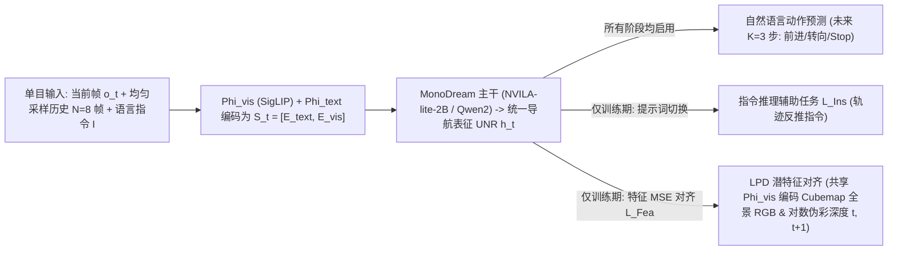

# MonoDream

**MonoDream: Monocular Vision-Language Navigation with Panoramic Dreaming**（Shuo Wang, Yongcai Wang, Zhaoxin Fan, Yucheng Wang, Maiyue Chen, Kaihui Wang, Zhizhong Su, Wanting Li, Xudong Cai, Yeying Jin, Deying Li，中国人民大学 / 地平线 Horizon Robotics / 新加坡国立大学，AAAI 2026 / arXiv:2508.02549v4）收录于 [Awesome World-Action Models (RCL)](https://github.com/rcl-robotics/Awesome-World-Action-Models) **第 431/564** 篇，分组 **WAMs**。本页基于论文全文，系统梳理其统一导航表征（UNR）、潜空间全景做梦（LPD）机制与 VLN-CE 基准评测结果。

## 一句话定义

**MonoDream** 是一种轻量级（2B）单目视觉–语言导航（VLN-CE）世界–动作框架：通过在训练期引入 **潜空间全景做梦（LPD）** 辅助任务，迫使主干输出的 **统一导航表征（UNR）** 仅凭单目 RGB 序列即可隐式对齐当前与未来一步的全景 RGB、全景深度特征及动作意图，在推理期无需全景相机或深度传感器即可大幅缩小与全景 RGB-D 智能体的导航差距。

## 英文缩写速查

| 缩写 | 英文全称 | 简要说明 |
|------|----------|----------|
| WAM | World Action Model | 世界预测与动作生成耦合 |
| VLA | Vision-Language-Action | 视觉–语言–动作策略 |
| IDM | Inverse Dynamics Model | 先预测未来再反推动作 |
| WM | World Model | 环境前向预测模型 |
| VLN-CE | Vision-and-Language Navigation in Continuous Environments | 连续环境中的视觉–语言导航基准 |
| UNR | Unified Navigation Representation | 本文由 VLM 主干输出的统一导航隐表征，联合对齐场景布局、深度、未来动态与动作意图 |
| LPD | Latent Panoramic Dreaming | 本文训练期辅助任务：在潜空间预测当前及下一时刻全景 RGB 与对数深度特征 |
| SR / SPL | Success Rate / Success weighted by Path Length | 导航成功率与路径长度加权成功率（VLN 主评价指标） |

## 为什么重要

- **用「隐式潜空间全景想象」破解单目机器人的视野盲区与硬件成本矛盾**：全景 RGB-D 传感器虽能提供完整几何与 360° 视野，但在真实部署中成本、功耗与重量代价高；而普通单目 VLA 缺乏侧后方转角与显式深度信息，极易误判走廊或盲转出错。MonoDream 仅在**训练期**借用仿真全景 RGB-D 潜特征做蒸馏式监督，**推理期完全零额外传感器与渲染开销**。
- **不依赖海量外部 Web/VQA 数据、以 2B 小模型击败 8B 基线**：仅使用仿真器内部数据（R2R-CE + RxR-CE + DAgger），2B 参数量即在 R2R-CE 与 RxR-CE 上刷新单目 SOTA，且单卡 4090 推理耗时比 8B 模型快 **1.5×**（0.8s vs 1.2s）。
- **顺着索引入口延伸阅读**：对照 [Awesome World-Action Models（RCL）](paper-rcl-wam-robot-learning-control-survey.md)、[RCL Awesome WAM 技术地图](../overview/rcl-awesome-wam-technology-map.md) 的「导航 · 潜空间预测与 JEPA · Q1（One Model × 联合预测）」象限。

## 核心信息

| 字段 | 内容 |
|------|------|
| 作者与机构 | Shuo Wang, Yongcai Wang, Zhaoxin Fan, Yucheng Wang 等（中国人民大学 / Horizon Robotics / NUS） |
| 编号 / 分组 | 431/564 · WAMs（子类/象限：导航 · 潜空间预测与JEPA · Q1 · One Model × 联合预测） |
| 出处 / 原文 | AAAI 2026 · <https://ojs.aaai.org/index.php/AAAI/article/view/37974> / arXiv:2508.02549v4 |
| 项目页 | <https://horizonrobotics.github.io/robot_lab/monodream/>（论文正文仅列出项目页，未附独立 GitHub 源码仓库链接） |
| 底座与训练 | **NVILA-lite-2B**（SigLIP 视觉编码器 + 投影层 + Qwen2 LLM）；8× H20 GPU 训练 5 epochs（`lr=1e-5`, `bs=80`, 历史采样 `N=8` 帧, 预测未来 `K=3` 步动作） |

## 核心机制（归纳）

1. **统一导航表征（UNR）构建**：
   - 将自然语言指令 $I$ 经文本编码器得 $E_{\text{text}}=\Phi_{\text{text}}(I)$；从历史观测中均匀采样 $N=8$ 帧与当前单目 RGB 帧 $o_t$ 拼成 $O_t$，经视觉编码器 $\Phi_{\text{vis}}$ 提取视觉 token 序列 $E_{\text{vis}}$。
   - 拼接 $S_t = [E_{\text{text}}, E_{\text{vis}}]$ 输入基于 NVILA-lite-2B 的 MonoDream 主干，输出隐藏状态 $h_t = \text{MonoDream-Backbone}(S_t) \in \mathbb{R}^{l_{\text{seq}}\times d}$，即 **UNR**。
2. **潜空间全景做梦（LPD，仅限训练期）**：
   - 不在像素空间重建耗时的 360° 图像，而是复用权重共享的视觉编码器 $\Phi_{\text{vis}}$ 将真值当前/未来一步全景 RGB（$H_t^{\text{PI}}, H_{t+1}^{\text{PI}}$）与全景深度（$H_t^{\text{PD}}, H_{t+1}^{\text{PD}}$）映射到同一特征空间，通过均方误差损失 $\mathcal{L}_t^{\text{Fea}}(\theta) = \sum_{m\in\{\text{PI},\text{PD}\}}(\|h_t - H_t^m\|^2 + \|h_t - H_{t+1}^m\|^2)$ 监督 UNR。
   - **视觉对齐预处理（Appendix Table 8 & 9）**：为契合预训练透视 RGB 视觉编码器（SigLIP）的归纳偏置，全景图像采用 **4 方向 90° Cubemap**（左/前/右/后，优于 Equirectangular 全景展开图）；深度图先做 **对数尺度压缩（Logarithmic scaling）** 再映射为伪彩色 RGB（优于线性归一化与逆深度）。
3. **提示切换式多任务联合训练（Multi-Task Co-Training）**：
   - 通过切换任务提示词联合优化三类目标：$\mathcal{L} = \sum_{\tau\in\mathcal{D}}\sum_t(\mathcal{L}_t^{\text{Act}}(\theta) + \lambda\mathcal{L}_t^{\text{Fea}}(\theta)) + \mathcal{L}_\tau^{\text{Ins}}(\theta)$：
     - **动作预测（$\mathcal{L}_t^{\text{Act}}$）**：以自然语言自回归预测未来 **3 步**细粒度动作序列 $(a_t, a_{t+1}, a_{t+2})$（前进 25/50/75 cm、左/右转 15°/30°/45°、停止）。
     - **指令推理（$\mathcal{L}_\tau^{\text{Ins}}$）**：给定轨迹视觉序列反推导航指令文本 $I_\tau$，强化视觉到语言的双向对齐。
     - **训练数据配比**：R2R-CE 320K + RxR-CE 600K + 基于 R2R-CE 的 DAgger 非最优轨迹纠偏 500K 样本，**0 外部数据**。
   - **零开销推理**：测试时完全关闭 LPD 与指令推理头，仅输入单目历史 + 当前帧，以 **0.8 s/step**（单卡 RTX 4090）输出动作。

### 方法流程图

## 评测与指标

### 1. R2R-CE Val-Unseen 连续导航基准对比（Table 1）

| 方法 | 传感器（S.RGB / Depth / Pano.） | 外部数据量 | NE ↓ | OSR ↑ | SR ↑ | SPL ↑ |
|------|---------------------------------|------------|------|-------|------|-------|
| BEVBert *(参考全景上限)* | Pano. + Depth | — | 4.57 | 67.0 | 59.0 | 50.0 |
| ETPNav† *(参考全景上限)* | Pano. + Depth | — | 4.71 | 65.0 | 57.0 | 49.0 |
| NaVid | 仅单目 RGB | 0K | 5.47 | 49.1 | 37.4 | 35.9 |
| Uni-NaVid | 仅单目 RGB | 2300K | 5.58 | 53.3 | 47.0 | 42.7 |
| NaVILA (8B) | 仅单目 RGB | 2215K | **5.22** | 62.5 | 54.0 | 49.0 |
| Aux-Think (8B) | 仅单目 RGB | 1600K | 5.49 | **62.9** | 55.7 | 48.7 |
| **MonoDream（本文, 2B）** | **仅单目 RGB** | **0K** | 5.45 | 61.5 | **55.8** | **49.1** |

### 2. RxR-CE Val-Unseen、跨数据集迁移与推理效率（Table 2, 3, 7）

- **RxR-CE Val-Unseen（Table 2）**：MonoDream 取得 NE **6.38**、OSR **55.8**（优于 NaVILA 55.5）、SR **49.4**（优于 NaVILA 49.3 与 Uni-NaVid 48.7）、SPL **40.9**。
- **跨数据集零样本迁移（仅 R2R 训练 $\to$ RxR-CE Val-Unseen 评测，Table 3）**：MonoDream 取得 NE **8.57**、SR **25.1**、SPL **21.6**，超越 NaVid（SR 23.8 / SPL 21.2）。
- **单卡 RTX 4090 推理效率（Table 7）**：参数量仅 **2B**、单步耗时 **0.8s**，显著轻量并快于 `NaVILA`（8B, **1.2s**）与 `Aux-Think`（8B, **1.2s**）。

### 3. 核心消融结论（仅 R2R-CE 训练集，Table 4, 5, 6, 8, 9）

| 消融项 | 关键配置对比 | NE ↓ | OSR ↑ | SR ↑ | SPL ↑ |
|--------|--------------|------|-------|------|-------|
| **辅助任务贡献（Table 4）** | 无辅助 $\to$ +IR $\to$ **+IR + LPD** | 7.78 $\to$ 7.67 $\to$ **6.19** | 43.7 $\to$ 45.8 $\to$ **51.1** | 35.1 $\to$ 37.7 $\to$ **46.1** | 30.2 $\to$ 32.1 $\to$ **39.9** |
| **LPD 子任务拆解（Table 5）** | 基线(仅IR) $\to$ +PI $\to$ +PI+PD $\to$ **+PI+PD+FPI+FPD** | 7.67 $\to$ 7.22 $\to$ 6.71 $\to$ **6.19** | 45.8 $\to$ 44.2 $\to$ 47.4 $\to$ **51.1** | 37.7 $\to$ 39.6 $\to$ 42.2 $\to$ **46.1** | 32.1 $\to$ 35.3 $\to$ 37.7 $\to$ **39.9** |
| **未来预测步长（Table 6, FPI）** | **1 步** vs 2 步 vs 3 步 | **7.03** / 7.89 / 8.77 | **44.5** / 43.9 / 40.0 | **39.1** / 34.3 / 29.2 | **34.2** / 29.1 / 26.2 |
| **全景/深度表示（Table 8–9）** | Cubemap+对数深度 vs Equirectangular+对数深度 | **6.71** vs 7.07 | **47.4** vs 45.1 | **42.2** vs 39.9 | **37.7** vs 35.1 |

## 与其他工作对比

- **相比显式全景/建图路线（BEVBert / ETPNav / 神经渲染方法）**：无需全景硬件、在线 SLAM 建图或测试期新视角渲染模块；R2R-CE 上 **49.1 SPL** 已几乎追平全景方法 **49.0–50.0 SPL**。
- **相比外部大数据单目 VLA（NaVILA / Uni-NaVid / Aux-Think）**：不依赖上百万条外部 Web/VQA 预训练数据，以四分之一参数量（2B vs 8B）取得更高的 R2R-CE SR（55.8%）与 SPL（49.1%）及更低推理时延（0.8s/step）。
- **相比显式世界模型生成动作框架（DreamVLA / WorldVLA 等）**：不在推理期解码高维图像或未来视频帧，而是将当前全景、深度与 1 步未来动力学压缩为训练期潜特征蒸馏监督，契合「Q1 · One Model × 联合预测」的轻量潜空间路线。

## 常见误区或局限

1. **LPD 预测步数并非越长越好**：Table 6 明确表明，仅预测 **未来 1 步** 全景特征效果最佳（SR 39.1 / SPL 34.2）；把 LPD 视界强行拉长到 2 步或 3 步会因局部观测下的复合不确定性导致指标持续下跌至 SR 34.3 与 29.2。
2. **缺乏显式长期全景记忆结构**：作者在 Limitations 中明确指出，MonoDream 仅从采样历史帧（$N=8$）隐式想象当前与即时未来场景，并未显式重建历史全景拓扑记忆，在超长跨房间回环探索场景下仍可结合记忆机制改进。
3. **论文实验局限于仿真器数据集**：论文报告的所有主实验与消融均在 R2R-CE 与 RxR-CE 仿真环境中完成（项目页链接已给出，但正文未报告真机部署统计表与独立代码库公开状态）。

## 结论

**MonoDream 验证了「训练期潜空间全景特征蒸馏 + 推理期纯单目轻量执行」是缩小单目 VLN 与全景 RGB-D 系统性能鸿沟的高性价比路线。**

1. **用特征空间对齐取代像素级全景重建**：借助共享权重视觉编码器对当前/未来 1 步全景 RGB 与深度做潜特征 MSE 对齐，使单目主干内化全局几何与空间转角先验，同时保持测试期零额外算力/传感器开销。
2. **4 视角 Cubemap + 对数深度伪彩对齐预训练视觉编码器**：直接喂入等距柱状投影或线性深度图会损失 2.3%–2.6% SR；转换为标准透视视图与对数伪彩是迁移 SigLIP 先验的关键工程细节。
3. **未来潜想象视界控制在 1 步最稳健**：在局部可观测导航中，1 步特征监督最能抑制误差累积（39.1% SR vs 3 步 29.2%）。
4. **2B 轻量底座配合 DAgger 数据足以抗衡 8B + 外部数据模型**：在 R2R-CE 零外部数据设定下实现 **55.8% SR / 49.1% SPL / 0.8s 推理时延**，适合端侧具身导航部署参考。

## 关联页面

- 列表实体：[Awesome World-Action Models（RCL）](paper-rcl-wam-robot-learning-control-survey.md)
- 技术地图：[RCL Awesome WAM 技术地图](../overview/rcl-awesome-wam-technology-map.md)
- 方法/任务：[generative-world-models.md](../methods/generative-world-models.md)、[vla.md](../methods/vla.md)、[manipulation.md](../tasks/manipulation.md)

## 参考来源

- [`sources/papers/rcl_awesome_wam_ref_c268d974279d36619757_monodream-monocular-vision-language-navi.md`](../../sources/papers/rcl_awesome_wam_ref_c268d974279d36619757_monodream-monocular-vision-language-navi.md) — 本条目策展摘录
- [`sources/papers/rcl_awesome_wam_catalog.md`](../../sources/papers/rcl_awesome_wam_catalog.md) — 列表总表
- [`sources/repos/awesome-world-action-models-rcl.md`](../../sources/repos/awesome-world-action-models-rcl.md)
- [`docs/PAPERS.md`](https://github.com/RCL-Robotics/Awesome-World-Action-Models/blob/main/docs/PAPERS.md) — 上游论文目录
- 论文：<https://ojs.aaai.org/index.php/AAAI/article/view/37974>

## 推荐继续阅读

- [Awesome World-Action Models (RCL) 仓库](https://github.com/rcl-robotics/Awesome-World-Action-Models)
- [原文（AAAI 2026）](https://ojs.aaai.org/index.php/AAAI/article/view/37974)
- [MonoDream 官方项目主页](https://horizonrobotics.github.io/robot_lab/monodream/)
