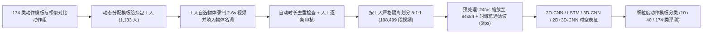

# The "Something Something" Video Database for Learning and Evaluating Visual Common Sense

**The "something something" video database for learning and evaluating visual common sense**（ICCV 2017，pp. 5842–5850，TwentyBN）收录于 [Awesome World-Action Models (RCL)](https://github.com/rcl-robotics/Awesome-World-Action-Models) **第 126/564** 篇，分组 **Datasets**。本页基于 ICCV 2017 论文全文完成结构化精读与核实。

## 一句话定义

**Something-Something** 是一个面向视觉常识与直观物理理解的大规模人类–物体交互视频数据集（108,499 段短视频、174 类模板化动作标签），通过众包按动作模板录制并引入“假装执行”对比样本，抑制模型依赖静态物体外观或手部位置“作弊”。

## 英文缩写速查

| 缩写 | 英文全称 | 简要说明 |
|------|----------|----------|
| HOI | Human-Object Interaction | 人–物交互，视频中手与日常物体的物理作用过程 |
| 2D-CNN / 3D-CNN | 2D / 3D Convolutional Neural Network | 逐帧卷积与时空三维卷积视频表征基线 |
| LSTM | Long Short-Term Memory | 长短期记忆网络，用于聚合帧级 CNN 特征的时序依赖 |
| HIT | Human Intelligence Task | 众包平台上的单个录制与模板填空任务单元 |
| WAM | World Action Model | 世界预测与动作生成耦合模型，见 [World Action Models（WAM）](../concepts/world-action-models.md) |

## 为什么重要

- **弥补高层动作数据集的物理常识缺失**：早期 UCF101、Sports-1M、ActivityNet 等聚焦体育或高层社会活动，模型往往凭单帧静态场景/物体分类即可得分；而机器人操作与具身预测需要理解重力、遮挡、支撑、可变形性及“开关/推拉/倾倒”跨物体的动作共性。
- **低成本高多样性的“模板驱动反向众包”范式**：不从网络视频抓取后补标，而是由众包工人自选日常物体演绎给定动作模板，天然覆盖长尾物理交互组合（1,133 名工人贡献 23,137 个原始物体名词）。
- **直观物理判别的经典试金石**：通过动作相似组与 *Pretending to ...*（假装做某动作）样本，暴露标准 2D/3D-CNN 在细粒度时序与因果状态变化上的显著短板（全 174 类 Top-1 错误率高达 88.5%）。

## 核心信息

| 字段 | 内容 |
|------|------|
| 编号 | 126/564（RCL Awesome WAM） |
| 分组 | Datasets |
| 出处 | ICCV 2017（pp. 5842–5850） |
| 作者与机构 | Raghav Goyal, Samira Ebrahimi Kahou, Vincent Michalski, Joanna Materzyńska, Susanne Westphal 等 14 位作者（TwentyBN） |
| 数据规模 | 108,499 段视频（时长 2–6 s，均值 4.03 s），174 类模板，平均 620 段/类（最少 77、最多 986） |
| 数据集入口 | <https://www.twentybn.com/datasets/something-something> |
| 论文 | <https://openaccess.thecvf.com/content_iccv_2017/html/Goyal_The_Something_Something_ICCV_2017_paper.html> |
| 子类 / 象限 | 视频动作理解数据 · 语言标注与再标注 · 不适用 |

## 核心机制

1. **结构化文本模板与反向众包采集（Template-driven Crowdsourcing）**
   - 将动作定义为带 `[something]` 占位符的自然语言模板（如 `Dropping [something] into [something]`、`Pushing a [something] so that it falls off [something]`），仅保留动词、名词、介词等核心词性作为可控的“结构化字幕”。
   - 众包工人登录自建采集平台选择模板，自选物理上合理的日常物体录制 2–6 秒视频，并在输入框填回实际物体名词（利用真实世界动作–物体联合分布的低熵特性高效采样）。
   - 平台支持分批离线提交、**按工人历史动态分配未录制标签**（1,133 名工人参与，平均每类覆盖 127.32 名不同工人）、自动时长/去重质检与人工运营逐条审核；按 **8:1:1 划分 train / val / test**，且严格保证**同一工人的所有视频仅落入单一划分**，避免身份或背景泄漏。
2. **课程学习与细粒度对比动作组（Grouping & Contrastive Examples）**
   - 依据模型验证精度逐步扩展模板语义复杂度的课程学习路线（初始版本定位为“教一岁儿童的日常物理概念”）。
   - 为防止网络通过静态物体外观、手部位置或相机抖动等数据集偏置（dataset bias）“作弊”，将高度相似动作编入同一动作组（如 `Putting [something] on top of / next to / behind [something]`；轻戳不动 / 轻戳微动 / 戳倒），并在部分组中加入 **Pretending to ...**（假装放下或假装戳，实际未留下或未接触），迫使模型关注目标状态变化与物理因果。
3. **时空基线建模与预处理管线**
   - 视频统一抽帧至 24 fps 并缩放至 84×84（预训练模型按其输入分辨率），经高斯时域低通滤波降采样至 6 fps（训练期引入 0–3 随机时域偏移增强），对比 2D-CNN（VGG-16 帧均值 / ImageNet 预训练 + LSTM）与 3D-CNN（36 帧填充 4×9 帧堆叠或 Sports-1M 预训练 16 帧均值）及其拼接组合 `2D+3D-CNN`。

### 方法流程图

## 评测与指标

### 1. 数据集横向对比（原文 Table 1）

| 数据集 | 领域 | 视频数量 | 平均时长 | 关键特征 |
|--------|------|----------|----------|----------|
| Physics 101 | 直观物理 | 17,408 | - | 101 个物体，4 类物理实验（斜坡/弹簧/下落/液体） |
| MPII Cooking | 动作（烹饪） | 44 | 600 s | 长时程精细烹饪活动 |
| TACoS | 动作（烹饪） | 127 | 360 s | 烹饪场景语言描述 |
| Charades | 动作（日常人类） | 10,000 | 30 s | 众包脚本日常活动 |
| KITTI | 动作（驾驶） | 21 | 30 s | 车载道路场景 |
| **Something-Something（本文）** | **人–物交互** | **108,499** | **4.03 s** | **174 类细粒度人–物交互与物理状态变化模板** |

### 2. 分类基线错误率（原文 Table 4，Error rate %，越低越好）

在手工挑选的 10 类简单子集（28,198 段）、40 类子集（53,267 段）与全量 174 类上的测试错误率如下：

| 方法 | 10 类 Top-1 ↓ | 10 类 Top-2 ↓ | 40 类 Top-1 ↓ | 40 类 Top-2 ↓ | 174 类 Top-1 ↓ | 174 类 Top-2 ↓ | 174 类 Top-5 ↓ |
|------|---------------|---------------|---------------|---------------|----------------|----------------|----------------|
| `2D CNN + Avg`（从头训练 VGG-16） | 76.5% | 58.9% | 88.0% | 78.5% | - | - | - |
| `Pre-2D CNN + Avg`（ImageNet 预训练） | 54.7% | 39.0% | 79.2% | 70.0% | - | - | - |
| `Pre-2D CNN + LSTM`（隐层 256） | 52.3% | 34.1% | 77.8% | 68.0% | - | - | - |
| `3D CNN + Stack`（从头训练，9 帧×4 段） | 58.1% | 38.7% | 70.3% | 57.3% | - | - | - |
| `Pre-3D CNN + Avg`（Sports-1M 预训练，8 fps） | 47.5% | 29.2% | 66.2% | 52.7% | **88.5%** | **81.5%** | **70.0%** |
| `2D+3D-CNN`（最优 2D 与 3D 拼接） | **44.9%** | **27.1%** | **63.8%** | **50.7%** | - | - | - |

> 注：原文 §4.3 另以 40 类预训练的 3D-CNN 微调 174 类报告了 Top-1 88.5% / Top-5 70.3%；此外，10 名人类被试在约 700 条全量 174 类测试样本上的非正式评测正确率约 **60%**（对应错误率约 40%），说明标签存在一定语义歧义但模型仍有巨大提升空间。

## 与其他工作对比

- **对比像素级未来帧预测与物理模拟器**：直接预测原始像素计算与统计代价过高，而纯游戏引擎积木塔等仅针对特定受限实验；Something-Something 通过细粒度语言模板监督，在真实日常物体与光照下学习通用动作表征，可对接 [World Action Models（WAM）](../concepts/world-action-models.md) 与具身操作策略。
- **对比同清单其他数据集**：在 [RCL Awesome WAM 技术地图](../overview/rcl-awesome-wam-technology-map.md) 的 **Datasets** 分组中，本数据集以“动作模板 + 对比假装样本”成为后来 SSv2 及众多视频表征、世界模型与 [VLA](../methods/vla.md) 预训练的核心时序动作基准之一。

## 常见误区或局限

1. **8:1:1 划分是“按工人隔离”而非随机切分**：复用该数据集做交叉验证或迁移实验时，应沿用官方按工人互斥的 split，否则背景/手型/光照等个体偏置会虚高准确率。
2. **模板间存在天然语义重叠与歧义**：如某些相似投放或移动类在无上下文或视角受限时连人类也仅达约 60% Top-1 准确率，评测时常需结合 Top-2/Top-5 指标。
3. **本论文对应 v1 版本（174 类 / 108,499 段），尚未包含完整自然句字幕实验与物体级边界框**：文中提到的物体名词（23,137 个原始词条，含大小写与词形差异）未在本版实验中作为联合开放词表生成评测，且“几何不变类的水平翻转/小角度旋转增强”在作者基线实验中未带来显著收益。
4. **标准 2D/3D-CNN 对微弱状态差异极度敏感**：面对“轻戳未动 vs 轻戳微动”及 `Pretending to` 样本，仅靠帧均值或短片段卷积极易失效，需要显式时序推理与细粒度状态跟踪架构。

## 结论

**Something-Something 通过模板化众包与“假装/细微物理差异”动作组，构建了首个大规模强迫模型理解真实世界直观物理与动作–物体共性的视频数据库（108,499 段视频 / 174 类）。**

- 训练世界模型或操作策略的视觉骨干时，使用包含对比动作组与 *Pretending* 负样本的数据子集，可有效检验表征是否真正编码了物体状态转移而非静态物体偏置。
- 复现或对齐历史基准时，需明确区分本文 **ICCV 2017 v1（108,499 段）** 与后续扩展的 Something-Something V2，避免跨版本指标混用。
- 在 2D 空间外观特征与 3D 时空动态特征之间做拼接融合（`2D+3D-CNN`）能稳定降低错误率，但全 174 类仍高达 88.5% Top-1 错误率，表明单纯池化时序片段不足以解决物理因果推理。

## 关联页面

- 列表实体：[Awesome World-Action Models（RCL）](paper-rcl-wam-robot-learning-control-survey.md)
- 技术地图：[RCL Awesome WAM 技术地图](../overview/rcl-awesome-wam-technology-map.md)
- 概念与方法/任务：[World Action Models（WAM）](../concepts/world-action-models.md)、[generative-world-models.md](../methods/generative-world-models.md)、[vla.md](../methods/vla.md)、[manipulation.md](../tasks/manipulation.md)

## 参考来源

- [`sources/papers/rcl_awesome_wam_ref_c71dcf53130e8fdc61fa_the-something-something-video-database-f.md`](../../sources/papers/rcl_awesome_wam_ref_c71dcf53130e8fdc61fa_the-something-something-video-database-f.md) — 本条目策展摘录
- [`sources/papers/rcl_awesome_wam_catalog.md`](../../sources/papers/rcl_awesome_wam_catalog.md) — 列表总表
- [`sources/repos/awesome-world-action-models-rcl.md`](../../sources/repos/awesome-world-action-models-rcl.md)
- [`docs/PAPERS.md`](https://github.com/RCL-Robotics/Awesome-World-Action-Models/blob/main/docs/PAPERS.md) — 上游论文目录
- 论文：<https://openaccess.thecvf.com/content_iccv_2017/html/Goyal_The_Something_Something_ICCV_2017_paper.html>

## 推荐继续阅读

- [Awesome World-Action Models (RCL) 仓库](https://github.com/rcl-robotics/Awesome-World-Action-Models)
- [原文 PDF (CVF Open Access)](https://openaccess.thecvf.com/content_iccv_2017/papers/Goyal_The_Something_Something_ICCV_2017_paper.pdf)
- [Something-Something 数据集官方入口](https://www.twentybn.com/datasets/something-something)
