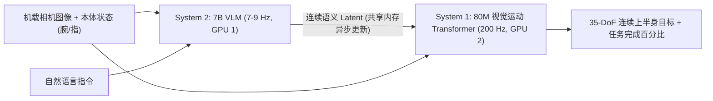

# Helix：Figure 上半身视觉语言动作系统

## 一句话定义

Helix 用慢速语义 System 2 条件化高速视觉运动 System 1，以共享权重在 Figure 人形上完成语言指令驱动的上半身操作。

## 英文缩写速查

| 缩写 | 英文全称 | 简要说明 |
| --- | --- | --- |
| VLA | Vision-Language-Action | 视觉和语言条件下生成动作 |
| VLM | Vision-Language Model | 场景和指令语义理解 |
| GPU | Graphics Processing Unit | 机载推理硬件 |

## 为什么重要

- 语言理解与高频关节动作有不同时间尺度，Helix 给出显式分工。
- 展示陌生物体与双机器人协作，是后续全身 Helix 02 的技术起点。

## 核心原理

**System 2**（7B 开源 VLM 骨干，7–9 Hz）接收单目图像、腕部/手指状态与自然语言指令，蒸馏出连续语义 latent；**System 1**（80M 交叉注意力 Transformer + 仿真预训练多尺度全卷积视觉骨干，200 Hz）受该 latent 条件化，结合最新视觉与本体状态直接回归 35-DoF 连续上半身动作（双腕位姿、手指屈伸/外展、头与躯干朝向）及合成“任务完成百分比”终止信号。全模型端到端以回归损失联合优化（训练时在 S1/S2 输入间加入与部署时延匹配的时间偏移），并部署在双机载嵌入式 GPU 上异步流式运行。

初代的主要展示是约 500 小时遥操数据（VLM 后验指令标注）训练出的上半身取放与双机器人协作；[Helix 02](helix-02.md) 增加全身 System 0、掌部视觉和触觉，两代硬件/接口不能混用。

## 源码运行时序图

**不适用**：官方发布页未提供可运行训练/推理/部署代码，不能将架构描述当成源码模块。

## 工程实践

1. 用 S2→S1 接口理解语义计划与运动执行的解耦。
2. 评估新物体、新指令、协作与长程任务时分别设计协议，不能由单条视频判断全部泛化。
3. 官方 2025-02-20 发布页提供架构和演示，未列模型代码、权重或训练数据下载入口。

## 评测与指标

官方展示双机器人整理未见过的食品等行为。本页保留“新物体、指令条件、协作、机载执行”四个观察维度；没有重复试验和统一基准的数字，就不据此排性能名次。

## 结论

**Helix 的主线是语义 latent 与快速上半身执行的协同。**

1. 把语义和动作层分别计时。
2. 区分上半身演示与后续全身控制。
3. 把演示泛化与可独立复现分开判断。

## 与其他工作对比

初版 Helix 展示语义 S2 与快速上半身 S1 的协作；[Helix 02](helix-02.md) 加入全身 S1、身体 S0 与掌部感知。不能用 Helix 02 的频率、触觉和全身演示解释初版 Helix；与开源 VLA 对照时还需区分可复现资产和演示证据。

## 局限与风险

- “共享权重”不意味着系统没有多个时标或专门动作头。
- 初代展示不等于全身自主移动；应与 Helix 02 和 2.5 的评测分开。
- 官方未提供足以独立复现的完整栈。

## 关联页面

- [Figure](./figure-ai.md)
- [Helix 02](./helix-02.md)
- [Helix 2.5](./helix-25.md)
- [VLA](../methods/vla.md)

## 参考来源

- [Helix 官方技术说明全文核对](../../sources/papers/rcl_awesome_wam_ref_cb61c489d1333f433fc4_helix-a-vision-language-action-model-for.md)
- [Helix 官方两代发布归档](../../sources/sites/figure-helix-models.md)

## 推荐继续阅读

- [Helix 官方技术文章](https://www.figure.ai/news/helix)
