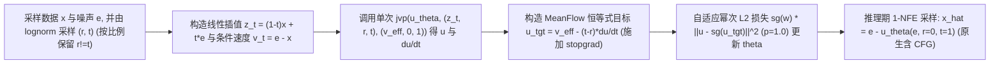

# Mean Flows for One-step Generative Modeling

**Mean Flows for One-step Generative Modeling**（Zhengyang Geng, Mingyang Deng, Xingjian Bai, J. Zico Kolter, Kaiming He，CMU / MIT，NeurIPS 2025 / arXiv:2505.13447v1）收录于 [Awesome World-Action Models (RCL)](https://github.com/rcl-robotics/Awesome-World-Action-Models) **第 166/564** 篇，分组 **Foundational work**。本页基于论文全文，系统梳理平均速度场定义、MeanFlow 恒等式、JVP 优化目标、原生单步 CFG 及关键量化实验结果。

## 一句话定义

**MeanFlow** 是一种自洽、从零单阶段训练的单步（1-NFE）生成建模框架：它用双时间区间 $[r, t]$ 上的 **平均速度场 $u(z_t, r, t)$** 取代传统 Flow Matching 的瞬时速度 $v(z_t, t)$，基于积分微分的 **MeanFlow 恒等式** 与轻量化 Jacobian-Vector Product（JVP）完成训练，无需预训练、蒸馏或离散化课程学习即可实现高质量单步采样（且原生以 1-NFE 支持无分类器引导 CFG）。

## 英文缩写速查

| 缩写 | 英文全称 | 简要说明 |
|------|----------|----------|
| WAM | World Action Model | 世界预测与动作生成耦合 |
| VLA | Vision-Language-Action | 视觉–语言–动作策略 |
| IDM | Inverse Dynamics Model | 先预测未来再反推动作 |
| WM | World Model | 环境前向预测模型 |
| NFE | Number of Function Evaluations | 单次采样调用主神经网络前向推理的次数 |
| JVP | Jacobian-Vector Product | 雅可比–向量积，用于一步高效计算平均速度场的时变全导数 $\frac{d}{dt}u$ |
| CFG | Classifier-Free Guidance | 无分类器引导，本文将其直接融入真值目标场从而保持 1-NFE 推理 |
| DiT / SiT | Diffusion / Scalable Interpolant Transformer | 本文在 ImageNet 256×256 上沿用的潜空间视觉 Transformer 主干 |

## 为什么重要

- **无需多阶段 Reflow 或蒸馏即可「原生单步生成」**：Flow Matching 即使采用直线条件流，其边缘速度场 $v(z_t, t)$ 仍会诱导弯曲轨迹，必须多步积分或通过 [Rectified Flow](paper-rcl-ref-8c87d43c8563d21b1a7e-flow-straight-and-fast-learning-to-generate-and.md) 的 Reflow/蒸馏加速；而 Consistency Models 等依赖网络行为自洽约束与脆弱的离散化课程。MeanFlow 为「平均速度」建立了独立于网络的解析真值场，单阶段从零训练即在 ImageNet 256×256 将 1-NFE 生成 FID 从 10.60（Shortcut）/ 34.24（iCT）压低至 **3.43**。
- **单步即可享受 CFG 且推理开销不翻倍**：常规 CFG 在每步推理需同时跑有条件与无条件两路前向（NFE 翻倍）；MeanFlow 将 CFG 线性组合直接写入训练目标速度场，使 1-NFE 模型自带引导效果。这对高频实时机器人动作生成与世界模型推演具有直接工程价值。
- **顺着索引入口延伸阅读**：对照 [Awesome World-Action Models（RCL）](paper-rcl-wam-robot-learning-control-survey.md)、[RCL Awesome WAM 技术地图](../overview/rcl-awesome-wam-technology-map.md) 与前置工作 [Flow Straight and Fast](paper-rcl-ref-8c87d43c8563d21b1a7e-flow-straight-and-fast-learning-to-generate-and.md)。

## 核心信息

| 字段 | 内容 |
|------|------|
| 作者与机构 | Zhengyang Geng, Mingyang Deng, Xingjian Bai, J. Zico Kolter, Kaiming He（CMU / MIT） |
| 编号 / 分组 | 166/564 · Foundational work（子类：扩散与流匹配基础） |
| 出处 / 原文 | NeurIPS 2025 · <https://papers.neurips.cc/paper_files/paper/2025/hash/6d13e085b79d454da5910e4ca82a3d9d-Abstract-Conference.html> / arXiv:2505.13447v1 |
| 骨干与实验配置 | ImageNet 256×256（32×32×4 VAE 潜空间，DiT-B/M/L/XL/2，Adam `lr=1e-4`, `bs=256`, 240 epochs）；CIFAR-10（55M U-Net 像素空间，无 EDM 预处理） |
| 核心指标 | ImageNet 256×256 **1-NFE FID 3.43**，**2-NFE FID 2.20**；CIFAR-10 **1-NFE FID 2.92** |

## 核心机制（归纳）

1. **平均速度场与 MeanFlow 恒等式（充要等价）**：
   - 将区间 $[r, t]$ 上的平均速度定义为瞬时速度路径积分除以时间跨度：
     $$u(z_t, r, t) \triangleq \frac{1}{t - r}\int_r^t v(z_\tau, \tau)\,d\tau$$
     当 $r \to t$ 时还原为瞬时速度 $\lim_{r\to t}u = v$。写成位移形式 $(t-r)u(z_t, r, t) = \int_r^t v(z_\tau, \tau)d\tau$ 并对 $t$ 求导（保持 $r$ 独立于 $t$），即得无需积分的 **MeanFlow 恒等式**：
     $$u(z_t, r, t) = v(z_t, t) - (t - r)\frac{d}{dt}u(z_t, r, t)$$
   - **充要性保证（Appendix B.3）**：直接建模平均速度 $u$ 而非位移 $S=(t-r)u$ 时，当 $t=r$ 自动满足边界条件 $S|_{t=r}=0$，使恒等式与原积分定义完全充要等价。
2. **基于轻量化 JVP 的自洽训练与 1-NFE 采样**：
   - 全导数展开为 $\frac{d}{dt}u(z_t, r, t) = v(z_t, t)\partial_z u + \partial_t u$（因为 $\frac{dz_t}{dt}=v,\ \frac{dr}{dt}=0,\ \frac{dt}{dt}=1$），在 PyTorch/JAX 中通过一次前向自动微分接口 `jvp(fn, (z, r, t), (v, 0, 1))` 即可同时得到网络输出 $u_\theta$ 与全导数 `dudt`。
   - 用条件速度 $v_t = \epsilon - x$（$z_t = (1-t)x + t\epsilon$）构造回归目标 $u_{\text{tgt}} = v_t - (t-r)(v_t \partial_z u_\theta + \partial_t u_\theta)$，并对 $u_{\text{tgt}}$ 施加 **`stopgrad`** 彻底避免二阶反向传播；当 $r=t$ 时第二项消零，严格退化为标准 Flow Matching。
   - **采样**：一般步长为 $z_r = z_t - (t-r)u_\theta(z_t, r, t)$；**1-NFE 单步采样**仅需一次前向 $z_0 = \epsilon - u_\theta(\epsilon, 0, 1)$。
3. **原生 1-NFE 无分类器引导（CFG）与关键设计**：
   - 将引导速度场定义为真值场 $v^{\text{cfg}}(z_t, t|c) = \omega v(z_t, t|c) + (1-\omega)v(z_t, t)$（及改进版混合 $\kappa$ 形式，等价有效引导系数 $\omega' = \omega/(1-\kappa)$），利用 $v^{\text{cfg}}(z_t, t)=u^{\text{cfg}}(z_t, t, t)$ 直接在目标 $u_{\text{tgt}}$ 中融入引导信号（同时以 10% 概率丢弃类别条件），推理期仍仅需 **1-NFE**。
   - **工程三要素（Table 1）**：(1) 时间采样 $(r, t)$ 采用 `lognorm(-0.4, 1.0)` 并设定 **25%** 样本满足 $r\neq t$（ImageNet；CIFAR-10 为 75%）；(2) 网络输入采用 $(t, t-r)$ 位置编码；(3) 采用自适应加权 L2 损失 $w = 1/(\|\Delta\|_2^2 + c)^p$（$p=1-\gamma$，ImageNet 默认 $p=1.0$，优于标准 L2 $p=0$ 与 Pseudo-Huber $p=0.5$）。

### 方法流程图

## 评测与指标

### 1. ImageNet 256×256 类别条件生成（从零训练，FID-50K ↓，Table 2）

| 模型 / 家族 | 参数量 | NFE（含 CFG 倍率） | FID-50K ↓ | 关键对比说明 |
|-------------|--------|--------------------|-----------|--------------|
| iCT-XL/2 | 675M | 1 | 34.24 | 从零单步一致性模型 |
| Shortcut-XL/2 | 675M | 1 | 10.60 | 自洽快捷模型 |
| **MeanFlow-B/2** | 131M | **1** | **6.17** | 240 epochs 从零训练 |
| **MeanFlow-M/2** | 308M | **1** | **5.01** | 240 epochs 从零训练 |
| **MeanFlow-L/2** | 459M | **1** | **3.84** | 240 epochs 从零训练 |
| **MeanFlow-XL/2** | 676M | **1** | **3.43** | 相对 Shortcut 降约 **68%**，相对 IMM 降超 **50%** |
| iMM-XL/2 | 675M | 1×2（2 NFE） | 7.77 | 单步需 2-NFE CFG |
| **MeanFlow-XL/2** | 676M | **2** | **2.93** | 240 epochs |
| **MeanFlow-XL/2+** | 676M | **2** | **2.20** | 追平 500-NFE DiT-XL/2 (**2.27**) 与 SiT-XL/2 (**2.06/2.15**) |

### 2. CIFAR-10 无条件生成（像素空间 ~55M U-Net，1-NFE FID-50K，Table 3）

| 方法 | 预条件器 | NFE | FID ↓ |
|------|----------|-----|-------|
| iCT (Song & Dhariwal, 2024) | EDM | 1 | 2.83 |
| **MeanFlow（本文）** | **无（none）** | **1** | **2.92** |
| sCT | EDM | 1 | 2.97 |
| IMM | EDM | 1 | 3.20 |
| ECT | EDM | 1 | 3.60 |

### 3. 核心消融与计算开销（ViT-B/4, 80 epochs, ImageNet 256×256, Table 1 & Appendix B.4）

- **Flow Matching 退化对比（Table 1a）**：$r\neq t$ 比例为 `0%`（即标准 FM）时 1-NFE FID 崩塌至 **328.91**；开启 `25%` 即降至 **61.06**（50% 为 63.14，100% 为 67.32）。
- **JVP 切向量校验（Table 1b）**：正确切向量 `(v, 0, 1)` 得 **61.06**；若错置为 `(v, 0, 0)`、`(v, 1, 0)` 或 `(v, 1, 1)`，FID 立刻恶化至 **268.06**、**329.22** 与 **137.96**。
- **JVP 墙钟训练开销（Appendix B.4，TPU v4-8 B/4）**：由于目标施加了 `stopgrad`（无需对参数 $\theta$ 求二阶导，仅需回传到输入变量），Flow Matching 为 `0.045 sec/iter`，MeanFlow 为 `0.052 sec/iter`，额外耗时仅约 **16%**（文中估算整体 <20%）。
- **损失加权与 CFG（Table 1e & 1f）**：自适应幂次 $p=1.0$（61.06）优于 $p=0.5$（63.98）和传统平方 L2 $p=0$（79.75）；引入 1-NFE CFG（$\omega=3.0$）将 B/4 从 61.06 显著改善至 **15.53**（`XL/2+` 进一步用混合参数 $\kappa$ 与窗口 `[0.3, 0.8]` 调优）。

## 与其他工作对比

- **相比 Consistency Models（CM / iCT / ECT / sCT）**：CM 强制网络输出在固定端点 $r \equiv 0$ 处保持自洽，缺少独立于网络的真值流场定义，因而往往需要精密的离散化步长课程学习与 EDM 预条件；MeanFlow 由微分恒等式直接给出双时间 $(r, t)$ 真值目标，无需课程学习或预条件即可稳定收敛。
- **相比 Rectified Flow（Reflow + Distillation）**：Rectified Flow 需先训 1-Flow、生成数百万合成轨迹再做 Reflow 与蒸馏的多阶段流水线；MeanFlow 通过平均速度在单阶段从零训练内一步到位获得 1-NFE/2-NFE 能力，且可与 REPA 等表征对齐方法正交结合。
- **相比 Shortcut / IMM**：虽然同属双时间条件模型，Shortcut 与 IMM 额外假设离散时间步自洽约束；MeanFlow 完全由平均速度积分定义导出 MeanFlow 恒等式，形式更简洁且在 ImageNet 1-NFE 上大幅拉开差距（3.43 vs 10.60 / 7.77）。

## 常见误区或局限

1. **误以为 JVP 会触发昂贵的二阶梯度显存爆炸**：由于 `u_tgt` 外层包裹了 `stopgrad`，优化器对 $\theta$ 求梯度时将 $\frac{d}{dt}u_\theta$ 视为常数，JVP 仅多一次类似输入端前/反向的轻量开销（实测仅 +16% 迭代时间），但前提是深度学习框架算子对 `torch.func.jvp` / `jax.jvp` 兼容（部分自定义 FlashAttention 核需用支持前向 AD 的实现）。
2. **$r \neq t$ 比例与时间采样对效果高度敏感**：如果设 $r\neq t$ 为 100%（完全放弃 $r=t$ 的瞬时速度监督）反而略逊于 25%（67.32 vs 61.06），需要保留一定比例的瞬时速度锚点来稳定微分方程边界。
3. **当前主力验证集中于连续/潜空间图像分布**：论文在 ImageNet 潜空间和 CIFAR-10 像素空间验证了 1-NFE/2-NFE 生成，尚未在论文中直接给出多步交互决策或机器人高维动作序列控制基准的实测数值（但该框架已被视作低延迟扩散/流策略的潜在替代方案）。

## 结论

**MeanFlow 通过把生成模型建模对象从「瞬时速度」切换为「区间平均速度」，为流匹配带来了首个无需蒸馏、无需课程学习的原生高质量单步训练范式。**

1. **记住核心恒等式 $u = v - (t-r)\frac{d}{dt}u$**：只要用条件速度 $v_t = \epsilon - x$ 配合单次 `jvp(fn, (z,r,t), (v,0,1))` 与 `stopgrad` 回归该恒等式，就能用纯监督回归学会一步积分结果。
2. **训练配比以 $r=t$ 锚定瞬时流、$r\neq t$ 传播平均流**：ImageNet 实测保留约 **25%** 的 $r\neq t$（配合 `lognorm(-0.4, 1.0)`、`(t, t-r)` 编码与 $p=1.0$ 自适应 L2 权重）效果最优。
3. **1-NFE 下也能直接吃满 CFG 增益**：把无分类器引导写进真值目标速度场 $\tilde{v}_t$ 而非推理期双路运行，可在不翻倍 NFE 的前提下实现 **3.43 FID（1-NFE）** 与 **2.20 FID（2-NFE）**。

## 关联页面

- 列表实体：[Awesome World-Action Models（RCL）](paper-rcl-wam-robot-learning-control-survey.md)
- 技术地图：[RCL Awesome WAM 技术地图](../overview/rcl-awesome-wam-technology-map.md)
- 前置基础工作：[Flow Straight and Fast (Rectified Flow)](paper-rcl-ref-8c87d43c8563d21b1a7e-flow-straight-and-fast-learning-to-generate-and.md)
- 方法/任务：[generative-world-models.md](../methods/generative-world-models.md)、[manipulation.md](../tasks/manipulation.md)

## 参考来源

- [`sources/papers/rcl_awesome_wam_ref_ce6916f81594a9c4c73f_mean-flows-for-one-step-generative-model.md`](../../sources/papers/rcl_awesome_wam_ref_ce6916f81594a9c4c73f_mean-flows-for-one-step-generative-model.md) — 本条目策展摘录
- [`sources/papers/rcl_awesome_wam_catalog.md`](../../sources/papers/rcl_awesome_wam_catalog.md) — 列表总表
- [`sources/repos/awesome-world-action-models-rcl.md`](../../sources/repos/awesome-world-action-models-rcl.md)
- [`docs/PAPERS.md`](https://github.com/RCL-Robotics/Awesome-World-Action-Models/blob/main/docs/PAPERS.md) — 上游论文目录
- 论文：<https://papers.neurips.cc/paper_files/paper/2025/hash/6d13e085b79d454da5910e4ca82a3d9d-Abstract-Conference.html>

## 推荐继续阅读

- [Awesome World-Action Models (RCL) 仓库](https://github.com/rcl-robotics/Awesome-World-Action-Models)
- [原文（NeurIPS 2025）](https://papers.neurips.cc/paper_files/paper/2025/hash/6d13e085b79d454da5910e4ca82a3d9d-Abstract-Conference.html)
