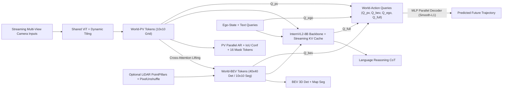

# Percept-WAM

**Percept-WAM: Perception-Enhanced World-Awareness-Action Model for Robust End-to-End Autonomous Driving** 收录于 [Awesome World-Action Models (RCL)](https://github.com/rcl-robotics/Awesome-World-Action-Models) **第 249/564** 篇，分组 **VLA**。本页是 **清单索引**：给出它在清单中的位置与原文入口，方法细节和量化结果请看原文。

## 一句话定义

RCL Awesome WAM 清单收录（VLA）；细节以原文 PDF / 项目页为准。

## 英文缩写速查

| 缩写 | 英文全称 | 简要说明 |
|------|----------|----------|
| WAM | World Action Model | 世界预测与动作生成耦合 |
| VLA | Vision-Language-Action | 视觉–语言–动作策略 |
| IDM | Inverse Dynamics Model | 先预测未来再反推动作 |
| WM | World Model | 环境前向预测模型 |

## 为什么重要

- RCL Awesome WAM 清单收录（VLA）；细节以原文 PDF / 项目页为准。
- 想横向对照同一分组的其他工作，可以从 [RCL Awesome WAM 技术地图](../overview/rcl-awesome-wam-technology-map.md) 逐条展开。
- 顺着列表实体 [Awesome World-Action Models](paper-rcl-wam-robot-learning-control-survey.md) 与站内 WAM / VLA 方法页，可以接回对应的学习主线。

## 核心信息

| 字段 | 内容 |
|------|------|
| 编号 | 249/564 |
| 分组 | VLA |
| 出处 | CVPR 2026 |
| 论文 | <https://openaccess.thecvf.com/content/CVPR2026/html/Han_Percept-WAM_Perception-Enhanced_World-Awareness-Action_Model_for_Robust_End-to-End_Autonomous_Driving_CVPR_2026_paper.html> |
| 子类 / 象限 | 自动驾驶VLA · 空间感知增强VLA · 不适用 |

## 核心机制（归纳）

> 注：以下机制与评测指标基于通读 CVF 开放获取原文全文核对补充。

Percept-WAM（[原文](https://openaccess.thecvf.com/content/CVPR2026/html/Han_Percept-WAM_Perception-Enhanced_World-Awareness-Action_Model_for_Robust_End-to-End_Autonomous_Driving_CVPR_2026_paper.html)）基于预训练 VLM 主干（`InternVL2-8B`），放弃间接的 QA 式空间问答，首次在单个 VLA 模型内部通过 **World-PV**、**World-BEV** 与 **World-Action** 三类令牌显式统一 2D 透视感知、3D BEV 感知、语言推理与端到端轨迹规划，详见 [World Action Models（WAM）](../concepts/world-action-models.md)：

- **World-PV 透视视角感知与网格条件并行解码**：
  - **高分辨率输入与网格查询**：采用 InternVL 动态非重叠分块（tiling）+ 共享 ViT 编码多视角图像为 `World-PV` 令牌，并在 $10 \times 10$ 网格上通过双线性插值构造局部网格查询令牌，通过可控注意力掩码实现跨网格**并行自回归（AR）解码**。
  - **统一序列感知输出**：2D 检测输出 `cls, <box>x,y,w,h</box>, <conf>s</conf>`，单目 3D 检测扩展为 9 维 3D 框参数 `(x, y, z, w, h, l, θ, vx, vy)`，连续坐标离散化为整数桶并用令牌交叉熵监督；2D 实例/语义分割通过预测 $K=16$ 个 `<MASK>` 令牌与 `World-PV` 令牌做点积检索掩码（不增加额外分割头），采用 CE + Sigmoid Focal + Dice 损失联合训练。
  - **IoU 感知置信度校准**：针对 MLLM softmax 过度自信导致的重复框与误检，用中间阶段模型在训练集上的真实预测与 GT 的 IoU（离散为 20 桶）构造 `Confidence-tuning Dataset`，训练时通过损失掩码分离类别/坐标监督与置信度监督；推理时以 `类别 softmax 分数 × 预测 IoU 分数` 作为最终检测置信度。
- **World-BEV 鸟瞰图感知与可选多传感器融合**：
  - 设立可学习 BEV 网格令牌（3D 检测用 $40 \times 40$ 网格，BEV 地图分割用 $10 \times 10$ 网格），在 prefill 单次前向中通过交叉注意力从 `World-PV` 提取 3D 证据；当提供 LiDAR 点云时，用 `PointPillars` 提取特征经 `PixelUnshuffle` + MLP 初始化 `World-BEV` 令牌。
  - BEV 3D 检测将 3D 框离散化至 $[0, 1024)$ 区间并支持并行 AR 或提速 16 倍的 MLP 并行坐标解码；BEV 地图分割同样复用 16 个 `<mask>` 令牌以独立二分类分割（CE + Focal + Dice）处理可重叠地图要素（可行驶区域、人行横道、车道线等）。
- **World-Action 感知到动作对齐与流式推理**：
  - 设置 4 组点级轨迹查询 `Q_pv`、`Q_bev`、`Q_ego` 与 `Q_full`（$\in \mathbb{R}^{N \times C}$）：前 3 组通过注意力掩码分别仅关注图像、BEV 与自车运动学模态令牌以强制跨模态对齐，第 4 组 `Q_full` 访问全部特征并经 MLP 并行解码最终轨迹（训练采用 Smooth-L1 损失，支持 NAVSIM 静态词表打分）。
  - 采用两阶段课程训练（阶段 1 巩固 PV/BEV 空间感知，阶段 2 进行端到端 VLA 轨迹微调即 `Percept-WAM*`），推理端结合长片段训练与双重视重计算流式 KV Cache（Streaming KV Cache）降低延迟。

### 方法流程图

## 评测与指标

- **PV 2D/单目 3D 感知（Table 1）**：`Percept-WAM (AD+Gen)` 在 **COCO 2D 检测**达到 **51.7 mAP**（优于 `LMM-Det` 47.5 与 `UFO-InternVL2-8B` 48.9），在 **nuImages 2D 检测**达 **49.6 mAP**（`AD` 单域达 **49.9 mAP**，超过 `Mask R-CNN` 47.8），**nuImages/COCO 实例分割**达 **41.7 / 45.9 mAP**，**nuScenes Mono3D 检测**达 **33.0 mAP / 38.6 NDS**（超越 `FCOS3D` 32.1 mAP），**nuImages/ADE20K/COCOStuff 语义分割**达 **62.8 / 54.3 / 50.3 mIoU**（详见 [原文](https://openaccess.thecvf.com/content/CVPR2026/html/Han_Percept-WAM_Perception-Enhanced_World-Awareness-Action_Model_for_Robust_End-to-End_Autonomous_Driving_CVPR_2026_paper.html)）。
- **BEV 3D 感知（nuScenes val，Table 4）**：取得 **0.589 mAP / 0.645 NDS**（超过 `PointPillars` 0.523 / 0.613 与 `SECOND` 0.526 / 0.630）；BEV 地图分割 IoU 为 Drivable Area **87.0**、Ped Crossing **70.9**、Lane Divider **62.7**、Vehicle **60.2**。
- **端到端轨迹规划（Table 3）**：
  - **nuScenes 开环规划**：`Percept-WAM` 平均 L2 误差 0.38m，两阶段微调 `Percept-WAM*` 进一步降至 **0.36m**（1s: 0.16m / 2s: 0.33m / 3s: 0.60m），优于 `UniAD`（0.46m）与 `DiffusionDrive`（0.57m）。
  - **NAVSIM v1 闭环规划**：`Percept-WAM` 达 88.6 PDMS，`Percept-WAM*` 达 **90.2 PDMS**（NC 98.8 / DAC 98.6 / TTC 94.4 / Comf. 99.5 / EP 84.8），超越 `DiffusionDrive`（88.1，+2.1）与 `Hydra-MDP`（86.5）。
- **消融与推理效率（Table 5–7）**：真实预测分布的 IoU 置信度校准使 nuImages 2D 检测从 48.1 提升至 **49.6 AP**（AP75 +2.3）；BEV 端融合 LiDAR、数据增强、40×40 网格与 MLP 并行解码将 mAP 从 25.0 提升至 **50.4**（提速 16×）；查询式动作头结合 Streaming KV Cache 将单帧推理延迟从 AR 的 2700 ms 降至 **707 ms**（平均 L2 0.3839m）。

## 与其他工作对比

- 本页 **不做** 与具体基线的逐项数值对比；同分组的横向对照请回到 [技术地图](../overview/rcl-awesome-wam-technology-map.md) 的 **VLA** 分组逐条展开。
- 如果站内已经有这篇的深读页（含机构、实验表与源码运行时序图），请以那一页为准；本页只保留清单要点。
- 与清单内相邻条目孰优孰劣，本页不下结论：清单 Contribution 可能滞后于论文最新版本，差异应以各自原文的问题设定与评测口径为准。

## 结论

**这一页能给你的是「Percept-WAM」在策展清单里的坐标与要点：够你判断要不要去读原文，但不能替代原文。**

- 可确证的只有清单坐标：分组 **VLA**，以及 Contribution 点出的问题设定；本页不自行推导新结论。
- 适用边界：本页不能替代原文 PDF；开源状态以项目页实际链接为准（清单可能滞后）。
- 要深读这篇，建议直接从原文入手，再回到下方关联的方法 / 任务页对照。

## 常见误区

1. 不要把 Awesome 条目的 Contribution 当成完整方法证明——它只是策展导读。
2. 若站内已有这篇的深读页，以那一页为准——本页只是清单入口，不含实验数据。

## 关联页面

- 列表实体：[Awesome World-Action Models（RCL）](paper-rcl-wam-robot-learning-control-survey.md)
- 技术地图：[RCL Awesome WAM 技术地图](../overview/rcl-awesome-wam-technology-map.md)
- 方法/任务：[generative-world-models.md](../methods/generative-world-models.md)、[manipulation.md](../tasks/manipulation.md)

## 参考来源

- [`sources/papers/rcl_awesome_wam_ref_ced7109d62bb4514d467_percept-wam-perception-enhanced-world-aw.md`](../../sources/papers/rcl_awesome_wam_ref_ced7109d62bb4514d467_percept-wam-perception-enhanced-world-aw.md) — 本条目策展摘录
- [`sources/papers/rcl_awesome_wam_catalog.md`](../../sources/papers/rcl_awesome_wam_catalog.md) — 列表总表
- [`sources/repos/awesome-world-action-models-rcl.md`](../../sources/repos/awesome-world-action-models-rcl.md)
- [`docs/PAPERS.md`](https://github.com/RCL-Robotics/Awesome-World-Action-Models/blob/main/docs/PAPERS.md) — 上游论文目录
- 论文：<https://openaccess.thecvf.com/content/CVPR2026/html/Han_Percept-WAM_Perception-Enhanced_World-Awareness-Action_Model_for_Robust_End-to-End_Autonomous_Driving_CVPR_2026_paper.html>

## 推荐继续阅读

- [Awesome World-Action Models (RCL) 仓库](https://github.com/rcl-robotics/Awesome-World-Action-Models)
- [原文](https://openaccess.thecvf.com/content/CVPR2026/html/Han_Percept-WAM_Perception-Enhanced_World-Awareness-Action_Model_for_Robust_End-to-End_Autonomous_Driving_CVPR_2026_paper.html)
