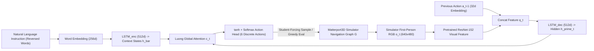

# Vision-and-Language Navigation

**Vision-and-Language Navigation: Interpreting Visually-Grounded Navigation Instructions in Real Environments** 收录于 [Awesome World-Action Models (RCL)](https://github.com/rcl-robotics/Awesome-World-Action-Models) **第 129/564** 篇，分组 **Datasets**。本页是 **清单索引**：给出它在清单中的位置与原文入口，方法细节和量化结果请看原文。

## 一句话定义

RCL Awesome WAM 清单收录（Datasets）；细节以原文 PDF / 项目页为准。

## 英文缩写速查

| 缩写 | 英文全称 | 简要说明 |
|------|----------|----------|
| WAM | World Action Model | 世界预测与动作生成耦合 |
| VLA | Vision-Language-Action | 视觉–语言–动作策略 |
| IDM | Inverse Dynamics Model | 先预测未来再反推动作 |
| WM | World Model | 环境前向预测模型 |

## 为什么重要

- RCL Awesome WAM 清单收录（Datasets）；细节以原文 PDF / 项目页为准。
- 想横向对照同一分组的其他工作，可以从 [RCL Awesome WAM 技术地图](../overview/rcl-awesome-wam-technology-map.md) 逐条展开。
- 顺着列表实体 [Awesome World-Action Models](paper-rcl-wam-robot-learning-control-survey.md) 与站内 WAM / VLA 方法页，可以接回对应的学习主线。

## 核心信息

| 字段 | 内容 |
|------|------|
| 编号 | 129/564 |
| 分组 | Datasets |
| 出处 | CVPR 2018 |
| 论文 | <https://openaccess.thecvf.com/content_cvpr_2018/html/Anderson_Vision-and-Language_Navigation_Interpreting_CVPR_2018_paper.html> |
| 子类 / 象限 | 视觉语言导航数据 · 语言标注与再标注 · 基准与评测协议 · 不适用 |

## 核心机制（归纳）

> 注：以下机制与评测指标基于通读 CVF 开放获取原文全文核对补充。

本文（[原文](https://openaccess.thecvf.com/content_cvpr_2018/html/Anderson_Vision-and-Language_Navigation_Interpreting_CVPR_2018_paper.html)）正式提出真实室内建筑中的**视觉–语言导航（VLN）**任务，构建了 **Matterport3D Simulator**、首个实景跨房间导航基准 **Room-to-Room（R2R）**，以及带注意力机制的 **Seq2Seq** 导航智能体基线：

- **Matterport3D Simulator（实景离散图仿真环境）**：
  - 基于 Matterport3D 全景 RGB-D 数据集（90 栋建筑级真实室内场景、10,800 个全景视点、194,400 张 RGB-D 图像，视点平均间距 2.25m），采用 C++ / OpenGL 实现并提供 Python 接口。
  - 智能体状态为 $s_t = \langle v_t, \psi_t, \theta_t \rangle$（3D 视点 $v_t \in V$、偏航角 $\psi_t$、俯仰角 $\theta_t$），每步从立方体贴图投影生成 640×480 第一人称 RGB 图像 $o_t$（垂直视场角 $60^\circ$）。
  - 为防止穿墙瞬移，每个场景通过网格光线追踪与人工核验构建无向带权导航图 $G = \langle V, E \rangle$（剔除 >5m 边，平均每图 117 视点、平均度数 4.1）；状态依赖动作空间仅允许智能体停在当前视点调整视角，或移向当前相机视锥 $P_t$ 内可达的邻接视点 $W_{t+1}$。
- **Room-to-Room（R2R）数据集**：
  - 从跨房间起终点对中采样 7,189 条最短路径（路径长度 $\ge 5$m、4–6 条边、平均 10m），通过交互式 WebGL 界面由 400+ 名 AMT 标注员为每条路径撰写 3 条自然语言指令，共 **21,567 条**开放词表英文指令（平均长度 29 词，词表约 3.1k 词）。
  - 划分：61 个场景构成 `train`（14,025 条）与 `val seen`（1,020 条），11 个未见场景构成 `val unseen`（2,349 条），18 个未见场景构成 `test unseen`（4,173 条）。
- **Seq2Seq 注意力导航智能体与训练范式**：
  - **简化动作空间**：将连续视角选择离散化为 6 个动作——`left`、`right`、`up`、`down`（每次旋转 $30^\circ$）、`forward`（移向最靠近视野中心的可达邻接视点）与 `stop`。
  - **双 LSTM 编码–解码架构**：将指令词序列 $\bar{x}$ 逆序嵌入（256 维）后送入 512 单元 `LSTM_enc` 得到语言上下文 $\bar{h} = \{h_1, \dots, h_L\}$；每步用 ImageNet 预训练 `ResNet-152` 提取当前帧 $o_t$ 平均池化特征，与上一动作 $a_{t-1}$ 的 32 维嵌入拼接输入 512 单元 `LSTM_dec`；再用 Luong 全局注意力计算指令上下文 $c_t = f(h'_t, \bar{h})$ 与注意力隐状态 $\tilde{h}_t = \tanh(W_c[c_t; h'_t])$，经 softmax 预测下一动作 $a_t$。
  - **Teacher-forcing vs. Student-forcing 训练**：以每步交叉熵损失监督向目标位置 $v^*$ 的最短路径真值动作 $a^*_t$。Teacher-forcing 沿真值路径推进，存在训练–测试分布偏移；Student-forcing 每步按智能体自身输出概率分布采样动作（等价于在线 DAgger / always-sampling scheduled sampling）以探索偏离路径后的恢复策略；测试时采用贪心解码。

### 方法流程图

## 评测与指标

- **评测协议与核心指标**：要求智能体主动触发 `stop` 动作，以导航图 $G$ 上终点 $v_T$ 到目标 $v^*$ 的最短路径距离作为 **Navigation Error（NE, m）**，NE **< 3m** 判定为成功（**Success Rate, SR**）；同时报告 **Trajectory Length（TL, m）** 与 **Oracle Success（轨迹最接近目标点时的成功率）**，详细设置见 [原文](https://openaccess.thecvf.com/content_cvpr_2018/html/Anderson_Vision-and-Language_Navigation_Interpreting_CVPR_2018_paper.html)。
- **主实验结果（Table 1）**：
  - **Val Seen**：`Random` 基线 NE 9.45m / SR 15.9% / Oracle 21.4%；`Teacher-forcing` 达 NE 8.01m / SR 27.1% / Oracle 36.7%；`Student-forcing` 提升至 **NE 6.01m / SR 38.6% / Oracle 52.9%**。
  - **Val Unseen**：`Random` 为 NE 9.23m / SR 16.3% / Oracle 22.0%；`Teacher-forcing` 为 NE 8.61m / SR 19.6% / Oracle 29.1%；`Student-forcing` 达 **NE 7.81m / SR 21.8% / Oracle 28.4%**。
  - **Test（Unseen，4,173 条指令）**：`Shortest` 最短路径 TL 9.93m / NE 0.00m / SR 100%；`Random` 为 NE 9.77m / SR 13.2% / Oracle 18.3%；`Student-forcing` 达 TL 8.13m / **NE 7.85m / SR 20.4% / Oracle 26.6%**；**Human（AMT 人类基准，1,390 条指令）** 达 TL 11.90m / NE 1.61m / **SR 86.4%** / Oracle 90.2%。
- **关键结论与局限**：`Val Seen`（38.6%）与 `Val Unseen`（21.8%）存在显著泛化鸿沟，说明即便加入强正则化（0.5 dropout 与 weight decay），Seq2Seq 模型仍易过拟合训练场景的视觉外观；此外 Matterport3D 存在场景偏整洁、少行人/动物及视点居高采样等偏差（Sec. 3.2.4）。项目与仿真器入口见原文标注的 <https://bringmeaspoon.org>。

## 与其他工作对比

- 本页 **不做** 与具体基线的逐项数值对比；同分组的横向对照请回到 [技术地图](../overview/rcl-awesome-wam-technology-map.md) 的 **Datasets** 分组逐条展开。
- 如果站内已经有这篇的深读页（含机构、实验表与源码运行时序图），请以那一页为准；本页只保留清单要点。
- 与清单内相邻条目孰优孰劣，本页不下结论：清单 Contribution 可能滞后于论文最新版本，差异应以各自原文的问题设定与评测口径为准。

## 结论

**这一页能给你的是「Vision-and-Language Navigation」在策展清单里的坐标与要点：够你判断要不要去读原文，但不能替代原文。**

- 可确证的只有清单坐标：分组 **Datasets**，以及 Contribution 点出的问题设定；本页不自行推导新结论。
- 适用边界：本页不能替代原文 PDF；开源状态以项目页实际链接为准（清单可能滞后）。
- 要深读这篇，建议直接从原文入手，再回到下方关联的方法 / 任务页对照。

## 常见误区

1. 不要把 Awesome 条目的 Contribution 当成完整方法证明——它只是策展导读。
2. 若站内已有这篇的深读页，以那一页为准——本页只是清单入口，不含实验数据。

## 关联页面

- 列表实体：[Awesome World-Action Models（RCL）](paper-rcl-wam-robot-learning-control-survey.md)
- 技术地图：[RCL Awesome WAM 技术地图](../overview/rcl-awesome-wam-technology-map.md)
- 方法/任务：[generative-world-models.md](../methods/generative-world-models.md)、[manipulation.md](../tasks/manipulation.md)

## 参考来源

- [`sources/papers/rcl_awesome_wam_ref_e0201a8da35e8b32ce42_vision-and-language-navigation-interpret.md`](../../sources/papers/rcl_awesome_wam_ref_e0201a8da35e8b32ce42_vision-and-language-navigation-interpret.md) — 本条目策展摘录
- [`sources/papers/rcl_awesome_wam_catalog.md`](../../sources/papers/rcl_awesome_wam_catalog.md) — 列表总表
- [`sources/repos/awesome-world-action-models-rcl.md`](../../sources/repos/awesome-world-action-models-rcl.md)
- [`docs/PAPERS.md`](https://github.com/RCL-Robotics/Awesome-World-Action-Models/blob/main/docs/PAPERS.md) — 上游论文目录
- 论文：<https://openaccess.thecvf.com/content_cvpr_2018/html/Anderson_Vision-and-Language_Navigation_Interpreting_CVPR_2018_paper.html>

## 推荐继续阅读

- [Awesome World-Action Models (RCL) 仓库](https://github.com/rcl-robotics/Awesome-World-Action-Models)
- [原文](https://openaccess.thecvf.com/content_cvpr_2018/html/Anderson_Vision-and-Language_Navigation_Interpreting_CVPR_2018_paper.html)
