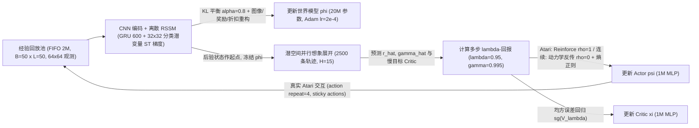

# Mastering Atari with Discrete World Models

**Mastering Atari with Discrete World Models**（**DreamerV2**；Danijar Hafner, Timothy Lillicrap, Mohammad Norouzi, Jimmy Ba，Google Research / DeepMind / University of Toronto，ICLR 2021 / arXiv:2010.02193v4）收录于 [Awesome World-Action Models (RCL)](https://github.com/rcl-robotics/Awesome-World-Action-Models) **第 164/564** 篇，分组 **Foundational work**。本页基于原文全文，系统归纳其离散潜空间世界模型、KL 平衡机制、Atari 55 游戏评测与消融结论。

## 一句话定义

**DreamerV2** 是 [Dreamer（DreamerV1）](paper-rcl-ref-23813a5cbed0b2b6d37e-dream-to-control-learning-behaviors-by-latent-im.md) 的离散表征演进版：通过将 RSSM 随机潜状态由单峰对角高斯替换为 **32×32 分类潜变量（Straight-Through 梯度）** 并引入 **KL 平衡（KL Balancing）** 训练更精准的时序先验，在单张 V100 GPU 上完全于紧凑潜空间想象训练 Actor-Critic，首次实现纯世界模型智能体在 Atari 55 项游戏 200M 步基准上达到人类水平并超越 IQN 与 Rainbow。

## 英文缩写速查

| 缩写 | 英文全称 | 简要说明 |
|------|----------|----------|
| WAM | World Action Model | 世界预测与动作生成耦合 |
| VLA | Vision-Language-Action | 视觉–语言–动作策略 |
| IDM | Inverse Dynamics Model | 先预测未来再反推动作 |
| WM | World Model | 环境前向预测模型 |
| RSSM | Recurrent State-Space Model | 结合 GRU 确定性状态与离散随机潜状态的循环状态空间模型 |
| KL | Kullback–Leibler Divergence | 度量潜空间后验表征与时序先验之间差异的散度项 |
| ST / STE | Straight-Through Estimator | 前向采样 one-hot 离散变量、反向将 softmax 概率梯度直通传回的估计器 |

## 为什么重要

- **打破「视觉世界模型打不过无模型 Atari 强基线」的瓶颈**：在 DreamerV2 之前，像素级世界模型（如 SimPLe）仅在少数游戏或 400k–2M 低数据区有效，而 MuZero 虽强却依赖不公开的大规模工程与 80 个加速器天（单卡需训练超 2 个月）且不含图像表征学习。DreamerV2 用单张 V100 GPU、单环境实例在 **10 天内**跑完 200M 步 Atari，全面超越同期最强单卡无模型智能体 IQN 和 Rainbow。
- **确立离散潜状态与 KL 平衡的通用工程范式**：消融实验证明离散分类潜变量（在 42/55 款游戏上胜出高斯潜变量）和 KL 平衡（在 44/55 款游戏上胜出标准 KL 正则）对捕捉游戏画面突变（新房间切换、道具/敌人消失）和多模态转移至关重要，这一设计被 DreamerV3 及后续具身世界模型广泛沿用。
- **顺着索引入口延伸阅读**：可对照 [Awesome World-Action Models（RCL）](paper-rcl-wam-robot-learning-control-survey.md)、[RCL Awesome WAM 技术地图](../overview/rcl-awesome-wam-technology-map.md) 与前作 [Dreamer](paper-rcl-ref-23813a5cbed0b2b6d37e-dream-to-control-learning-behaviors-by-latent-im.md)。

## 核心信息

| 字段 | 内容 |
|------|------|
| 作者与机构 | Danijar Hafner, Timothy Lillicrap, Mohammad Norouzi, Jimmy Ba（Google Research / DeepMind / University of Toronto） |
| 编号 / 分组 | 164/564 · Foundational work（子类：经典WM与模型式RL） |
| 出处 / 原文 | ICLR 2021 · <https://openreview.net/forum?id=0oabwyZbOu> / arXiv:2010.02193v4 |
| 项目页与代码 | <https://danijar.com/dreamerv2>（论文注明包含源码与 JSON 训练曲线） |
| 模型规模与算力 | 总参数 **22M**（世界模型 20M + Actor 1M + Critic 1M）；单卡 NVIDIA V100 + 单环境实例，<10 天完成 200M 步 |

## 核心机制（归纳）

1. **离散潜状态 RSSM 世界模型（总参数 20M）**：
   - 将 $84\times 84$ 灰度帧下采样至 $64\times 64$，经 CNN + MLP 编码后输入由 GRU（600 隐藏单元）驱动的 RSSM。模型状态拼接确定性循环状态 $h_t = f_\phi(h_{t-1}, z_{t-1}, a_{t-1})$ 与随机潜状态 $z_t$，并同时预测重建图像 $\hat{x}_t$、奖励 $\hat{r}_t$（经 $\tanh$ 变换）与折扣因子 $\hat{\gamma}_t$（伯努利分布估计回合终止概率）。
   - **32×32 分类潜变量（Categorical Latents）**：将 DreamerV1 的对角高斯潜变量替换为 **32 个独立的 32 类分类分布**（展平为长度 1024、恰有 32 个激活位为 1 的稀疏二值向量）。由于多分类分布的混合仍是分类分布（而高斯的混合不再是单峰高斯），模型能更准确表达非平滑与多模态状态跳变；前向采样 one-hot，反向利用 Straight-Through 梯度 `sample + probs - stop_grad(probs)` 传递梯度。
   - 经验池为容量 $2\times 10^6$ 的 FIFO 队列，训练批大小 $B=50$、序列长度 $L=50$，全网采用 ELU 激活。
2. **KL 平衡（KL Balancing，权重 $\alpha=0.8$）**：
   - 在 ELBO 损失（图像对数似然 + 奖励对数似然 + 折扣对数似然 + $\beta\cdot \text{KL}$，Atari 取 $\beta=0.1$，连续控制取 $\beta=1.0$）中，标准 KL 会同时把未训练好的先验拉向后验、又把后验拉向糟糕的先验。
   - DreamerV2 将 KL 拆分为两项并分别施加 `stop_grad`：$\alpha \cdot \text{KL}(\text{sg}(q_\phi) \parallel p_\phi) + (1-\alpha)\cdot \text{KL}(q_\phi \parallel \text{sg}(p_\phi))$（$\alpha=0.8$），迫使时序先验 $p_\phi(z_t|h_t)$ 更快追赶信息更丰富的后验 $q_\phi(z_t|h_t,x_t)$，而非靠增大后验熵来敷衍 KL 正则。
3. **纯潜空间 Actor-Critic 行为学习（单卡并行 2,500 条想象轨迹）**：
   - 训练行为策略时冻结世界模型参数 $\phi$，从经验池真实编码状态出发，仅依靠先验转移模型与策略在紧凑潜空间向前展开视界 $H=15$ 步（200M 环境步期间累计在潜空间想象了 **468B** 个紧凑状态，是真实 50M 动作重复后输入帧的 **10,000×**）。
   - **Critic（1M 参数 MLP）**：基于 $\lambda$-回报 $V_t^\lambda$（$\lambda=0.95,\ \gamma=0.995$）与每 100 步同步的目标网络做时序差分回归，并按累积预测折扣权重软处理回合终止。
   - **Actor（1M 参数 MLP）**：混合无偏但高方差的 Reinforce 梯度（基线为 $v_\xi(\hat{z}_t)$）与低方差但有偏的动力学直通梯度，并叠加策略熵正则 $\eta H[a_t|\hat{z}_t]$。离散 Atari 动作最优配置为纯 Reinforce（$\rho=1,\ \eta=10^{-3}$）；连续控制（如 21 自由度像素 Humanoid）则使用纯动力学反向传播（$\rho=0,\ \eta=10^{-4}\text{ 或 }10^{-5}$）。

### 方法流程图

## 评测与指标

### 1. Atari 55 款游戏 200M 环境步基准（Sticky Actions，Table 1）

论文建议采用 **Clipped Record Mean**（按人类世界纪录归一化并裁剪至 $[0, 1]$ 后求均值），以避免 Gamer Median 忽略近半数零分游戏或 Gamer Mean 被个别极低人类基准游戏（如 Crazy Climber / James Bond / Video Pinball）主导：

| 智能体 | Gamer Median ↑ | Gamer Mean ↑ | Record Mean ↑ | Clipped Record Mean ↑ |
|--------|----------------|--------------|---------------|-----------------------|
| **DreamerV2** | **2.15** | **11.33** | **0.44** | **0.28** |
| **DreamerV2 (schedules)** | **2.64** | 10.45 | 0.43 | **0.28** |
| Rainbow (Dopamine) | 1.47 | 9.12 | 0.17 | 0.17 |
| IQN (Dopamine) | 1.29 | 8.85 | 0.21 | 0.21 |
| C51 (Dopamine) | 1.09 | 7.70 | 0.15 | 0.15 |
| DQN (Dopamine) | 0.65 | 2.84 | 0.12 | 0.12 |

### 2. 关键消融实验（早期版本基线对比，Table 2）

| 消融配置 | Gamer Median | Gamer Mean | Record Mean | Clipped Record Mean | 55 款游戏胜/负/平 |
|----------|--------------|------------|-------------|---------------------|------------------|
| DreamerV2（完整早期基准） | 1.64 | 11.33 | 0.36 | 0.25 | — |
| No Layer Norm | 1.66 | 5.95 | 0.38 | 0.25 | 影响边际 |
| No Reward Gradients（仅图像表征） | 1.68 | 6.18 | 0.37 | 0.24 | 15 胜 / 22 负 / 18 平 |
| **No Discrete Latents（改回高斯）** | **1.08** | 3.71 | 0.24 | **0.19** | 离散 42 胜 / 8 负 / 5 平 |
| **No KL Balancing** | **0.84** | 3.49 | 0.19 | **0.16** | KL 平衡 44 胜 / 6 负 / 5 平 |
| **No Policy Reinforce（仅 ST 反传）** | **0.69** | 2.74 | 0.16 | **0.15** | 纯 ST 仅 5 胜 / 44 负 / 6 平 |
| **No Image Gradients（停图像梯度）** | **0.04** | 0.31 | 0.01 | **0.01** | 停图梯度 3 胜 / 51 负 / 1 平 |

### 3. 连续控制与困难探索扩展（Appendix A & B）

- **纯像素 Humanoid Walk（DMControl，21 维连续动作）**：设 $\rho=0$（纯动力学反向传播）、$\eta=10^{-5}$、$\beta=2$，DreamerV2 从纯像素输入学会了起身站立与持续行走（40M 步内得分逼近 800）。
- **困难探索游戏 Montezuma's Revenge（Appendix B）**：无需任何显式探索奖励（如 ICM），仅将折扣因子调为 $\gamma=0.99$ 后即在 200M 步内取得超越无模型基线、比肩 Rainbow+Curiosity（~2500 分）的表现。

## 与其他工作对比

| 算法 | 奖励建模 | 图像建模 | 潜空间转移 | 单卡 GPU | 可训练参数 | Atari 步数 | 加速器天数 |
|------|----------|----------|------------|----------|------------|------------|------------|
| **DreamerV2（本文）** | ✓ | ✓ | ✓ | ✓ | **22M** | **200M** | **10** |
| SimPLe (Kaiser et al., 2019) | ✓ | ✓ | ✗（像素自回归） | ✓ | 74M | 4M | 40 |
| MuZero | ✓ | ✗（仅价值梯度） | ✓ | ✗ | 40M | 20B | 80 |
| MuZero Reanalyze | ✓ | ✗ | ✓ | ✗ | 40M | 200M | 80 |

- **相比 DreamerV1**：通过分类潜变量、KL 平衡、Atari 改用 Reinforce 策略梯度、模型扩容（13M $\to$ 22M）及策略熵正则替代外部动作噪声，将纯世界模型范式从连续控制推广到高难度离散视觉基准。
- **相比 MuZero**：DreamerV2 依赖图像重构梯度学习与任务奖励解耦的通用环境表征（停掉奖励梯度仍能在多款游戏上取得相近或更好泛化），且无需复杂难并行化的 MCTS 搜索。

## 常见误区或局限

1. **极小像素关键物体损失与重构瓶颈**：在 *Video Pinball* 上 DreamerV2 表现不如无模型基线，论文指出原因在于游戏核心球体仅占单个像素，像素重建 MSE 损失难以迫使潜表征关注此类高语义、低像素面积目标；同时消融显示停掉图像梯度会导致性能崩塌（Clipped Record Mean 降至 0.01）。
2. **离散与连续动作的最优策略梯度估计器并不通用**：Atari 离散动作必须依赖无偏的 Reinforce（$\rho=1$），若只用带偏的 Straight-Through 动力学反传会在 44/55 款游戏上明显退化；而在 21 维连续控制的 Humanoid 上恰恰相反，动力学反传（$\rho=0$）显著优于 Reinforce。
3. **单一超参数与多游戏方差**：后继工作 [Statistical Precipice](paper-rcl-ref-92f666cd9d15e83951cb-deep-reinforcement-learning-at-the-edge-of-the-s.md) 对 Atari 200M 复核指出，DreamerV2 在少运行次数下的聚合分数仍存在一定统计置信区间波动，且个别游戏如 James Bond 的超高均值会显著拉高未裁剪平均分。

## 结论

**DreamerV2 证明了仅凭单张 GPU 与独立训练的离散潜空间世界模型，模型式强化学习即可在最具竞争力的 200M 步 Atari 视觉基准上全面超越强无模型算法。**

1. **用 32×32 分类潜变量取代连续高斯**：稀疏二值多分类表示配合 Straight-Through 梯度能刻画画面突变与多模态转移，在 42/55 款游戏上击败高斯版本（Clipped Record Mean 从 0.19 升至 0.25）。
2. **用 KL 平衡（$\alpha=0.8$）保护表征并加速先验拟合**：重点惩罚固定后验向时序先验的交叉熵而非过早拉扁后验，比传统自由比特或对称 KL 在 44/55 款游戏上胜出。
3. **图像自监督重构提供了可迁移的主体表征信号**：停用奖励梯度仅微调部分任务，但停用图像重建梯度会彻底摧毁策略学习（0.25 $\to$ 0.01）。
4. **按动作空间选择梯度路径**：离散控制优先 Reinforce（$\rho=1$）+ 策略熵正则；连续高维控制（如 21-DoF Humanoid）使用可微分重参数化动力学反传（$\rho=0$）。
5. **评测多任务基准优先看 Clipped Record Mean**：避免被少数极端高分异常游戏或半数零分中位数掩盖算法真实短板。

## 关联页面

- 列表实体：[Awesome World-Action Models（RCL）](paper-rcl-wam-robot-learning-control-survey.md)
- 技术地图：[RCL Awesome WAM 技术地图](../overview/rcl-awesome-wam-technology-map.md)
- 相关基础论文：[Dream to Control (DreamerV1)](paper-rcl-ref-23813a5cbed0b2b6d37e-dream-to-control-learning-behaviors-by-latent-im.md)、[Deep Reinforcement Learning at the Edge of the Statistical Precipice](paper-rcl-ref-92f666cd9d15e83951cb-deep-reinforcement-learning-at-the-edge-of-the-s.md)
- 方法/任务：[generative-world-models.md](../methods/generative-world-models.md)、[manipulation.md](../tasks/manipulation.md)

## 参考来源

- [`sources/papers/rcl_awesome_wam_ref_e1815cc67e6f9fc2bb7e_mastering-atari-with-discrete-world-mode.md`](../../sources/papers/rcl_awesome_wam_ref_e1815cc67e6f9fc2bb7e_mastering-atari-with-discrete-world-mode.md) — 本条目策展摘录
- [`sources/papers/rcl_awesome_wam_catalog.md`](../../sources/papers/rcl_awesome_wam_catalog.md) — 列表总表
- [`sources/repos/awesome-world-action-models-rcl.md`](../../sources/repos/awesome-world-action-models-rcl.md)
- [`docs/PAPERS.md`](https://github.com/RCL-Robotics/Awesome-World-Action-Models/blob/main/docs/PAPERS.md) — 上游论文目录
- 论文：<https://openreview.net/forum?id=0oabwyZbOu>

## 推荐继续阅读

- [Awesome World-Action Models (RCL) 仓库](https://github.com/rcl-robotics/Awesome-World-Action-Models)
- [原文（OpenReview）](https://openreview.net/forum?id=0oabwyZbOu)
- [DreamerV2 项目主页与官方源码](https://danijar.com/dreamerv2)
