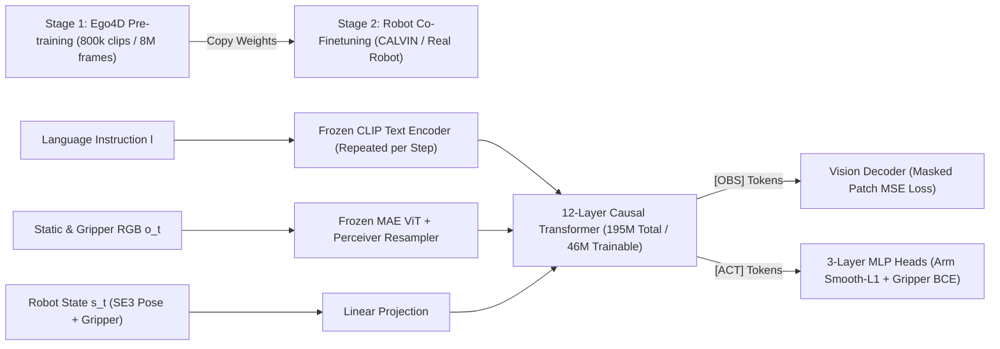

# Unleashing Large-Scale Video Generative Pre-training for Visual Robot Manipul...

**Unleashing Large-Scale Video Generative Pre-training for Visual Robot Manipulation** 收录于 [Awesome World-Action Models (RCL)](https://github.com/rcl-robotics/Awesome-World-Action-Models) **第 510/564** 篇，分组 **WAMs**。本页是 **清单索引**：给出它在清单中的位置与原文入口，方法细节和量化结果请看原文。

## 一句话定义

RCL Awesome WAM 清单收录（WAMs）；细节以原文 PDF / 项目页为准。

## 英文缩写速查

| 缩写 | 英文全称 | 简要说明 |
|------|----------|----------|
| WAM | World Action Model | 世界预测与动作生成耦合 |
| VLA | Vision-Language-Action | 视觉–语言–动作策略 |
| IDM | Inverse Dynamics Model | 先预测未来再反推动作 |
| WM | World Model | 环境前向预测模型 |

## 为什么重要

- RCL Awesome WAM 清单收录（WAMs）；细节以原文 PDF / 项目页为准。
- 想横向对照同一分组的其他工作，可以从 [RCL Awesome WAM 技术地图](../overview/rcl-awesome-wam-technology-map.md) 逐条展开。
- 顺着列表实体 [Awesome World-Action Models](paper-rcl-wam-robot-learning-control-survey.md) 与站内 WAM / VLA 方法页，可以接回对应的学习主线。

## 核心信息

| 字段 | 内容 |
|------|------|
| 编号 | 510/564 |
| 分组 | WAMs |
| 出处 | ICLR 2024 |
| 论文 | <https://proceedings.iclr.cc/paper_files/paper/2024/hash/2c37c5bcef24b9541550261dcd63261b-Abstract-Conference.html> |
| 子类 / 象限 | 联合视频动作建模 · Q1 · One Model × 联合预测 |

## 核心机制（归纳）

> 注：以下机制与评测指标基于通读 ICLR 2024 原文全文核对补充（[ICLR 2024 OpenReview](https://proceedings.iclr.cc/paper_files/paper/2024/hash/2c37c5bcef24b9541550261dcd63261b-Abstract-Conference.html)）。

**GR-1**（ByteDance Research）首次证明：用大规模非机器人第一视角视频生成预训练初始化一个统一的 GPT 风格因果 Transformer，随后在机器人数据上联合预测未来观测帧与动作，能够显著提升多任务长程操作与零样本泛化能力（与 [World Action Models（WAM）](../concepts/world-action-models.md) 联合未来预测与动作生成的思路一脉相承）：

1. **两阶段统一预训练–微调范式（§3.1, §3.3）**：
   - **大规模视频生成预训练**：从 **Ego4D**（超 3,500 小时第一视角人类交互视频）抽取 **800,000** 段 3 秒视频片段（共 **8M 帧**，按 1/3 秒间隔采样），在无动作/状态标签条件下学习语言条件未来帧预测 $\pi_{pt}(l, o_{t-h:t}) \to o_{t+\Delta t}$（$\Delta t=1$），优化像素级 MSE 损失 $\mathcal{L}_{video}$。
   - **机器人数据端到端微调**：无需更换主干网络，输入加入机械臂状态 $s_{t-h:t}$ 与动作查询令牌 `[ACT]`，联合预测未来图像（$\Delta t=3$，同时预测静态视角与腕部视角）与当前控制动作（6-DoF 末端增量/位姿与二值夹爪状态），总损失 $\mathcal{L}_{finetune} = \mathcal{L}_{arm} + \mathcal{L}_{gripper} + \mathcal{L}_{video}$。
2. **多模态输入编码与掩码因果注意力（§3.2, Appendix A.1）**：
   - **编码器（全程冻结）**：语言 $l$ 由冻结 **CLIP** 文本编码器编码并在**每个时间步重复注入**以防止长上下文稀释；视觉图像 $o$ 由冻结 **MAE** 预训练 ViT 提取全局 `[CLS]` 令牌与局部 patch 令牌（局部令牌经 **Perceiver Resampler** 压缩）；机器人状态（$s_{arm} \in SE(3)$ 与 $s_{gripper} \in \{0,1\}$）经线性层映射；同一步内所有模态共享相对时间步嵌入。
   - **主干与令牌排列**：**12 层、12 头、隐藏维 384** 的因果 Transformer（总参数 **195M**，可训练参数 **46M**），序列为 `(l, s_{t-h}, o_{t-h}, [OBS], [ACT], ...)`（输入窗长 10 步），因果掩码规定后续步不能注意前序 `[OBS]` 与 `[ACT]` 令牌。
   - **双解码头**：`[OBS]` 输出经带 mask token 的 Transformer 图像解码器重建未来帧（patch 归一化 MSE）；`[ACT]` 输出经 3 层 MLP 双头分别用 **Smooth-L1** 与 **BCE** 监督连续臂动作和二值夹爪动作。

### 方法流程图

## 评测与指标

- **CALVIN 长程语言操作基准（34 任务，1,000 条 5 步指令链，仅用占全集 1% 的带语言标注轨迹微调；Table 1）**：
  - **`ABCD→D`（全环境已见）**：连续完成 1–5 项任务成功率分别达 **94.9% / 89.6% / 84.4% / 78.9% / 73.1%**，平均完成长度 **Avg. Len. = 4.21**；全面超越使用 100% 含无标注 play 数据的 `HULC`（**88.9% / 73.3% / 58.7% / 47.5% / 38.3%**，Avg. Len. **3.06**）以及 `RT-1`（84.4% / 2.45）、`MT-R3M`（75.2% / 2.08）、`MCIL`（37.3% / 0.40）。
  - **`ABC→D`（零样本未见场景 D）**：1–5 任务连续完成率 **85.4% / 71.2% / 59.6% / 49.7% / 40.1%**，Avg. Len. **3.06**（对比最佳基线 `RT-1` 53.3% / 0.90、`MT-R3M` 52.9% / 0.93、`HULC` 41.8% / 0.67）。
  - **10% 小数据设定（每任务 66 条，共 2,244 条）**：首任务成功率 **77.8%**、Avg. Len. **2.00**（对比 `HULC` 66.8% / 1.11、`MT-R3M` 40.8% / 0.61、`RT-1` 24.9% / 0.34）。
  - **零样本未见语言指令（GPT-4 生成 50 条同义指令/任务）**：首任务 **76.4%**、Avg. Len. **2.17**（对比 `HULC` 71.5% / 1.82、`MT-R3M` 51.2% / 0.92、`RT-1` 49.4% / 0.86）。
- **核心消融（Table 4–5）**：
  - 完整 GR-1（预训练+视频预测）在 `ABCD→D / ABC→D / 10% data` 的 Avg. Len. 为 **4.21 / 3.06 / 2.00**；去掉预训练仅保留视频预测降至 **3.82 / 2.65 / 1.52**；同时去掉预训练与视频预测降至 **3.33 / 2.40 / 1.04**。未来步长 $\Delta t=3$（Avg. Len. 3.82）优于 $\Delta t=1$（3.61）与 $\Delta t=5$（3.67）。
- **真机实验（7-DoF Kinova Gen2 + 腕部 RealSense + 静态 Kinect Azure，Table 2）**：
  - **物体搬运**（1,775 条 HTC Vive 遥操作示教）：`Seen Objects`（含干扰物与背景变更）GR-1 **0.79** vs RT-1 **0.27** vs MT-R3M **0.15**；`Unseen Instances` GR-1 **0.73** vs RT-1 **0.13** vs MT-R3M **0.00**；`Unseen Categories`（未见番茄、黄桃）GR-1 **0.30** vs RT-1 **0.13** vs MT-R3M **0.10**。
  - **铰接物体操作**（开/关抽屉，2,856 条示教）：GR-1 **0.75** vs RT-1 **0.35** vs MT-R3M **0.30**。

## 与其他工作对比

- 本页 **不做** 与具体基线的逐项数值对比；同分组的横向对照请回到 [技术地图](../overview/rcl-awesome-wam-technology-map.md) 的 **WAMs** 分组逐条展开。
- 与先生成完整视频再由独立逆动力学模型（IDM）反推动作的两阶段视频策略（如 UniPi）相比，GR-1 在单一因果 Transformer 中共享主干隐状态同步预测 `[OBS]` 与 `[ACT]`，避免离线像素误差直接阻断实时控制。
- 与仅做静态图像对比表示预训练的 `MT-R3M`（同用 Ego4D 数据）相比，GR-1 的语言条件视频预测预训练在未见场景 `ABC→D` 上将 Avg. Len. 从 0.93 推高至 3.06。

## 结论

**GR-1 验证了“Ego4D 语言条件视频生成预训练 + 统一因果 Transformer 微调”的强迁移效应，仅凭 1% 带语言标注的 CALVIN 数据即可在已见与零样本未见场景下显著刷新长程操作上限。**

- **生成式时序预训练显著优于静态表征**：同源 Ego4D 下，GR-1 在 CALVIN 未见场景 `ABC→D` 取得 85.4%（Avg. Len. 3.06），远超冻结静态表征基线 `MT-R3M`（52.9% / 0.93）。
- **未来视觉预测是有效的辅助训练信号**：即使不经过 Ego4D 预训练，微调阶段保留 `[OBS]` 未来帧预测也能将 `ABCD→D` Avg. Len. 从 3.33 提升至 3.82，且步长 $\Delta t=3$ 在信息增量与局部动作对齐间取得最佳平衡。
- **冻结 CLIP + 重复注入语言令牌保留语义泛化**：面向未见同义指令仍保持 76.4% 首任务成功率（Avg. Len. 2.17），并在真机未见物体实例上达 0.73 成功率。
- **当前边界**：真机跨类别泛化（`Unseen Categories` 0.30）仍易受视觉颜色/外观混淆影响，且尚未使用无语言标签的机器人 play 轨迹参与微调。

## 常见误区或局限

1. **未见类别泛化仍有明显落差**：真机 `Unseen Categories` 成功率为 0.30，论文指出典型失败模式是将未见黄桃/番茄与外观颜色接近的彩椒混淆。
2. **仅利用带语言标签的机器人示教**：与 MCIL/HULC 利用 100% 含无标签 play 数据不同，GR-1 微调依赖带语言标注的 1% 子集，尚未融合海量无标签机器人轨迹。
3. **单步回归式动作头与遮挡预测缺失**：输出端使用 Smooth-L1/BCE 单点回归动作（未建模多模态分布），且重建未来帧中被遮挡物体细节常较模糊，视频输出主要服务于隐状态引导而非高精度物理渲染。

## 关联页面

- 列表实体：[Awesome World-Action Models（RCL）](paper-rcl-wam-robot-learning-control-survey.md)
- 技术地图：[RCL Awesome WAM 技术地图](../overview/rcl-awesome-wam-technology-map.md)
- 方法/任务：[generative-world-models.md](../methods/generative-world-models.md)、[manipulation.md](../tasks/manipulation.md)

## 参考来源

- [`sources/papers/rcl_awesome_wam_ref_e1a2abbaffcea1e2e971_unleashing-large-scale-video-generative.md`](../../sources/papers/rcl_awesome_wam_ref_e1a2abbaffcea1e2e971_unleashing-large-scale-video-generative.md) — 本条目策展摘录
- [`sources/papers/rcl_awesome_wam_catalog.md`](../../sources/papers/rcl_awesome_wam_catalog.md) — 列表总表
- [`sources/repos/awesome-world-action-models-rcl.md`](../../sources/repos/awesome-world-action-models-rcl.md)
- [`docs/PAPERS.md`](https://github.com/RCL-Robotics/Awesome-World-Action-Models/blob/main/docs/PAPERS.md) — 上游论文目录
- 论文：<https://proceedings.iclr.cc/paper_files/paper/2024/hash/2c37c5bcef24b9541550261dcd63261b-Abstract-Conference.html>

## 推荐继续阅读

- [Awesome World-Action Models (RCL) 仓库](https://github.com/rcl-robotics/Awesome-World-Action-Models)
- [原文](https://proceedings.iclr.cc/paper_files/paper/2024/hash/2c37c5bcef24b9541550261dcd63261b-Abstract-Conference.html)
