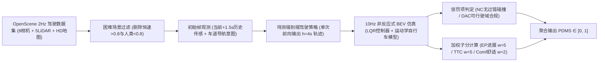

# NAVSIM

**NAVSIM: Data-Driven Non-Reactive Autonomous Vehicle Simulation and Benchmarking** 收录于 [Awesome World-Action Models (RCL)](https://github.com/rcl-robotics/Awesome-World-Action-Models) **第 039/564** 篇，分组 **Benchmarks & simulators**。本页是 **清单索引**：给出它在清单中的位置与原文入口，方法细节和量化结果请看原文。

## 一句话定义

RCL Awesome WAM 清单收录（Benchmarks & simulators）；细节以原文 PDF / 项目页为准。

## 英文缩写速查

| 缩写 | 英文全称 | 简要说明 |
|------|----------|----------|
| WAM | World Action Model | 世界预测与动作生成耦合 |
| VLA | Vision-Language-Action | 视觉–语言–动作策略 |
| IDM | Inverse Dynamics Model | 先预测未来再反推动作 |
| WM | World Model | 环境前向预测模型 |

## 为什么重要

- RCL Awesome WAM 清单收录（Benchmarks & simulators）；细节以原文 PDF / 项目页为准。
- 想横向对照同一分组的其他工作，可以从 [RCL Awesome WAM 技术地图](../overview/rcl-awesome-wam-technology-map.md) 逐条展开。
- 顺着列表实体 [Awesome World-Action Models](paper-rcl-wam-robot-learning-control-survey.md) 与站内 WAM / VLA 方法页，可以接回对应的学习主线。

## 核心信息

| 字段 | 内容 |
|------|------|
| 编号 | 039/564 |
| 分组 | Benchmarks & simulators |
| 出处 | NeurIPS 2024 Datasets and Benchmarks Track |
| 论文 | <https://proceedings.neurips.cc/paper_files/paper/2024/file/32768f7faf1995026ef9821c696f3404-Paper-Datasets_and_Benchmarks_Track.pdf> |
| 子类 / 象限 | 自动驾驶基准 · 评测协议与诊断 · 驾驶仿真 · 不适用 |

## 核心机制（归纳）

> 注：以下机制与评测指标基于通读开放获取原文全文核对补充。

### 问题定位与设计动机

NAVSIM 旨在填补两类传统自动驾驶评测范式之间的空白：一方面，以 nuScenes 为代表的开环基准主要计算位移误差（如 ADE），不仅无法惩罚偏离可行域或无视交互的多模态安全轨迹，还因约 75% 片段为简单直行而使仅输入自车运动状态的“盲”策略（如 AD-MLP）也能刷高分；另一方面，CARLA 等闭环仿真器存在高昂算力开销以及合成传感器渲染与真实世界的域差距。NAVSIM 通过**大规模真实传感器数据 + 困难场景筛选 + 短时域非反应式 BEV 仿真**实现兼具可扩展性与闭环一致性的评测。

### 核心模块与输入/输出流

1. **多模态数据与防泄漏输入接口**：基于 **OpenScene**（nuPlan 的 2Hz 重分发子集，120 小时驾驶数据，存储从 >20 TB 压缩至 2 TB）构建标准输入。策略在初始帧接收 **8 路相机图像（1920 × 1080）**、**5 传感器合并 LiDAR 点云**，以及自车状态（当前速度、加速度与从车道图而非人类终点反推的三分类 one-hot 导航意图 `{left, straight, right}`，防止标签泄漏），可选回溯最多 3 帧历史（共 1.5 s）。输出为未来 `h = 4 s` 的规划轨迹。
2. **困难场景过滤（`navtrain` / `navtest` / `navmini`）**：剔除“恒速直行/保持航向基线即可达到 `PDMS > 0.8`”的平庸帧以及“人类专家轨迹 `PDMS < 0.8`”的标注噪声帧，过滤后恒速基线 PDMS 从 79% 骤降至 22%，人类专家从 91% 升至 95%，形成 `navtrain`（103k）、`navtest`（12k，450 GB）与用于闭环相关性校准的 `navmini`（396 场景）。
3. **非反应式 BEV 仿真与控制器**：仅在场景初始帧查询一次待测策略并固定其 `4 s` 轨迹；在 `10 Hz` 仿真步长下，通过 **LQR 控制器**计算转向与加减速指令，并由**运动学自行车模型**在鸟瞰图（BEV）抽象中推演自车位姿；假设背景交通参与者按数据日志回放且不受自车影响（非反应式）。
4. **PDM Score（PDMS ∈ [0, 1]）评估体系**：
   - **乘法惩罚项**：无过错碰撞 `NC`（与道路使用者碰撞计 `0`，静态障碍物计 `0.5`，自车静止被追尾不判责）与可行驶区域合规 `DAC`（驶出可行驶区计 `0`）。
   - **加权平均项**（权重 `weight_EP = 5`、`weight_TTC = 5`、`weight_C = 2`）：自车进展 `EP`（相对 PDM-Closed 规则规划器安全上界的沿路线进展比值，上界低于 5 m 时忽略）、碰撞时间 `TTC`（4 s 内任一步恒速前推碰撞时间低于阈值则计 `0`）与舒适度 `C`（加速度与加加速度满足阈值）。

### 方法流程图

## 评测与指标

- **数据集与划分**：`navtrain`（103,000 样本）、`navtest`（12,000 样本，用于主基准与 Leaderboard 1.1）、`navmini`（396 个过滤场景，用于在 nuPlan 闭环仿真器中检验开闭环相关性）。
- **闭环对齐验证（`navmini`，对比 nuPlan 闭环分数 CLS `d=15s, f=10Hz`）**：
  - 在 37 个规则规划器（2 恒速、8 恒加速度、15 IDM、12 PDM-Closed）与 114 个学习规划器（Urban Driver、PlanCNN）上，PDMS 的 Spearman 秩相关与 Pearson 线性相关在所有 5 类规划器中均稳定优于传统距离开环分数 `OLS`。
  - 缩短闭环时长（`d=15s` 至 `4s`）、降低控制频率（`10Hz` 至 `2Hz`）或增加 PDMS 推演视野（`h=2s` 至 `8s`）均可提高相关性；将背景交通从日志回放切换为反应式 IDM 智能体对相关性影响很小。
- **`navtest` 主基准对比（Table 1，均为百分比 ↑）**：
  - `Constant Velocity`：`NC=68.0` / `DAC=57.8` / `TTC=50.0` / `Comf.=100` / `EP=19.4` / **`PDMS=20.6`**
  - `Ego Status MLP`（纯运动学盲基线）：`NC=93.0` / `DAC=77.3` / `TTC=83.6` / `Comf.=100` / `EP=62.8` / **`PDMS=65.6`**（显着落后于感知策略，说明 `navtest` 有效克制了盲策略）
  - `UniAD`（BEVFormer + 串行多任务）：`NC=97.8` / `DAC=91.9` / `TTC=92.9` / `Comf.=100` / `EP=78.8` / **`PDMS=83.4`**
  - `LTF`（Latent TransFuser，仅前视相机）：`NC=97.4` / `DAC=92.8` / `TTC=92.4` / `Comf.=100` / `EP=79.0` / **`PDMS=83.8`**
  - `TransFuser`（前视拼接相机 + BEV LiDAR）：`NC=97.7` / `DAC=92.8` / `TTC=92.8` / `Comf.=100` / `EP=79.2` / **`PDMS=84.0`**（单卡 1 天训完，与需 80 卡训 3 天的 `PARA-Drive` 持平）
  - `PARA-Drive`（BEVFormer + 并行辅助头）：`NC=97.9` / `DAC=92.4` / `TTC=93.0` / `Comf.=99.8` / `EP=79.3` / **`PDMS=84.0`**
  - `Human` 上界：`NC=100` / `DAC=100` / `TTC=100` / `Comf.=99.9` / `EP=87.5` / **`PDMS=94.8`**
- **TransFuser 消融与敏感性（Table 2）**：
  - 3 个随机种子 `PDMS = 83.3 / 84.0 / 84.4`（标准差 ±0.56，且确定性策略评测可完全复现）；去掉速度与加速度输入（B1）降为 `81.8`，仅去加速度（B2）降为 `82.3`。
  - 相机视场角：60° 单相机（C1）`80.3`、160° 三相机（C2）`82.8`、240° 五相机（C3）`84.1`；LiDAR 范围缩至全向 16 m（D1）反而跌至 `79.1`（低于无 LiDAR 的 LTF），前向 64 m/侧后 32 m（D2）为 `84.3`；移除 BEV 语义分割辅助监督（E1）降至 `81.6`，移除 3D 检测（E2）仍为 `84.0`。
- **Leaderboard 1.1 与 CVPR 2024 挑战赛（Table 3）**：3 种子均值 `TransFuser 83.9 ± 0.4`、`LTF 83.5 ± 0.6`、`Ego Status MLP 66.4 ± 0.9`；挑战赛（143 队、463 次提交）冠军 **Hydra-MDP**（基于轨迹采样与多目标蒸馏打分）达到 **`PDMS=91.3`**。

## 与其他工作对比

- 本页 **不做** 与具体基线的逐项数值对比；同分组的横向对照请回到 [技术地图](../overview/rcl-awesome-wam-technology-map.md) 的 **Benchmarks & simulators** 分组逐条展开。
- 如果站内已经有这篇的深读页（含机构、实验表与源码运行时序图），请以那一页为准；本页只保留清单要点。
- 与清单内相邻条目孰优孰劣，本页不下结论：清单 Contribution 可能滞后于论文最新版本，差异应以各自原文的问题设定与评测口径为准。

## 结论

**NAVSIM 通过“困难真实场景过滤 + 非反应式短时域 BEV 仿真 + PDM 组合评分”，为端到端自动驾驶提供了比传统开环位移误差更贴近闭环表现、比闭环传感器仿真更易规模化的评测基准。**

- **基准有效性**：剔除平庸帧后，盲基线 `Ego Status MLP` 仅得 `65.6` PDMS，远低于传感策略（`83.4–84.0`）与人类（`94.8`），有效消除了 nuScenes 上的运动学外推捷径。
- **架构性价比结论**：在挑战性场景上，轻量级 `TransFuser`（`84.0`）与纯相机 `LTF`（`83.8`）以极低训练成本即可匹敌高算力 `UniAD`（`83.4`）与 `PARA-Drive`（`84.0`），而采样加评分路线（如 Hydra-MDP `91.3`）潜力突出。
- **边界与局限**：非反应式假设无法评估长时域交互与误差累积，被追尾不判责导致后向感知权重偏低，且未覆盖红绿灯/停车牌等交通规则；开发时建议与 CARLA 等全反应式闭环仿真器互补使用。
- **开源状态**：官方代码与评测套件已开源（<https://github.com/autonomousvision/navsim>），Leaderboard 1.1 托管于 HuggingFace。

## 常见误区

1. 不要把 Awesome 条目的 Contribution 当成完整方法证明——它只是策展导读。
2. 若站内已有这篇的深读页，以那一页为准——本页只是清单入口，不含实验数据。

## 关联页面

- 列表实体：[Awesome World-Action Models（RCL）](paper-rcl-wam-robot-learning-control-survey.md)
- 技术地图：[RCL Awesome WAM 技术地图](../overview/rcl-awesome-wam-technology-map.md)
- 方法/任务：[generative-world-models.md](../methods/generative-world-models.md)、[manipulation.md](../tasks/manipulation.md)
- 下游基准：[PlanContext](paper-plancontext.md) — 在 NAVSIM navtest 场景上固定观测、切换导航意图，评测上下文驾驶决策（arXiv:2611.03067）

## 参考来源

- [`sources/papers/rcl_awesome_wam_ref_e25271fa6f028e5611cf_navsim-data-driven-non-reactive-autonomo.md`](../../sources/papers/rcl_awesome_wam_ref_e25271fa6f028e5611cf_navsim-data-driven-non-reactive-autonomo.md) — 本条目策展摘录
- [`sources/papers/rcl_awesome_wam_catalog.md`](../../sources/papers/rcl_awesome_wam_catalog.md) — 列表总表
- [`sources/repos/awesome-world-action-models-rcl.md`](../../sources/repos/awesome-world-action-models-rcl.md)
- [`docs/PAPERS.md`](https://github.com/RCL-Robotics/Awesome-World-Action-Models/blob/main/docs/PAPERS.md) — 上游论文目录
- 论文：<https://proceedings.neurips.cc/paper_files/paper/2024/file/32768f7faf1995026ef9821c696f3404-Paper-Datasets_and_Benchmarks_Track.pdf>

## 推荐继续阅读

- [Awesome World-Action Models (RCL) 仓库](https://github.com/rcl-robotics/Awesome-World-Action-Models)
- [原文](https://proceedings.neurips.cc/paper_files/paper/2024/file/32768f7faf1995026ef9821c696f3404-Paper-Datasets_and_Benchmarks_Track.pdf)
