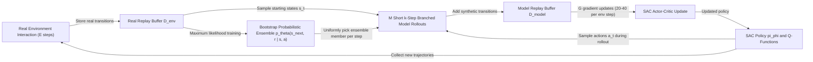

# When to Trust Your Model

**When to Trust Your Model: Model-Based Policy Optimization** 收录于 [Awesome World-Action Models (RCL)](https://github.com/rcl-robotics/Awesome-World-Action-Models) **第 186/564** 篇，分组 **Foundational work**。本页是 **清单索引**：给出它在清单中的位置与原文入口，方法细节和量化结果请看原文。

## 一句话定义

RCL Awesome WAM 清单收录（Foundational work）；细节以原文 PDF / 项目页为准。

## 英文缩写速查

| 缩写 | 英文全称 | 简要说明 |
|------|----------|----------|
| WAM | World Action Model | 世界预测与动作生成耦合 |
| VLA | Vision-Language-Action | 视觉–语言–动作策略 |
| IDM | Inverse Dynamics Model | 先预测未来再反推动作 |
| WM | World Model | 环境前向预测模型 |

## 为什么重要

- RCL Awesome WAM 清单收录（Foundational work）；细节以原文 PDF / 项目页为准。
- 想横向对照同一分组的其他工作，可以从 [RCL Awesome WAM 技术地图](../overview/rcl-awesome-wam-technology-map.md) 逐条展开。
- 顺着列表实体 [Awesome World-Action Models](paper-rcl-wam-robot-learning-control-survey.md) 与站内 WAM / VLA 方法页，可以接回对应的学习主线。

## 核心信息

| 字段 | 内容 |
|------|------|
| 编号 | 186/564 |
| 分组 | Foundational work |
| 出处 | NeurIPS 2019 |
| 论文 | <https://proceedings.neurips.cc/paper_files/paper/2019/hash/5faf461eff3099671ad63c6f3f094f7f-Abstract.html> |
| 子类 / 象限 | 经典WM与模型式RL · 训练优化与蒸馏 · 不适用 |

## 核心机制（归纳）

> 注：以下机制与评测指标基于通读开放获取原文全文核对补充。

### 理论分析：何时信赖模型与分支短展开

**MBPO（Model-Based Policy Optimization）**从理论与实证两方面回答了“在存在模型误差与策略分布偏移时，应如何安全使用学到的动力学模型进行策略优化”：

- **全局模型展开的悲观界（Theorem 4.1）**：真实回报 $\eta[\pi]$ 与模型回报 $\hat{\eta}[\pi]$ 的差距受模型泛化误差 $\epsilon_m$ 与策略偏移 $\epsilon_\pi$ 控制：$C(\epsilon_m, \epsilon_\pi) = \frac{2\gamma r_{\max}(\epsilon_m + 2\epsilon_\pi)}{(1-\gamma)^2} + \frac{4r_{\max}\epsilon_\pi}{1-\gamma}$。由于长轨迹误差按 $(1-\gamma)^{-2}$ 二次累积，直接用完整模型轨迹几乎无法从理论上保证使用模型有收益。
- **分支短展开与实证模型泛化（$k$-branched rollout, Theorem 4.2 & 4.3）**：改为从真实数据采集策略 $\pi_D$ 的状态分布 $d^{\pi_D}(s)$ 出发，仅在模型下按当前策略 $\pi$ 展开 $k$ 步（将**任务视野与模型视野解耦**）。尽管不加泛化假设的 Theorem 4.2 仍给出 $k^* = 0$，但实证测量表明随着真实样本量增大，模型对策略偏移的误差增长率 $\frac{d\epsilon_{m'}}{d\epsilon_\pi}$ 显著下降（模型可泛化至邻近新策略分布）。将线性近似 $\hat{\epsilon}_{m'}(\epsilon_\pi) \approx \epsilon_m + \frac{d\epsilon_{m'}}{d\epsilon_\pi}\epsilon_\pi$ 代入 Theorem 4.3 后，当 $\epsilon_{m'}$ 足够低时最优模型展开长度 $k^* > 0$，从理论上证明了“大量短步分支模型展开”的合理性。

### 实用算法组件与训练管线（Algorithm 2）

- **Bootstrap 概率神经网络集成（Predictive Ensemble）**：由 $B$ 个概率动力学网络 $\{p_\theta^1, \dots, p_\theta^B\}$ 组成，每个成员输出对角高斯分布 $p_\theta^i(s_{t+1}, r \mid s_t, a_t) = \mathcal{N}(\mu_\theta^i(s_t, a_t), \Sigma_\theta^i(s_t, a_t))$ 同时预测下一状态与奖励，分别建模**偶然不确定性（aleatoric）**与**认知不确定性（epistemic）**；模型展开时每步均匀随机抽取一个集成成员以抑制策略对单模型误差的利用（model exploitation）。
- **分支短 rollout 数据扩增 + SAC 策略优化**：
  1. 在真实环境数据集 $\mathcal{D}_{\mathrm{env}}$ 上以最大似然训练集成动力学模型 $p_\theta$；
  2. 每在真实环境交互 $E$ 步收集真实样本存入 $\mathcal{D}_{\mathrm{env}}$，便从 $\mathcal{D}_{\mathrm{env}}$ 均匀采样真实状态 $s_t$，在模型中按当前策略 $\pi_\phi$ 执行 $M$ 次长度为 $k$ 的分支展开，将生成样本存入 $\mathcal{D}_{\mathrm{model}}$；
  3. 使用 **Soft Actor-Critic (SAC)** 在 $\mathcal{D}_{\mathrm{model}}$ 上执行 $G$ 次梯度更新（每步真实采样可稳定执行 $G \in [20, 40]$ 次梯度更新，大幅高于无模型 SAC 的更新频率）。

### 方法流程图

## 评测与指标

- **评测基准与基线**：在 **6 个标准全长（1000 步）MuJoCo 连续控制任务**（不截断任务视野、不假设已知解析奖励或特权信息，5 次随机种子报告均值与标准差）上，对比无模型 SOTA（`SAC`、`PPO`）与基于模型方法（`PETS`、`STEVE`、`SLBO`）。
- **核心量化结果（Fig. 2–4）**：
  - **样本效率与渐近回报（Fig. 2）**：MBPO 在学习速度上比此前无模型方法快最高约一个数量级，同时达到与 `SAC` 相当的渐近性能：
    - **Ant**：MBPO 在 **30 万（300k）步**达到的回报与 `SAC` 在 **300 万（3M）步**持平（**10× 样本效率提升**），而纯基于模型规划的 `PETS` 在高维 Ant 上难以有效学习。
    - **Hopper / Walker2d**：MBPO 达到高效收敛所需的交互步数若按真实实时仿真折算，分别仅等价于 **14 分钟**与 **40 分钟**。
    - 在全长（1000 步）任务上全面超越从初始分布长展开的 `SLBO` 以及价值扩展方法 `STEVE`。
  - **关键消融实验（Fig. 3，Hopper）**：
    - **No model（仅增大 SAC 更新比例 $G$）**：无模型情况下单纯把每步梯度更新次数提升到与 MBPO 相同只能带来边际提速，远逊于 MBPO，证明了模型合成样本的核心作用。
    - **展开长度 $k$**：Hopper 上最优调度为随训练线性从 $k=1$ 增至 $15$；但即使全程固定单步展开 **$k=1$** 也保留了绝大部分增益，构成极难被超越的强基线；模型本身在 Hopper 上 200 步展开虽仍较准确，但用于策略优化效果明显退化，500 步展开则完全失效。
    - **对比价值扩展（H-step MVE）**：将 $H$ 步模型价值扩展与 SAC 结合时同样表现为 $H=1$ 最强；初步实验将 MVE 与 MBPO 模型样本扩增叠加未见进一步收益。
  - **抑制模型利用（Model Exploitation，Fig. 4）**：在 Hopper 上对比同一策略在模型内 rollout 回报与真实环境回报，发现两者高度正相关（模型整体略保守低估真实回报），证实集成动力学 + 短步分支展开有效避免了策略钻模型预测漏洞的现象。

## 与其他工作对比

- 本页 **不做** 与具体基线的逐项数值对比；同分组的横向对照请回到 [技术地图](../overview/rcl-awesome-wam-technology-map.md) 的 **Foundational work** 分组逐条展开。
- 如果站内已经有这篇的深读页（含机构、实验表与源码运行时序图），请以那一页为准；本页只保留清单要点。
- 与清单内相邻条目孰优孰劣，本页不下结论：清单 Contribution 可能滞后于论文最新版本，差异应以各自原文的问题设定与评测口径为准。

## 结论

**MBPO 通过“从真实状态出发的短步分支模型展开 + Bootstrap 概率集成 + SAC 高频更新”，在不牺牲渐近最优性的前提下将连续控制的样本效率提升了一个数量级。**

- **解耦任务视野与模型视野**：无需令模型准确预测完整 1000 步轨迹，短步（甚至 $k=1$）分支展开即可支撑每步 20–40 次稳定梯度更新并大幅抑制误差累积与模型利用。
- **理论与实证衔接**：虽然纯最坏情况界过于保守，但引入实证测得的局部模型泛化斜率后，理论与实验共同指向“随模型数据增多逐步采用适度短步 rollout”。
- **同时兼具效率与高维扩展性**：在 Hopper/Walker2d/Ant 等全长 MuJoCo 任务上超越 `PETS`、`STEVE`、`SLBO` 等早期模型方法并追平 `SAC` 的最终性能。
- **适用边界**：论文假设低维连续状态空间，直接向高维像素观测扩展需要额外表征或潜空间机制；且最佳 rollout 长度调度（如 $1 \to 15$）随环境复杂程度而异。

## 常见误区

1. 不要把 Awesome 条目的 Contribution 当成完整方法证明——它只是策展导读。
2. 若站内已有这篇的深读页，以那一页为准——本页只是清单入口，不含实验数据。

## 关联页面

- 列表实体：[Awesome World-Action Models（RCL）](paper-rcl-wam-robot-learning-control-survey.md)
- 技术地图：[RCL Awesome WAM 技术地图](../overview/rcl-awesome-wam-technology-map.md)
- 方法/任务：[generative-world-models.md](../methods/generative-world-models.md)、[manipulation.md](../tasks/manipulation.md)

## 参考来源

- [`sources/papers/rcl_awesome_wam_ref_e6aba3e8a3ffe044339d_when-to-trust-your-model-model-based-pol.md`](../../sources/papers/rcl_awesome_wam_ref_e6aba3e8a3ffe044339d_when-to-trust-your-model-model-based-pol.md) — 本条目策展摘录
- [`sources/papers/rcl_awesome_wam_catalog.md`](../../sources/papers/rcl_awesome_wam_catalog.md) — 列表总表
- [`sources/repos/awesome-world-action-models-rcl.md`](../../sources/repos/awesome-world-action-models-rcl.md)
- [`docs/PAPERS.md`](https://github.com/RCL-Robotics/Awesome-World-Action-Models/blob/main/docs/PAPERS.md) — 上游论文目录
- 论文：<https://proceedings.neurips.cc/paper_files/paper/2019/hash/5faf461eff3099671ad63c6f3f094f7f-Abstract.html>

## 推荐继续阅读

- [Awesome World-Action Models (RCL) 仓库](https://github.com/rcl-robotics/Awesome-World-Action-Models)
- [原文](https://proceedings.neurips.cc/paper_files/paper/2019/hash/5faf461eff3099671ad63c6f3f094f7f-Abstract.html)
