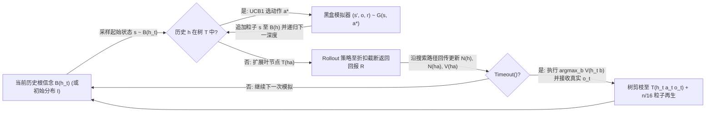

# Monte-Carlo Planning in Large POMDPs

**Monte-Carlo Planning in Large POMDPs**（Joel Veness & David Silver，UNSW & MIT，NeurIPS 2010）收录于 [Awesome World-Action Models (RCL)](https://github.com/rcl-robotics/Awesome-World-Action-Models) **第 169/564** 篇，分组 **Foundational work**。本文提出的 **POMCP** 算法奠定了大规模部分可观测环境在线蒙特卡洛树搜索的经典框架。

## 一句话定义

提出 **POMCP**（Partially Observable Monte-Carlo Planning），将历史树上的 **PO-UCT** 最佳优先蒙特卡洛搜索与**共享模拟粒子的无权重粒子滤波器**结合，仅需状态转移黑盒生成器即可在 $10^{18}$ 至 $10^{56}$ 状态的未分解超大 POMDP 中进行在线规划。

## 英文缩写速查

| 缩写 | 英文全称 | 简要说明 |
|------|----------|----------|
| POMDP | Partially Observable Markov Decision Process | 部分可观测马尔可夫决策过程 |
| POMCP | Partially Observable Monte-Carlo Planning | 本文提出的在线搜索与粒子滤波融合规划器 |
| PO-UCT | Partially Observable UCT | 建于动作–观测历史树上的置信上界树搜索 |
| MCTS | Monte-Carlo Tree Search | 蒙特卡洛树搜索 |
| UCB1 | Upper Confidence Bound 1 | 平衡探索与利用树节点选择的经典赌博机公式 |

## 为什么重要

- **同时打破 POMDP 的「维数灾难」与「历史灾难」**：传统点值迭代规划器（如 PBVI、HSVI、SARSOP）需对 $|S|$ 维显式信念向量做全宽度备份并依赖精确因式分解概率表 $\langle P, R, Z, I\rangle$，状态数上百万即无法运行；POMCP 通过抽样状态与抽样历史将样本复杂度与 $|S|$ 解耦。
- **零显式概率模型需求**：仅需调用黑盒生成式模拟器 $(s', o, r) \sim \mathcal{G}(s, a)$，天然适配复杂物理仿真器或基于学习的[生成式世界模型](../methods/generative-world-models.md)作为规划底座。
- **理论收敛保障与实时任意时间（Anytime）特性**：证明了在真实信念下 PO-UCT 以概率收敛至最优历史价值函数 $V^*(h)$，同时复用同一批搜索轨迹完成粒子信念更新，在真实交互中实现秒级在线决策。

## 核心信息

| 字段 | 内容 |
|------|------|
| 编号 | 169/564 |
| 分组 | Foundational work |
| 出处 | NeurIPS 2010 |
| 作者 | Joel Veness（UNSW）, David Silver（MIT） |
| 论文 | <https://proceedings.neurips.cc/paper/2010/hash/edfbe1afcf9246bb0d40eb4d8027d90f-Abstract.html> |
| 关联源码 | <http://www.cs.ucl.ac.uk/staff/D.Silver/web/Applications.html>（论文提及提供实时演示与源码） |
| 子类 / 象限 | 理论与规划 · 部分可观测树搜索 |

## 核心机制（归纳）

### 1. PO-UCT（历史树搜索）与收敛性

POMCP 为每个可达动作–观测历史 $h$ 维护树节点 $T(h) = \langle N(h), V(h), B(h) \rangle$，分别存储访问次数、平均 Monte-Carlo 回报估计以及经过该节点的模拟状态粒子集 $B(h)$。每次模拟从当前根节点信念 $B(h_t)$（初始为 $I$）抽样一个起始状态 $s$：

- **树内阶段（UCB1 选择）**：当所有子节点均存在时，选择最大化置信上界的动作：
  $$a^* = \arg\max_b \left( V(hb) + c\sqrt{\frac{\log N(h)}{N(hb)}} \right)$$
  实验中探索常数设为 $c = R_{\text{hi}} - R_{\text{lo}}$。
- **树外阶段（Rollout）**：遇到首次访问的历史节点时扩展该节点（每次模拟仅新增 1 个节点），并调用历史策略 $\pi_{\text{rollout}}(h, \cdot)$ 推进至终局或折扣截断步数（$\gamma^{\text{depth}} < \epsilon$，取 $\epsilon=0.01$）。
- **理论结果（Theorem 1）**：通过构建以历史 $h$ 为状态的等价导出 MDP $\tilde{M}$（Lemmas 1–2），证明当信念精确时，PO-UCT 估计值依概率收敛到 $V^*(h)$，且偏差上界为 $O(\log N(h)/N(h))$。

### 2. 共享仿真的无权重粒子滤波与粒子再生（Reinvigoration）

传统贝叶斯信念更新需要枚举状态和观测似然；POMCP 在每次树内模拟 `Simulate(s, h, depth)` 经过历史节点 $h$ 时顺便执行 $B(h) \leftarrow B(h) \cup \{s\}$，用粒子集近似 $\hat{B}(s, h) = \frac{1}{K}\sum_{i=1}^K \delta_{s B_i}$。当真实世界执行最优动作 $a_t$ 并返回观测 $o_t$ 后，直接将树剪枝并切换根节点至 $T(h_t a_t o_t)$，其粒子池 $B(h_t a_t o_t)$ 即为更新后的信念状态。针对大状态空间中可能出现的**粒子匮乏（particle deprivation）**，每次真实交互后额外注入 $n/16$ 个新粒子（$n$ 为搜索模拟次数）：对现有粒子施加领域局部扰动变换，并仅保留与最新真实观测 $o_t$ 一致的粒子。

### 方法流程图

## 工程实践

- **领域先验注入（Preferred Actions $A_p$）**：在不破坏渐近收敛性的前提下，可定义偏好动作集合 $A_p$，并将新节点初始化为 $V_{\text{init}}(ha) = R_{\text{hi}}, N_{\text{init}}(ha) = 10$（对 $a \in A_p$）与 $V_{\text{init}}(ha) = R_{\text{lo}}, N_{\text{init}}(ha) = 0$（其他动作），同时让 Rollout 优先从 $A_p$ 均匀采样，显著压缩早期无效搜索分支。
- **粒子再生变换设计**：由于纯无权重拒绝采样会在长时域或低概率观测下耗尽粒子，工程部署中必须结合具体问题设计保约束的局部状态扰动（如 Battleship 中交换不同尺寸船只位置、PocMan 中随机瞬移 1–2 个幽灵并检验观测一致性）。
- **向世界模型规划（MBRL / WAM）迁移**：当把 $\mathcal{G}(s,a)$ 替换为学得的潜在空间动力学模型时，POMCP 范式允许机器人针对遮挡（部分可观测接触、盲抓取、隐藏物体搜寻）在线生成应急分支规划。

## 评测与指标

### 1. Rocksample 基准对比（Table 1，未分解输入 vs 精确因式分解全宽度规划器）

所有在线算法每步预算 **1 秒**；离线全宽度规划器 **SARSOP** 额外给予约 **1,000 秒**离线计算时间：

| 环境规格 | 状态数 $\|S\|$ | AEMS2 | HSVI-BFS | SARSOP (1000s 离线) | PO-Rollout | **POMCP (1s 在线)** |
|----------|----------------|-------|----------|---------------------|------------|---------------------|
| **Rocksample (7, 8)** | 12,544 | 21.37 ± 0.22 | 21.46 ± 0.22 | 21.39 ± 0.01 | 9.46 ± 0.27 | **20.71 ± 0.21** |
| **Rocksample (11, 11)** | 247,808 | N/A | N/A | 21.56 ± 0.11 | 8.70 ± 0.29 | **20.01 ± 0.23** |
| **Rocksample (15, 15)** | 7,372,800 | N/A | N/A | N/A | 7.56 ± 0.25 | **15.32 ± 0.28** |

注：在 `rocksample(11, 11)` 上，POMCP 仅用 **4 秒**在线搜索即可追平 SARSOP **1,000 秒**离线求解的回报水平。

### 2. 超大规模未分解 POMDP 新基准（Section 5，1000 次实验均值）

- **10×10 海战（Battleship）**：约 **$10^{18}$ 状态**、100 动作、2 观测（$\gamma=1$，每步 -1、全沉 +100）。POMCP 击沉全部 5 艘船所需步数平均比随机策略快 **50 步以上**，比按偏好动作（排除对角相邻格）随机挑选快 **25 步以上**。
- **部分可观测吃豆人（PocMan，$17\times 19$ 迷宫）**：约 **$10^{56}$ 状态**、4 动作、1,024 观测（10 位视觉/听觉/触觉/嗅觉观测位，$\gamma=0.95$）。
  - 使用偏好动作先验：POMCP 平均无折扣回报 **> 300**（对比 PO-Rollout **230**）；
  - 不使用任何领域知识（basic）：POMCP 平均无折扣回报达 **260**（对比 PO-Rollout 仅 **130**）。

## 与其他工作对比

- **对比全宽度点值迭代在线/离线求解器（PBVI / AEMS2 / HSVI-BFS / SARSOP）**：全宽度方法在小尺度、可紧凑因式分解的问题上极精准（Table 1 中 Rocksample (7,8) 略高于 POMCP），但一旦状态达数百万或问题不可分解（Battleship、PocMan）即彻底不可行；POMCP 在不依赖任何因式分解的前提下扩展到 $10^{56}$ 状态。
- **对比早期 Monte-Carlo POMDP 规划（Sparse Sampling / PO-Rollout）**：Kearns 等人的稀疏采样采用固定深度全分支枚举，难以兼顾深视界与低预算；纯 PO-Rollout 没有跨步树记忆；PO-UCT 实现了面向高回报分支的非均匀深度聚焦。
- **站内对照**：可结合 [生成式世界模型](../methods/generative-world-models.md) 与 [RCL Awesome WAM 技术地图](../overview/rcl-awesome-wam-technology-map.md)，对照「经典显式搜索规划」与「神经网络潜空间生成式规划」的设计取舍。

## 结论

**POMCP 证明了只需一个黑盒状态模拟器，将 PO-UCT 历史树搜索与共享仿真粒子的无权重粒子滤波结合，即可在不做因式分解的条件下突破维数与历史灾难，在 $10^{56}$ 状态级别的大规模 POMDP 中实现实时高效规划。**

- **当模型不可解析分解或状态维数爆炸时首选黑盒模拟采样**：放弃构建显式转移矩阵 $P_{ss'}^a$ 与观测矩阵 $Z_{s'o}^a$，直接围绕仿真器接口 $(s', o, r) \sim \mathcal{G}(s, a)$ 设计搜索。
- **必须配套粒子再生（Particle Reinvigoration）防信念退化**：在大空间中，仅靠匹配真实观测 $o_t$ 的模拟粒子往往迅速枯竭，工程上需结合领域对称性或局部噪声在每步后补充约 $n/16$ 个合法粒子。
- **用 $R_{\text{hi}} - R_{\text{lo}}$ 标定 UCB1 探索常数并用偏好动作加速冷启动**：合理先验能大幅减少前期搜索量，且不改变渐近收敛性。
- **评估树搜索收益需对比同粒子滤波底座的 PO-Rollout**：若任务中动作价值差远小于回报方差（如 Battleship），深层树搜索相比单层 PO-Rollout 的边际提升可能有限。

## 常见误区与局限

1. **误区：POMCP 完全无需考虑粒子数量或信念退化**。虽然 Theorem 1 证明了在*真实*信念下 PO-UCT 的渐近收敛性，但有限模拟预算下无权重粒子滤波在长程交互中极易遭遇粒子匮乏（particle deprivation），在连续或极高维观测空间（观测精确匹配概率趋近 0）时尤为严重。
2. **误区：POMCP 在所有规模上都优于精确求解器**。在中小规模且可精确因式分解的问题上（如 `rocksample(7, 8)`），SARSOP、HSVI-BFS 等全宽度规划器仍具备更高的渐近与在线精度上限。
3. **大动作空间与树搜索收益边界**：基础 PO-UCT 要求先展开节点的全部合法动作，面对超大或连续动作空间时分支因子过大；此外在回报方差极高且动作区分度小的环境（如 Battleship），树结构相对 PO-Rollout 带来的提升有限。

## 关联页面

- 列表实体：[Awesome World-Action Models（RCL）](paper-rcl-wam-robot-learning-control-survey.md)
- 技术地图：[RCL Awesome WAM 技术地图](../overview/rcl-awesome-wam-technology-map.md)
- 方法/任务：[generative-world-models.md](../methods/generative-world-models.md)、[vla.md](../methods/vla.md)、[manipulation.md](../tasks/manipulation.md)、[locomotion.md](../tasks/locomotion.md)

## 参考来源

- [`sources/papers/rcl_awesome_wam_ref_f81b18b1d9818e0e2585_monte-carlo-planning-in-large-pomdps.md`](../../sources/papers/rcl_awesome_wam_ref_f81b18b1d9818e0e2585_monte-carlo-planning-in-large-pomdps.md) — 本条目策展摘录
- [`sources/papers/rcl_awesome_wam_catalog.md`](../../sources/papers/rcl_awesome_wam_catalog.md) — 列表总表
- [`sources/repos/awesome-world-action-models-rcl.md`](../../sources/repos/awesome-world-action-models-rcl.md)
- [`docs/PAPERS.md`](https://github.com/RCL-Robotics/Awesome-World-Action-Models/blob/main/docs/PAPERS.md) — 上游论文目录
- 论文：<https://proceedings.neurips.cc/paper/2010/hash/edfbe1afcf9246bb0d40eb4d8027d90f-Abstract.html>

## 推荐继续阅读

- [Awesome World-Action Models (RCL) 仓库](https://github.com/rcl-robotics/Awesome-World-Action-Models)
- [原文（NeurIPS 2010）](https://proceedings.neurips.cc/paper/2010/hash/edfbe1afcf9246bb0d40eb4d8027d90f-Abstract.html)
