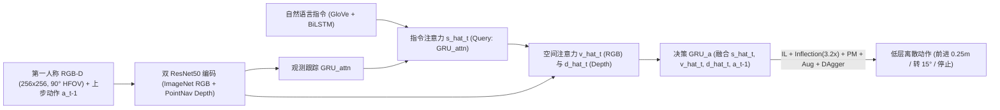

# Beyond the Nav-Graph

**Beyond the Nav-Graph: Vision-and-Language Navigation in Continuous Environments（VLN-CE）** 收录于 [Awesome World-Action Models (RCL)](https://github.com/rcl-robotics/Awesome-World-Action-Models) **第 005/564** 篇，分组 **Benchmarks & simulators（导航基准 / 物理仿真）**。本页基于 ECCV 2020 原文全文（`arXiv:2004.02857v2`）完成结构化精读升级。

## 一句话定义

**VLN-CE** 将传统的离散导航图（nav-graph）视觉语言导航任务 Room-to-Room（R2R）迁移到基于 Habitat 与 Matterport3D 网格的**连续 3D 环境**中，要求智能体仅凭第一人称 RGB-D 感知执行低层离散动作（前进 0.25m / 转向 15° / 停止），从而剥离已知环境拓扑、短程神谕导航与完美定位三项非现实假设。

## 英文缩写速查

| 缩写 | 英文全称 | 简要说明 |
|------|----------|----------|
| VLN-CE | Vision-and-Language Navigation in Continuous Environments | 连续三维环境下的视觉–语言导航任务与数据集 |
| R2R | Room-to-Room | 原始基于 Matterport3D 离散全景图的 VLN 数据集 |
| SPL | Success weighted by inverse Path Length | 路径长度加权成功率（导航核心效率指标） |
| nDTW | Normalized Dynamic-Time Warping | 归一化动态时间规整，衡量轨迹与参考路径形状吻合度 |
| DAgger | Dataset Aggregation | 迭代聚合策略采样轨迹并由专家标注的模仿学习算法 |
| VLA | Vision-Language-Action | 视觉–语言–动作策略 |

## 为什么重要

- **揭露离散导航图 VLN 的“结构先验虚高”**：在离散 R2R 导航图上随机选向直行可达 **16.3%** 成功率，而在连续 VLN-CE 环境中同款随机/手工基线仅 **3% SR**（Table 2）；连续环境中智能体会撞墙卡死、丢失视野且平均动作步长从 4–6 跳暴增至 **55.88 步**（最佳模型均值 **88 步**）。
- **确立连续具身导航的基准信号与训练配方**：首次通过单模态消融证实 **深度（Depth）图是连续环境中避障与起步的必要信号**（缺深度时 SR 跌至 ≤4%），并厘清了 Progress Monitor 单独使用过拟合、需与合成数据增强和 DAgger 微调联合的规律。
- **桥接高层语言导航与低层机器人控制**：为后续将语言导航策略接回真实移动机器人运动控制器或 [World Action Models（WAM）](../concepts/world-action-models.md) 提供了标准的连续仿真测试床，横向对比见 [RCL Awesome WAM 技术地图](../overview/rcl-awesome-wam-technology-map.md)。

## 核心信息

| 字段 | 内容 |
|------|------|
| 编号 | 005/564 |
| 分组 | Benchmarks & simulators |
| 作者与机构 | Jacob Krantz（OSU）、Erik Wijmans（GaTech / FAIR）、Arjun Majumdar（GaTech）、Dhruv Batra（GaTech / FAIR）、Stefan Lee（OSU） |
| 出处 | ECCV 2020 · `arXiv:2004.02857v2` |
| 论文 | <https://www.ecva.net/papers/eccv_2020/papers_ECCV/html/6018_ECCV_2020_paper.php> |
| 项目与代码 | <https://jacobkrantz.github.io/vlnce> · <https://github.com/jacobkrantz/VLN-CE> |
| 子类 / 象限 | 导航基准 · 物理仿真 · 评测协议与诊断 · 已开源（数据集与基线代码） |

## 核心机制（归纳）

> 注：以下机制与评测指标基于通读原文全文（ECCV 2020 / `arXiv:2004.02857v2`）核对补充。

### 1. 连续 3D 设定与 R2R 轨迹转换管线（§3）

- **仿真平台与智能体接口**：基于 **Habitat** 模拟器与 **Matterport3D（MP3D）** 90 个重建室内场景网格，模拟类似 LoCoBot 的地面零转弯半径圆柱体机器人（高 1.5m、直径 0.2m）。智能体无全局位置与朝向输入，仅观测前向 **256×256 RGB-D**（90° 水平视场角），动作空间为 4 项低层控制：`move forward 0.25m`、`turn-left 15°`、`turn-right 15°`、`stop`。
- **航点投影与可通行校验（§3.1–§3.2）**：直接将 MP3D 全景节点投影到最近网格面有 **73%** 失败（落到天花板或桌面）。作者改为从相机节点向下发射最长 2m 射线、在 0.5m 水平位移阈值内寻找最近可站立网格点并人工修正个别节点，成功转换 **98.3%** 节点（仅 3% 需水平微调，均值 0.19m）；再用 A* 启发式寻路验证相邻航点 0.5m 内的连续可达性，保留 **77%** 可通行轨迹，建成 **4,475** 条 R2R 训练/验证轨迹（平均 **55.88 步**，对比 R2R 仅 4–6 跳）。

### 2. 基线架构：Seq2Seq 与跨模态注意力模型（§4.1–§4.2）

- **统一特征编码**：RGB 由 ImageNet 预训练 `ResNet50` 提取空间特征 $V_t$；Depth 由 PointGoal 导航（DD-PPO）预训练 `ResNet50` 提取空间特征 $D_t$；自然语言指令经 GloVe 词嵌入与 LSTM / BiLSTM 编码。
- **Seq2Seq 简单基线（§4.1）**：将均值池化 RGB $\bar{v}_t$、展平深度 $\bar{d}_t$ 与指令终态隐状态 $s$ 拼接送入单层 GRU，直接输出 4 动作分布。
- **Cross-Modal Attention 双循环模型（§4.2）**：
  1. **观测跟踪循环 $\text{GRU}^{(\text{attn})}$**：融合 $\bar{v}_t, \bar{d}_t$ 与上步动作嵌入 $a_{t-1}$ 更新状态 $h_t^{(\text{attn})}$；
  2. **跨模态缩放点积注意力**：以 $h_t^{(\text{attn})}$ 查询 BiLSTM 指令序列 $S$ 得到聚焦指令表征 $\hat{s}_t$，再以 $\hat{s}_t$ 分别对空间 RGB $V_t$ 与 Depth $D_t$ 做空间注意力得到 $\hat{v}_t, \hat{d}_t$；
  3. **决策循环 $\text{GRU}^{(a)}$**：融合 $[\hat{s}_t, \hat{v}_t, \hat{d}_t, a_{t-1}, h_t^{(\text{attn})}]$ 预测当前低层动作。

### 3. 长程模仿学习与增强训练策略（§4.3）

- 针对连续长序列（~55–88 步）导致的动作重复与暴露偏差（exposure bias），引入四项机制：
  1. **拐点加权（Inflection Weighting）**：在动作切换步（$a_{t-1} \neq a_t$）施加 **3.2×** 损失权重；
  2. **DAgger（Dataset Aggregation）**：按 $\beta = 0.75^n$ 概率采样专家最短路动作（每轮采集 5,000 条轨迹聚合微调 4 epoch）；
  3. **反向翻译合成数据增强（Back-Translation）**：将 Tan et al. 的约 **150k** 条合成导航轨迹转换到 VLN-CE；
  4. **进度监控（Progress Monitor, PM）**：以 MSE 辅助损失监督智能体预测当前所处轨迹进度比例。

### 方法流程图

## 评测与指标

- **无学习与单模态消融（Val-Unseen，Table 2）**：
  - **无学习基线**：按训练集动作分布随机采样（68% 前进 / 15% 左转 / 15% 右转 / 2% 停止）与手工策略（随机朝向走 37 步）均仅获 **3% SR / 0.02 SPL**（nDTW 0.30）。
  - **Seq2Seq 模态消融**：完整 RGB-D + 指令为 **20% SR / 0.18 SPL**（NE 8.94m, nDTW 0.43, OS 0.25）；去除 RGB（`No Image`）降至 **17% SR / 0.15 SPL**；去除指令（`No Instruction`）为 **17% SR / 0.16 SPL**；**去除深度（`No Depth`）暴跌至 4% SR / 0.04 SPL**；完全无视觉（`No Vision`）为 **0% SR / 0.00 SPL**。
- **架构与训练增强对比（Val-Unseen，Table 3）**：
  - `Seq2Seq`：基础模仿学习 **20% SR / 0.18 SPL**；+DAgger 升至 **26% SR / 0.23 SPL**；+PM+DA*+Aug 为 **25% SR / 0.22 SPL**。
  - `Cross-Modal Attention`：基础模仿学习 **23% SR / 0.22 SPL**；单独加 PM 或单独加 Aug 均略降至 **21% SR / 0.19 SPL**（PM 无增强时在 Val-Unseen 严重过拟合：损失 **0.67** vs 加 Aug 后 **0.47**）；仅加 DAgger 达 **27% SR / 0.25 SPL**；**联合预训练 PM+Aug 后用 DAgger 微调（`PM+DA*+Aug`）达到最佳 32% SR / 0.30 SPL**（Val-Seen **37% SR / 0.35 SPL**，Val-Unseen TL 8.64m, NE 7.37m, nDTW 0.51, OS 0.40）。
- **回传离散 VLN 排行榜对比（Table 4）**：
  - 将最佳 `Cross-Modal (PM+DA*+Aug)` 连续轨迹贴合回 VLN 导航图后，Test 集仅得 **24% SR / 0.21 SPL**（Val-Unseen **22% SR / 0.20 SPL**），远低于依赖导航图训练推理的 `RCM`（**43% SR / 0.38 SPL**）与 `Back-Translation`（**51% SR / 0.47 SPL**），即便扣除约 10 SPL 的路径贴合与 20% 不可通行轨迹误差后仍有巨大鸿沟。

## 与其他工作对比

- 本页 **不做** 与具体基线的逐项数值对比；同分组的横向对照请回到 [技术地图](../overview/rcl-awesome-wam-technology-map.md) 的 **Benchmarks & simulators** 分组逐条展开。
- 如果站内已经有这篇的深读页（含机构、实验表与源码运行时序图），请以那一页为准；本页基于原文补全核心机制与评测数字。
- 与清单内相邻条目孰优孰劣，本页不下结论：清单 Contribution 可能滞后于论文最新版本，差异应以各自原文的问题设定与评测口径为准。

## 结论

**VLN-CE 揭示了基于稀疏全景图“瞬移”的传统 VLN 存在严重的导航图先验膨胀，确立了连续 3D 环境下的低层视觉语言导航基准，并证明深度感知、跨模态时空注意力与“增强+进度监控预训练+DAgger 微调”组合是克服长程连续控制困难的关键。**

- **深度图是连续导航的基石信号**：缺少深度图时基线几乎无法避障起步（SR 从 20% 跌至 4%），而 RGB 主要用于锚定指令中的语义参照物（缺 RGB 时仅靠深度+路径规律仍有 17% SR）。
- **跨模态注意力全配置稳定优于 Seq2Seq**：在所有训练配方下均带来 +0.04 至 +0.08 SPL（22%–36% 相对提升）的一致增益。
- **训练技巧在长程连续环境下存在强耦合**：单独加入 Progress Monitor 或合成数据增强反而掉点，必须先用 PM + 数据增强联合预训练抑制过拟合，再以 DAgger 交互微调缓解暴露偏差，才能将 Val-Unseen SR 推升至 32%。
- **开源与研究边界**：代码、转换后的 4,475 条轨迹与基线模型已开源于 <https://github.com/jacobkrantz/VLN-CE>；当前端到端从前向 90° RGB-D 直接映射低层动作仍常因视野受限或卡滞而失败，亟需分层规划或局部地图记忆模块的介入。

## 常见误区或局限

1. **误将离散 VLN 分数直接等价于真实机器人能力**：论文通过双向对比证明离散 VLN 的高分高度依赖已知拓扑、跨障碍瞬移和全局精确定位，脱离导航图后同架构性能大幅回落。
2. **约 23% 原 R2R 轨迹在连续网格中物理不可行**：主要源于 1.7% 无法合法投影的节点、MP3D 重建网格空洞，以及全景拍摄间隙椅子移动或关门造成的路径断裂（§3.1, §5.3）。
3. **窄视场（90° HFOV）与端到端低层策略局限**：无主动环视与局部拓扑记忆的端到端 GRU 策略在遇到「左转进入走廊」等不确定转角步数或目标处于视野外时极易失败；作者在 §6 指出未来应探索分层调用底层运动控制器的模块化方案。
4. **注意跨设定直接比较的换算误差**：将连续路径回贴到稀疏全景节点（§5.3, Fig. 6）会产生之字形震荡并造成约 10 SPL 折损，对比 VLN 与 VLN-CE 绝对数值时须扣除该换算偏差。

## 关联页面

- 列表实体：[Awesome World-Action Models（RCL）](paper-rcl-wam-robot-learning-control-survey.md)
- 技术地图：[RCL Awesome WAM 技术地图](../overview/rcl-awesome-wam-technology-map.md)
- 方法/任务：[generative-world-models.md](../methods/generative-world-models.md)、[manipulation.md](../tasks/manipulation.md)

## 参考来源

- [`sources/papers/rcl_awesome_wam_ref_f851fa79e6baee5a919e_beyond-the-nav-graph-vision-and-language.md`](../../sources/papers/rcl_awesome_wam_ref_f851fa79e6baee5a919e_beyond-the-nav-graph-vision-and-language.md) — 本条目策展摘录
- [`sources/papers/rcl_awesome_wam_catalog.md`](../../sources/papers/rcl_awesome_wam_catalog.md) — 列表总表
- [`sources/repos/awesome-world-action-models-rcl.md`](../../sources/repos/awesome-world-action-models-rcl.md)
- [`docs/PAPERS.md`](https://github.com/RCL-Robotics/Awesome-World-Action-Models/blob/main/docs/PAPERS.md) — 上游论文目录
- 论文：<https://www.ecva.net/papers/eccv_2020/papers_ECCV/html/6018_ECCV_2020_paper.php>

## 推荐继续阅读

- [Awesome World-Action Models (RCL) 仓库](https://github.com/rcl-robotics/Awesome-World-Action-Models)
- [原文](https://www.ecva.net/papers/eccv_2020/papers_ECCV/html/6018_ECCV_2020_paper.php)
