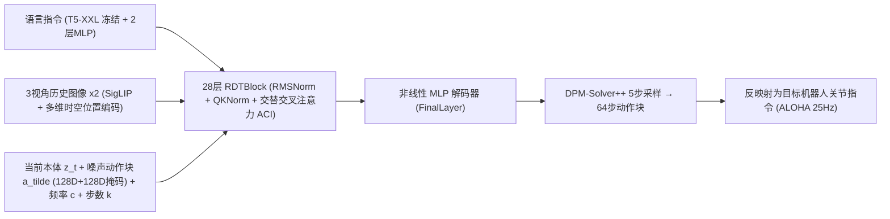
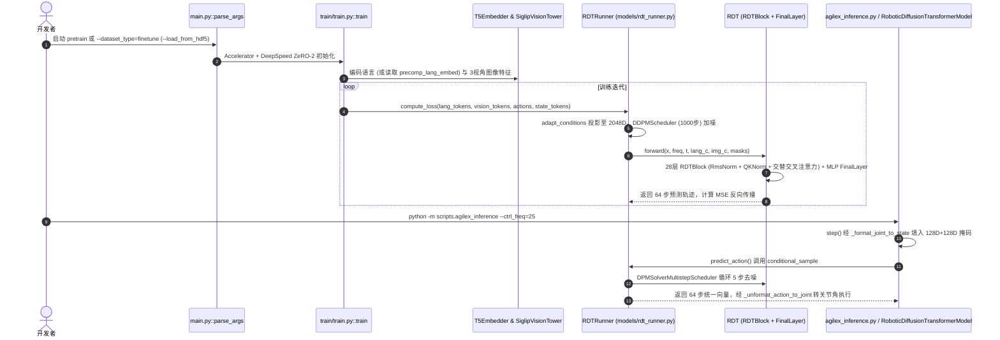

# RDT-1B（Robotics Diffusion Transformer）

**RDT-1B**（*RDT-1B: a Diffusion Foundation Model for Bimanual Manipulation*，ICLR 2025，[arXiv:2410.07864](https://arxiv.org/abs/2410.07864)，[项目页](https://rdt-robotics.github.io/rdt-robotics/)，[代码](https://github.com/thu-ml/RoboticsDiffusionTransformer)，[HF rdt-1b](https://huggingface.co/robotics-diffusion-transformer/rdt-1b)）由 **清华大学**（THBI Lab / 人工智能研究院）等提出。工作旨在解决双臂操作“动作多模态分布强”与“双臂真机数据极度稀缺”的双重瓶颈，构建了当时参数量最大的 **1.2B 扩散基础策略模型**。对应学习路径见 [扩散与流匹配纵深路线](../../roadmap/depth-robotics-diffusion-dit-flow.md) 第 ③ 步。

## 一句话定义

**通过物理可解释的 128 维统一动作空间整合百万级跨本体多机器人预训练数据，并用经过 QKNorm、RMSNorm 与交替条件注入改造的 1.2B 扩散 Transformer 生成 64 步双臂连续动作块。**

## 英文缩写速查

| 缩写 | 英文全称 | 简要说明 |
|------|----------|----------|
| RDT | Robotics Diffusion Transformer | 本文提出的 1.2B / 170M 扩散操作基础模型 |
| ACI | Alternating Condition Injection | 跨层交替注入图像与文本跨注意力条件，防模态淹没 |
| VLA | Vision-Language-Action | 视觉–语言–动作多模态策略 |
| DP | Diffusion Policy | 连续动作块扩散生成基础范式 |
| EEF | End-Effector | 机械臂末端执行器 |
| T5-XXL | Text-to-Text Transfer Transformer (XXL) | 本文使用的 4096D 冻结语言编码器 |
| SigLIP | Sigmoid Loss for Language Image Pre-Training | 本文使用的 384×384 冻结视觉编码器 |

## 为什么重要

- **跨本体预训练赋能双臂稀缺领域：** 双臂真机示范采集成本远高于单臂，RDT-1B 验证了用统一物理量纲空间吸纳以单臂为主的 **46 个开源数据集（1M+ 轨迹、21TB）**，能使目标 ALOHA 双臂总体成功率相对从零训练提升 **+33.4%**（68.2% vs 34.8%）。
- **证明离散化与小模型在灵巧双臂任务中的失效：** 在包含强多模态和精细角度控制的 7 项 ALOHA 真机测试中，1.2B 扩散模型显著拉开了与离散动作 VLM（OpenVLA 1.7%）、小容量扩散头（Octo 1.6%）和单任务 CVAE（ACT 12.2%）的差距。
- **揭示大模型做机器人时序扩散的结构稳定性法则：** 明确给出了原始 DiT 在处理带噪物理极值时崩溃的原因，并用 **QKNorm + RMSNorm + MLP 解码器 + 交替条件注入** 构建出稳定预训练 1M 步的大型扩散骨干。

## 核心原理

### 核心信息

| 项 | 内容 |
|----|------|
| **机构** | 清华大学（THBI Lab、计算机系、AI 研究院） |
| **出处** | ICLR 2025 · arXiv:2410.07864v2 |
| **模型规模** | **RDT-1B**（1.2B 参数：28 层、2048 维、32 头）；另有开源 **RDT-170M** 轻量版 |
| **多模态输入** | 冻结 **T5-XXL** 文本嵌入 + 最多 **3 视角 RGB**（$T_{\text{img}}=2$，$384\times 384$，冻结 SigLIP）+ 当前本体 $z_t$ + 控制频率 $c$ |
| **输出与频率** | **64 步（$T_a=64$）** 统一动作块；DPM-Solver++ **5 步**采样在板载 RTX 4090 上达 **6 chunks/s（381 actions/s）** |
| **数据与算力** | 预训练 46 数据集 1M+ 轨迹（48× H100 80GB 训 1M 步）；微调自采 **6K+ ALOHA 轨迹 / 300+ 任务**（取 500K 预训练 ckpt 微调 130K 步） |
| **开源** | **全栈 MIT 开源** — 代码、`rdt-1b` / `rdt-170m` 权重与 `rdt-ft-data` 微调数据集 |

### 核心设计

1. **物理可解释统一动作空间（128D + 128D 可用性掩码）：**
   - 将异构机器人的关节位置/速度、夹爪、末端 3D 位置/6D 姿态/线角速度及底盘速度统一填入 128 维向量固定槽位（单臂默认映射到右臂槽位），保留国际单位制（m、rad、m/s、rad/s）而非强行按数据集缩放到 `[-1, 1]`，以传递共同物理规律；
   - 为区分“速度为 0 的静止”与“当前本体缺失的自由度填充值 0”，将 128D 物理向量与 128D `0/1` 可用性指示掩码拼接成 **256 维向量**，经 3 层 MLP 映射至 2048 维隐藏空间。
2. **反低维捷径与模态均衡掩码：** 为阻止网络偷懒靠历史本体状态记忆轨迹，仅输入当前帧本体 $z_t$（排除 $z_{i<t}$）迫使决策依据高维视觉；训练时对文本、图像、本体与历史帧各以 **10% 概率独立掩码**，防止外视相机压制腕部相机。
3. **DiT 面向机器人物理量的三项关键改造：**
   - **QKNorm + RMSNorm：** 在注意力层加入 QKNorm 防止大数值范围与传感器毛刺引起注意力溢出，并用不带中心化的 **RMSNorm** 替代 LayerNorm，防止破坏机器人时间序列对称性（Fig. 4a 显示去掉二者将在 60K 步内损失发散）；
   - **非线性 MLP 解码器：** 用带非线性激活的 MLP 解码器替代原始线性头（Fig. 4b 显示去掉 MLP 使摇杆控制机器狗等精细任务成功率由 `32%` 骤降至 `12%`）；
   - **交替条件注入（ACI）：** 由于图像时空特征（含多视角多维网格位置编码）词元数远多于文本词元，同层交叉注意力易淹没语言指令；RDT 在偶数/奇数块间交替注入文本和图像特征（Fig. 4b：Pour Water-L-1/3 指令准确率去掉 ACI 由 `62.5%` 跌至 `12.5%`）。
4. **调度与采样实践：** 训练采用 1000 步 DDPM（`squaredcos_cap_v2` 余弦调度）；微调发现启用 Classifier-Free Guidance（CFG）反而导致真机机械臂动作不稳定，因此最终禁用 CFG；部署改用 **DPM-Solver++ 5 步**求解器实现实时高频推理。

### 流程总览

## 评测与实验对比

基于 `arXiv:2410.07864v2`（ICLR 2025 全文）与官方仓库实测数据：

- **总体跨维度对比（Fig. 1，ALOHA 真机 7 大类挑战任务综合均分）：** **RDT-1B 68.2%** vs `RDT (scratch)` **34.8%**（跨本体预训练带来 **+33.4%** 净提升） vs ACT **12.2%** vs OpenVLA **1.7%** vs Octo **1.6%**。
- **7 项 ALOHA 真机分项成功率（Table 3）：**
  - **未见物体（Wash Cup, 24 trials）：** Seen/Unseen1/Unseen2 完整任务成功率分别为 **50% / 75% / 50%**（其余基线包括 `RDT scratch`、ACT、OpenVLA、Octo 在全流程均为 **0%**）；
  - **未见场景（Pour Water, 24 trials）：** 3 个未见房间完整任务分别达 **62.5% / 100% / 62.5%**（vs `RDT scratch` `25% / 75% / 25%`）；
  - **未见指令组合（Pour Water-L-1/3 | R-2/3）：** 训练仅见过 `little/half/full` 词汇，测试指定左右手及 `1/3`、`2/3` 水量仍获 **100% / 87.5%**（对准手别 `100%`、对准水量 `75%`），OpenVLA 与 Octo 在全流程均为 **0%**；
  - **少样本新技能：** **Fold Shorts (1-shot)** 达 **68%**（vs `RDT scratch` 40%、Octo 4%）；**Handover (5-shot)** 达 **40%**（vs `RDT scratch` 16%、ACT/OpenVLA/Octo 均 `0%`）；
  - **灵巧操纵（Robot Dog 摇杆直行）：** 遥控成功推杆 **76%**、机器狗走直线 **48%**（vs ACT `32% / 32%`、`RDT scratch` `64% / 32%`）。
- **核心消融（Table 2，Unseen Object / Unseen Scene / Instruction Following）：**
  - **完整 RDT-1B：** `50% / 62.5% / 100%`；
  - **去扩散改回归 `RDT (regress)`：** 暴跌至 `12.5% / 50% / 12.5%`，证实扩散多模态分布建模不可或缺；
  - **缩减参数量 `RDT (small, 166M)`：** 降至 `37.5% / 62.5% / 25%`；
  - **无预训练 `RDT (scratch)`：** 降至 `0% / 25% / 62.5%`。
- **仿真补充基准（官方仓 README）：** 在 ManiSkill 5 任务（250 trials，关节位置控制）平均达 **53.6 ± 0.52%**（vs Diffusion Policy 30.2%、OpenVLA 4.8%、Octo 0.0%）；在 RoboTwin 2.0 榜单（50 双臂任务）仅次于 [π₀](./paper-pi0.md)（不计用真实点云的 DP3）。

## 与其他工作对比

| 维度 | RDT-1B（本文） | [DiT-Block Policy](./paper-robotic-dit-ingredients-dit-block-policy.md) | [Dita](./paper-dita-scaling-diffusion-transformer-vla.md) | [π₀](./paper-pi0.md) |
|------|----------------|-----------------------------------------------------------------------|---------------------------------------------------------|----------------------|
| 核心动作表示 | **128D+掩码统一空间**, 64 步扩散 | 单机器人动作块，100 步 DDPM / 8–10 步 DDIM | 7D 末端执行器，因果 Transformer in-context 扩散 | 跨本体，PaliGemma + 流匹配专家 |
| 参数与骨干 | **1.2B**（28 层，QKNorm+RMSNorm+ACI） | ~115M（adaLN-Zero 解码器） | 334M（12 层 LLaMA2 + Q-Former） | 3.3B（PaliGemma 3B + 300M 专家） |
| 预训练规模 | **46 数据集, 1M+ 轨迹 (21TB)** | BiPlay ~7k play clips + 任务数据 | OXE 跨本体集合 | OXE + 自研 10K 小时数据 |
| 主战场景 | **双臂灵巧操作**与跨形态统一适配 | 长时域双臂/单臂算法配方验证 | 单第三视角通才 VLA 迁移 | 高频双臂与通用灵巧流控制 |

## 结论

**RDT-1B 证明“百万级多机器人预训练 + 1.2B 稳定改造的扩散 Transformer + 物理可解释统一动作空间”能够大幅突破双臂模仿学习在少样本、未见对象与精细操纵上的瓶颈。**

- **扩散、大模型与大数据缺一不可：** 消融表清晰显示，把扩散换为回归（`100% → 12.5%`）、把 1.2B 缩为 166M（`100% → 25%`）或拿掉预训练（`50% → 0%` 未见物体）都会造成能力崩塌。
- **跨本体不该随意把物理量归一化到 `[-1, 1]`：** 保持国际单位制物理含义并辅以 0-1 可用性掩码，是单臂海量数据迁移至双臂目标平台的前提。
- **工程调优重心在“冻结大编码器 + 仅训去噪主干”：** 离线预计算 T5-XXL 语言嵌入（`scripts/encode_lang.py`）和选用 `rdt-170m` 可大幅降低单卡微调门槛。
- **注意评估微调起点：** 论文正文实际使用 **500K 步预训练权重** 微调 130K 步，而 Hugging Face 上同时开源了 1M 步 `rdt-1b` 与 500K 步 `rdt-170m`。

## 源码运行时序图

节点直接对齐 `thu-ml/RoboticsDiffusionTransformer` 的 `main.py`、`train/train.py`、`models/rdt_runner.py`、`models/rdt/model.py`、`models/rdt/blocks.py` 与 `scripts/agilex_inference.py` / `agilex_model.py`：

## 工程实践

| 实践项 | 仓库实现细节与建议 |
|--------|--------------------|
| 预训练 I/O 优化 | 针对 OXE 海量 TFRecord 数据内存洗牌瓶颈，采用 TFRecord 生产者解压写硬盘缓存 + PyTorch 消费者乱序读取的双进程架构（`VLAConsumerDataset`，需预留 >= 400GB `buf_path`）。 |
| 微调数据与步数 | 私有机器人数据采用 HDF5（`--load_from_hdf5`）与 `configs/base.yaml`；README 建议不论 batch 大小至少训练 **150K 步**，通过观察采样验证指标 `overall_avg_sample_mse` 收敛（过低则防过拟合）判断停训。 |
| 显存受限微调路径 | 1）使用 `--precomp_lang_embed` 提前通过 `scripts/encode_lang_batch.py` 缓存 4096D T5-XXL 特征以卸载大模型；2）启用 DeepSpeed ZeRO-2 / ZeRO-3 offload 与 `--use_8bit_adam`；3）VRAM 紧张时优先试跑 **RDT-170M**。 |
| 真机适配要点 | 继承或修改 `scripts/agilex_model.py` 中 `RoboticDiffusionTransformerModel` 的 `_format_joint_to_state` 和 `_unformat_action_to_joint`，务必保持图像输入顺序为 `[ext_{t-1}, right_{t-1}, left_{t-1}, ext_t, right_t, left_t]`，可开启 `--use_actions_interpolation` 平滑 25 Hz 执行。 |

## 局限与风险

- **算力与数据极度重型：** 从头预训练需 48× H100 80GB 约 1 个月及 400GB+ 磁盘缓存；即便冻结 T5-XXL（约 11B 级文本模型体量）在端侧机载 GPU 仍常需提前离线编码语言向量。
- **微调禁用 CFG 与真机超速风险：** 附录 F 明确指出启用 CFG 会引发机械臂动作剧烈不稳定，工程部署应保持无 CFG 配置并加装速度限幅与急停保护。
- **仅覆盖双臂与静态底盘任务：** 虽然设计了底盘速度槽位（索引 `100–102`），但论文微调与真机评估中的 Mobile ALOHA 主要作为可移动测试台架使用，并未系统评测自主移动导航与全身双足协调控制。

## 与其他页面的关联

- [Diffusion Policy 方法页](../methods/diffusion-policy.md) — RDT 动作分布生成与块预测的理论基础
- [VLA 视觉语言动作模型](../methods/vla.md) — 跨本体与语言条件具身基础模型谱系
- [Action Chunking](../methods/action-chunking.md) — $T_a=64$ 长块预测减少误差累积的设计依据
- [双臂操作任务（Bimanual Manipulation）](../tasks/bimanual-manipulation.md) 与 [操作任务（Manipulation）](../tasks/manipulation.md) — RDT-1B 的主攻场景与真机基准
- [DiT-Block Policy](./paper-robotic-dit-ingredients-dit-block-policy.md) — 同阶段对比不同条件注入机制（adaLN-Zero vs 交替交叉注意力）的代表工作
- [Dita](./paper-dita-scaling-diffusion-transformer-vla.md) — 同时期探索因果 Transformer 扩散 VLA 的路线对比
- [π₀](./paper-pi0.md) — 采用 PaliGemma + Flow Matching 方案的跨本体双臂基座模型
- [扩散与流匹配纵深路线](../../roadmap/depth-robotics-diffusion-dit-flow.md) — 本页在路线中承担的“大规模 DiT 跨本体扩散基座”角色

## 参考来源

- [rdt_1b_arxiv_2410_07864.md](../../sources/papers/rdt_1b_arxiv_2410_07864.md) — ICLR 2025 终稿全文（28 页）通读与实验/消融详情归档
- [thu_ml_robotics_diffusion_transformer.md](../../sources/repos/thu_ml_robotics_diffusion_transformer.md) — 官方代码仓核心模块与 ManiSkill/RoboTwin 结果核对
- [rdt-robotics-github-io.md](../../sources/sites/rdt-robotics-github-io.md) — 官方项目页内容核对
- [wechat_lumina_vla_survey_part1_2026-09-20.md](../../sources/blogs/wechat_lumina_vla_survey_part1_2026-09-20.md)

## 推荐继续阅读

- [论文 PDF（arXiv:2410.07864v2, ICLR 2025）](https://arxiv.org/abs/2410.07864)
- [官方代码仓（thu-ml/RoboticsDiffusionTransformer）](https://github.com/thu-ml/RoboticsDiffusionTransformer)
- [Hugging Face 模型权重（rdt-1b）](https://huggingface.co/robotics-diffusion-transformer/rdt-1b) · [微调数据集（rdt-ft-data）](https://huggingface.co/datasets/robotics-diffusion-transformer/rdt-ft-data)
