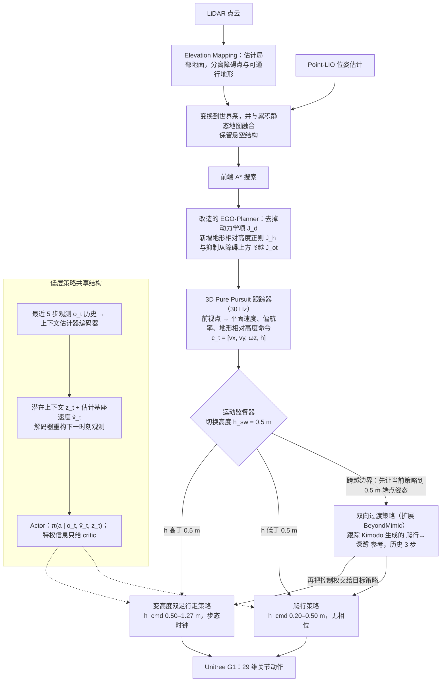

# REACH：面向可适应狭窄空间穿越的分层强化学习人形爬行框架

**REACH**（*REACH: An RL-based Hierarchical Humanoid Crawling Framework for Adaptable Confined Space Traversal*，[arXiv:2610.36546](https://arxiv.org/abs/2610.36546)）收录于 senlanke「具身运控lab」10-26–10-30 前沿论文动态（人形/四足）。本页依据**周报条目 + arXiv 摘要页**整理，未逐页核对正文 PDF；指标与结论以论文为准。

## 一句话定义

**REACH：面向可适应狭窄空间穿越的分层强化学习人形爬行框架——分别训练变高度双足策略和爬行策略，以历史条件 latent 编码接触及地形信息；双向转换策略连接两种模式，激光雷达规划器进一步生成三维路径、速度和主动高度指令。**

## 英文缩写速查

| 缩写 | 英文全称 | 简要说明 |
|------|----------|----------|
| RL | Reinforcement Learning | 强化学习 |
| WBC | Whole-Body Control | 全身控制 |

## 为什么重要

- 周报所述待解决的问题：仅降低双足行走高度仍无法穿越极低空间，而且行走与爬行之间存在较大的姿态和接触模式突变。

## 流程总览

图依据：论文 §III-A（共享 actor-critic 与历史条件潜变量）、§III-B（双向过渡）、§IV-A/B/C（感知规划与路径到策略接口）、Fig. 2。

## 核心机制

| 项 | 内容 |
|----|------|
| **arXiv** | [2610.36546](https://arxiv.org/abs/2610.36546) · [PDF](https://arxiv.org/pdf/2610.36546) |
| **作者（arXiv）** | Xu, Shengzhang, Guo, Yuning, Hu, Weiyi, Xu, Yifeng, Li, Zhongyu, Kong, He |
| **机构（周报所述，未逐条核实）** | 南方科技大学、香港中文大学 |
| **arXiv 评论栏** | （无） |
| **开源** | arXiv 摘要页与评论未见代码或项目页链接（仅核对 arXiv 摘要页，不代表未发布）（2026-11-02） |
| **周报所述创新点** | 分别训练变高度双足策略和爬行策略，以历史条件 latent 编码接触及地形信息；双向转换策略连接两种模式，激光雷达规划器进一步生成三维路径、速度和主动高度指令。 |

### arXiv 摘要节选（英文原文）

> Humanoid locomotion in confined spaces requires continuous height adaptation across multiple locomotion modes, yet most existing approaches remain limited to height-adjustable bipedal walking. We present REACH, an RL-based hierarchical framework that enables a Unitree G1 humanoid to traverse height-constrained environments through variable-height bipedal walking and crawling.

## 源码运行时序图

**不适用**：arXiv 摘要页与评论未见代码或项目页链接（仅核对 arXiv 摘要页，不代表未发布），无可对齐的官方代码流程。

## 实验与评测

- 周报与摘要给出的数字/场景已写入上表「创新点」与摘要节选；其余实验细节、基线与成功率定义请回到论文正文。
- 读法：先对齐任务设定、传感器与成功定义（仿真/真机），再解读 headline 数字，勿跨论文直接比较。

## 与其他工作对比

| 维度 | 读法 |
|------|------|
| **同周对照** | 见 [人形/四足周报技术地图](../overview/senlanke-weekly-2026-10-26-30-humanoid-quadruped-technology-map.md)，按方向浏览同期论文 |
| **开源状态** | arXiv 摘要页与评论未见代码或项目页链接（仅核对 arXiv 摘要页，不代表未发布） |

## 结论

**REACH：面向可适应狭窄空间穿越的分层强化学习人形爬行框架。**

1. 本页是入库级摘要，复现前请核对论文正文、附录与代码仓库。
2. 指标须连同实验条件解读。
3. 关注 arXiv 版本更新与代码发布。

## 关联页面

- [senlanke-weekly-2026-10-26-30-humanoid-quadruped-technology-map](../overview/senlanke-weekly-2026-10-26-30-humanoid-quadruped-technology-map.md)
- [humanoid-locomotion](../tasks/humanoid-locomotion.md)
- [reinforcement-learning](../methods/reinforcement-learning.md)

## 参考来源

- [reach-humanoid-crawling-confined-space_arxiv_2610_36546.md](../../sources/papers/reach-humanoid-crawling-confined-space_arxiv_2610_36546.md)
- [wechat_senlanke_weekly_humanoid_quadruped_2026-10-26_30.md](../../sources/blogs/wechat_senlanke_weekly_humanoid_quadruped_2026-10-26_30.md)
- [arXiv:2610.36546](https://arxiv.org/abs/2610.36546)
- [arXiv PDF](https://arxiv.org/pdf/2610.36546)：已通读全文：§III 方法（变高度行走/爬行、双向过渡）、§IV 感知与规划（点云、EGO-Planner 改造、路径到策略接口）、§V-A 消融设定

## 推荐继续阅读

- [arXiv PDF](https://arxiv.org/pdf/2610.36546)
