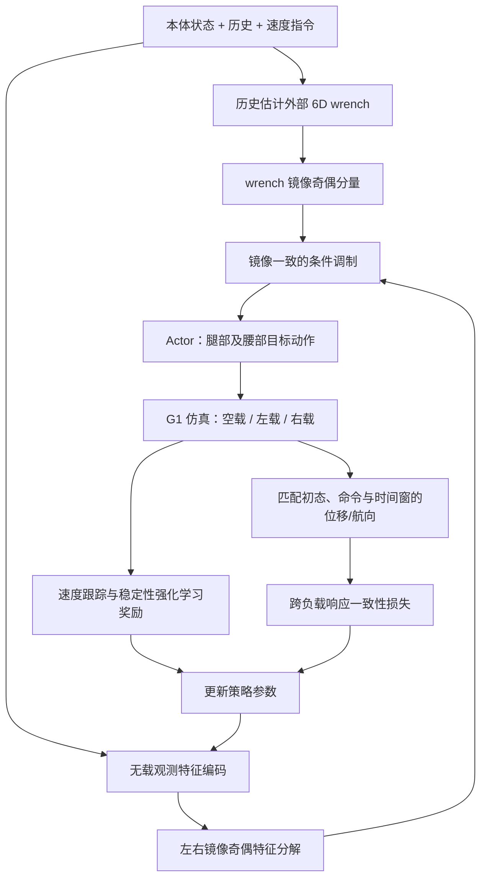

# ReACT: Reflection-Consistent Modulation and Cross-Load Consistency for Humanoid Velocity Tracking Under Asymmetric Loads｜ReACT：非对称载荷下的人形机器人镜像一致调制与跨负载速度跟踪

## 一句话定义

**ReACT** 是面向 **Unitree G1 单手携物**的学习式速度跟踪方法：把外部载荷估计嵌入左右镜像一致的策略结构，并通过空载、左载、右载的配对轨迹一致性约束降低负载对速度命令响应的影响。来源：[arXiv:2611.13929v1](https://arxiv.org/html/2611.13929v1)。

## 英文缩写速查

| 缩写 | 英文全称 | 简要说明 |
|---|---|---|
| G1 | Unitree G1 | 论文使用的人形机器人平台 |
| RL | Reinforcement Learning | 学习速度跟踪控制策略 |
| Wrench | Force–Torque Wrench | 6 维外载力与力矩估计 |
| MAE | Mean Absolute Error | 真机速度跟踪绝对误差 |
| SAC | Soft Actor-Critic | 文中使用的强化学习算法族 |

## 为什么重要

通用速度跟踪控制往往在空载或近对称条件下训练。单手搬运将载荷偏心地施加于机身，策略既要区分左右物理扰动，又希望对“同一个向前走命令”保持一致的实际移动响应。ReACT 的重点是**正确的对称性先验 + 对照式训练目标**，而不是简单延长观测历史或增加扰动幅度。

## 核心原理

1. **输入与动作**：actor 消费约 106 维本体/速度命令/负载信息。6 维外力/力矩由 15 帧本体历史估计；动作输出覆盖腿与腰的 15 关节，臂姿态由外部命令控制，不能误写成控制全部 G1 关节。
2. **Reflection-consistent modulation**：无载信息先编码为镜像奇偶特征，载荷 wrench 按镜像的符号变换分组；镜像偶分量 Fx、Fz、My 与奇分量 Fy、Mx、Mz 分别进行调制和耦合，让网络对左右镜像指令满足相容的变换规则。
3. **Cross-load consistency**：对相同初态和速度命令创建空载、左载、右载的配对 rollout，在约 0.4 s 窗口比较机器人平面位移和转角响应；它约束**控制结果**一致，而不是要求不同负载的关节力矩相同。
4. **训练**：论文报告 Isaac Gym 4096 并行环境，联合配对负载采样与常规随机扰动，50 Hz 的策略执行。

### 方法流程总览

根据论文网络结构和训练目标绘制；这是**论文方法的数据/监督流**，不是未发布源码的函数调用图。

## 实验评测与基线对比

| 评测条件 | ReACT | 对比项 | 解读 |
|---|---:|---:|---|
| 仿真直行纵向速度误差 | 0.0632 | FALCON 0.1033 | 更低 |
| 仿真直行侧向误差 | 0.0824 | FALCON 0.1212 | 更低 |
| 仿真直行航向误差 | 0.0924 | FALCON 0.5115 | 更低 |
| G1 真机双环境单手 1.5 kg 导航 | 40/40 完成 | FALCON 0/40 | 仅该测试协议 |
| G1 真机转弯侧向 MAE | **0.159** | FALCON **0.135** | ReACT **并非更优** |

真实导航的成功条件和碰撞条件依赖论文实验协议；不能转换为未测试地形、不同负载形态的通用成功率。

## 结论

**ReACT 的主要价值是将外载的左右反射对称性显式写进策略，并通过跨负载轨迹匹配改善负载变化下的整体移动表现；不是每个速度误差都单调改善。**

1. 复现时同时检查左右镜像后 wrench 的符号，避免把力/力矩六个通道混合成普通不变 embedding。
2. 用相同初态与命令的三种负载配对试验，评估位移和航向的跨负载一致性。
3. 报告纵向、侧向、角速度误差和碰撞率，不以单一“导航成功”替代所有指标。
4. 真机验证需覆盖负载质量、持物臂、转弯和长时稳定性；现有结果未保证跨本体泛化。

## 工程实践

建议在速度跟踪策略的训练环境中将外载 wrench 估计与普通本体特征分支分开，利用左右镜像单元测试检查等变性；在评估时固定地图/命令和负载，以确保对照有效。由于论文未公开可运行官方代码，该段是**基于论文的工程复现要点**，并非声称已复现 G1 控制。

## 源码运行时序图

**不适用（截至 2026-11-12 未核实到官方可执行仓库）**。仅根据论文无法确定具体训练脚本、推理入口和真实设备 IO，故不编造时序。

## 局限与风险

- 真机对比的基线和负载/环境范围有限，特别是转弯时侧向 MAE 反而较高。
- 外部载荷估计依赖本体历史；未证明可迁移到所有重量、抓取位置或复杂负载动态。
- 训练使用腿部与腰部控制，单手载物时臂控制仍依赖独立命令，**不是完整 loco-manipulation 端到端策略**。

## 关联页面

- [人形机器人移动](../tasks/humanoid-locomotion.md)
- [运控模型评测指标](../concepts/motion-control-policy-evaluation-metrics.md)
- [全身控制](../concepts/whole-body-control.md)
- [RedirectMimic 局部动作编辑](./paper-redirectmimic.md)

## 参考来源

- [ReACT 论文通读归档](../../sources/papers/react_arxiv_2611_13929.md)
- [arXiv:2611.13929v1 全文](https://arxiv.org/html/2611.13929v1)

## 推荐继续阅读

- [论文实验表与真机展示](https://arxiv.org/html/2611.13929v1)
- [人形移动任务](../tasks/humanoid-locomotion.md)
