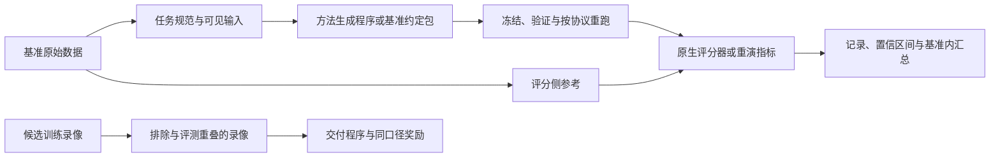
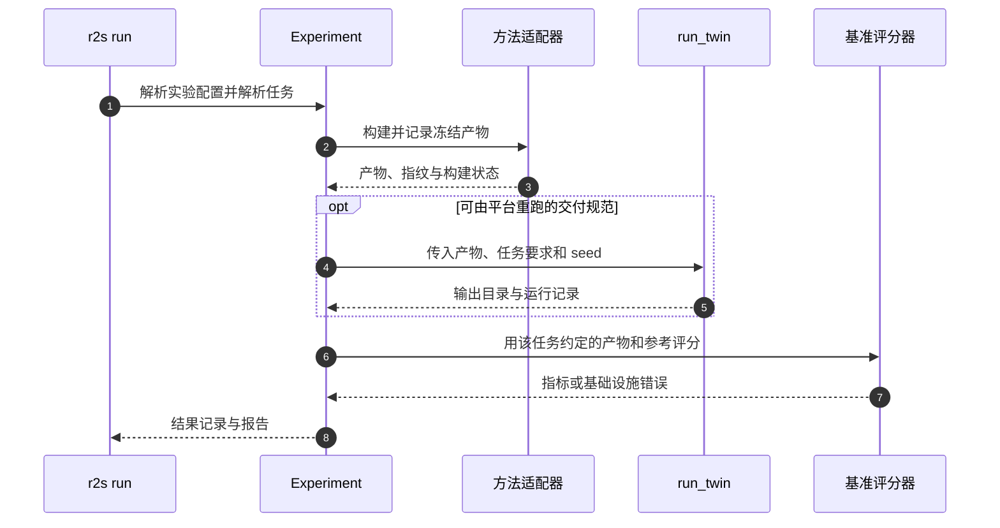

# Real2SimLab：现实到仿真迁移的统一平台 | Real2SimLab: A Unified Platform for Real-to-Simulation Transfer

## 一句话定义

Real2SimLab 把可执行的仿真程序和约定的输出当作适配器之间的交付接口，统一编排来自真实记录的仿真重建、冻结重跑、基准评分和训练奖励标注。

## 英文缩写速查

| 缩写 | 英文全称 | 简要说明 |
|---|---|---|
| R2S | Real-to-Simulation | 从现实观测构建仿真；也是官方 CLI 名称 |
| CLI | Command-Line Interface | 运行任务、实验和冻结产物检查的命令行 |
| IoU | Intersection over Union | 4DCodeBench、PhysCodeGym 原生指标的组成形式 |

## 为什么重要

Physics-IQ 要求由前三秒预测未来五秒的视频，Video2World 则要交重建场景及机器人动作包。统一的是接入接口和运行记录，不是把不同输出、测试协议和分数混成同一指标。新增一个方法或基准只需各实现一次适配，接入数从 N×M 降至 N+M，但全部跑完仍要执行所选的方法–基准组合。

| 项目 | 核对信息 |
|---|---|
| 机构 | 北京大学、Ngoro Robotics、香港大学 |
| 论文 | arXiv:2611.34849v1，2026-11-25 |
| 代码 | Apache-2.0；有实验编排、基准 / 方法适配及训练样本管线，没有随论文发布该任务的通用模型权重 |

## 核心机制

适配器把原始数据组织成任务规范、可见材料和评分侧参考。方法只见录像、可用相机参数和说明；交付物包括程序、构建脚本或基准约定的包。常规重跑检查指纹，读取冻结程序，并校验输出结构。会话一致性（现场结果与重跑）和同 seed 重跑可重复性是两种检查。Video2World 的冻结包由官方评分器执行，不由平台自行重跑。

## 源码运行时序图

入口是 `real2simlab/cli/experiments.py` 的 `_run`；编排与冻结交付见 `orchestrate/experiment.py`，常规程序重跑接口见 `runner/run.py`。此处为源码核对，不代表运行了外部模型或所有基准。

## 工程实践

- 选型先定交付：需要可操作场景和动作，选对应包契约；只预测视频帧则不能用该视频分数证明物体物性已经辨识。
- 建议先用官方 `r2s demo` 的玩具例验证环境，再用项目的实验 TOML 固定方法版本、运行镜像和任务。另存方法失败与机器或评分器失败；后者不作为方法得分。
- 真正的重跑与评分须核对协议：Physics-IQ 等有会话输出与冻结重跑两个变体，分开汇报；对于由官方评估器执行的包不能照搬重跑入口。
- 训练记录包含录像、标签、程序和奖励；先做录像级重叠排除，再复用对应评分。开源平台含示范流程，论文不是一个生产训练器或通用权重发布。

## 实验与评测

- 论文接入 47 个 Harbor 编程智能体（其中 5 个亦有直连）和 5 个非智能体方法；适配 Physics-IQ、Video2World、4DCodeBench、PhysCodeGym、PhySimCode、IRIS 六个既有基准，另有合成套件，不能把数字解读为完成了全面横评。
- 五个既有基准保留原生评分，IRIS 只覆盖八类中的落球类，由视频提取轨迹后按重演技能评分。Physics-IQ 适配输出与官方同视频分数一致，Video2World 的 Push-T 参考包复现其记录分数，合成数据生成程序的重演技能为 1。
- 重演技能定义为 1 减去程序误差与静止场景误差之比；0 是与静止基线持平，负值表示更差。该值与其他基准原生分数不作直接排序。
- 重叠筛查检测到 40 份合成变换片段中的 36 份，以及 PhysCodeGym 复用的全部 27 个 Physics-IQ 片段；极重压缩可漏检，不能把该流程视为没有污染的证明。

## 与相关工作对比

[Video2World](paper-video2world-coding-agents-benchmark.md) 本身规定场景/动作输入和评分；Real2SimLab 将其连同其他基准接入统一工件与重跑流程。统一运行接口不代表各原生分数可以直接跨基准排序。

## 结论

Real2SimLab 的贡献在于让交付和验证可复用，不在于训练出一种通用 Real2Sim 模型。

- 在接入新方法前先明确运行环境、标注和交付格式。
- 保持参考数据与方法输入分离，分别报告会话成绩和冻结重跑成绩。
- 将缺失、超时、评分器故障和低分分开记录，便于复查。
- 数据去重结果要保留检测能力与许可说明，避免暗示可以用评测集训练。

## 局限与风险

论文重点验证平台和适配器，未系统比较所有方法，也不意味着跨基准分数可直接排序；视频匹配并不覆盖所有变换和独立重拍，单视角重演成绩同样不能证明参数唯一。项目 README 的本地调试后端不提供隔离，不宜用于运行来源不明的产物。

## 关联页面

- [CRISP Real2Sim](../methods/crisp-real2sim.md)：将接触约束用于物理重建，与平台的通用评测接口分工不同。
- [系统辨识](../concepts/system-identification.md)：把重演质量与参数可辨识性区分开。
- [仿真评测基础设施](../concepts/simulation-evaluation-infrastructure.md)：对照任务版本、运行记录与评分口径。
- [Video2World](paper-video2world-coding-agents-benchmark.md)：具体的场景和动作包协议。
- [具身评测与基准中心](../overview/hub-embodied-eval-benchmark.md)
- [Real2Sim 纵深路线](../../roadmap/depth-real2sim.md)

- [Sim2Real 关节系统辨识实验设计](../methods/sim2real-joint-sysid-experiment-design.md)：用受控实测信号验证参数，补足基准运行接口本身不保证的物理可辨识性。

## 参考来源

- [论文原文归档](../../sources/papers/real2simlab_arxiv_2611_34849.md)
- [官方项目与文档归档](../../sources/sites/real2simlab.md)
- [官方源码归档](../../sources/repos/real2simlab.md)

## 推荐继续阅读

- [Awesome-Real2Sim](https://github.com/Real2SimHub/Awesome-Real2Sim)：按动机或交付形式梳理不同重建路线。
