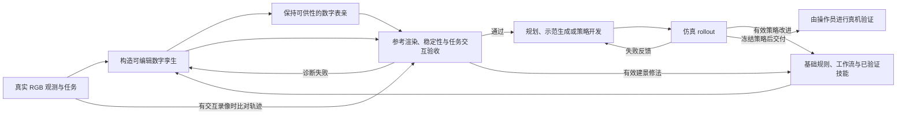
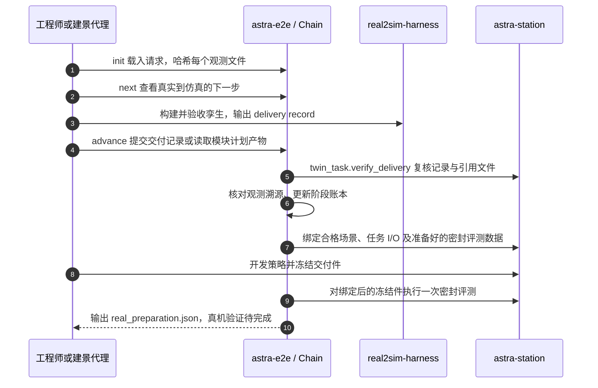

# Real2Worlds2Real：可积累建景与策略技能的真机—仿真—真机框架（Scaling Self-Improving Agentic Real2Sim2Real for Robot Manipulation）

## 一句话定义

用编码智能体从少量真实视觉观测构建可交互数字孪生、扩增经物理验收的数字表亲，再用模拟执行反馈改进操作策略；把验证过的修法作为技能存入共享工作流，而不是更新智能体的模型权重。

## 英文缩写速查

| 缩写 | 英文全称 | 简要说明 |
|---|---|---|
| RGB-D | Red, Green, Blue and Depth | 真机评测用 Orbbec 彩色与深度相机 |
| USD | Universal Scene Description | 装配可交互场景及背景的场景文件格式 |
| ACT | Action Chunking with Transformers | 表 1a 用 60 条真机示范训练的基础策略 |
| DAgger | Dataset Aggregation | 为当前策略访问过的状态追加专家纠正 |
| SSIM | Structural Similarity Index Measure | 对照真实参考视角检查渲染保真度 |

## 为什么重要

一次真实采集只能覆盖少量对象布局和初始状态。只复刻一个场景容易让策略记住背景或物体位置；只批量随机化，又可能破坏插孔配合、关节连接或稳定支撑。该工作把「几何像、物理能跑、策略能学」拆成可分别验收的阶段，也把训练世界数量与示范数量单独对照。

## 核心信息

| 字段 | 内容 |
|---|---|
| 机构 | 加州大学伯克利分校（UC Berkeley）、英伟达（NVIDIA）、伊利诺伊大学厄巴纳-香槟分校（UIUC）、卡内基梅隆大学（CMU） |
| 原文 | [arXiv:2611.31098v1](https://arxiv.org/abs/2611.31098v1)，2026-11-23 |
| 真实硬件 | Dexmate、Sharpa 灵巧手、Orbbec RGB-D，相同方法每任务 30 次真机试验 |
| 核验过的源码 | [公共仓库 576cbd5](https://github.com/real2worlds2real/real2worlds2real/tree/576cbd561ad1853ee90b9a4c331d3029ee499687) |

## 核心机制

1. **按证据修正数字孪生。** 智能体从 RGB 图像/视频、任务文字和可用的尺寸或标定线索出发，用 Blender 程序化构建独立可编辑物体；背景可用网格、Gaussian splats 或混合表示，真正接触的表面要有碰撞网格。对照渲染发现几何或装配错误时回到对应环节修正，不必整条流水线重跑。
2. **数字表亲不是盲目随机化。** 改物体尺寸、外观、材质以及场景布局/背景/光照时保留任务相关的关节类型、连接、支撑和可操作空间。以 PhysX 处理刚体/关节体，可变形示例使用适合布料、绳索或软体的物理表示与 PhysX / Newton 后端。若有真实交互录像，再用候选参数下的模拟轨迹与观察轨迹作对齐，迭代辨识可观测的物性。
3. **在仿真中按失败选工具。** 可直接组合抓取优化与规划/MPC，或生成示范训练 ACT、[Diffusion Policy](../methods/diffusion-policy.md)；有兼容专家时做 [DAgger](../methods/dagger.md)，也可冻结基策略、学习[残差动作](../methods/residual-policy-learning.md)。建景和策略阶段都把验证过的步骤、适用条件和证据整理成技能，供新任务复用。
4. **真实执行是单独边界。** 论文有人工运行的真机结果；公开框架只制作交付包，并将真实验证标为待完成，不因仿真通过而自动操作机器人。

## 流程总览

## 源码运行时序图

下图对应公开 `end_to_end/src/astra_e2e/chain.py` 的确定性编排。构建孪生和策略开发循环是外部步骤，不由 `advance --execute` 代做。

## 实验与评测

| 论文证据 | 固定条件 | 结果与边界 |
|---|---|---|
| [图 4b：训练世界多样性](https://arxiv.org/html/2611.31098v1#S4.F4) | 叠杯；相同 Diffusion Policy 配置、1,000 条训练示范；在 100 个未见仿真场景评估 | 10 / 100 / 200 / 500 / 1,000 个训练世界对应 17 / 46 / 57 / 64 / 71% 成功。只证明这个任务与配置的仿真泛化趋势。 |
| [表 1a：世界构建](https://arxiv.org/html/2611.31098v1#S4.T1) | 每项用 60 条真实示范初始化 ACT，各组用相同流程和等量数据做残差精炼；Real2Sim 组从相同输入视频构建孪生 | 真机插销 30/30、叠杯 30/30、齿轮插入 28/30、取纸擦拭 21/30、旋瓶盖 28/30。不是图 4b 策略的结果，也不代表纯仿真零样本。 |
| 表 1b：策略开发 | 固定作者的仿真环境；各方法可以用 60 条真实示范 | 真机提杯 30/30、搬放 27/30、旋螺母 22/30、叠杯 30/30；对比 ASPIRE/ENPIRE，测试的是策略开发方法而非换场景。 |
| [表 2–3：世界保真和物性](https://arxiv.org/html/2611.31098v1#S4.SS3) | 参考图像不做事后对齐或重缩放；另用七项视频参数辨识与留出轨迹测试 | 场景 SSIM 0.85，固定流程 0.61、无自适应修正 0.66；物性参数误差 4.2%、留出运动预测误差 2.6%。覆盖随方法变化，不是任意场景的物性精度保证。 |
| [图 5：技能复用](https://arxiv.org/html/2611.31098v1#S4.F5) | 留出切柠檬场景；另测 LIBERO-Pro Long 的 20 项任务、每项 50 个留出初始状态 | 建景降至 13.9M token（原 28.1M，SSIM 0.925→0.929）；0→136 项技能后长任务成功率 52.9→82.2%，全候选程序平均 44.1→69.1%。不是智能体权重训练或真机数据规模结果。 |

## 工程实践

- 从 `astra-e2e schemas` 检查契约，再用 `init` 和 `next` 查看当前需要的建景产物。接受的孪生要有可复核的交付记录；后续阶段复验内容哈希，避免评测时静默换场景。
- 有可用参考时先量尺度和接触关键尺寸，如插孔与齿轮齿形；将仿真通过、真实物性有独立证据和真机成功分别记录。
- [官方 USDZ 示例](https://github.com/real2worlds2real/real2worlds2real/tree/576cbd561ad1853ee90b9a4c331d3029ee499687/examples) 可用自备控制器在 Isaac Sim 5.1 操作：插孔被遮挡的孔底是推断的，套杯两个碰撞体都保留空腔。1 cm 阈值的可见表面 F-score 不能证明毫米级装配间隙；作者还报告了对照孪生缺齿和轴距失准导致齿轮策略精炼难以迁移的例子。
- MIT 仓库公开通用工具、示例和策略站编排；论文任务的专用策略开发代码、手写任务的仿真后端、真机 worker 未随仓发布。复现该公开链路之外的任务前需自备任务目录与执行环境；项目文档列出 Blender 4.5、Isaac Sim 5.1 与 GPU 要求。
- 本次本地 CPU 验证 `schemas → init → next/status`，检查观测文件 SHA-256；在无孪生交付记录时，`advance --execute` 返回错误并且不推进。未运行建景代理、模拟器、策略训练或物理机器人。

## 与相关工作对比

- [SimFoundry](paper-simfoundry-real2sim-scene-generation.md) 也从实拍生成场景和数字表亲；本篇将相同输入视频下的孪生用于表 1a 的相同残差精炼流程，并加入跨任务可复用的修正程序。两篇各自论文里的成功率不能直接横比。
- [Agentic Real2Sim](paper-agentic-real2sim.md) 重点是把既有交互过程重建成可回放 episode；本篇的重点是从场景孪生扩展训练世界，并联动策略开发。
- [Real2SimLab](paper-real2simlab.md) 重点是可执行仿真程序和独立评分；本篇借交付契约连接建景与策略站，额外实验场景多样性与技能积累。
- [Blind Precise Assembly](paper-blind-proprioceptive-assembly.md) 的插销策略只用仿真训练，在 Flexiv 真机上从靠近孔且接触夹具的位置开始，8 种插销、单侧间隙 0.5–1.5 mm，成功 173/237 次。它检验的是最后一段接触装配，与本篇采用真实示范初始化的 Dexmate 实验没有同口径排名关系。

## 结论

真实数据不足时，把有限示范分布到更多**物理可交互**的场景值得单独做消融，不必先扩示范总量。

- 先固定策略架构、示范预算及留出评测，再测训练世界数量的贡献。
- 分开检查视觉还原、接触几何/物性和真机策略成功，避免用好看的渲染或模拟成功率替代后两项。
- 用过验证才沉淀成技能，把适用条件和验收证据一起保存。

## 局限与风险

论文的 30/30 是有限试验次数与特定硬件上的观察值，不等于保证成功或跨工位泛化。叠杯扩展只测一个任务；未知布局、外观和物体变体的独立贡献未由图 4b 分离。无可靠真实运动或尺度证据时，材质和动力学参数属于假设；可下载资料不能重跑论文全套设定。

## 关联页面

- [Real2Sim 纵深 Stage 4](../../roadmap/depth-real2sim.md#stage-4-real2sim2real-闭环回训real-to-sim-评测与真机回放)
- [操作任务](../tasks/manipulation.md) · [残差策略学习](../methods/residual-policy-learning.md) · [Diffusion Policy](../methods/diffusion-policy.md)

## 参考来源

- [arXiv v1 完整论文归档](../../sources/papers/real2worlds2real_arxiv_2611_31098.md)
- [作者项目页](../../sources/sites/real2worlds2real.md) · [官方仓库与代码核验](../../sources/repos/real2worlds2real.md)

## 推荐继续阅读

- [项目页：交互式场景扩展与真机演示](https://real2worlds2real.github.io/)
- [公开编排链的交付和验收约束](https://github.com/real2worlds2real/real2worlds2real/blob/576cbd561ad1853ee90b9a4c331d3029ee499687/end_to_end/docs/chain.md)
