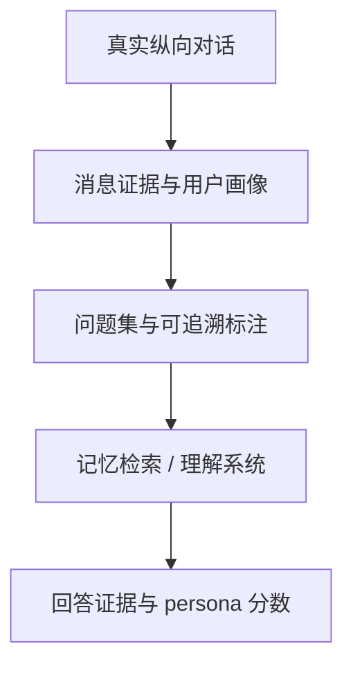

# RealCompanion：真实纵向对话中的用户理解基准

RealCompanion 是真实人-AI companion 长周期对话基准，检验模型能否理解用户、判断何时需要历史记忆，并让回答由消息证据支撑。

## 英文缩写速查

| 缩写 | 英文全称 | 简要说明 |
|------|----------|----------|
| LLM | Large Language Model | 被测对话理解与推理模型 |
| F1 | F1 Score | persona 重建的综合指标 |
| QA | Question Answering | 基准中的用户问题回答任务 |
| GT | Ground Truth | 依据对话消息建立的标注答案 |

## 为什么重要

真实用户理解不只是总结历史，还要求区分当前上下文、一般知识和确实需要回忆的旧消息。合成用户或预先编写的问题可能泄漏“此处应该查记忆”的线索，导致记忆能力被高估。

## 方法栈与基准结构

基准覆盖 10 段真实关系、27,218 条消息、最长 120 天；材料包括原始对话及 profile、persona、chat ground truth、question set。派生标签指回支持它的消息，标签推理轨迹逐步与对话核验。

## 评测与结果

最近窗口在 95.9% probes 中找到目标消息，但对真正需要记忆的 probes 覆盖率仅 2.2%；所测 detector 不能可靠判断是否需要调用记忆。显式把相同消息标为 memory 可让使用率上升 10–14 个百分点。三个 agent 系统 persona F1 相同，推理成本相差 31 倍。因此只报告总体准确率会掩盖记忆是否真被需要及其调用成本。

## 结论

**关键不是让系统搜到更多历史，而是检验它是否在需要时使用可验证的历史证据。**

1. 分层报告无需记忆、需近期和需远期记忆的问题。
2. 保存消息 ID 与证据跨度，区分用户建模和无根据猜测。
3. 同时报告 persona F1 与 token/检索/调用成本。
4. 避免用提示过强的合成问题测量记忆触发能力。
5. 真实私人对话的公开声明不等于可无限分发；须核实数据许可和访问条件。

## 与其他工作对比

[Self-Retrospection Distillation](./paper-self-retrospection-distillation.md) 将完成轨迹转成事前预测训练目标；RealCompanion 是真实对话的评测基准。前者不是长期用户记忆系统，也不能用其任务分数替代真实对话评测。

## 工程实践

- 记忆评测按问题是否需要历史证据分桶。
- 用引用消息或时间戳审计答案支持度。
- 报告检索延时、上下文 token 和端到端成本。
- **源码运行时序图：** 不适用（arXiv 页面未列独立可运行代码仓库；论文提到的数据发布入口仍需单独确认）。

## 局限与风险

样本规模仅 10 段关系；问题分布影响“需要记忆”的比例。数据发布摘要不足以确认下载入口、许可和去标识化细节，需在实际复用前核验。

## 关联页面

- [Self-Retrospection Distillation](./paper-self-retrospection-distillation.md) — 从交互轨迹训练事前预测
- [WorldScape Policy](./paper-worldscape-policy-2.md) — 带长短期记忆的视频世界模型策略

## 参考来源

- [RealCompanion 论文摘录](../../sources/papers/realcompanion_arxiv_2610_01780.md)
- [arXiv:2610.01780v3](https://arxiv.org/abs/2610.01780v3)

## 推荐继续阅读

- [RealCompanion arXiv 原文](https://arxiv.org/abs/2610.01780)
