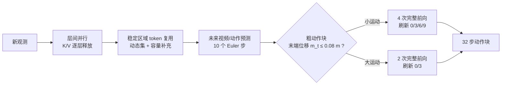
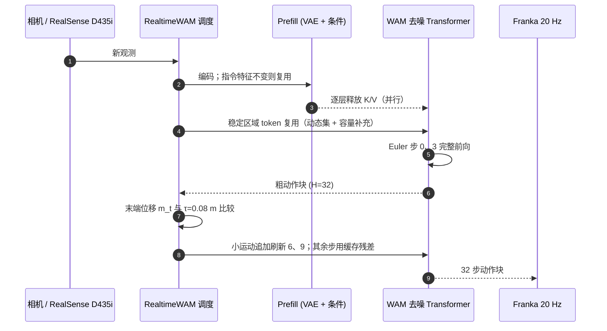

# RealtimeWAM：免训练的世界–动作模型实时推理

## 一句话定义

**RealtimeWAM** 不改权重、不重训，只在推理层面做两件事——让观测预填充（Prefill）与未来预测按层并行重叠，以及按画面/运动变化选择性复用缓存的 token 特征与 Transformer 残差——把已有 WAM（FastWAM、OpenWAM）的单次动作生成从数百毫秒降到约 25–65 ms。

## 英文缩写速查

| 缩写 | 英文全称 | 简要说明 |
|------|----------|----------|
| WAM | World-Action Model | 联合未来视频预测与动作生成的模型 |
| NFE | Number of Function Evaluations | 去噪网络前向次数；文中 2F/4F/10F 指前向次数 |
| SR | Success Rate | 任务成功率 |
| FFN | Feed-Forward Network | token 复用时仅对选中位置重算的层 |
| CUDA Graph | CUDA Graph replay | 预录 GPU 调用图以减少启动开销 |
| TeaCache / ToCa / BAC / VLA-Cache | 扩散与 VLA 缓存加速方法 | 本文对比的现有加速基线 |

## 为什么重要

- **延迟是 WAM 上真机的主要障碍：** 原生 FastWAM 约 214 ms、OpenWAM 约 673 ms，远高于传送带任务经验阈值（约 90 ms）。
- **免训练：** 直接套用官方微调检查点，所以不引入新的数据/训练成本。
- **有真机佐证：** 五个真机任务平均成功率 FastWAM 35.6→52.8、OpenWAM 33.6→70.8，主要归因于延迟下降。

## 核心信息

| 项 | 内容 |
|----|------|
| **机构** | 清华大学；YuanxingGuangnian Robotics（作者栏原样，中文名未核实）；南京大学 |
| **被加速模型** | FastWAM（[paper-fast-wam](./paper-fast-wam.md)）与 OpenWAM（[NUS 等版本，2609.07398](./paper-openwam.md)） |
| **硬件** | 改装 48GiB RTX 4090，BF16，batch 1 |
| **真机** | Franka Research 3 + RealSense D435i，20 Hz，每请求 32 步动作块 |
| **开源** | 截至 2026-10-12 无代码（匿名项目页仅有论文 PDF、视频、图） |

## 核心原理

### 方法栈

| 模块 | 设计 |
|------|------|
| 层间并行 | 每层投影后立刻释放观测 K/V，预测与 Prefill 余下层重叠；VAE 编码与条件准备并行；指令特征复用 |
| 系统优化 | 融合算子、预分配缓冲、CUDA Graph 重放、`reduce-overhead` 编译 |
| 稳定区域 token 复用 | RGB 变化超过 δ 的位置视为动态集 D_t，再按 α 补充；容量取预剖析 {80,120} 中不小于 r_t 的档；第 0 层全稠密，其余层仅选中位置重算 FFN，注意力与残差门始终全算，未来视频与动作 token 全算 |
| 残差缓存 | 缓存 C=B(h)−h；10 个 Euler 步中第 0、3 步刷新；用粗动作块（H=32）末端位移 m_t 判运动，τ=0.08 m：运动小 4 次完整前向，运动大 2 次 |

### 流程总览

## 方法

1. **并行执行带来最大降幅。** 累积表（FastWAM / OpenWAM，全请求 ms）：原生 214.33 / 672.83 → +CUDA Graph 104.09 / 524.69 → +编译 99.68 / 450.90 → +并行 33.52 / 223.27 → +token 复用 29.47 / 217.24（10F 设置）。其中并行一步降幅最大。
2. **token 复用的选择有价值。** 匹配刷新数时，引导式选择的动作平均绝对误差 0.004866，随机选择 0.018892（真实视频）。但主方法 δ、α 数值正文未给出。
3. **运动自适应预算。** 小运动给 4 次前向、大运动给 2 次：平均 NFE 2.65，XYZ 偏差 6.48 mm，介于固定 2F（7.65 mm）与固定 4F（3.68 mm）之间。
4. **两种骨干的差异。** FastWAM 推理时不生成未来视频，只缓存动作 Transformer 残差；OpenWAM 联合预测，缓存视频与动作两个 Transformer 的残差，所以绝对加速倍数更大（10.67× 对 8.90×）。

## 实验与评测

- **主表（RTX 4090）：** FastWAM 82.77% / 214.33 ms → **82.75% / 24.09 ms（8.90×）**；OpenWAM 87.94% / 672.83 ms → **87.41% / 63.09 ms（10.67×）**。平均 SR 为 RoboTwin Clean / Random、LIBERO、LIBERO-Plus 四项等权；相对已编译 + CUDA Graph 的原生，加速 4.14× 与 7.15×。
- **对比其他缓存加速（OpenWAM 平均 SR / 延迟）：** VLA-Cache 86.10 / 400.26 ms；TeaCache 86.74 / 245.99；ToCa 87.30 / 440.42；BAC 87.77 / 305.08；RealtimeWAM 87.41 / 63.09。FastWAM 上 TeaCache 79.63 / 49.28，BAC 82.56 / 67.14，RealtimeWAM 82.75 / 24.09。
- **组件消融（OpenWAM, RoboTwin）：** 完整 93.4% / 63.76 ms；去 token 复用 93.8% / 72.10 ms；随机 token 91.3%；随机门控 91.1%；固定 2F 89.6% / 54.70 ms；固定 4F 93.7% / 95.26 ms。
- **真机五任务，每任务 50 次（SR% 原生→RealtimeWAM，FastWAM / OpenWAM）：** 三个羽毛球 24→40 / 4→68；胡萝卜入盘 46→74 / 66→96；挂杯 72→70 / 82→82；网球入碗 26→34 / 16→76；滚筒入碗 10→46 / 0→32；平均 35.6→52.8 与 33.6→70.8；延迟 210.71→23.72 与 640.87→65.27 ms。
- 论文把真机增益与延迟下降联系起来（传送带实验经验阈值约 90 ms），但未给出单独的因果分析。

## 源码运行时序图

**不适用**：官方未发布代码，匿名项目页只有论文 PDF、演示视频与方法图；下方为论文描述的单次请求时序，并非仓库脚本。

## 工程实践

| 项 | 建议 |
|----|------|
| 适用对象 | 已有 FastWAM / OpenWAM 类检查点，不想重训 |
| 优先动作 | 先做 CUDA Graph + 编译 + 层间并行（降幅最大），再考虑 token 复用与残差缓存 |
| 参数 | τ=0.08 m 仅看 XYZ，换任务需重新标定；δ、α 数值原文未给出 |
| 延迟预算 | 动态场景（如 1 m/min 传送带）需低于约 90 ms |
| 开源核查（2026-10-12） | 匿名项目页无仓库；无法复现需自实现 |

## 结论

**WAM 的实时性主要靠「不改模型的执行层优化」拿到：并行与缓存让延迟降近一个数量级，仿真成功率几乎不变；动态真机任务上降延迟本身带来大幅增益。**

1. **先做系统级并行与图重放** — 累积表中它们贡献了绝大部分延迟下降。
2. **仿真成功率几乎不变** — 平均 SR 变化 −0.02（FastWAM）与 −0.53（OpenWAM）。
3. **运动自适应比固定预算划算** — 自适应 93.4% / 63.76 ms，介于固定 2F（89.6% / 54.70 ms）与固定 4F（93.7% / 95.26 ms）之间，接近 4F 的成功率且延迟低 33%。
4. **真机收益来自延迟** — 但归因证据是经验性的，且仅五个任务、单一平台。
5. **阈值须重标定** — τ=0.08 m、约 90 ms 都是特定任务的经验值。

## 与其他工作对比

| 对照 | 差异读法 |
|------|----------|
| [Fast-WAM](./paper-fast-wam.md) | Fast-WAM 在模型设计层跳过未来视频去噪；RealtimeWAM 在其上继续做执行层加速（214→24 ms） |
| [OpenWAM（NUS 等）](./paper-openwam.md) | 被加速的联合视频–动作 WAM（673→63 ms）；注意与 Stanford 同名 OpenWAM 不同 |
| TeaCache / ToCa / BAC / VLA-Cache | 通用缓存加速，延迟仍 49–440 ms 且部分掉点明显；RealtimeWAM 专为 WAM 的视频–动作结构设计 |
| [WAM 概念](../concepts/world-action-models.md) | 本文属于推理系统优化，不改变 WAM 建模方式 |

## 局限与风险

- **证据边界：** 论文无独立局限节；组件消融仅在 OpenWAM + RoboTwin；细化分析仅 3 条轨迹 93 对观测；真机五任务单平台；去 token 复用成功率略高（93.8 对 93.4）未解释。
- **复现风险：** 主方法 δ、α 未给出；所用检查点和 4090 环境（改装 48GiB）特殊。
- **开源状态：** 截至 2026-10-12 未发布代码，项目页为匿名页。

## 关联页面

- [Manipulation 周报汇总（2026-10-05~10-09）](../overview/frontier-manipulation-2026-10-05-10-09.md)
- [Fast-WAM](./paper-fast-wam.md)
- [OpenWAM（NUS 等）](./paper-openwam.md)
- [World Action Models 概念](../concepts/world-action-models.md)
- [LIBERO 基准](./libero-benchmark.md)
- [RoboTwin](./robotwin.md)

## 参考来源

- [realtimewam_arxiv_2610_10079.md](../../sources/papers/realtimewam_arxiv_2610_10079.md) — 论文摘录
- [realtimewam.md](../../sources/sites/realtimewam.md) — 匿名项目页与开源核查
- [Manipulation 周报来源](../../sources/blogs/frontier_manipulation_2026_10_05_10_09.md) — 线索来源（技术事实以论文为准）
- [arXiv:2610.10079](https://arxiv.org/abs/2610.10079)

## 推荐继续阅读

- [RealtimeWAM 匿名项目页](https://anonymous.4open.science/w/realtimewam/)
- [FastWAM 论文](https://arxiv.org/abs/2603.16666)
- [OpenWAM（NUS 等）论文](https://arxiv.org/abs/2609.07398)
