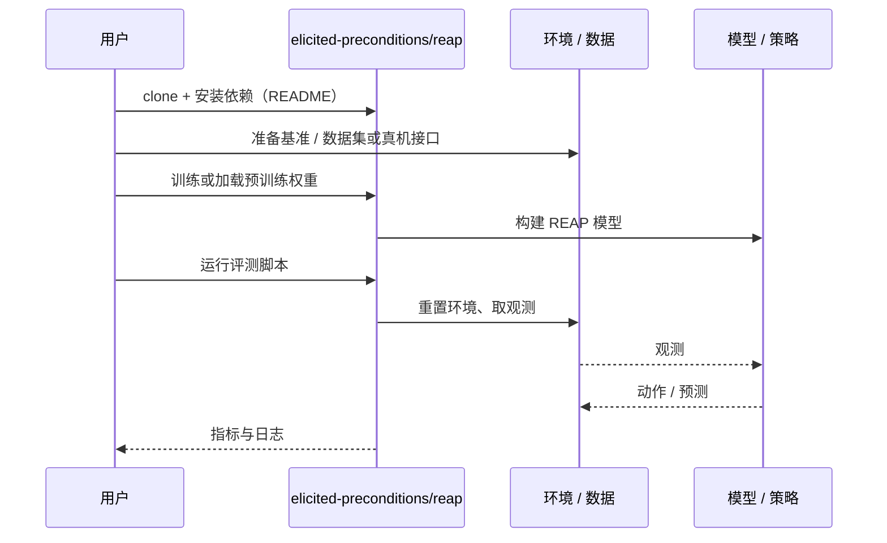

# REAP（arXiv:2610.23973）

**REAP**（*REAP: Learning General Rearrangement Heuristics from Motion-Planner Feedback*，[arXiv:2610.23973](https://arxiv.org/abs/2610.23973)，[项目页](https://elicited-preconditions.github.io)，[代码](https://github.com/elicited-preconditions/reap)）来自 [具身智能小站 2026-11-01 盘点](../../sources/blogs/wechat_embodied_station_56_papers_libero_dynamic_latency_eval_2026-11-01.md)，属「具身智能体与导航」组。

## 一句话定义

**REAP让关系图网络学习哪些符号动作在几何上可行，再指导搜索减少规划调用；仿真验证物体数和布局泛化，仍假设符号状态已知且动作空间离散。**

## 英文缩写速查

| 缩写 | 英文全称 | 简要说明 |
|------|----------|----------|
| REAP | REAP: Learning General Rearrangement Heuristics from Motion-Planner Feedback | 本文方法 / 基准的简称 |

## 为什么重要

- 从运动规划反馈学出隐藏前提。
- 开源结论：**已开源**（步骤 2.5，2026-11-01）。仓库可达（git ls-remote）。项目页 HTTP 200。
- 同期同组工作见 [动态评测、技能编译与环境潜变量适配：具身智能小站 11-01 期 56 篇阅读坐标](../overview/embodied-station-2026-11-01-56-papers-technology-map.md)。

## 核心机制

| 项 | 内容 |
|----|------|
| **arXiv** | [2610.23973](https://arxiv.org/abs/2610.23973) |
| **开源** | **已开源** |
| **要点** | REAP让关系图网络学习哪些符号动作在几何上可行，再指导搜索减少规划调用；仿真验证物体数和布局泛化，仍假设符号状态已知且动作空间离散。 |
| **文内指标** | 公众号未给具体数字，本页不引用。 |

## 源码运行时序图

以下为按仓库入口（`elicited-preconditions/reap`）推断的通用运行链路；入库日仅核实仓库可达，未逐文件阅读，具体脚本名以 README 为准。

## 实验与评测

- 公众号未给具体数字，本页不引用。
- **读法：** 本页为索引级摘要，依据公众号转述的官方摘要与仓库信息整理；逐项数字与 baseline 以原文 PDF 为准。

## 与其他工作对比

- 横向索引见 [动态评测、技能编译与环境潜变量适配：具身智能小站 11-01 期 56 篇阅读坐标](../overview/embodied-station-2026-11-01-56-papers-technology-map.md)；同 arXiv 不重复造页。

## 结论

**从运动规划反馈学出隐藏前提：REAP让关系图网络学习哪些符号动作在几何上可行，再指导搜索减少规划调用；仿真验证物体数和布局泛化，仍假设符号状态已知且动作空间离散。**

1. 开源边界：**已开源** — 仓库可达（git ls-remote）。项目页 HTTP 200。
2. 核心机制：REAP让关系图网络学习哪些符号动作在几何上可行，再指导搜索减少规划调用；仿真验证物体数和布局泛化，仍假设符号状态已知且动作空间离散。
3. 复现与选型前核对任务协议、硬件与基准口径，勿直接横比公众号摘录数字。

## 关联页面

- [llm-robotics-control-interfaces](../concepts/llm-robotics-control-interfaces.md)
- [vision-language-navigation](../tasks/vision-language-navigation.md)
- [manipulation](../tasks/manipulation.md)
- [embodied-station-2026-11-01-56-papers-technology-map](../overview/embodied-station-2026-11-01-56-papers-technology-map.md)

## 参考来源

- [reap_arxiv_2610_23973.md](../../sources/papers/reap_arxiv_2610_23973.md)
- [wechat_embodied_station_56_papers_libero_dynamic_latency_eval_2026-11-01.md](../../sources/blogs/wechat_embodied_station_56_papers_libero_dynamic_latency_eval_2026-11-01.md)
- [arXiv:2610.23973](https://arxiv.org/abs/2610.23973)

## 推荐继续阅读

- [arXiv PDF](https://arxiv.org/pdf/2610.23973)
- [项目页](https://elicited-preconditions.github.io)
- [https://github.com/elicited-preconditions/reap](https://github.com/elicited-preconditions/reap)
