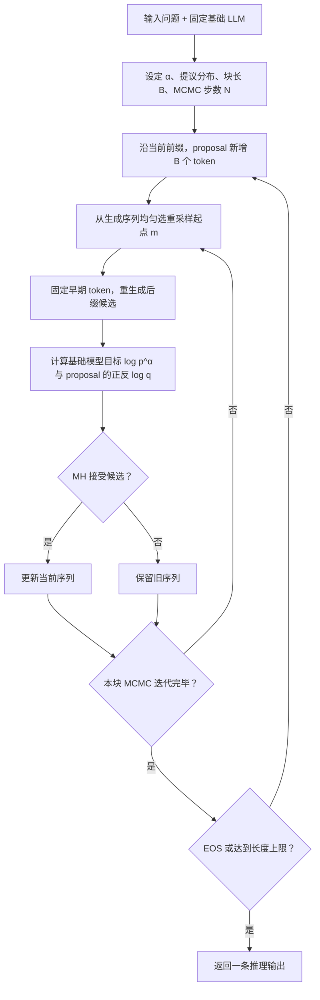
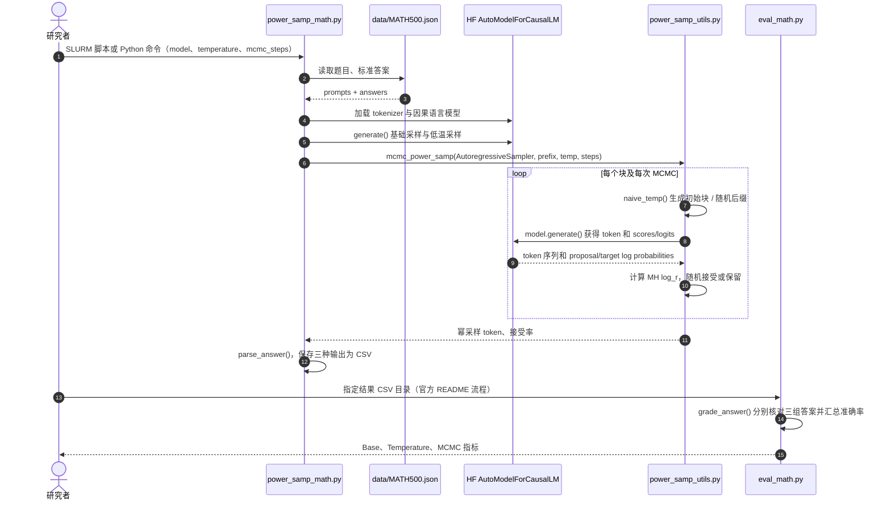

# Reasoning with Sampling：通过采样增强基础模型推理能力 | Your Base Model is Smarter Than You Think

**论文：** [Reasoning with Sampling: Your Base Model is Smarter Than You Think](https://arxiv.org/abs/2510.14901)（arXiv:2510.14901v1，2025-10-16；ICLR 2026）  
**作者：** Aayush Karan、Yilun Du。**机构：** 哈佛大学（Harvard University）。  
**资源：** [论文全文 HTML](https://arxiv.org/html/2510.14901v1) · [官方项目](https://aakaran.github.io/reasoning_with_sampling/) · [官方 PyTorch 代码](https://github.com/aakaran/reasoning-with-sampling)。

## 一句话定义

**Power Sampling** 在不改基础 LLM 权重、无需训练数据或答案验证器的条件下，使用**分块自回归 Metropolis–Hastings（MH）采样**逼近整个输出序列的幂分布 `p(\mathbf{x})^\alpha`，用更多推理时计算换取更强的单次推理表现，同时保留多样解的覆盖。

## 英文缩写速查

| 缩写 | 英文全称 | 简要说明 |
|---|---|---|
| LLM | Large Language Model | 提供序列似然与随机提议的基础语言模型 |
| MCMC | Markov Chain Monte Carlo | 通过迭代随机重采样逼近目标分布 |
| MH | Metropolis–Hastings | 根据目标权重和提议正反概率决定接受或拒绝 |
| GRPO | Group Relative Policy Optimization | 论文对照的强化学习后训练方法 |
| RL | Reinforcement Learning | 使用回报训练模型，与本文不更新权重的采样形成对照 |
| EOS | End of Sequence | 代码遇到生成终止 token 时截断序列 |

## 为什么重要

- **检验“基础模型是否已经具备推理路径”。** 论文将 post-RL 的高似然推理链视为可检验的分布锐化假设，而非宣称 RL 没价值。
- **把计算预算放在推理时。** 无须训练新权重、构造 verifier 或微调数据集；但会增加生成 token、延迟与显存/算力负担。
- **区分 pass@1 与 pass@k。** 单次高分并不代表多次采样覆盖好；论文观察到 GRPO 的多样性退化，而幂分布采样保留较好的多样性。
- **对机器人相关的正确定位。** 可作为云端任务规划器、VLM/LLM 推理策略的候选研究思路；**论文本身没有验证具身决策、机器人真机成功率或实时控制闭环**，不可据此声称能替代低层 RL 控制器。

## 核心原理

### 1. 整序列幂分布不等于逐 token 降温

给定基础模型的完整序列概率 `p(\mathbf{x})=\prod_t p(x_t\mid x_{<t})`，目标为

$$
p_{\mathrm{pow}}(\mathbf{x})=\frac{p(\mathbf{x})^\alpha}{Z_\alpha},\quad \alpha>1 .
$$

普通低温采样把**每一步**的条件概率按 `\alpha=1/\tau` 锐化；整序列幂分布在计算某个 token 的权重时需要考虑所有后续路径，前者是“对未来求和后取幂”，后者是“对未来取幂后求和”（`4.1 命题 1）。所以**设置 `temperature=0.25` 不等于直接从 `p^4` 完整序列分布采样**。整序列幂分布偏好少量但概率高的未来路径，能缓解容易将后续推理锁死的关键 token 选择。

### 2. 分块自回归 MCMC：只靠基础模型似然接受/拒绝

针对整序列空间无法穷举归一化，论文（Algorithm 1）对每个长度增量 `B` 执行：

1. 用 `p_prop` 自回归扩展当前序列 `B` 个 token，初始化本块；
2. 在现有序列中随机选择起点 `m`，保留之前的 token，使用 `p_prop` 重生成 `m` 之后的后缀；
3. 用 MH 比率 `\min(1, [p(\mathbf{x}')^\alpha/p(\mathbf{x})^\alpha] [q(\mathbf{x}\mid\mathbf{x}')/q(\mathbf{x}'\mid\mathbf{x})])` 接受/拒绝；
4. 重复 `N_{\mathrm{MCMC}}` 轮，确认更新后的整块前缀，再进入下一块直至 EOS 或 token 上限。

**关键边界：** 这里的 MH 校正通过 `q` 的正反概率抵消 proposal 的偏差；并非 “best-of-N 生成后由答案评分器挑选”，也不是用 RL 更新模型参数。有限 `N_{\mathrm{MCMC}}` 仅近似目标分布，不保证收敛。

## 流程总览

按论文 `4 / Algorithm 1 绘制的主干路径：

## 源码运行时序图

依据官方 `power_samp_math.py` 与 `power_samp_utils.py` 的已阅读函数调用，而非泛化模板：

源码 `mcmc_power_samp` 默认 `block_num=16`，日志与 CSV 结果由 `power_samp_math.py` 保存；`eval_math.py` 是另行调用的离线评测步骤，不在推理循环中充当 verifier。已静态核对代码，**未实际运行 GPU 评测**。

## 实验与评测

论文 `5 / Table 1，**作者报告、非本次复现**。四列为同一 `Qwen2.5-Math-7B` 的任务成绩（AlpacaEval 2.0 为长度校正 win rate，其他列为正确率）：

| 方式 | MATH500 | HumanEval | GPQA Diamond | AlpacaEval 2.0 |
|---|---:|---:|---:|---:|
| 基础采样 | 49.6% | 32.9% | 27.8% | 1.61 |
| 低温采样 | 69.0% | 51.2% | 35.3% | 2.09 |
| Power Sampling | 74.8% | **57.3%** | 38.9% | **2.88** |
| GRPO（MATH 训练） | **78.5%** | 53.7% | **39.9%** | 2.38 |

- 另在 Qwen2.5-7B、Phi-3.5-mini-instruct 验证；但结果依模型和任务而异（Phi 的 AlpacaEval 2.0 为 Power 17.65、GRPO 16.74、低温 18.15），不能宣传“所有指标均超过 RL”。
- **采样预算：** `T_max=3072`、`B=192`（16 块）、`\alpha=4`、`N_MCMC=10`；论文对 MATH500 的平均输出 `T=679` 估算生成 token 量为普通推理的 **8.84 倍**，**不等于实测 wall-clock 延迟恰为 8.84 倍**。
- **pass@k：** Figure 5 与附录 A.2 报告幂采样在多次尝试时保持样本多样性、缓解 GRPO 的 collapse；这不是保证任何任务采样 `k` 次都变好。

## 与其他方法对比

| 机制 | 是否更新权重 | 是否需要外部 reward / verifier | 主要取舍 |
|---|---|---|---|
| 普通/低温解码 | 否 | 否 | 每 token 局部重权，不能建模整序列未来完成概率 |
| Power Sampling（本文） | 否 | 否 | 整序列 `p^\alpha`、MCMC 反复重采样；有额外 token 预算 |
| GRPO 等 RL 后训练 | 是 | 通常需要可核验回报 | 训练期开销与奖励数据；论文所测基线可能损失 pass@k 多样性 |

与 [GRASP](./paper-grasp.md) 的联系仅在概率采样/MH 思想；GRASP 用物理仿真代价优化**机器人控制轨迹**，本文用 LLM 自身似然优化**文本序列分布**，不能当作同一算法的机器人实验复现。

## 结论

**本文的关键结果是：基础模型的推理能力可通过整序列采样被进一步利用，但计算开销从训练端部分转移到推理端，且没有具身任务验证。**

1. **先区分目标分布。** 低温 token 解码不等于整序列幂分布，关键在未来路径的权重如何聚合。
2. **以 MH 校正为核心。** 必须考虑 proposal 正反概率，不能把算法简化为“只留最高似然的多个结果”。
3. **按相同预算评估。** 对比时同时记录 pass@1、pass@k、生成 token、wall-clock 延迟和模型/显存条件。
4. **检验跨任务泛化。** HumanEval 和 AlpacaEval 2.0 上的优势是论文特定模型/对照结果，不是所有推理域的定理。
5. **机器人场景单独复验。** 若用作 VLA 的语言推理层，应核验响应时间与实际闭环任务成功率，不能直接用于 1 kHz 低层控制。

## 工程实践

- 官方环境创建：`conda env create -f environment.yml`，`conda activate psamp`；MATH500 可参考 `llm_experiments/scripts/power_samp_math.sh`；此例需 SLURM，普通机器需另行改启动方式。
- 关键入口：`power_samp_math.py` 读取数据、加载 HF 模型、调用 `mcmc_power_samp`；`power_samp_utils.py` 实现 proposal、log probability 与 MH 更新；`eval_math.py` 对 CSV 结果离线评分。
- 控制变量：使用相同 base model、题目、prompt 和停止条件；对比原生温度生成、power sampling 与训练后 GRPO，保留不同随机种子的结果。
- 机器人研究迁移仅作为**推断**：LLM 高层规划可能有推理质量收益，但必须测 P95 延迟、输出正确率和后续执行成功率，不能推定真机有效性。

## 局限与风险

- MH 收敛理论依赖 proposal 可达性与足够混合步数；在高维长序列上有限迭代可能偏离目标。
- 高似然不等于真实世界正确或安全；这里**没有外部事实校验**，不消除模型固有的错误与幻觉。
- 计算成本显著上升；作者估算的是生成 token 数量，而非经过生产部署的推理时间/成本账单。
- 论文实验集中在语言模型 MATH500、HumanEval、GPQA、AlpacaEval；**没有机器人真机控制、Sim2Real、实时机载或物理接触安全实验**。
- 源码公开且可静态追踪，但本次未执行 GPU/SLURM 评测，无法声称独立复现论文分数。

## 关联页面

- [AI Agent 评测](../concepts/ai-agent-evaluation.md) — 区分 pass@1 与 pass@k，核对性能和多样性。
- [LLM 推理显存估算](../concepts/llm-inference-vram-estimation.md) — 比较多轮重采样的部署预算。
- [RLCR：集体奖励强化学习](../methods/rlcr-collective-inference-time-scaling.md) — 另一类 inference-time scaling，机制与并行/训练前提不同。
- [GRASP：梯度引导机器人采样优化](./paper-grasp.md) — 对照 MH 接受思想和不同目标分布。

## 参考来源

- [arXiv:2510.14901v1 原文核读归档](../../sources/papers/reasoning_with_sampling_arxiv_2510_14901.md)
- [官方项目页归档](../../sources/sites/reasoning-with-sampling.md)
- [官方源码阅读归档](../../sources/repos/reasoning-with-sampling.md)

## 推荐继续阅读

- [ICLR 2026 论文正式收录](https://proceedings.iclr.cc/paper_files/paper/2026/hash/01498f17142547dadb60999c39bd0a09-Abstract-Conference.html)
- [arXiv HTML 原文（含算法与附录）](https://arxiv.org/html/2510.14901v1)
- [官方 PyTorch 实现](https://github.com/aakaran/reasoning-with-sampling)
