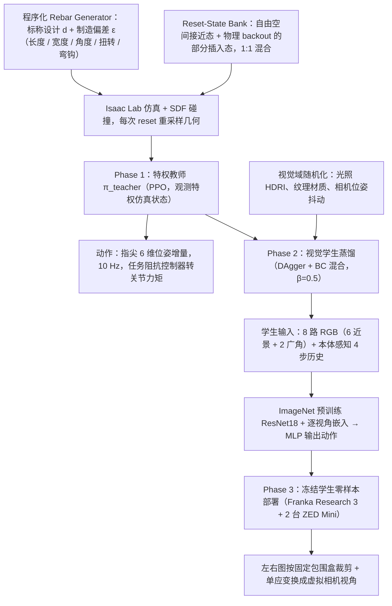

# Visual Sim-to-Real Learning for Robotic Insertion under Geometric Variations（arXiv:2609.20477）

**Visual Sim-to-Real Learning for Robotic Insertion under Geometric Variations**（*Application to Rebar Installation*，[arXiv:2609.20477](https://arxiv.org/abs/2609.20477)，[项目页](https://rebarsim.github.io/)）来自 [具身智能小站 10 篇盘点](../../sources/blogs/wechat_embodied_station_10_papers_contact_wm_2026-09-18.md)（策展档位：**扫读**）。

## 一句话定义

**RebarSim：特权 RL teacher → 视觉 student 蒸馏 + DAgger；1.4 mm 间隙；真机零样本插入 SR 91.3%。**

## 英文缩写速查

| 缩写 | 英文全称 | 简要说明 |
|------|----------|----------|
| WAM | World-Action Model | 联合预测未来观测与动作的策略 |
| VLA | Vision-Language-Action | 视觉–语言–动作策略 |
| SR | Success Rate | 任务成功率 |
| IL | Imitation Learning | 模仿学习 |
| GS | Gaussian Splatting | 高斯溅射三维表示 |

## 为什么重要

- 公众号将本文归入「接触时视觉之外还需预测什么」专题；扫读档位。
- **（匿名审稿）**；开源结论：**待发布**（步骤 2.5，2026-09-18）。
- 与 tactile/WAM、主动视角、多智能体场景理解、Sim2Real、人形导航等主线交叉。

## 流程总览

图依据：论文 §III 概述与 §III-A~E、Fig. 3。

## 核心机制

| 项 | 内容 |
|----|------|
| **arXiv** | [2609.20477](https://arxiv.org/abs/2609.20477) |
| **开源** | **待发布** |
| **策展摘要** | RebarSim：特权 RL teacher → 视觉 student 蒸馏 + DAgger；1.4 mm 间隙；真机零样本插入 SR 91.3%。 |

## 源码运行时序图

**不适用**（截至 2026-09-18 项目页/arXiv 未发布可运行官方代码）。

## 实验与评测

- 定量指标与 baseline 协议以 arXiv PDF 与项目页为准；本页为清单级摘要。
- 读法：先确认任务设定（仿真/真机、传感器、成功定义）再对比 SR/延迟/路径长度等 headline 数字。

## 与其他工作对比

> 本页为清单级摘要，下表只做**定位对照**：1.4 mm 间隙与真机零样本 SR 91.3% 是本文现场设定下的数字，与下列各页不可横比。

| 对照 | 差异读法 |
|------|----------|
| [FPSA / R2S2R](./paper-fpsa-r2s2r.md) | 同为缩 sim2real 差距，方向相反：R2S2R 先把真实回灌进仿真再迁回，RebarSim 直接在仿真里用特权 teacher 蒸馏视觉 student。一个改仿真，一个改训练流程 |
| [ViLoMan](./paper-viloman.md) | 同批次里同样是「特权 teacher → 视觉 student + DAgger」，任务尺度是两端极值：ViLoMan 做人形全身 loco-manip，RebarSim 做 1.4 mm 间隙精密插入。同一配方能覆盖这个跨度本身是看点 |
| **直接在真机上采数据训插入策略**（本文要替代的默认做法） | 同为拿到可用插入策略，差别在**几何变化从哪来**：真机采集覆盖不了钢筋尺寸/位姿的全部变体，仿真里可批量枚举。代价是要为此补齐视觉域差，DAgger 就在补这一段 |
| [Sim2Real](../concepts/sim2real.md) | 91.3% 是零样本数字；该页给「零样本」的前提口径（标定、光照、物体分布），换现场不可直接沿用 |
| [10 篇技术地图](../overview/contact-wm-10-papers-technology-map.md) | 同批次横向对照入口：本文列 **扫读** 档位 |

## 结论

**Visual Sim-to-Real Learning for Robotic Insertion under Geometric Variations 代表「扫读」档位的 sim2real 方向样本——部署前以开源状态与评测协议为准绳。**

1. 开源状态：**待发布**；勿凭 PDF 臆断可复现性。
2. 与同专辑 [Agile-WAM](./paper-agile-wam.md) / [INSPECT](./paper-inspect-view-selection.md) 等形成「触觉 WAM → 主动视角 → 系统平台」阅读链。
3. 若做工程选型，先对齐传感器栈与任务是否匹配文内设定。
4. 关注项目页/arXiv 版本更新与代码发布。

## 关联页面

- [sim2real](../concepts/sim2real.md)
- [manipulation](../tasks/manipulation.md)
- [reinforcement-learning](../methods/reinforcement-learning.md)
- ./paper-fpsa-r2s2r.md
- [10 篇技术地图](../overview/contact-wm-10-papers-technology-map.md)

## 参考来源

- [rebarsim_arxiv_2609_20477.md](../../sources/papers/rebarsim_arxiv_2609_20477.md)
- [wechat_embodied_station_10_papers_contact_wm_2026-09-18.md](../../sources/blogs/wechat_embodied_station_10_papers_contact_wm_2026-09-18.md)
- [arXiv:2609.20477](https://arxiv.org/abs/2609.20477)
- [arXiv PDF](https://arxiv.org/pdf/2609.20477)：已通读方法部分（实验与附录以略读为准）：§III-A~E（几何仿真、reset 状态库、特权教师、视觉学生蒸馏、真机部署）

## 推荐继续阅读

- [arXiv PDF](https://arxiv.org/pdf/2609.20477)
