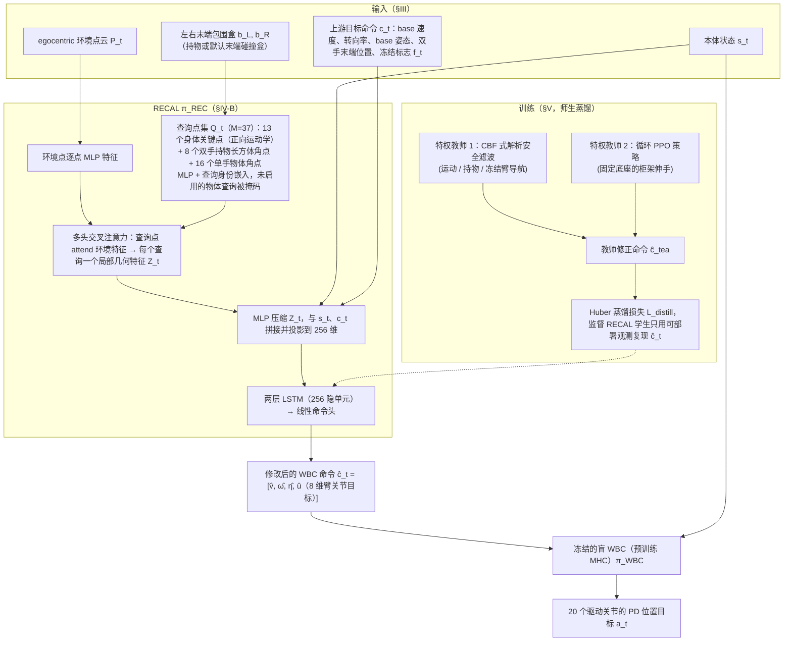

# RECAL（arXiv:2609.16405）

**RECAL**（*Collision-Aware Humanoid Whole-Body Control under Imperfect Tracking Targets*，[arXiv:2609.16405](https://arxiv.org/abs/2609.16405)）来自 [senlanke 具身运控lab 周更盘点](../../sources/blogs/wechat_senlanke_weekly_humanoid_quadruped_2026-09-14_18.md)（2026-09-14–18）。

## 一句话定义

**RECAL 交叉注意力层用机器人/物体/环境点云修正冻结 WBC；特权 Teacher→观测 Student，Digit V3 兼顾跟踪、行走与局部避碰。**

## 英文缩写速查

| 缩写 | 英文全称 | 简要说明 |
|------|----------|----------|
| WBC | Whole-Body Control | 全身控制 |
| RL | Reinforcement Learning | 强化学习 |
| TS | Teacher–Student | 特权–观测蒸馏 |

## 为什么重要

- 冻结 WBC 在 clutter 与 imperfect reference 下易碰撞；需几何感知修正层而非重训全身策略。

## 流程总览

图依据：论文 §III–V 与 Fig. 2（架构）

## 核心机制

| 项 | 内容 |
|----|------|
| **arXiv** | [2609.16405](https://arxiv.org/abs/2609.16405) |
| **开源** | **待发布**（步骤 2.5，2026-09-20） |
| **方法摘要** | RECAL cross-attention 融合点云修正 WBC 输出；Teacher–Student 蒸馏部署观测策略。 |

## 源码运行时序图

**不适用**（截至 2026-09-20 未发布可运行官方代码或待核实）。

## 实验与评测

- Digit V3：目标跟踪 + 行走 + 局部避碰（以 PDF 为准）。
- 读法：先对齐任务设定、传感器与成功定义，再解读 headline 数字。

## 与其他工作对比

| 维度 | 读法 |
|------|------|
| **同周对照** | 见对应 [周更盘点](../../sources/blogs/wechat_senlanke_weekly_humanoid_quadruped_2026-09-14_18.md) 映射表，勿跨任务直接比 SR |
| **开源状态** | **待发布** — 部署前以项目页/arXiv 为准 |

## 结论

**RECAL 把碰撞感知作为 WBC 之上的可蒸馏修正层，适合 imperfect tracking 的 clutter 场景。**

1. 开源：**待发布**；勿凭公众号摘要臆断可复现性。
2. 指标须连同实验条件解读（仿真/真机、平台、成功阈值）。
3. 关注 arXiv 版本更新与代码发布。

## 关联页面

- [humanoid-locomotion](../tasks/humanoid-locomotion.md)
- [whole-body-control](../concepts/whole-body-control.md)
- [reinforcement-learning](../methods/reinforcement-learning.md)

## 参考来源

- [recal-collision-aware-wbc_arxiv_2609_16405.md](../../sources/papers/recal-collision-aware-wbc_arxiv_2609_16405.md)
- [wechat_senlanke_weekly_humanoid_quadruped_2026-09-14_18.md](../../sources/blogs/wechat_senlanke_weekly_humanoid_quadruped_2026-09-14_18.md)
- [arXiv:2609.16405](https://arxiv.org/abs/2609.16405)
- [arXiv PDF](https://arxiv.org/pdf/2609.16405)：已通读方法部分（实验与附录以略读为准）：§III 问题定义，§IV 架构（基础 WBC、RECAL），§V 训练（环境、特权教师、学生蒸馏）；§VI 仅看了 Table I

## 推荐继续阅读

- [arXiv PDF](https://arxiv.org/pdf/2609.16405)
