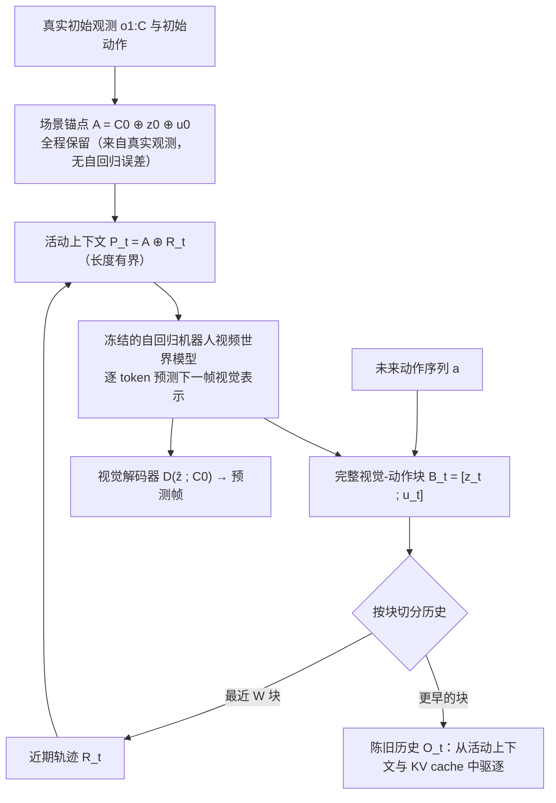

# ReCAP（arXiv:2610.14583）

**ReCAP**（*Remembering What Matters for Long-Horizon Robotic World Models*，[arXiv:2610.14583](https://arxiv.org/abs/2610.14583)，[项目页](https://alexander-wu.github.io/recap-project-page/)，[资源](https://huggingface.co/easylearning/recap-robot-models)）来自 [具身智能小站 2026-10-14 盘点](../../sources/blogs/wechat_embodied_station_41_papers_streamingwam_2026-10-14.md)，属「世界模型与记忆」组。

## 一句话定义

**冻结世界模型，只保留初始场景锚点与近期完整视觉动作块，移除陈旧生成历史，改善长时给定动作的视频预测。**

## 英文缩写速查

| 缩写 | 英文全称 | 简要说明 |
|------|----------|----------|
| WM | World Model | 环境前向预测模型 |
| HF | Hugging Face | 模型托管平台 |
| FVD | Fréchet Video Distance | 视频生成质量指标 |

## 为什么重要

- 长程滚动预测中陈旧的自生成历史会污染上下文；记忆该留什么比留多少更重要。
- 开源结论：**部分开源**（步骤 2.5，2026-10-14）。Hugging Face 提供模型权重（easylearning/recap-robot-models）；项目页写代码即将发布，入库日未列 GitHub。
- 同期同组工作见 [流式动作块与世界模型记忆：具身智能小站 10-14 期 41 篇阅读坐标](../overview/embodied-station-2026-10-14-41-papers-technology-map.md)。

## 流程总览

图依据：论文 §3 Problem Formulation、§4.1–4.2 与 Fig. 2（训练免调度器，不改模型参数，块级操作于 token 与 KV cache 空间）。

## 核心机制

| 项 | 内容 |
|----|------|
| **arXiv** | [2610.14583](https://arxiv.org/abs/2610.14583) |
| **开源** | **部分开源** |
| **要点** | 上下文 = 初始锚点 + 近期块；不重训骨干。记忆冲突解释可能与上下文长度效应混合。 |
| **文内指标** | 长时视频预测指标；以原文为准。 |

## 源码运行时序图

**部分开源** — Hugging Face 提供模型权重（easylearning/recap-robot-models）；项目页写代码即将发布，入库日未列 GitHub。 待可运行代码公开后补图。

## 实验与评测

- 长时视频预测指标；以原文为准。
- **读法：** 本页为索引级摘要，依据公众号转述的官方摘要与仓库信息整理；逐项数字与 baseline 以原文 PDF 为准。

## 与其他工作对比

- 横向索引见 [流式动作块与世界模型记忆：具身智能小站 10-14 期 41 篇阅读坐标](../overview/embodied-station-2026-10-14-41-papers-technology-map.md)；同 arXiv 不重复造页。

## 结论

**长程世界模型先做上下文裁剪再谈扩容：锚点 + 近期窗口是便宜且有效的基线。**

1. 开源边界：**部分开源** — Hugging Face 提供模型权重（easylearning/recap-robot-models）；项目页写代码即将发布，入库日未列 GitHub。
2. 核心机制：上下文 = 初始锚点 + 近期块；不重训骨干。记忆冲突解释可能与上下文长度效应混合。
3. 复现与选型前核对任务协议、硬件与基准口径，勿直接横比公众号摘录数字。

## 关联页面

- [generative-world-models](../methods/generative-world-models.md)
- [world-action-models](../concepts/world-action-models.md)
- [functional-taxonomy-world-models](../concepts/functional-taxonomy-world-models.md)
- [embodied-station-2026-10-14-41-papers-technology-map](../overview/embodied-station-2026-10-14-41-papers-technology-map.md)

## 参考来源

- [recap_long_horizon_world_model_memory_arxiv_2610_14583.md](../../sources/papers/recap_long_horizon_world_model_memory_arxiv_2610_14583.md)
- [wechat_embodied_station_41_papers_streamingwam_2026-10-14.md](../../sources/blogs/wechat_embodied_station_41_papers_streamingwam_2026-10-14.md)
- [arXiv:2610.14583](https://arxiv.org/abs/2610.14583)
- [arXiv PDF](https://arxiv.org/pdf/2610.14583)：已通读方法部分（实验与附录以略读为准）：§1 Introduction、§3 Problem Formulation、§4 Methodology（4.1–4.2）、§5.1 实验设定

## 推荐继续阅读

- [arXiv PDF](https://arxiv.org/pdf/2610.14583)
- [项目页](https://alexander-wu.github.io/recap-project-page/)
- [https://huggingface.co/easylearning/recap-robot-models](https://huggingface.co/easylearning/recap-robot-models)
