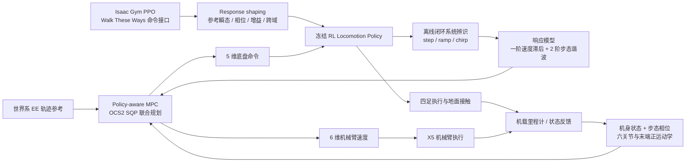

# ReCo：面向腿式移动操作的响应一致运动控制与策略感知 MPC

**ReCo: Response-Consistent Locomotion with Policy-Aware MPC for Legged Manipulation** · Kuankuan Sima、Yichao Gao、Chenxi Gu、Kefan Zhao、Lin Zhao · **新加坡国立大学（National University of Singapore, NUS）** · [arXiv:2610.01612v1](https://arxiv.org/html/2610.01612v1)（2026-10-01）。

## 一句话定义

ReCo 让四足机器人底层 RL 运动策略对速度、机身高度与俯仰命令产生**可重复、可辨识的闭环响应**，使上层 MPC 能预测底盘走动及步态振荡，并与机械臂关节速度**联合优化世界系末端 SE(3) 轨迹跟踪**。

## 英文缩写速查

| 缩写 | 英文全称 | 简要说明 |
|---|---|---|
| ReCo | Response-Consistent Locomotion | 本文响应一致的行走策略与规划接口 |
| RL / PPO | Reinforcement Learning / Proximal Policy Optimization | 训练底层四足运动策略 |
| MPC | Model Predictive Control | 联合优化底盘与机械臂运动命令 |
| OCS2 | Optimal Control for Switched Systems | 本文用于多重打靶 SQP 的开源优化框架 |
| EE | End Effector | 世界系末端位姿追踪目标 |
| SQP | Sequential Quadratic Programming | 迭代求解在线最优控制问题 |
| RMSE | Root Mean Square Error | 每条轨迹位置或姿态误差的均方根 |
| PP | Pure Pursuit | 评测时附加给部分 baseline 的路径跟踪器 |

## 为什么重要

- **问题不是 RL 走不稳，而是 MPC 不知道底盘接到命令之后会怎么动。** 步态相位、接触、载荷影响命令到运动的时滞、稳态增益与周期摆动，未建模会传递到臂末端跟踪误差。
- **一致的延迟可以补偿，可变延迟很难预测。** ReCo 在训练期主动整形闭环响应，而不是仅在规划层事后补复杂模型。
- **模块分工明确：** RL 处理接触鲁棒性、抗扰与足端执行；MPC 处理未来底盘位移、机身姿态与六自由度机械臂轨迹协调；两者经离线辨识的低阶响应模型连接。
- **适用本体要说清楚：** 本文实证是 Unitree **Go2 四足 + ARX X5 六轴臂**，并非 Unitree G1 等人形平台的直接验证。

## 核心原理（方法）

### 控制量、状态与任务接口

| 层 | 原文定义 |
|---|---|
| 任务目标 | 世界系连续末端位姿参考 T_WE_ref(t)，位置和旋转均计入损失 |
| 底层 RL 命令 | c=(c_x,c_y,c_omega,c_h,c_theta)：前后/横移速度、yaw 角速度、相对机身高度、pitch，共 **5 维** |
| MPC 控制量 | u=(c,u_q)，其中六轴臂关节速度 u_q 为 6 维；合计 **11 维** |
| MPC 状态 | x=(x_base, φ, q)，**16 维**：base 位置、ZYX yaw/pitch/roll、平面速度与 yaw rate、步态相位 φ、6 关节位置 |
| 不能直接控制的量 | roll 作为预测状态纳入末端姿态计算；没有 roll 命令通道 |
| 运动学耦合 | T_WE = T_WB × T_BE(q)，底盘姿态/位置和臂关节共同决定末端位姿 |

### 1. Response shaping：把策略响应变得可预测

沿用 [Walk These Ways](paper-walk-these-ways-quadruped-mob.md) 的 gait-conditioned PPO 运动接口，在普通行走奖励之外加入四种响应约束：

1. **Reference tracking：** 以每一命令通道的临界阻尼二阶参考生成器给出理想瞬态；采用速率限制并跟踪参考。
2. **Phase repeatability：** 按相位/速度分桶估计步态周期项，约束同相位响应偏差，**不是压制正常的周期起伏幅度**。
3. **Steady-state gain：** 减少命令稳定后输出相对输入的偏差。
4. **Cross-domain consistency：** nominal 与质量、负载、摩擦、电机强度随机化的环境执行相同命令/相位，优化跨环境输出一致性。扰动发生与恢复期间暂停参考跟踪奖励，优先保持稳定。

### 2. 冻结策略后辨识闭环响应

- 平面 vx/vy/yaw-rate：单极点响应 dot(v_i)=(k_i c_i - v_i)/tau_i，辨识通道增益 k_i 与时间常数 tau_i。注意**训练时的参考是二阶**，实际建模采用紧凑的一阶响应，两者不可混称。
- 机身安装面 z、pitch、roll：加入与 gait phase φ、平面速度 ν 相关的周期谐波（**Nh=2**，主步幅和半步幅），用于预测周期振荡对末端的影响。
- 用阶跃、斜坡、chirp 命令及随机动力学采样，针对冻结策略做**多步预测误差的有界非线性最小二乘**离线辨识。用于预测的周期项与训练期分桶估计**分别**计算。
- 闭环响应模型是**策略+机器人**的经验模型，**没有显式加入机械臂引起的 wrench**，这也是潜在耦合误差来源。

### 3. Policy-aware MPC

MPC 结合上述模型和臂正运动学，最小化世界系末端的位置、四元数姿态、速度误差，以及控制幅度、底盘姿态和臂收拢偏好；对关节限位、命令范围和部分自碰撞距离加入软惩罚。

采用 **OCS2 multiple-shooting SQP + 自动微分 + warm start**。控制回路运行 **100 Hz**、预测窗 **1.0 s**、**67** 个 shooting nodes、每次更新 **3** 次 SQP 迭代、RK2 积分、3 线程。参考管理器以更高采样频率输出命令，MPC 更新之间保持底盘命令；优化前还会把测量状态推进一个采样间隔补偿反馈延迟。

### 方法流程总览

*图基于论文 III-A–D、Fig. 2、式 (1)–(11) 重绘；表示算法模块关系，**不是未经公开的 ReCo 源码调用时序**。*

## 源码运行时序图

**不适用（截至 2026-11-09 未核验到作者官方公开的 ReCo 训练/系统辨识/MPC 可运行仓库与入口）。** OCS2、Walk These Ways 和 RoboDuet 虽然有公开代码，但分别是通用求解器、参考 locomotion 路线和比较基线，**均不是 ReCo 项目本身源码**；不能据此杜撰训练脚本、ROS 2 节点名或运行时调用序列。若后续正式开放源码，再基于真实入口补 sequenceDiagram。

## 实验与评测

### 仿真结果（arXiv v1 Table II）

50 条固定世界系 EE 轨迹，分别执行 nominal 与 80 N / 0.1 s（8 N·s，世界系 +X）推扰两种工况，总计 **100 runs/方法**；MuJoCo 凹凸地形为 16×16 m。学习方法在 Isaac Gym 训练，并在 MuJoCo 评测。

| 控制器 | 位置 RMSE (m) ↓ | 姿态 RMSE (°) ↓ | 完成进度 ↑ | 成功数 ↑ | 摔倒数 ↓ |
|---|---:|---:|---:|---:|---:|
| Ma et al. (RL+MPC) | 0.199 | 32.7 | 82.6% | 31/100 | 8/100 |
| Pure MPC | 0.189 | 46.8 | 80.5% | 19/100 | 12/100 |
| UMI on Legs | 0.883 | 81.1 | 12.9% | 12/100 | 80/100 |
| RoboDuet + PP | 0.679 | 79.9 | 65.7% | 42/100 | 9/100 |
| Visual WBC + PP | 1.454 | 68.2 | 25.0% | 23/100 | 38/100 |
| **ReCo** | **0.135** | **23.8** | **94.0%** | **75/100** | **3/100** |

- 论文给出的 **位置降低 28.7%**，比较对象是**位置最优**基线 Pure MPC（0.189 m）；**姿态降低 27.4%**，比较对象是**姿态最优**基线 Ma et al.（32.7°）；不是同一 baseline。
- **成功**要求至少 97% 进度、无摔倒或提前异常终止、终点位置 <0.15 m 和角度 <40° 连续保持 ≥0.5 s，并且至少 40% 样本同时达阈值。提前失败者 RMSE 只按已记录轨迹前缀计算，不能脱离成功率/进度单独比较。
- RoboDuet 和 Visual WBC 在本文测试时**额外配有 omnidirectional pure-pursuit（PP）**提供底盘速度命令；这是针对其接口的适配，并不是把原项目当作与 ReCo 输入完全相同的原生端到端策略。

### 消融和模型预测（Tables III–IV）

- Shaping × 辨识消融：都没有 **0.257 m**、只辨识 **0.232 m**、只 shaping **0.166 m**、两者都使用 **0.135 m**；两模块在位置维度有互补增益。
- **姿态 trade-off 必须保留：** shaped policy 加入辨识后，姿态 RMSE 从 **21.5° 上升至 23.8°**；unshaped 组从 **21.7° 上升至 24.3°**。不能把总表的姿态优于 baseline 误读为每个模块都改善姿态。
- 36 条未参与辨识的命令上，响应整形使归一化预测 MSE 从 **0.105 → 0.042（−59.6%）**；臂运动时前向速度残差 RMS **0.0345 → 0.0139 m/s**。
- 加入步态周期项使短时高度预测 RMSE **6.49 → 3.58 mm（−44.8%）**；但论文也明确承认 shaping 对**高度重复性**的改善未达到速度通道的效果。

### 真机验证（IV-F）

- 硬件 **Unitree Go2 + ARX X5（6 DoF）+ Jetson Orin NX**；**ROS 2 Foxy** 机载运行；论文给出完整控制栈平均 CPU **75%**、RAM **43%**。
- 动捕场 8 条轨迹：动捕向底盘反馈提供状态，跟踪 RMSE 为**0.0760 m / 9.93°**；不能误称这些数值代表纯里程计场景。
- 非动捕区域以 VR 预录参考轨迹完成物品整理、柜门开关与抓放；每任务 3 次，报告 **0.153 m / 24.9°**。后者使用机载里程计+臂正运动学恢复 EE 位姿，**没有独立测得里程计漂移**。

## 与其他工作对比

| 项目 | 核心控制接口 | 与 ReCo 的边界 |
|---|---|---|
| **ReCo** | 5 维底盘命令 + 6 维机械臂速度，由响应模型感知的 MPC 联合规划 | 先整形策略使其可预测，再辨识并规划 |
| **[Walk These Ways](paper-walk-these-ways-quadruped-mob.md)** | 单一 RL 策略 + 速度/姿态/步态条件命令 | ReCo 继承命令接口，额外解决预测一致性与末端轨迹 MPC |
| **[RoboDuet](paper-roboduet-loco-manipulation.md)** | locomotion policy + arm policy 协作 | 本文作为学习式对照；对齐世界系轨迹时额外接 PP |
| **OCS2** | 数值最优控制框架与 SQP 求解器 | 它是 ReCo 的实现依赖框架，不是 ReCo 的发布代码 |
| **Ma et al.（论文 baseline）** | RL locomotion + 预测 wrench 的模型式操控 | 重心为让运动策略提前感知臂载荷，ReCo 重心是让 MPC 预测 RL 底盘响应 |

## 结论

**ReCo 的可迁移贡献在于“训练时塑造可预测的 RL 闭环，再把辨识模型接到在线 MPC”，不是单纯堆叠 RL 和 MPC。**

1. **先量测 command-to-response：** 阶跃、斜坡和 chirp 下比对延迟、增益与步态相位，判断 MPC 是否可以用低阶模型有效预测。
2. **奖励设计避免两难：** 约束参考瞬态、相位重复性与跨域一致性，外扰恢复时关闭参考跟踪奖励，防止为跟踪牺牲平衡。
3. **预测时保留 gait phase：** base 高度、pitch、roll 的周期运动会传到世界系末端；只拟合平均速度不足以获得精密轨迹补偿。
4. **评测看全套口径：** 75/100 成功与 0.135 m 位置 RMSE 必须同时读；基线输入接口、跌倒数、进度和前缀 RMSE 很重要。
5. **工程代价与边界：** 100 Hz OCS2、在线状态估计、6-DoF 臂 FK、独立的离线辨识数据；真机和模型均未覆盖任意 arm–base 接触力耦合。

## 工程实践

1. **数据采集：** 先冻结 locomotion policy，按目标步态/载荷/摩擦分组施加 step/ramp/chirp；记录 c、实际 vx/vy/yaw-rate、z/pitch/roll、gait phase 与臂动作，避免将辨识集拿来报告 held-out 预测成绩。
2. **规划接线：** 用底盘状态估计、相位与关节位置初始化 MPC；按 T_WE_ref 构造 SE(3) 追踪成本；单独限幅 5 维 locomotion 命令与 6 维关节速度，并测每周期 solver 延迟。
3. **周期项校准：** 调整步态频率/相位对齐与速度条件谐波，否则预测到的姿态起伏可能与现实错相；关注 roll 虽不可命令但不能被忽略。
4. **Sim2Real 验收：** 不能仅验证能走；还应复现任务时间同步、在线 EE 位置/姿态、进度、摔倒、外推扰动和里程计漂移口径。原文在 RTX 4090 单卡约 12 GB 上报告 locomotion 训练约 10 小时，不等于从零复现整套 MPC+硬件系统的成本。
5. **可用参考源码（非 ReCo）：** [OCS2](https://github.com/leggedrobotics/ocs2) / [Walk These Ways](https://github.com/Improbable-AI/walk-these-ways) / [RoboDuet](https://github.com/locomanip-duet/RoboDuet)；它们可用于学习基础模块，但仍需自行完成响应整形、辨识与耦合预测问题。

## 局限与风险

- **开源状态（2026-11-09）：** arXiv 原文未给出 ReCo 独立项目主页或公开源码入口；检索未确认到作者官方 ReCo 代码、权重、数据。**不能以 OCS2、Walk These Ways、RoboDuet 代替 ReCo 官方复现包**。
- **有限动力学表征：** 没有显式 arm-induced wrench/coupled arm–base dynamics，辨识改善位置误差却可能恶化姿态；高度响应的跨负载一致性改善也有限。
- **benchmark 口径：** 单套 16×16 m 起伏地形、50 条固定生成轨迹、单向固定推扰；未显示所有崎岖地形、复杂接触/大负载下的普适成功率。
- **真机测量边界：** 动捕场使用外部真值辅助反馈；非动捕任务使用里程计重建 EE 误差，无独立漂移测量。不能互换指标或宣称视觉自主任务规划能力。
- **复现声明：** 本页通读论文官方 HTML 全文并核对三个参考仓库的身份；**未运行 ReCo 源码、未自行训练、未做真机或本地 100 Hz 性能基准**，所有指标均为论文作者报告。

## 关联页面

- [Loco-Manipulation（移动操作任务）](../tasks/loco-manipulation.md) — 分层/学习式全身控制接口
- [Locomotion（运动控制任务）](../tasks/locomotion.md) — RL 命令跟踪与步态稳定性
- [Walk These Ways（多步态条件 RL）](paper-walk-these-ways-quadruped-mob.md) — 控制接口起点
- [RoboDuet（双策略四足移动操作）](paper-roboduet-loco-manipulation.md) — 原文比较对象
- [2026 年秋季腿足论文综述](../overview/frontier-humanoid-quadruped-2026-09-28-10-02.md) — ReCo 旧综述入口

## 参考来源

- [ReCo 官方 arXiv HTML v1 全文深读（方法、实验、限制）](../../sources/papers/reco_arxiv_2610_01612.md)
- [原始综述（仅作历史入库线索）](../../sources/blogs/frontier_humanoid_quadruped_2026_09_28_10_02.md)
- [RoboDuet 官方来源状态归档](../../sources/sites/roboduet.md)

## 推荐继续阅读

- [ReCo 官方论文 HTML 全文（2026-10-01 v1）](https://arxiv.org/html/2610.01612v1)
- [OCS2 官方开源仓库](https://github.com/leggedrobotics/ocs2)
- [Walk These Ways 官方开源仓库](https://github.com/Improbable-AI/walk-these-ways)
- [RoboDuet 官方开源仓库](https://github.com/locomanip-duet/RoboDuet)
