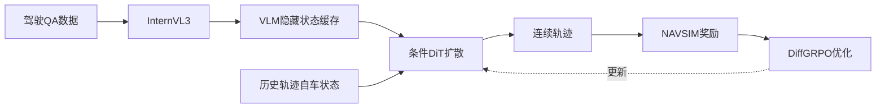
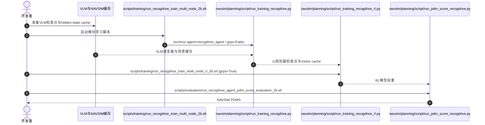

# ReCogDrive：驾驶认知引导扩散规划与DiffGRPO

**英文：** ReCogDrive: A Reinforced Cognitive Framework for End-to-End Autonomous Driving

## 一句话定义

三阶段驾驶问答知识生成、提炼、质检微调InternVL3；将VLM隐状态送入DiT连续轨迹规划；DiffGRPO用规划奖励对扩散去噪策略进行后训练。

## 英文缩写速查

| 缩写 | 英文全称 | 简要说明 |
|---|---|---|
| DiT | Diffusion Transformer | 连续轨迹规划模块 |
| E2E | End-to-End | 从观测到规划的端到端模型 |
| RL | Reinforcement Learning | 奖励信号驱动的优化 |
| VLA | Vision-Language-Action | 视觉语言动作联合学习 |

## 为什么重要

驾驶认知引导扩散规划与DiffGRPO专门针对单纯模仿驾驶轨迹难以解释或处理长尾交互的限制，提供可核查的论文、权重或代码入口。

## 核心原理

三阶段驾驶问答知识生成、提炼、质检微调InternVL3；将VLM隐状态送入DiT连续轨迹规划；DiffGRPO用规划奖励对扩散去噪策略进行后训练。

## 流程总览



此流程根据 [原始论文记录](../../sources/papers/ad_top10_2026_recogdrive.md)，非跨项目通用套图。

## 源码运行时序图



按官方README和 [源码入口记录](../../sources/repos/ad_top10_2026_recogdrive.md) 核对；**未在本次 ingest 执行完整 GPU 推理或训练**。

## 评测与指标

官方NAVSIM 2B VLM/IL/RL 依次为84.1/86.5/90.8 PDMS；还提供Bench2Drive闭环结果。

## 工程实践

官方仓库：https://github.com/xiaomi-research/recogdrive

1. ```cd internvl_chat && sh ./shell/internvl3.0/2nd_finetune/internvl3_8b_dynamic_res_2nd_finetune_recogdrive_pretrain.sh```
2. ```sh scripts/training/run_recogdrive_train_multi_node_2b.sh```
3. ```sh scripts/training/run_recogdrive_train_multi_node_rl_2b.sh```
4. ```sh scripts/evaluation/run_recogdrive_agent_pdm_score_evaluation_2b.sh```

## 结论

**驾驶认知引导扩散规划与DiffGRPO** 是驾驶研究中一条具有独立问题设定的复现路线。

1. 先使用官方公开checkpoint与现有评测脚本建立基线。
2. 明确划分论文提出的完整系统和当前代码实际已开放的部分。
3. 记录数据、版本、硬件与指标，避免不同评测设定的数字错比。

## 与其他工作对比

- **对比端到端多模态与纯视觉规划器（NAVSIM navtest，Table 1）：** 仅使用相机输入的 ReCogDrive 达到 **90.8 PDMS**，高于同为纯视觉的 `PARA-Drive`（84.0）、[UniAD](./paper-uniad.md)（83.4）、`DrivingGPT`（82.4）与 `VADv2-V8192`（80.9），同时也超越使用相机+LiDAR 的 [DiffusionDrive](./paper-diffusiondrive.md)（88.1）和 `WoTE`（88.3）。
- **对比直接微调 VLM 基线：** 论文在相同 NAVSIM 轨迹数据上复现的 `InternVL3-8B†` 与 `QwenVL2.5-8B†` 均为 83.3 PDMS；ReCogDrive 通过驾驶问答认知注入、条件 DiT 规划头及 DiffGRPO 奖励后训练取得 +7.5 PDMS 增益（后续 [SGDrive](./paper-sgdrive-2601-05640.md) 进一步以分层世界查询在 RFT 下达 91.1 PDMS）。
- **对比 CARLA Bench2Drive 闭环排行榜（Table 2）：** ReCogDrive 取得 **45.45% 场景成功率**与 **71.36 Driving Score**，高于 `DriveTransformer-L`（35.01% / 63.46）、`DriveAdapter*`（33.08% / 64.22）、`UniAD-B`（16.36% / 45.81）与 `VAD`（15.00% / 42.35），紧急制动（69.09%）和交通标志遵守（71.34%）突出，但 Comfort（17.45）与让行（20.00%）落后于部分经典端到端基线，且依赖 1–2 TB VLM 隐状态磁盘缓存。

## 局限与风险

部分第三方数据受许可限制；VLM隐状态缓存约占1–2TB磁盘；不同数据集分数不可混合。

真实上路安全和合规均不能由离线分数、仿真结果或开源状态单独证明。

## 关联页面

- [2026 自动驾驶开源项目技术地图](../overview/autonomous-driving-open-source-top10-2026.md)
- [VLA](../methods/vla.md)
- [生成式世界模型](../methods/generative-world-models.md)

## 参考来源

- [论文核对记录](../../sources/papers/ad_top10_2026_recogdrive.md)
- [官方源码入口](../../sources/repos/ad_top10_2026_recogdrive.md)
- [深蓝AI策展原文](../../sources/blogs/wechat_shenlan_ai_autonomous_driving_top10_2026.md)

## 推荐继续阅读

- [原论文](https://arxiv.org/html/2506.08052)
- [官方代码](https://github.com/xiaomi-research/recogdrive)
