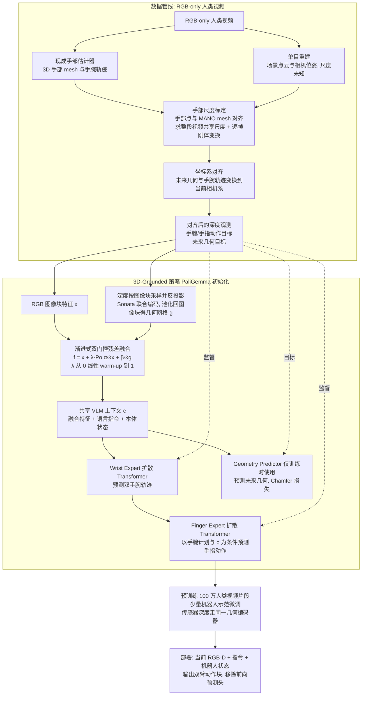

# Recon-Augmented Bimanual Pretrain：利用三维重建增强的视觉运动预训练，从纯 RGB 人类视频学习双臂灵巧操作

**Recon-Augmented Bimanual Pretrain**（*Reconstruction-Augmented Visuomotor Pre-Training of 3D-Grounded Bimanual Dexterity from RGB-Only Human Videos*，[arXiv:2610.29716](https://arxiv.org/abs/2610.29716)）收录于 senlanke「具身运控lab」10-19–10-23 前沿论文动态（Manipulation）。本页依据**周报条目 + arXiv 摘要页**整理，流程图依据论文方法部分（见参考来源），未逐页核对实验数字；指标与结论以论文为准。

## 一句话定义

**Recon-Augmented Bimanual Pretrain：利用三维重建增强的视觉运动预训练，从纯 RGB 人类视频学习双臂灵巧操作——将三维重建引入视觉运动预训练，使模型能够利用纯 RGB 视频中的三维操作信息学习双臂灵巧能力。**

## 英文缩写速查

| 缩写 | 英文全称 | 简要说明 |
|------|----------|----------|
| VLA | Vision-Language-Action | 视觉–语言–动作模型 |
| IL | Imitation Learning | 模仿学习 |

## 为什么重要

- 周报所述待解决的问题：人类 RGB 视频缺少机器人动作标签和直接可用的三维操作状态，限制了双臂策略从大规模人类视频中学习。

## 流程总览

图依据：论文 §III-A–C / Fig.2 / Fig.3 / 式(1)–(5)

## 核心机制

| 项 | 内容 |
|----|------|
| **arXiv** | [2610.29716](https://arxiv.org/abs/2610.29716) · [PDF](https://arxiv.org/pdf/2610.29716) |
| **作者（arXiv）** | Xingyi He, Zhiwen Qiu, Adhitya Polavaram, Yunhao Cao, Cory Fan, Julius Samwer, Saleh Kalantari, Kuan Fang |
| **机构（周报所述，未逐条核实）** | 待核实（作者：Xingyi He、Zhiwen Qiu、Kuan Fang 等）。 |
| **arXiv 评论栏** | Project page: this https URL |
| **开源** | arXiv 摘要页/评论给出项目页或外链（https://spatial-dex.github.io/）；未发现代码仓库链接（2026-10-26） |
| **周报所述创新点** | 将三维重建引入视觉运动预训练，使模型能够利用纯 RGB 视频中的三维操作信息学习双臂灵巧能力。 |

### arXiv 摘要节选（英文原文）

> We present SpatialDex, a framework that learns 3D-grounded bimanual dexterity from RGB-only human videos through reconstruction-augmented visuomotor pre-training. The central idea is to learn human behavior together with its spatial context.

## 源码运行时序图

**不适用**：arXiv 摘要页/评论给出项目页或外链（https://spatial-dex.github.io/）；未发现代码仓库链接，无可对齐的官方代码流程。

## 实验与评测

- 周报与摘要给出的数字/场景已写入上表「创新点」与摘要节选；其余实验细节、基线与成功率定义请回到论文正文。
- 读法：先对齐任务设定、传感器与成功定义（仿真/真机），再解读 headline 数字，勿跨论文直接比较。

## 与其他工作对比

| 维度 | 读法 |
|------|------|
| **同周对照** | 见 [Manipulation周报技术地图](../overview/senlanke-weekly-2026-10-19-23-manipulation-technology-map.md)，按方向浏览同期论文 |
| **开源状态** | arXiv 摘要页/评论给出项目页或外链（https://spatial-dex.github.io/）；未发现代码仓库链接 |

## 结论

**Recon-Augmented Bimanual Pretrain：利用三维重建增强的视觉运动预训练，从纯 RGB 人类视频学习双臂灵巧操作。**

1. 本页是入库级摘要，复现前请核对论文正文、附录与代码仓库。
2. 指标须连同实验条件解读。
3. 关注 arXiv 版本更新与代码发布。

## 关联页面

- [senlanke-weekly-2026-10-19-23-manipulation-technology-map](../overview/senlanke-weekly-2026-10-19-23-manipulation-technology-map.md)
- [manipulation](../tasks/manipulation.md)
- [vla](../methods/vla.md)

## 参考来源

- [reconstruction-augmented-bimanual-pretraining-rgb-human-video_arxiv_2610_29716.md](../../sources/papers/reconstruction-augmented-bimanual-pretraining-rgb-human-video_arxiv_2610_29716.md)
- [wechat_senlanke_weekly_manipulation_2026-10-19_23.md](../../sources/blogs/wechat_senlanke_weekly_manipulation_2026-10-19_23.md)
- [arXiv:2610.29716](https://arxiv.org/abs/2610.29716)
- [arXiv PDF](https://arxiv.org/pdf/2610.29716)：已通读方法部分（实验与附录以略读为准）：摘要、§I 引言、§II 相关工作、§III 方法（A–C）、§IV-A 实验设定开头

## 推荐继续阅读

- [arXiv PDF](https://arxiv.org/pdf/2610.29716)
