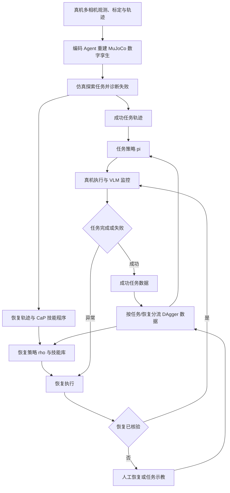

# Recova：智能体引导的机器人操作失败恢复 / Agent-Guided Failure Recovery

## 一句话定义

**Recova** 将常规机器人操作与异常场景恢复分开训练：Agent 先在数字孪生中探索失败并产生可复用纠正技能，真机再用视觉语言监控器核验恢复效果，将必要的人工接管转化为下轮策略训练数据。

## 英文缩写速查

| 缩写 | 英文全称 | 简要说明 |
|---|---|---|
| VLA | Vision-Language-Action | 执行语言指定操作任务的视觉动作策略 |
| VLM | Vision-Language Model | 周期性判断完成、失败、恢复状态的监控器 |
| DAgger | Dataset Aggregation | 将真机分布下的成功轨迹与人工接管分流聚合再训练 |
| CaP | Code as Policies | Agent 在仿真中开发、可调用的程序型恢复技能 |
| Real2Sim | Real-to-Simulation | 从真实工位观测和轨迹构建可测试的 MuJoCo 数字孪生 |

## 为什么重要

- 标准初态的成功数据很少覆盖异常接触与乱序物体；“失败后重跑”无法保证排除物理障碍。
- 把“恢复到可工作场景”与“完成任务”拆成不同学习目标，更容易归因和复用人类示教。
- 先在数字孪生中探索高风险失败，再用真机反馈和恢复核验补齐模拟与物理接触之间的差距。

## 核心原理

### 两种条件策略与恢复类型

- **任务策略** pi(a | o, g)：输入观测 o 和任务指令 g，目标是完成任务条件。
- **恢复策略** rho(a | o, z)：输入异常观测和恢复指令 z，目标是解除阻碍；也可以调用已验证的 CaP 程序。指令按失败类型注册到技能集合 K，而不是按任务复制恢复策略。
- 恢复有三种作用：**restorative**（扶正物体等恢复场景）、**enabling**（移动障碍以便后续动作）、**adaptive**（更换抓取姿态或执行路径）。

### 流程总览

其中成功任务示教用于任务策略，带恢复指令的示教用于恢复策略；未成功的策略片段保留供分析，但不用于监督更新。

### 真机执行与人工回退

1. **Monitor**：从原始场景生成可验证的任务完成条件；使用 completion 与 intervention 两类 VLM 查询。
2. **Detect**：介入查询比较初始与最近帧；判断场景是否仍完整，并重用已有恢复指令 z。
3. **Decide**：场景完整但任务停滞时人工演示任务；场景被扰动时先尝试注册恢复策略，失败或缺失时交由人类示教。连续两次介入后切换完整任务示教，避免失败循环。
4. **Verify**：恢复后对比前后场景，确认已达到“可继续尝试”的等价状态，而不是要求物体完全归位。验证通过后回到 home pose，重新开始任务尝试。

## 工程实践

| 实现要点 | 论文配置 / 工程意义 |
|---|---|
| 数字孪生 | 从四路相机、相机标定、机器人轨迹重建 MuJoCo，拟合物体姿态与接触参数 |
| 机器人 | 每工位双 I2RT YAM 臂、四 RealSense，相机：顶部/前方/双腕；30 Hz |
| 底层学习 | 任务、恢复策略分别从 pi0.5 底座微调；14 维关节/夹爪目标，动作 chunk 50 步 |
| 监控模型 | 论文使用 Gemini 3.8 Flash，按 requirement/completion/intervention/restoration 四种模板返回 JSON |
| 采集周期 | 完成查询 600 步（20 s），介入查询 300 步（10 s），一次恢复上限 1500 步（50 s） |
| 示教分流 | Success 与 Expand 更新任务策略，Recover 与核验通过的自主恢复更新恢复策略；失败片段只存日志 |
| 训练配置 | AdamW；学习率 2.5e-5 → 2.5e-6；batch 64；阶段 2k–5k 步；8× L40，约 1–3 h/阶段（论文附录 C） |
| 复现入口 | 官方论文、项目演示和附录伪代码已公开；未找到独立完整可运行仓库、训练权重或数据集发布入口 |

## 源码运行时序图

**不适用（截至 2026-11-07）**：项目页支持查看部分恢复程序片段，但没有核实到官方公开的完整训练/推理/部署源码仓库。上面的 Mermaid 是**论文方法流程图**，不是已核验源码的调用时序；不虚构函数、脚本或依赖。

## 实验与评测

| 评测 | Recova 平均成功率 | 论文中最强均值对照 | 增益 |
|---|---:|---:|---:|
| LIBERO-Pro：六种位置/任务扰动配置 | 78.8% | ASPIRE 71.7% | +7.1 pp |
| MolmoSpaces：Pick / P&P / Open / Close | 64.9% | RATs 38.0% | +26.9 pp |
| 真机四任务：基础 pi0.5 任务策略 | 23.8% | — | — |
| 真机四任务：+ DAgger | 77.5% | 基础策略 23.8% | +53.7 pp |
| 真机四任务：+ 恢复技能 | 87.5% | DAgger 77.5% | +10.0 pp |

真机为装铅笔盒、叠环、摸牌、弃牌，每项每配置各测 20 次。单独的摸牌任务在四轮数据收集中，人工接管比例从 **7/8（87.5%）降至 0/7（0%）**；这是该实验的有限样本观察，不代表所有任务永不需要人工。

## 结论

**核心增益来自“恢复技能 + 验证 + 任务/恢复数据分流”的完整闭环，而非单纯增加标准成功示教。**

1. **保留独立恢复指令 z**，使“扶正/清障/重抓”能跨同类失败复用。
2. **先检查是否恢复成功，再继续任务**；否则重试可能累积错误。
3. **归档成功/接管数据的来源类型**，避免将失败前缀混作有效监督。
4. **分别阅读 +53.7 pp（DAgger）与 +10.0 pp（恢复）**，不能把所有提升都归因于恢复策略。
5. **跨任务共享和新技能自动注册仍是未来方向**，不应当作现成的可部署功能。

## 与其他工作对比

- **ASPIRE / RATs**：偏重 agent 发现可执行程序或技能；Recova 把已发现恢复、真机 VLM 监控、可学习恢复策略与人类示教接成完整部署闭环。
- **通用任务 VLA**：对标准任务执行有效，但不一定能解决失败后的异常物体状态；Recova 为失败状态提供专用指令和纠正数据。
- **单纯 DAgger**：可以提高任务策略成功率，但仍存在可由专用恢复技能处理的故障状态（本文真机 77.5% → 87.5%）。

## 局限与风险

- **基准对比口径**：文中基线主要来自先前发表结果，未全部在统一条件下重跑；无法将跨论文差异直接等同于严格受控的消融结果。
- **小样本与任务覆盖**：真机每任务/配置 20 次；人工接管下降的四轮趋势只在一项任务上报告。
- **监控时延**：VLM 查询中位耗时 4.5–5.5 s，适合任务级检查，不等于 30 Hz 的安全关键接触闭环。
- **物理域差异**：数字孪生需手动或自动拟合场景布局与接触参数；仿真发现的恢复行为仍须物理核验。
- **开源边界**：项目页公开演示及部分恢复脚本的查看入口，但尚未发现端到端可执行代码、权重与数据集发布链接。

## 关联页面

- [Manipulation / 机器人操作](../tasks/manipulation.md)
- [Imitation Learning / 模仿学习](../methods/imitation-learning.md)
- [Contact-Rich Manipulation / 接触丰富操作](../concepts/contact-rich-manipulation.md)

## 参考来源

- [Recova 论文原文通读归档](../../sources/papers/recova_arxiv_2610_01178.md)
- [Recova 项目主页归档与开放状态核查](../../sources/sites/recova.md)

## 推荐继续阅读

- [原论文全文（arXiv HTML，含附录）](https://arxiv.org/html/2610.01178v1)
- [官方项目页面与演示](https://www.liuisabella.com/Recova/)
- [NVIDIA 官方项目页](https://research.nvidia.com/labs/gear/recova/)
