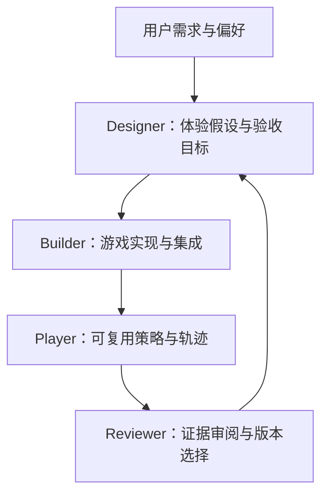
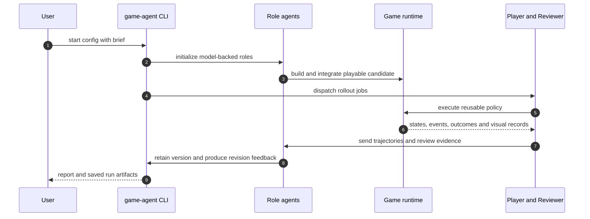

# Recursive Game Creator

## 一句话定义

**Recursive Game Creator** 是一个体验导向的游戏开发 harness：Designer、Builder、coding-native Player、Reviewer 组成循环，把可执行游玩证据和偏好反馈转成下一轮游戏修改。

## 英文缩写速查

| 缩写 | 英文全称 | 简要说明 |
| --- | --- | --- |
| RGC | Recursive Game Creator | 本框架简称，以固定模型参数迭代改进游戏产物 |
| LLM | Large Language Model | Designer、Builder、Reviewer 等角色可调用的语言模型 |
| API | Application Programming Interface | Player 用于读取游戏状态并提交动作的程序接口 |
| A/B | A/B comparison | Reviewer 对匿名候选版本与保留版本做偏好比较 |
| L1 | Source-level checks | GameASG-Bench 的源码静态检查 |
| L2 | Runtime checks | GameASG-Bench 的浏览器运行时检查 |

## 为什么重要

coding agent 能产出可运行程序，不代表程序符合玩家体验目标。RGC 把“好不好玩”拆成可检验的设计目标、策略轨迹、视觉证据、版本比较和后续修改，让多轮软件开发有可追溯的反馈闭环。

它与 [Three.js Game Skills](./threejs-game-skills.md) 的交付技能包互补：后者帮助 agent 构建和检查浏览器游戏，RGC 研究如何让游戏经过反复试玩与体验评审而改进。对机器人读者的价值在于 coding agent 的执行式评测与反馈设计；论文没有机器人或物理世界实验。

## 核心原理与流程总览

| 角色 | 输入 | 输出 | 关键作用 |
| --- | --- | --- | --- |
| Designer | 用户 brief、当前游戏、历史评审 | 体验假设、改动计划、验收目标、资产需求 | 把主观体验转成可实施改动 |
| Builder | 计划、游戏代码、资产需求 | 可运行候选版本与针对性自检 | 从 playable draft 集成为完整候选 |
| Player | 游戏状态 schema、动作、测试目标 | 多条策略轨迹和可选视觉记录 | 程序化执行，降低逐步视觉/模型调用成本 |
| Reviewer | 轨迹、视觉证据、用户输入、版本标准 | A/B 偏好、理由、证据路径和下一轮修订目标 | 评估并筛选候选版本 |

轨迹可包含状态、动作、事件、进度、耗时和终止结果。代理策略覆盖多个行为风格，但仍是被测策略，不等价于完整的人类玩家群体；用户明确表达的偏好和评审推断的偏好需分开记录。

## 源码运行时序图

仓库 README 提供 **game-agent start** 的 HTML/Godot quick start、运行目录、状态查询、恢复和导出入口；图中角色与 CLI、runtime 路径据此归纳，未代表已独立执行验证。

## 实验与评测

论文在 GameCraft-Bench 和 GameASG-Bench 上评估。前者衡量完整 Godot 游戏的机制、内容深度、功能视觉和美术质量；后者检查生成的浏览器游戏是否满足源码与运行要求。

| 评测 | 作者报告结果 | 读法 |
| --- | --- | --- |
| GameCraft-Bench，45 个选定任务 | GPT-6 Astra 配置下 R1 72.70 → R3 77.89（+5.19）；同模型基线 71.26 | 三轮后总分高 6.63；分数是论文自报，不是机器人或仿真指标 |
| GameASG-Bench，47 个任务 | 严格任务成功 25/47（53.2%）；L1 98.3%，L2 均值 93.4% | 源码检查通过率高不等于浏览器任务全部成功 |
| 专家体验评估 | R1→R3：控制 2→8、可玩性 1→7、深度 3→6、美术 2→8；平均游玩时长 1.50→12.41 分钟 | 作者报告的多轮变化，不能单凭代理或专家指标推断普遍玩家偏好 |

## 与其他工作对比

| 工作 | 改进对象 | 主要反馈 |
| --- | --- | --- |
| [Three.js Game Skills](./threejs-game-skills.md) | coding agent 的游戏制作流程与 QA 能力 | 构建、浏览器测试、截图和质量清单 |
| [Aether RSIAgent](./aether-rsiagent.md) | 计算机使用 agent 的经验记忆与任务表现 | verifier、执行结果和跨轮经验 |
| Recursive Game Creator | 游戏产物与体验 | 可复用游戏策略轨迹、视觉记录、偏好评审与版本筛选 |

RGC 把代码生成后的游戏体验纳入闭环；它不是通用 coding agent 基准，也未展示物理机器人操作。GameCraft-Bench 分数应按论文所用任务、模型和评分设置解读。

## 工程实践与开放状态

官方 [GitHub 仓库](https://github.com/IMBALDY/RecursiveGameCreator) 已公开，许可证为 MIT。README 给出 setup、HTML/Godot quick start、run resume 和导出入口；依赖 Docker、Node.js 22/npm、Python 3.12，真实生成需要模型认证。项目页另提供可试玩样例。此次仅核对公开源码和运行文档，未安装或复现完整流程。

实作时可先用仓库离线 mock 路径验证依赖与接口，再配置模型做一轮 quick start；正式比较应固定模型、游戏状态接口、rollout 预算及评审准则，并记录策略构造、修复、执行、评审各阶段成本。

## 结论

**RGC 展示了如何把游戏代码代理从“生成可运行成品”推进到“根据执行证据多轮改进体验”，但证据只适用于论文评测的游戏软件场景。**

1. **把游戏体验写成验收目标** — Designer 输出可观察的场景、动作和结果，不只给 Builder 一句审美描述。
2. **优先使用程序接口收集轨迹** — 减少逐动作模型调用，同时保留策略、状态与运行结果，方便复查。
3. **控制反馈来源** — 区分实测行为、Reviewer 推断和用户明确偏好；代理游玩时长不能替代真人偏好。
4. **按任务和预算读分数** — 三轮后有所提升，但作者测试的是选定游戏基准任务；结果不能外推到机器人任务。
5. **复现时计入整条流水线成本** — 策略生成与修复、rollout、评审、容器和模型服务都会消耗资源，不只看单次生成速度。

## 局限与风险

- **任务边界：** 论文在游戏生成、试玩和网页/Godot 测试环境中评测，没有机器人、动力学、接触或 sim-to-real 实验。
- **代理代表性：** coding-native Player 能生成多样轨迹，但不能代表人类玩家分布；游玩时间本身不能证明享受程度。
- **比较成本：** 总成本包括策略生成、策略修复、执行和评审；跨 harness 比较需统一预算与观测条件。
- **开放边界：** 代码已公开；本次未核实是否有可直接下载的训练数据或模型权重。

## 关联页面

- [Agentic Coding 时代的软件工程基础](../concepts/agentic-coding-software-fundamentals.md) — 评估 agent 写代码之外的工程闭环。
- [Three.js Game Skills](./threejs-game-skills.md) — coding agent 构建、测试和交付浏览器游戏。
- [Aether RSIAgent](./aether-rsiagent.md) — 另一种将执行反馈用于 coding agent 改进的研究。
- [开源游戏源码索引](./open-source-games.md) — 对照开源游戏源码与代理开发 harness 的边界。
- [具身大模型评测基准选型闭环](../queries/embodied-eval-benchmark-selection-loop.md) — 对照边界：RGC 的 GameCraft-Bench / GameASG-Bench 评测游戏软件，不属该闭环四层中任何一层，分数不能外推为具身能力。

## 参考来源

- [论文归档](../../sources/papers/recursive_game_creator.md)
- [项目页归档](../../sources/sites/recursive-game-creator.md)
- [代码仓库归档](../../sources/repos/recursive-game-creator.md)

## 推荐继续阅读

- [arXiv HTML 论文](https://arxiv.org/html/2610.08621v1) — 方法流程、基准和局限。
- [Recursive Game Creator 项目页](https://imbaldy.github.io/recursive-game-creator/) — 游戏演化示例与交互体验。
- [RecursiveGameCreator README](https://github.com/IMBALDY/RecursiveGameCreator/blob/main/README.md) — 安装和运行命令。
