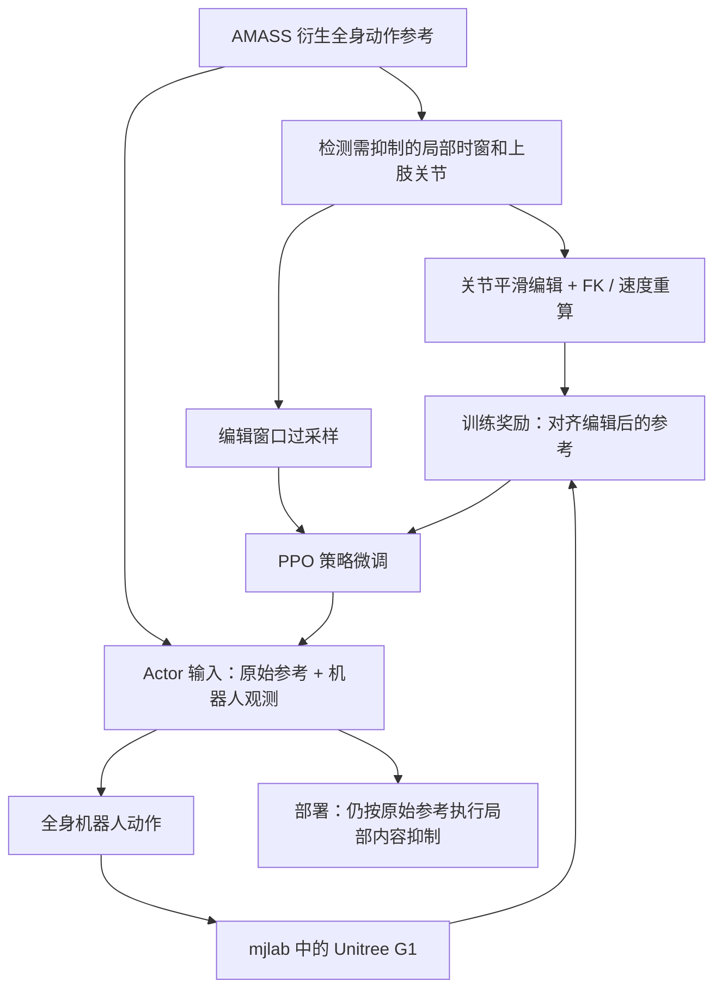

# RedirectMimic: Local Motion Content Redaction for Humanoid Whole-Body Control｜RedirectMimic：人形全身控制中的局部动作内容删改

## 一句话定义

**RedirectMimic** 对预训练人形动作模仿策略做**局部动作内容抑制**：只把需要去除的手臂动作片段转换成编辑后的奖励参考，在其他时间和身体部位尽可能保持原动作表现。论文：[arXiv:2611.14049v1](https://arxiv.org/html/2611.14049v1)，[官方项目页](https://xiaopeng-whu.github.io/RedirectMimic/)。

## 英文缩写速查

| 缩写 | 英文全称 | 简要说明 |
|---|---|---|
| PPO | Proximal Policy Optimization | 微调全身动作控制策略的强化学习优化 |
| G1 | Unitree G1 | 29 自由度仿真目标人形本体 |
| AMASS | Archive of Motion Capture as Surface Shapes | 人体动作来源 |
| FK | Forward Kinematics | 编辑关节动作后重算运动学参考 |
| SR | Success Rate | 是否同时满足动作删改与稳定跟踪的窗口成功率 |

## 为什么重要

全身模仿策略已会大量动作，但在特定场景可能需要“保留走路与平衡，只禁止某段举手”。用一个全新策略重新学习易损害正常运动；单纯强行钳制某关节又可能破坏全身协调。本文提出训练时通过**局部目标编辑**改写奖励，让策略在执行原始参考时自动完成必要抑制。

## 核心原理

- **选择局部内容**：在原始运动中定位高速度甩臂（S1）或手腕举过肩部（S2）等需要抑制的窗口及相关上肢关节。
- **生成编辑奖励参考**：仅对目标关节位姿进行向中性姿态的平滑改写，并更新 FK 和速度一致性；**原始参考仍输入策略 actor**，编辑参考用于训练奖励监督。
- **改进采样**：普通 on-policy 采样中编辑窗口稀少。训练采用混合窗口采样，增加这些短时片段出现频率，使 PPO 真正看见编辑成功/失败的反馈。
- **保留非编辑动作**：其余关节和时刻仍受到原始内容与稳定性目标约束，避免整体动作质量退化。

### 流程总览

根据论文原始/编辑参考双通道构造，并非源码调用顺序。

## 实验与评测

论文以 **7,509 段 AMASS 来源动作**、G1 29 DoF、mjlab 为实验设置；S1 关注快速手臂运动，S2 关注举手动作，另测试对正常运动的保留。

| 指标 | RedirectMimic | 参考方法 | 重要解释 |
|---|---:|---:|---|
| S2 联合成功率 | **94.2%** | AntiTrack 65.0%、ZeroTrack 40.8% | 同时顾及删改与动作质量 |
| S2 编辑内容出现率 | **2.7%** | AntiTrack 32.8%、ZeroTrack 58.9% | 越低意味着指定动作越少出现 |
| S2 编辑侧跟踪误差 | **0.079 m** | AntiTrack 0.171 m、ZeroTrack 0.224 m | 更接近编辑目标 |
| S1 联合成功率 | **87.4%** | ZeroTrack **89.7%** | RedirectMimic **不是这一列最高** |

论文在未编辑片段的跟踪表现接近预训练基线；上述成绩只代表所测动作集合与判据，并非任意全身运动可无代价删除。

## 结论

**RedirectMimic 的贡献是“原始运动供观察、局部改写供奖励、稀疏窗口增加训练权重”这一有效的策略编辑框架，而非增加运行时编辑输入。**

1. 明确指定要抑制的关节、时间窗与目标中性动作，不能仅用模糊语义定义“删除”。
2. 修改目标位姿时同步更新末端 FK 和速度，否则奖励自相矛盾。
3. 用编辑窗口采样提高微调信号占比，同时保留足够未修改窗口防止灾难性遗忘。
4. 同时报告内容抑制率、动作跟踪误差、稳定性与总体成功率；S1 有基线指标更高的情况。
5. 仿真有效不等于真实 G1 的动态安全验证，尤其应监测补偿动作带来的关节载荷。

## 工程实践

先冻结一份原始参考及编辑 mask，检查过渡窗的关节/末端连续性，再用带混合采样的 PPO 微调并做未编辑动作回归测试。项目页目前可查论文及演示，但此次未找到公开可辨认的训练/推理代码，不能据此宣称复现。

## 源码运行时序图

**不适用**。截至 2026-11-12 [项目页](https://xiaopeng-whu.github.io/RedirectMimic/)未提供可验证官方源码入口；不把描述性流程冒充程序调用链。

## 局限与风险

- 实验针对特定的上肢片段与 G1 模仿动作集合，不能推断任意多关节复杂任务的编辑质量。
- 结果主要来自仿真，真实接触、手持负载及外部碰撞场景的安全性仍需单独验证。
- 编辑参考是训练时的监督对象，**推理时仍输入原始动作参考**；不要误称“模型自动理解自然语言并编辑动作”。

## 关联页面

- [人形机器人移动](../tasks/humanoid-locomotion.md)
- [模仿学习](../methods/imitation-learning.md)
- [动作重定向流水线](../concepts/motion-retargeting-pipeline.md)
- [ReACT：非对称负载移动](./paper-react-asymmetric-load-tracking.md)

## 参考来源

- [RedirectMimic 论文通读归档](../../sources/papers/redirectmimic_arxiv_2611_14049.md)
- [官方项目页面归档](../../sources/sites/redirectmimic-project.md)
- [arXiv v1 全文](https://arxiv.org/html/2611.14049v1)

## 推荐继续阅读

- [官方项目（方法说明与演示）](https://xiaopeng-whu.github.io/RedirectMimic/)
- [论文全文](https://arxiv.org/html/2611.14049v1)
