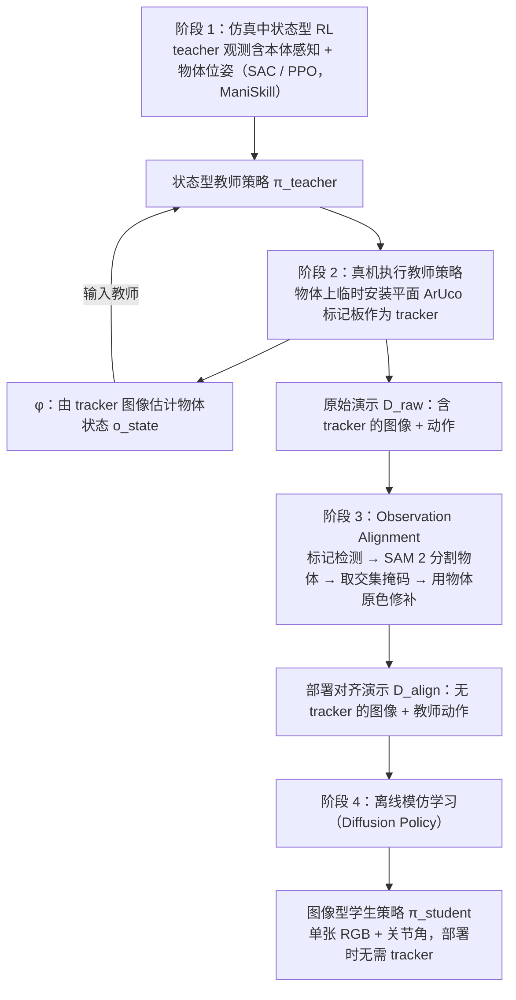

# ReDOA（arXiv:2610.25691）

**ReDOA**（*ReDOA: Real-World Distillation via Observation Alignment for Image-Based Manipulation Policy Learning*，[arXiv:2610.25691](https://arxiv.org/abs/2610.25691)，[项目页](https://isri-aist.github.io/redoa-project-page/)）来自 [具身智能小站 2026-10-31 盘点](../../sources/blogs/wechat_embodied_station_50_papers_scenerig_photo_to_sim_2026-10-31.md)，属「策略学习与 VLA」组。

## 一句话定义

**ReDOA先把状态教师部署到真机采集轨迹，再对齐观测、蒸馏图像策略；三项非抓取操作验证效率与成功，前提是教师本身能跨过仿真到现实鸿沟。**

## 英文缩写速查

| 缩写 | 英文全称 | 简要说明 |
|------|----------|----------|
| ReDOA | ReDOA: Real-World Distillation via Observation Alignment for Image-Based Manipulation Policy Learning | 本文方法 / 基准的简称 |

## 为什么重要

- 让仿真教师在真实世界教视觉策略。
- 开源结论：**项目页未列 GitHub**（步骤 2.5，2026-10-31）。项目页 HTTP 200，未见 GitHub 链接或 coming soon 字样。
- 同期同组工作见 [单图重建仿真、VLA 适配评测与跨形态世界模型：具身智能小站 10-31 期 50 篇阅读坐标](../overview/embodied-station-2026-10-31-50-papers-technology-map.md)。

## 流程总览

图依据：论文 §III-A–D、Fig.2 / Fig.3、§IV-B 实现细节。

## 核心机制

| 项 | 内容 |
|----|------|
| **arXiv** | [2610.25691](https://arxiv.org/abs/2610.25691) |
| **开源** | **项目页未列 GitHub** |
| **要点** | ReDOA先把状态教师部署到真机采集轨迹，再对齐观测、蒸馏图像策略；三项非抓取操作验证效率与成功，前提是教师本身能跨过仿真到现实鸿沟。 |
| **文内指标** | 公众号未给具体数字，本页不引用。 |

## 源码运行时序图

**不适用（项目页未列 GitHub）** — 项目页 HTTP 200，未见 GitHub 链接或 coming soon 字样。 不编造运行脚本；代码公开后再补。

## 实验与评测

- 公众号未给具体数字，本页不引用。
- **读法：** 本页为索引级摘要，依据公众号转述的官方摘要与仓库信息整理；逐项数字与 baseline 以原文 PDF 为准。

## 与其他工作对比

- 横向索引见 [单图重建仿真、VLA 适配评测与跨形态世界模型：具身智能小站 10-31 期 50 篇阅读坐标](../overview/embodied-station-2026-10-31-50-papers-technology-map.md)；同 arXiv 不重复造页。

## 结论

**让仿真教师在真实世界教视觉策略：ReDOA先把状态教师部署到真机采集轨迹，再对齐观测、蒸馏图像策略；三项非抓取操作验证效率与成功，前提是教师本身能跨过仿真到现实鸿沟。**

1. 开源边界：**项目页未列 GitHub** — 项目页 HTTP 200，未见 GitHub 链接或 coming soon 字样。
2. 核心机制：ReDOA先把状态教师部署到真机采集轨迹，再对齐观测、蒸馏图像策略；三项非抓取操作验证效率与成功，前提是教师本身能跨过仿真到现实鸿沟。
3. 复现与选型前核对任务协议、硬件与基准口径，勿直接横比公众号摘录数字。

## 关联页面

- [vla](../methods/vla.md)
- [imitation-learning](../methods/imitation-learning.md)
- [reinforcement-learning](../methods/reinforcement-learning.md)
- [sim2real](../concepts/sim2real.md)
- [embodied-station-2026-10-31-50-papers-technology-map](../overview/embodied-station-2026-10-31-50-papers-technology-map.md)

## 参考来源

- [redoa_arxiv_2610_25691.md](../../sources/papers/redoa_arxiv_2610_25691.md)
- [wechat_embodied_station_50_papers_scenerig_photo_to_sim_2026-10-31.md](../../sources/blogs/wechat_embodied_station_50_papers_scenerig_photo_to_sim_2026-10-31.md)
- [arXiv:2610.25691](https://arxiv.org/abs/2610.25691)
- [arXiv PDF](https://arxiv.org/pdf/2610.25691)：已通读全文：四阶段流程与 Observation Alignment（§III）、实验设定与实现细节（§IV）、基线对比（§V-A/B）

## 推荐继续阅读

- [arXiv PDF](https://arxiv.org/pdf/2610.25691)
- [项目页](https://isri-aist.github.io/redoa-project-page/)
