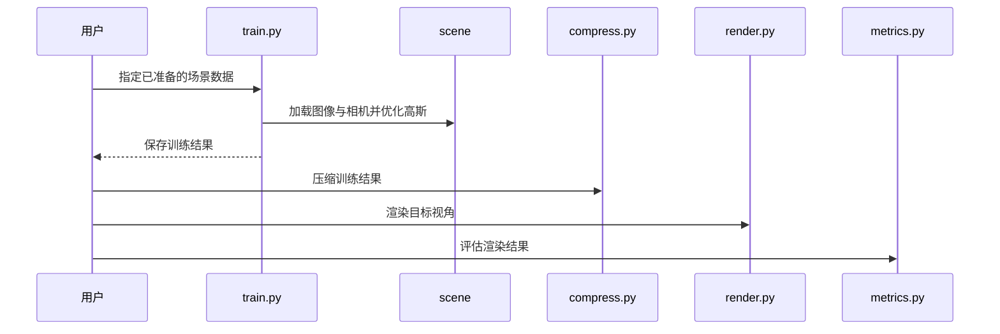

# Reducing the Memory Footprint of 3D Gaussian Splatting

## 一句话定义

**Reduced 3DGS** 是针对逐场景优化的 3DGS 表示的压缩方法，通过减少高斯数量、方向外观系数和属性精度降低场景文件大小。

## 英文缩写速查

| 缩写 | 英文全称 | 简要说明 |
|------|----------|----------|
| 3DGS | 3D Gaussian Splatting | 显式高斯场景表示与渲染 |
| SH | Spherical Harmonics | 表示视角相关外观的球谐函数 |
| NVS | Novel View Synthesis | 合成未见视角的图像 |
| PLY | Polygon File Format | 仓库保存点云和高斯属性的文件格式 |

## 核心信息

| 项 | 内容 |
|----|------|
| 作者 | Panagiotis Papantonakis、Georgios Kopanas、Bernhard Kerbl、Alexandre Lanvin、George Drettakis |
| 机构 | Inria、蔚蓝海岸大学（Université Côte d'Azur）、维也纳工业大学（TU Wien） |
| 发表 | I3D 2024 |
| 输入与输出 | 已标定多视图场景 → 优化、压缩后的高斯表示 |
| 代码与数据 | [官方代码](https://github.com/graphdeco-inria/reduced-3dgs)公开；仓库数据集链接标记 TODO，数据需另行准备 |

## 核心原理

1. **原语剪枝：** 训练期间结合分辨率移除贡献较小的高斯，降低数量。
2. **球谐系数分配：** 每个高斯按需选择方向外观的球谐阶数，减少不必要的系数。
3. **量化：** 优化后用码本量化和半精度表示进一步压缩属性。

## 源码运行时序图

具体命令、依赖与数据路径以官方 README 为准。

## 工程实践

- 递归克隆仓库及子模块，按 README 配置环境并准备场景数据。
- 改版 PLY 与原始 3DGS 格式不兼容；旧文件需用仓库提供的转换脚本处理。
- 许可与数据使用条件应分别查看官方代码及数据集说明。
- 视觉质量和文件大小不能证明生成的场景可用于碰撞检查或导航；机器人使用需另行验证几何、尺度与动态更新。

## 实验与评测

作者在 Mip-NeRF 360、Deep Blending、Tanks and Temples 数据集上报告总体磁盘大小缩小 **27 倍**、渲染速度提升 **1.7 倍**，并指出指标下降较小。数字属于论文测试条件，不代表任意场景或硬件均可复现。

## 与其他工作对比

| 工作 | 高斯从何而来 | 与 Reduced 3DGS 的差异 |
|------|--------------|------------------------|
| [原始 3DGS](./paper-rcl-2308-04079-3d-gaussian-splatting-for-real-time-radiance-fie.md) | 逐场景优化，所有高斯统一使用完整球谐系数 | Reduced 3DGS 沿用同一优化框架，在其上做剪枝、逐高斯球谐阶数分配与量化；PLY 格式因此不再兼容 |
| [CompactSplat](./paper-compactsplat.md) | 前馈网络直接预测，按纹理分区自适应分配 | CompactSplat 在生成阶段就少放高斯并支持推理期稀疏度控制；Reduced 3DGS 是对已优化场景的后处理式压缩，需要逐场景训练 |

三类压缩手段相互独立：只需降低传输体积时，量化收益最直接；需要提速渲染时，剪枝更关键。对机器人而言，两类方法都只保证渲染质量，几何可用性需另行验证，见[具身感知六种空间表征](../concepts/embodied-perception-six-spatial-representations.md)。

## 结论

**Reduced 3DGS 通过三类互补压缩减少存储和传输成本，同时保留新视角渲染能力。**

1. 同时比较文件大小、画质与渲染速度，避免只看压缩倍数。
2. 确认 PLY 格式、查看器和压缩模型之间的兼容性。
3. 部署前在目标数据和硬件上实测，机器人规划仍需独立验证几何。

## 关联页面

- [原始 3DGS](./paper-rcl-2308-04079-3d-gaussian-splatting-for-real-time-radiance-fie.md) — 逐场景优化和显式高斯渲染。
- [CompactSplat](./paper-compactsplat.md) — 前馈重建中自适应分配高斯，与本方法的逐场景压缩路径不同。
- [具身感知六种空间表征](../concepts/embodied-perception-six-spatial-representations.md) — 对照 NeRF、3DGS 与机器人地图需求。

## 参考来源

- [论文归档](../../sources/papers/reduced_3dgs.md)
- [项目页归档](../../sources/sites/reduced-3dgs.md)
- [官方代码归档](../../sources/repos/reduced-3dgs.md)

## 推荐继续阅读

- [官方项目页](https://repo-sam.inria.fr/fungraph/reduced_3dgs/) — 论文、可视化比较与交互查看器。
