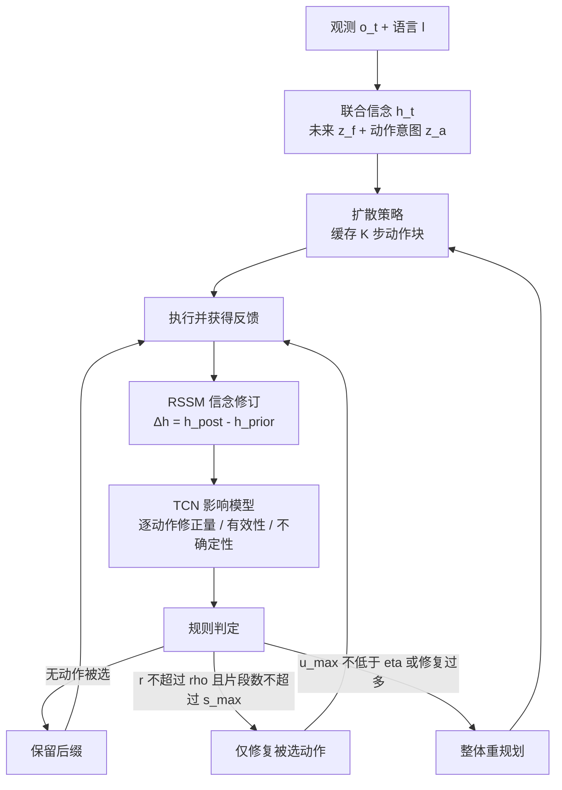

# ReEnvision：未来引导的选择性动作修复

**ReEnvision 在长程操作中维护「未来 + 动作」的联合信念，执行偏离时用反馈修订该信念，预测缓存动作块里哪些未执行动作受影响，只修复这些动作、保留仍有效的部分，偏离严重才整体重规划。**

论文 *ReEnvision: Future-Guided Selective Action Repair for Long-Horizon Manipulation*（[arXiv:2610.17977](https://arxiv.org/abs/2610.17977)，[项目页](https://reenvision.pages.dev/)）。

## 英文缩写速查

| 缩写 | 英文全称 | 简要说明 |
|------|----------|----------|
| RSSM | Recurrent State-Space Model | 论文用其先验 / 后验分支得到信念修订量 Δh |
| TCN | Temporal Convolutional Network | 影响模型，逐动作预测修正量、有效性与不确定性 |
| ASL | Average (completed) Length | CALVIN 连续完成任务数的平均长度（表中 Avg. Len.） |
| CALVIN | Composing Actions from Language and Vision | 语言条件长程操作基准，见 [CALVIN](../entities/calvin-benchmark.md) |

## 为什么重要

- 动作块执行中出现小偏离时，「整块重规划」可能把本来有效的动作改坏，「逐步纠偏」又反应太晚；该文把粒度放在中间，按动作定位影响范围。
- 消融给出了可检验的证据：随机掩码、补集掩码、整段后缀都不如选择性修复（CALVIN 平均长度 4.48 / 4.39 / 4.50 对 4.65）。
- 与 [DeFI](../methods/defi-decoupled-dynamics-vla.md) 等同基准方法可直接对比。

## 核心信息

| 项 | 内容 |
|----|------|
| **机构** | 香港科技大学（广州）Information Hub（Xiyin Zeng、Xuewei Huang、Yi Lu）；Daimon Robotics（Weihao Yuan）；南京大学智能科学与技术学院（Hao Wang），依据 arXiv HTML v2 |
| **平台** | CALVIN ABC→D、L-CALVIN、RLBench 18 任务；真机 ARX X5 + 两台 RealSense D405，每任务 150 条动觉示教 |
| **骨干** | 扩散策略生成 K 步动作块；未来表示来自预训练 Stable Video Diffusion |
| **开源** | **宣称将开源 / 未列链接**（2026-10-17 核查）：论文称录用后公开代码与权重；项目页无 GitHub / HF 链接 |

## 核心原理

### 流程总览

- 默认阈值（论文）：τ=1e-4（仅用于训练标签）、ρ=0.6、s_max=1、η=0.9；论文另做了三者的敏感性扫描。
- 初始信念取零未来修订。

## 源码运行时序图

**不适用**：截至 2026-10-17 无官方仓库，论文仅承诺录用后公开，故无法对齐真实入口。

## 与其他工作对比

| 维度 | ReEnvision（本文） | [DeFI](../methods/defi-decoupled-dynamics-vla.md) | [Diffusion Policy](../methods/diffusion-policy.md) | [Receding horizon 执行](../concepts/receding-horizon-policy-execution.md) |
|------|------|------|------|------|
| 定位 | 执行期修复层：缓存动作块内选择性修复，严重偏离才整体重规划 | 策略学习：前向 / 逆动力学预训练 + 扩散适配器 | 扩散生成动作序列的策略 | 预测序列、执行前缀、用新观测重规划 |
| 偏离处理 | RSSM 信念修订 + TCN 影响模型定位受影响动作 | 本库页未涉执行期修复 | 按固定前缀节奏重规划 | 固定节奏重规划或重叠融合 |
| CALVIN ABC→D（ReEnvision 论文表） | 5 步 86.6%，平均长度 4.62 | 81.2%，4.51 | — | — |
| 真机（ReEnvision 论文，ARX X5） | 平均 82.8% | — | 68.8% | — |

- **相对 DeFI：** 论文摘录将 DeFI 列为骨干对照（L-CALVIN 10 步 44%）；ReEnvision 是执行期的修复机制，DeFI 是策略学习方法，二者回答的问题不同。
- **相对 Diffusion Policy / receding horizon：** 后者按固定前缀长度整体重规划；ReEnvision 只改受影响动作，消融中整段后缀重生成 4.50 低于选择性修复 4.65。
- 表中数字均取自 ReEnvision 论文；DeFI、Diffusion Policy 原文口径未逐条核对。

## 工程实践

| 项 | 建议 |
|----|------|
| 复现 | 暂无官方代码；按论文需自备扩散策略骨干、SVD 未来表示、RSSM 与 TCN 影响模型 |
| 关键参数 | ρ（可修复比例）、s_max（片段数）、η（重规划不确定性阈值） |
| 延迟预算 | 端到端约 145 ms 对骨干约 110 ms，约 +32%；触发整体重规划再加约 110 ms |
| 真机 | ARX X5，两路 30 Hz 640×480 相机，7 维本体感觉，150 条示教 / 任务 |
| 开源状态 | 2026-10-17 项目页与论文均未给仓库地址，上线后需补 `sources/repos/` |

## 实验与评测

- **CALVIN ABC→D：** 5 步 86.6%，平均长度 4.62（VITA 84.5% / 4.57，DeFI 81.2% / 4.51）。
- **L-CALVIN：** 5 步 0.89、10 步 0.63、平均长度 8.36（Long-VLA 0.85 / 0.56 / 8.24）。
- **RLBench：** 18 任务平均 88.8%（HDFlow 87.5%，SpatialActor 87.4%）。
- **真机：** 5 任务各 50 次，平均 82.8%，π0.5* 80.8%，Diffusion Policy 68.8%。
- **受控扰动（项目页）：** 小偏离保留缓存后缀 73%；严重偏离整体重规划 52%。
- 以上数字均来自论文 / 项目页；结果为三随机种子平均（论文）。

## 结论

**ReEnvision 的收益来自「定位受影响动作」这一步，而不是多一次重规划；但增益幅度不大，且有 30% 以上的推理开销。**

1. **选择性优于整段与随机** — CALVIN 上选择性修复 4.65，整段后缀 4.50，随机掩码 4.48。
2. **短任务上重规划仍有竞争力** — RLBench 整体重规划 88.9% 略高于 ReEnvision 88.8%。
3. **基线口径要核对** — 摘要「10 步 56%→63%」中 56% 为 Long-VLA，DeFI 骨干为 44%。
4. **开销可观** — 约 +32% 延迟，部署前确认控制频率余量。
5. **暂无法复现** — 代码未公开，真机结果仅供参考。

## 局限与风险

- 作者自述：约 30–32% 额外延迟；结果级配对只提供动作级监督，无法确认每次修复都提升任务成功，信用分配仍难；后续要改进受影响动作估计与更多样真机环境。
- 开源：截至 2026-10-17 无官方仓库。
- 未核实：阈值在新平台上的迁移稳定性，论文只给了敏感性扫描。

## 关联页面

- [Diffusion Policy](../methods/diffusion-policy.md) — 动作块生成骨干
- [Receding horizon 执行](../concepts/receding-horizon-policy-execution.md) — 执行时重规划的对照
- [CALVIN](../entities/calvin-benchmark.md) — 主评测基准
- [DeFI](../methods/defi-decoupled-dynamics-vla.md) — 同基准对比方法
- [操作任务](../tasks/manipulation.md)

## 参考来源

- [reenvision_arxiv_2610_17977.md](../../sources/papers/reenvision_arxiv_2610_17977.md) — 论文摘录与开源核查
- [reenvision-project.md](../../sources/sites/reenvision-project.md) — 项目页归档
- [arXiv:2610.17977](https://arxiv.org/abs/2610.17977)

## 推荐继续阅读

- [ReEnvision 项目页](https://reenvision.pages.dev/)
- [ReEnvision 论文 HTML](https://arxiv.org/html/2610.17977v2)
