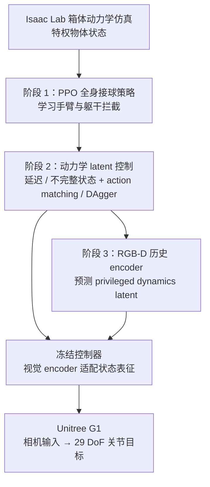
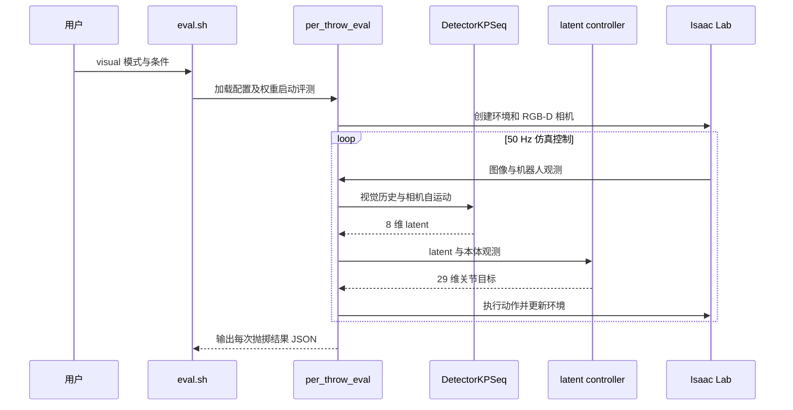

# Reflex：视觉驱动的人形机器人反应式接球

**Reflex**（*Visually Grounded Reactive Humanoid Control*，[项目页](https://toberj.github.io/reflex/)）研究 Unitree G1 如何从躯干 RGB-D 视觉历史中估计飞行箱体的运动状态，并以全身动作实时接住人抛来的箱体。

## 英文缩写速查

| 缩写 | 英文全称 | 简要说明 |
|------|----------|----------|
| RGB-D | Red Green Blue–Depth | 同步彩色与深度图像，作为机载视觉输入 |
| PPO | Proximal Policy Optimization | 第一阶段训练特权状态接球控制器的策略梯度算法 |
| DAgger | Dataset Aggregation | 聚合策略访问状态并用专家标签扩展训练数据 |
| CNN | Convolutional Neural Network | 提取单帧 RGB-D 空间特征的编码器 |
| GRU | Gated Recurrent Unit | 聚合视觉帧历史的循环网络 |
| DoF | Degrees of Freedom | G1 关节自由度；论文控制 29 个关节 |

## 为什么重要

高速抛掷物体的拦截不仅要求动作生成，还要求在观测延迟和遮挡下推断物体动力学。Reflex 把感知模块训练成**恢复已有控制器所需的状态表示**：先训练知道物体状态的策略，再学习对延迟观测做推断，最后把 RGB-D 历史映射到同一 dynamics latent。它因此把问题拆成“需要怎样的状态”与“怎样从视觉得到该状态”，而不是一次性从像素端到端拟合整套动作。

论文项目由 Taoyang Jia、Weikai Huang、Linxin Song、Jared Darlington、Jieyu Zhao、Yue Wang、Jiafei Duan、Zhongzheng Ren、Ranjay Krishna 等完成；机构包括 University of Washington、Stanford University、University of Southern California、National University of Singapore、University of North Carolina at Chapel Hill 与 Allen Institute for AI。

## 流程总览

控制策略的动作空间为 29 维关节位置目标；仿真物理步进 200 Hz，策略控制 50 Hz。阶段 3 中控制器保持冻结，使视觉训练的目标集中在对齐策略需要的动力学表征。

## 核心方法

### 阶段 1：用特权状态学全身接球

在 Isaac Lab 中直接提供模拟箱体状态训练 PPO 控制器。策略学习的不只是手臂触碰轨迹，还要协调躯干、步态和平衡，让身体到达可拦截位置并承接箱体。该策略作为后续阶段的控制基座。

### 阶段 2：让策略适应延迟和不完整观测

部署传感链路会引入几十毫秒延迟，单帧观测也不足以确定箱体速度。第二阶段的特权编码器将一个延迟观测样本（含速度）压缩为 8 维动力学 latent；视觉历史推断由第三阶段承担。在第一阶段控制能力上继续优化，并使用 action matching 与 DAgger 处理从特权输入转到有限观测时的分布偏差。

### 阶段 3：从 egocentric RGB-D 恢复动力学状态

视觉 encoder 读取 RGB-D 帧历史以及相机自运动，使用 CNN/GRU 输出策略所需的 dynamics latent。此阶段冻结前阶段的控制器，只训练视觉表征。因此，“视觉接球”依赖 temporal context 与机身运动信息，而不是单帧检测框直接映射关节命令。

## 工程实践

| 项目 | 论文 / 项目页报告 |
|------|------------------|
| 机器人 | Unitree G1，29 DoF |
| 传感器 | 躯干安装 RGB-D 相机；图像输入 192×144 |
| 控制 | 50 Hz 关节位置目标；Isaac Lab 仿真物理步进 200 Hz |
| 学习过程 | PPO 特权状态策略 → 延迟观测 dynamics latent → RGB-D latent 回归 |
| 可复现性 | 官方仓已公开仿真训练 / 评测代码和 checkpoint；真机部署栈未包含。参考动作需申请 BONES-SEED 数据并重建 |

### 源码运行时序图

下图对应公开的仿真评测入口，不代表真机部署实现。

入口为 `scripts/eval.sh visual`，调用 `reflex.eval.per_throw_eval`；`DetectorKPSeq` 使用热图、几何特征和 GRU。完整复现需依照官方 README 准备权重、参考动作及 Isaac Lab 环境。

## 实验与评测

| 设置 | Reflex 成功率 | 对照 / 读法 |
|------|---------------|------------|
| Isaac Lab 仿真 | RGB-D 策略 **85.7%** | 特权观测策略 **87.9%**，说明视觉策略接近状态上限但仍有差距 |
| 无视觉历史消融 | 居中抛掷降低 **35.6 个百分点** | 偏置抛掷降低 **39.8 个百分点**；历史对估计动力学至关重要 |
| G1 真机，2.5 m | **65%** | 人类接球率 **85%**；机器人达到其约 **76%** |
| G1 真机，5 m | **40%** | 人类接球率 **68.3%**；机器人达到其约 **59%**；距离增加时机器人差距扩大 |

项目页展示 2.5–7 m 抛掷视频；这只是演示范围，不能把未列成功率的 7 m 演示解读为高成功率结果。论文所列人类接球率也只是同距离参考，不代表人类与机器人实验条件完全一致。

## 结论

**Reflex 展示了把视觉 grounding 拆成状态表征恢复问题的有效路径：冻结接球控制器、单独训练 RGB-D 时序 encoder，可让真实机器人接近特权观测策略，但长距离真机接球仍不可靠。**

- 复现该训练策略时，先建立特权状态控制基线，再依次引入时延 dynamics latent 和视觉输入；直接从像素端到端学策略会丢失论文的分阶段对照。
- 保留多帧 RGB-D 与相机自运动输入；消融显示去除视觉历史会让成功率下降约 36–40 个百分点。
- 将仿真性能和真机性能分开比较：85.7% 的仿真结果不能外推为真实场景接球可靠度，5 m 真机成功率为 40%。
- 将 7 m 作为项目演示距离，不当作已报告成功率的测试点；评估时按明确抛掷距离分组报告。
- 仿真复现可使用公开代码和权重；真机部署仍需自行实现，参考动作数据需单独申请。

## 局限与风险

- **真机部署未公开：** 官方仓包含仿真训练、评测及 checkpoint，不包含真机部署栈。视觉评测约需 14 GB 显存（320 环境），参考动作需申请数据。
- **真机距离敏感：** G1 成功率从 2.5 m 的 65% 降至 5 m 的 40%；高速远距离抛掷仍是主要差距。
- **任务范围窄：** 证据集中在特定箱体接球设置，尚不足以推断对任意形状、质量、旋转或遮挡物体均可泛化。
- **对照口径：** 人类数据可帮助理解任务难度，但需谨慎看待实验场景、投掷和样本量差异；应优先使用论文给出的机器人分距离结果。

## 与其他页面的关系

- [人形机器人 RL 运动控制：身体系统栈](../overview/humanoid-rl-motion-control-body-system-stack.md) — Reflex 位于视觉闭环与动态交互的交界。
- [Humanoid Goalkeeper](./paper-amp-survey-13-humanoid_goalkeeper.md) — 同为快速物体拦截，但守门路线按落点区域路由任务与运动先验；Reflex 研究视觉历史如何恢复接球所需的动力学状态。
- [Unitree G1](./unitree-g1.md) — 真机平台。
- [AMP reward](../methods/amp-reward.md) — 对照运动先验在动态任务中的作用。

## 参考来源

- [论文摘录与结果](../../sources/papers/reflex_visually_grounded_reactive_humanoid_control.md)
- [官方项目页核查](../../sources/sites/reflex.md)
- [官方代码仓核查](../../sources/repos/toberj-reflex.md)

## 推荐继续阅读

- [Reflex 官方项目页](https://toberj.github.io/reflex/)
- [Reflex 论文](https://arxiv.org/abs/2610.12772)
- [ToberJ/reflex 官方仓](https://github.com/ToberJ/reflex)
