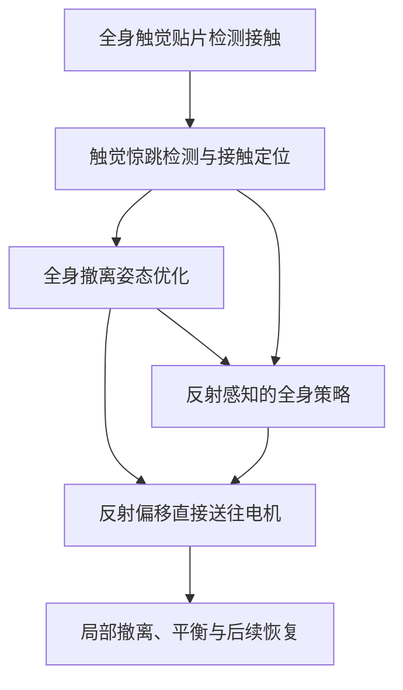

# ReflexArc（arXiv:2611.04424）

**ReflexArc**（*ReflexArc: Bottom-Up Integration of Instantaneous Tactile Reflexes into Whole-Body Humanoid Control*，[arXiv:2611.04424](https://arxiv.org/abs/2611.04424)，[项目页](https://minusmodulo.github.io/reflexarc-website/)）来自 [具身智能小站 2026-11-04 盘点](../../sources/blogs/wechat_embodied_station_57_papers_da_reward_model_failure_2026-11-04.md)，属「触觉与灵巧操作」组。

## 一句话定义

**把触觉反射通路直接接入电机，再通过策略训练接纳避让动作；在G1上研究突发接触后的撤离与平衡恢复，关键是反应时延和控制兼容性。**

## 英文缩写速查

| 缩写 | 英文全称 | 简要说明 |
|------|----------|----------|
| ARC | Ascending Reflex Control | 自下而上的反射控制框架 |
| PPO | Proximal Policy Optimization | 策略训练算法 |
| AMP | Adversarial Motion Prior | 人体动作先验奖励 |

## 核心信息

| 项 | 内容 |
|----|------|
| 机构 | 清华大学、北京大学、银河通用机器人 |
| 平台 | Unitree G1；触觉贴片 300 Hz，每片 128 个触点 |
| 原文 | [arXiv:2611.04424v1](https://arxiv.org/html/2611.04424v1) |
| 开源 | 项目页截至 2026-11-05 标注 Code Coming soon |

## 流程总览

## 核心机制

- 自适应触点阈值与连通区域识别早期接触；基于位置、法向和本体状态的全身优化考虑支撑、关节限位及自碰撞约束。
- 快速通路绕过策略推理直接作用于电机，触觉到电机命令小于 10 ms；策略仍同时负责平衡及任务。
- 在训练中引入反射；策略观测减去反射偏移、执行目标加回偏移，并使用反事实监督减少策略抵消反射。后续恢复通过触觉信息和人体动作先验训练。

## 源码运行时序图

不适用：项目页标注代码待发布，当前无法核实可运行入口。

## 实验与评测

- 手臂撞箱实验中，相比同一反射通路额外延迟 20 ms，首个力峰从 21.64 N 降至 14.25 N；冲量从 0.2632 降至 0.1225 N·s。该结果不能直接推广为任意碰撞的收益。
- 真机还展示障碍环境动作跟踪、遥操作和足部触觉引导的无视觉跨越。
- 消融显示，缺少反射参与训练或后续恢复适配会增加再次碰撞；详细实验条件需按原文核对。

## 局限与待核查

- 代码待发布；论文部分内容尚待逐项复核，本次更新保持草稿。

## 与其他工作对比

- 横向索引见 [VLM 奖励评估、动作动力学与开放权重机器人智能体：具身智能小站 11-04 期 57 篇阅读坐标](../overview/embodied-station-2026-11-04-57-papers-technology-map.md)；同 arXiv 不重复造页。

## 结论

快速反射与持续的全身策略协同，是论文减少冲击并恢复行为的关键。

1. 触觉事件走直接电机通路以减少响应时延。
2. 训练时需处理反射与跟踪策略的冲突。
3. 局部撤离之后还需要全身恢复，避免再次接触。

## 关联页面

- [HLO-AMP：物体感知移动操作](./paper-hlo-amp.md)
- [tactile-sensing](../concepts/tactile-sensing.md)
- [contact-rich-manipulation](../concepts/contact-rich-manipulation.md)
- [dexterous-kinematics](../concepts/dexterous-kinematics.md)
- [locomotion](../tasks/locomotion.md)
- [embodied-station-2026-11-04-57-papers-technology-map](../overview/embodied-station-2026-11-04-57-papers-technology-map.md)

## 参考来源

- [reflexarc_arxiv_2611_04424.md](../../sources/papers/reflexarc_arxiv_2611_04424.md)
- [wechat_embodied_station_57_papers_da_reward_model_failure_2026-11-04.md](../../sources/blogs/wechat_embodied_station_57_papers_da_reward_model_failure_2026-11-04.md)
- [arXiv:2611.04424](https://arxiv.org/abs/2611.04424)

## 推荐继续阅读

- [arXiv PDF](https://arxiv.org/pdf/2611.04424)
- [项目页](https://minusmodulo.github.io/reflexarc-website/)
