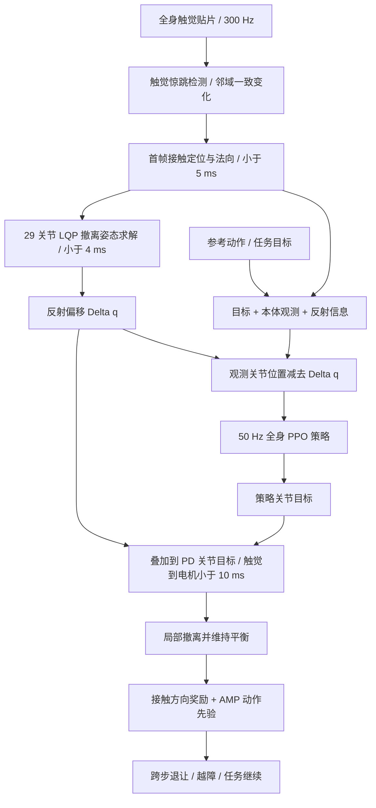
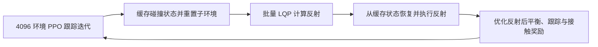

# ReflexArc：瞬时触觉反射融入人形机器人全身控制 / Bottom-Up Integration of Instantaneous Tactile Reflexes into Whole-Body Humanoid Control

**论文：** [ReflexArc（arXiv:2611.04424v1，2026-11-03）](https://arxiv.org/html/2611.04424v1) · **项目：** [官方主页](https://minusmodulo.github.io/reflexarc-website/) · **方法：** ARC（Ascending Reflex Control）。

## 一句话定义

**在低层用全身触觉触发小于 10 ms 的直达电机撤离命令，同时让高层学习策略维持平衡、容纳反射并完成后续退让。** 关键不是把策略频率简单调高，而是将毫秒级反射与慢一拍的全身任务控制解耦、再消除两者在相同关节上的控制冲突。

## 英文缩写速查

| 缩写 | 英文全称 | 简要说明 |
|---|---|---|
| ARC | Ascending Reflex Control | 自底向上反射集成框架 |
| LQP | Local Quadratic Programming | 逐轮线性化的局部二次规划反射求解 |
| PPO | Proximal Policy Optimization | 训练全身运动跟踪策略 |
| AMP | Adversarial Motion Prior | 反射后人体踏步/退让动作先验 |
| PD | Proportional-Derivative | 关节目标执行接口，输出叠加反射偏移 |
| CoM | Center of Mass | 全身质心，用于反射约束与代价 |
| DAgger | Dataset Aggregation | 论文用于描述对齐用的反事实监督风格 |

## 为什么重要

- **时间窗：** 人形机器人通常以 50 Hz 推理全身策略，20 ms 控制周期足以错过碰撞后的首个力峰；触觉必须能绕过策略推理直接触发。
- **控制权冲突：** 反射不能简单接管整个身体——撤离时平衡和任务仍需原策略；若不对齐，跟踪策略会把反射姿态当成误差主动抵消。
- **局部与全局分工：** 毫秒级关节缩回不是数秒内离开危险区域；后续步伐必须由策略完成。

## 核心信息

| 项目 | 原文核实内容 |
|---|---|
| 论文作者 | Mingyu Wang、Si Li、Ziqing Chen、He Wang、Li Yi |
| 机构 | 清华大学、北京大学、银河通用机器人（Galbot） |
| 机器人平台 | Unitree G1，反射优化覆盖 29 个关节 |
| 触觉输入 | 手腕、肘、膝、胸、背、足背的柔性压阻贴片；每片 16×8 cm、128 taxels、300 Hz |
| 反射速度 | 接触位置和方向在开始后 5 ms 内确定；板载 LQP <4 ms；触觉到电机 <10 ms |
| 上层训练 | PPO + Isaac Lab 的 4096 并行环境；ARC-Gym 交替训练跟踪与反射状态 |
| 开源现状 | 2026-11-11 官方页显示 Code Coming soon，未提供可运行 ARC 仓库 |
| 资料版本 | [arXiv HTML v1](https://arxiv.org/html/2611.04424v1)（2026-11-03）；[全文阅读记录](../../sources/papers/reflexarc_arxiv_2611_04424.md) |

## 流程总览

**两条并行控制链**：触觉→优化→电机是即时反射；任务/本体/反射观测→策略→PD 是较慢的稳定与恢复控制。执行阶段把同一反射偏移加在策略 PD 目标上，而不是再等一次策略调用。

## 核心原理

### 1. Tactile Startle：首帧识别突发接触（§III-A）

柔性压阻贴片每个 taxel 在正常运动中建立自身噪声基线，自适应阈值筛选异常读数，再借助相邻触点连通簇的同步上升区分局部撞击与运动振动；由活跃簇重心和表面法向估计接触点、撤离方向。论文强调普通接触在 2–3 帧后才明显，提前检测比等更强信号更关键。

### 2. 整身 LQP：用真实物理代价求撤离姿态（§III-B）

反射动作为关节终态与接触时关节姿态之差：

\[
\Delta \mathbf q = \mathbf q_r-\mathbf q_0,\qquad \mathbf q_0,\mathbf q_r\in\mathbb R^{29}.
\]

优化同时考虑碰撞点沿法向撤离、方向一致性、整身与水平质心运动、姿态正则；施加关节限位、固定支撑位置、自碰撞最小距离约束。利用惯性矩阵加权全身动作、放松竖直 CoM 位移惩罚，使膝部接触可通过伸腿避让。采用连续 LQP 局部线性化，但每轮代价始终相对同一碰撞初态。后续接触可从前一反射终态继续求解。

### 3. Reflex-in-the-Loop：在训练中真实注入反射（§IV-A）

PPO 观测由目标、本体感知和反射激活/位置/方向/偏移构成。反射期间，跟踪目标从 \(\mathbf q_{\mathrm{ref}}\) 调整为 \(\mathbf q_{\mathrm{ref}}+\Delta\mathbf q\)。ARC-Gym 先在普通跟踪迭代收集碰撞状态，再批量 LQP 求解反射，并从缓冲状态开始反射训练，以避免每个仿真环境在不同时间阻塞等待 CPU 求解。

### 4. Reflex-Transparent Alignment：避免策略抵消反射（§IV-B）

仅在 **观测的关节位置分量** 消去反射偏移，策略输出 PD 目标再加回该偏移（论文式 5）：

\[
\tilde{\mathbf s} = \mathbf s-\Delta\mathbf q,\quad
\mathbf a_{\mathrm{exec}}=\pi(\tilde{\mathbf s})+\Delta\mathbf q.
\]

上式第一项是论文简写，不能理解为对所有观测字段相减。反射会真实改变动力学，因此再以 DAgger 风格的反事实输出监督，让策略在反射发生时仍近似「没有反射」时的目标动作，减少隐性对抗。

### 5. Reflex-Informed Adaptation：从缩手到整身跨步（§IV-C）

局部撤离后，策略依据接触点与方向的任务奖励继续移动机器人根部；当它不得不偏离原跟踪参考时，人类重新站位动作的 AMP 先验限制恢复动作的形态。AMP 奖励仅在反射期间启用。足部碰到门槛时长期目标可改为 **向前越过**，不必总是向后退。

## 实验与评测

### A. 冲击时延的受控比较（§V-A；Fig. 6）

G1 向下摆臂击打固定箱体，箱体上的标定触觉贴片测力；240 Hz 相机标记辅助核实响应时间。基线是**同一反射额外人为添加 20 ms 延迟**，而非普遍意义上的所有「无 ARC 控制器」。

| 指标 | ARC 直接反射 | 同反射 +20 ms | 结论 |
|---|---:|---:|---|
| 首次力峰 | 14.25 N | 21.64 N | 降低 34.1% |
| 接触冲量 | 0.1225 N·s | 0.2632 N·s | 降低约 53.5%，延迟组是 2.15 倍 |

这支持「低层直达时延」的重要性，但只对应原文描述的受控撞箱实验，不代表普遍人机安全认证。

### B. 真机任务（§V-B）

- **动作跟踪：** 十余个任务，涵盖撞静态障碍、动态物体撞机器人、机器人与移动的人/机器人相撞。
- **遥操作：** ScaleBFM 泛化跟踪器可接收外部即时反射，但经其策略推理的上层反射更慢、容易被平滑；不能由此声称 ScaleBFM 已按 ARC 三机制完整训练。
- **盲式足部越障：** 通过足部触觉先缩脚，再跨门槛、上台阶，不依赖视觉识别障碍。

### C. 三项集成机制消融（§V-C；Table I）

| 变体 | 存活率 | 前 100 ms 接触冲量 | 同障碍再次碰撞 | 反射维持距离 | 3 秒位移 ≥1.5 m |
|---|---:|---:|---:|---:|---:|
| 完整 ARC | 99.2% | 3.42 N·s | 59.4% | 11.06 cm | 63.0% |
| 无 reflex-in-the-loop | 82.0% | 4.34 N·s | 90.9% | 5.65 cm | 8.9% |
| 无 transparency | 99.2% | 4.22 N·s | 58.3% | 6.74 cm | 57.3% |
| 无 adaptation | 77.3% | 3.63 N·s | 88.0% | 7.03 cm | 6.8% |
| 显式动作参考替代 AMP | 96.1% | 4.91 N·s | 63.3% | 10.89 cm | 14.1% |

**口径提醒：** Table I 的 100 ms 冲量与上述 Fig. 6 的撞箱冲量来自不同实验协议，数值不能交叉比较。无透明对齐时策略补偿分数从 -9.1% 变为 +29.7%（正值表示抵消反射）；无适配时全局撤离失败且易反复碰撞。

## 工程实践

1. **时间预算：** 保证触觉采样、接触检测、反射 LQP 和低层命令传输整段时延，而不仅是单个优化器 <4 ms；作者报告端到端 <10 ms。
2. **接口选择：** 反射偏移叠加到关节 PD 目标；需明确补偿发生于观测关节位置和输出关节目标这两个接口，避免将 reflex offset 错加到力矩输出或全部观测维度。
3. **仿真训练：** 反射状态要进入策略训练分布；可参考 ARC-Gym 的碰撞缓存→批量 LQP→反射迭代结构，但这不是可直接运行的作者源码。
4. **评测分层：** 单独测触觉到电机时延与力峰/冲量，再测反射维持、存活、二次碰撞和数秒后位移；不要仅凭一次缩手视频判断全身恢复性能。
5. **实现状态：** 官方源码、训练资产与触觉硬件完整设计尚未核实公开；当前文档可用于方法理解和自研设计讨论，不能当作一键复现指南。

## 源码运行时序图

**不适用（截至 2026-11-11）：** [官方项目页](https://minusmodulo.github.io/reflexarc-website/) 仍标注「Code Coming soon」，未提供可运行的 ARC-Gym、LQP 或真机部署源码入口。上面的 Mermaid 图仅由论文 §III–IV 的**算法/训练流程**重建，不能冒称真实源码函数调用时序。

## 局限与风险

- **作者明确的首要局限：** 触觉贴片只覆盖易碰撞的身体凸出区域；没有贴片的接触区不受该机制保护（§VI）。
- **工程可移植性：** G1 29 DoF、定制触觉贴片与相应关节控制栈是实验前提；没有公开完整软件/硬件工件时无法独立验证复现成本或可靠性。
- **定量外推：** 34.1%/53.5% 是特定撞箱的 20 ms 延迟对照；不等于所有碰撞、人机接触或长期安全指标均同比改善。
- **任务定位：** 此论文侧重反射优化、PPO 与 AMP，不是 VLA / 大语言模型直接输出动作的框架；不应因宣传标签将它分类成 VLA 方法。

## 与其他工作对比

- 相比仅靠 50 Hz 全身跟踪策略完成全部反应，ARC 的反射不等待策略周期；相比直接在反射期间切换整套控制器，它保留全身策略的平衡职责。
- 在已有全身跟踪器上叠加反射 **可以** 快速启动局部保护，但若要系统性处理策略抵消与长时间退让，仍需 reflex-in-the-loop、透明对齐和策略适配三部分。
- 早期收录索引仍沿用同一节点：[2026-11-04 具身论文路线图](../overview/embodied-station-2026-11-04-57-papers-technology-map.md)；不另建同一 arXiv 的实体。

## 结论

**ARC 的关键贡献是让毫秒级的接触反射与 50 Hz 的全身控制策略同时有效，而不是相互争夺控制权。**

1. 触觉到电机的端到端时延优先于仅提高上层推理帧率。
2. 反射求解要兼顾局部撤离、支撑与惯性代价，而非只做局部末端 IK。
3. 策略必须体验反射引起的动态状态，同时在输入/输出接口补偿偏移，防止将撤离取消。
4. 危险解除需要全身根部运动与动作先验，评测应覆盖再次碰撞与持续恢复。
5. 复现前先确认官方代码、硬件和训练工件是否开放；当前不具备可核实的开源运行入口。

## 关联页面

- [触觉感知 Tactile Sensing](../concepts/tactile-sensing.md)
- [富接触操作 Contact-rich Manipulation](../concepts/contact-rich-manipulation.md)
- [灵巧运动学 Dexerous Kinematics](../concepts/dexterous-kinematics.md)
- [人形移动 Locomotion](../tasks/locomotion.md)
- [HLO-AMP：物体感知移动操作](./paper-hlo-amp.md)
- [2026-11-04 具身智能小站技术地图](../overview/embodied-station-2026-11-04-57-papers-technology-map.md)

## 参考来源

- [arXiv v1 全文逐节阅读归档](../../sources/papers/reflexarc_arxiv_2611_04424.md)
- [官方项目页资源状态与展示归档](../../sources/sites/reflexarc.md)
- [原论文 HTML 版本（正文、公式、Table I、Fig. 6）](https://arxiv.org/html/2611.04424v1)
- [原项目主页](https://minusmodulo.github.io/reflexarc-website/)
- [2026-11-04 原始收录线索（非主证据）](../../sources/blogs/wechat_embodied_station_57_papers_da_reward_model_failure_2026-11-04.md)

## 推荐继续阅读

- [arXiv PDF](https://arxiv.org/pdf/2611.04424)
- [ReflexArc 官方视频与消融展示](https://minusmodulo.github.io/reflexarc-website/)
- [运动跟踪相关：HLO-AMP](./paper-hlo-amp.md)
