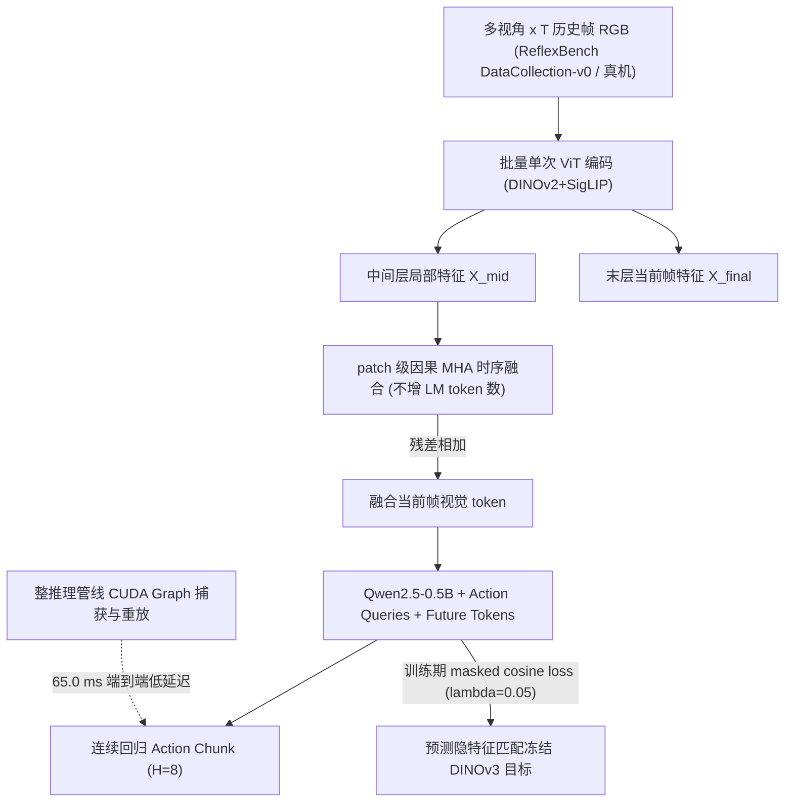
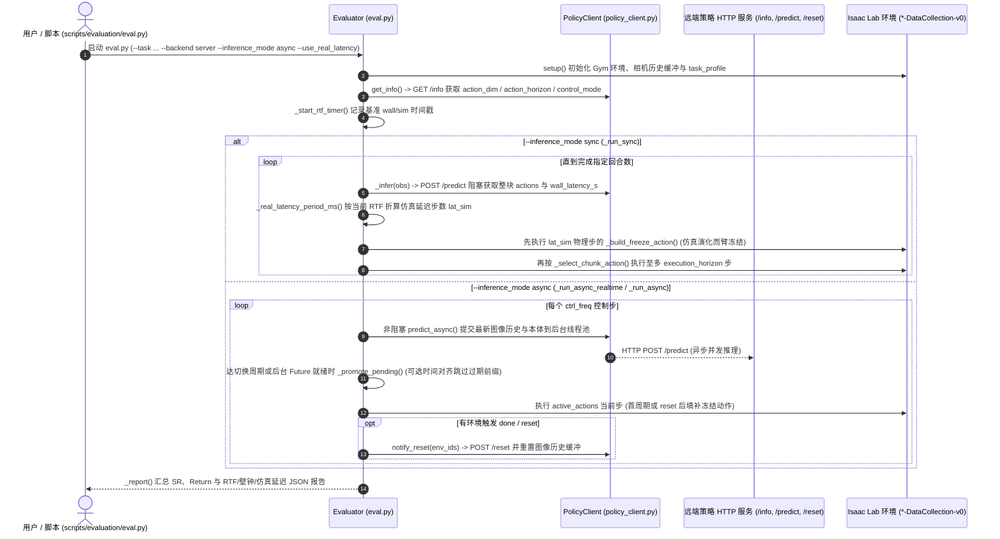

# ReflexVLA：动态任务低延迟 VLA 与 ReflexBench 基准

**ReflexVLA / ReflexBench**（*Reflex: Enabling Fast and Predictive Vision-Language-Action Models for Reaction-Critical Manipulation*，[arXiv:2608.14379](https://arxiv.org/abs/2608.14379)，[项目页](https://reflexvla.github.io/)）由**上海交通大学**陈宇轩、张婉若、李晓提出：一方面发布解耦仿真步进与控制周期的延迟感知动态[操作（Manipulation）](../tasks/manipulation.md)基准 **ReflexBench**（连同示范数据集已开源）；另一方面在 1B VLA-Adapter 骨干上结合未来隐特征预测、视觉中间层时序融合与系统级优化提出 **ReflexVLA** 策略。

> **同名分流与开源边界提醒：** 不要和 ICML 2026 同名工作 *Reflex: Real-Time VLA Control through Streaming Inference*（[arXiv:2607.14695](https://arxiv.org/abs/2607.14695)，流匹配 VLA 的 KV cache 流式推理）混淆。此外，**目前开源仅覆盖基准与数据**——[`LxRoboticsLab/ReflexBench`](https://github.com/LxRoboticsLab/ReflexBench)（BSD 3-Clause）与 [`ReflexBench_dataset`](https://huggingface.co/datasets/cyx337/ReflexBench_dataset) 已开放，但 **ReflexVLA 策略训练/推理代码在项目页仍标注 `Code After acceptance`**（经源码逐文件检索确认基准仓内不含任何 ReflexVLA 模型源码）。

## 一句话定义

**动态操纵的瓶颈不只是“会不会做”，而是“想得够不够早、算得够不够快”**——ReflexBench 将同步/异步感知-执行延迟显式注入仿真，而 ReflexVLA 在 1B [VLA](../methods/vla.md) 上以“冻结语义空间未来预测 + 视觉中间层因果融合 + CUDA Graph 回放”把延迟从 `125.1 ms` 压至 `65.0 ms` 并以四分之一参数追平 4B 动态专精基线。

## 英文缩写速查

| 缩写 | 英文全称 | 简要说明 |
| --- | --- | --- |
| ReflexVLA | Reflex Vision-Language-Action | 本文提出的 1B 反应关键动态操纵策略（模型源码待录用后开放） |
| ReflexBench | Reflex Benchmark | 六任务延迟感知 Isaac Lab 动态操纵基准（已开源） |
| VLA | Vision-Language-Action | 视觉–语言–动作多模态策略范式 |
| RTF | Real-Time Factor | 仿真加速倍率 $t_{\mathrm{sim}}/t_{\mathrm{wall}}$，用于将真实推理壁钟耗时折算为等价仿真延迟步数 |
| MHA | Multi-Head Attention | 多头注意力；本文将其嵌入视觉编码器中间层做跨帧因果时序融合 |
| CUDA Graph | CUDA Graph Replay | 固定静态推理计算图一次捕获并缓冲重放，消除高频推理的逐 kernel 调度开销 |
| LIBERO | Lifelong Robot Learning Benchmark | 静态机器人操作标准对照基准；用于检验动态结构是否损坏通用静态能力 |
| SR | Success Rate | 任务成功率；ReflexBench/LIBERO 报百分比均值，真机依任务报通过率或频次 |

## 为什么重要

- **静态基准掩盖反应与时间窗约束：** 接抛球、传送带拣放、限时打地鼠或旋转轴孔插拔要求策略在物体持续运动过程中于时间窗闭合前给出动作。
- **传统仿真“暂停世界”导致虚假高分：** 绝大多数闭环评测在等待策略推理时暂停物理步进，无法惩罚慢模型引入的观测–执行错位；ReflexBench 通过解耦步进与 RTF 折算还原了同步冻结惩罚与异步陈旧动作误差。
- **把“预测提前量”与“低延迟系统工程”合二为一：** 引入多帧历史与未来表征预测往往会拖垮推理延迟，ReflexVLA 通过语言侧零额外视觉 token 的视觉内融合、批量编码及整图 CUDA Graph，实现了成功率与速度的同步跃升。

## 核心原理

| 项 | 核心规格（依据论文 §§III–IV 与 `LxRoboticsLab/ReflexBench` 源码） |
| --- | --- |
| **策略骨干** | VLA-Adapter 族：`224×224` `DINOv2 + SigLIP` 双视觉编码器 + `Qwen2.5-0.5B` 因果 LM + 连续回归动作头（总计约 **1B**） |
| **未来隐特征预测** | 序列尾部追加与动作块等长的 $H$ 个 learnable future tokens，用掩码余弦损失（$\lambda_{\mathrm{future}}=0.05$）监督预测**冻结 `DINOv3`** 提取的未来视觉隐表示 $y_{t+i} \in \mathbb{R}^{1024}$ |
| **视觉中间层时序融合** | 在 $V$ 视角 × $T$ 历史帧的视觉中间层同位置 patch 轨迹上先降维、执行因果 `MHA_causal` 再升维残差加入当前帧末层特征 $x^{\mathrm{final}}_{v,p,t}$，语言侧仍只吃当前帧 $V \cdot P$ 个 token |
| **推理计算图加速** | 把多视角多历史图像合并成单次批量 ViT 编码，并用 `CUDA Graph` 捕获“视觉编码→时序融合→投影→LLM→动作头”整条推理图做固定缓冲回放 |
| **基准延迟协议** | `eval.py` 解耦物理仿真与策略端：支持固定 `--infer_freq` 或 `--use_real_latency` 实时壁钟耗时 × `RTF` 换算注入仿真；主评测采用异步 `--execution_horizon` 协议（论文设定 `chunk=8, horizon=2`） |

> **设计取舍与核心消融依据：** 论文 Table III 显示若让 DINOv3 未来目标参数参与可训练微调，特征空间坍缩会导致传送带成功率由基线 `36.8%` 暴跌至 `4.9%`；采用冻结 DINOv3 立即跳升至 `62.8%`。同时，在视觉中间层执行因果 MHA（`71.7%`）显著优于基于末层语义做交叉注意力（`66.1%`）或末层 MHA（`68.2%`），说明中层表征保留了更强的像素级运动线索。

## 源码运行时序图

经逐文件核查官方开源仓库 `LxRoboticsLab/ReflexBench`（BSD 3-Clause），该仓库**包含完整的 ReflexBench 基准环境、混合数据采集器与延迟感知异步/同步评测管线，但不包含 ReflexVLA 策略本体（DINOv3 未来预测、中间层时序融合与 CUDA Graph 服务均尚待论文接收后开源）**。下方时序严格对齐已开源的 `scripts/evaluation/eval.py` 与 `scripts/evaluation/policy_client.py` 真实运行链路（若仅关注 ReflexVLA 模型训练/推理源码，当前仍属待发布状态）：

## 评测与对比

主对比 protocol：ReflexBench 6 任务各 200 条示教合并共训单一策略；异步推理设置 `chunk=8, horizon=2`；单卡 RTX 5880 Ada 评测（每任务 150 episodes × 3 random seeds）。

### 1. ReflexBench 动态六任务对比（Table I，均值 SR % ± std）

| 模型 | 参数量 | 传送带拣放 | 空中接球 | 打地鼠 | 斜坡截球 | 投球 | 旋转插销 | 六任务均值 |
| --- | --- | --- | --- | --- | --- | --- | --- | --- |
| **OpenVLA-OFT** | `7B` | `58.0±1.2` | `5.3±1.2` | `100.0±0.0` | `41.4±4.2` | `10.0±3.3` | `1.3±0.7` | `36.0` |
| **$\pi_{0.5}$** | `4B` | `39.1±1.0` | `6.0±0.7` | `98.9±0.3` | `36.8±1.8` | `34.0±2.7` | `6.7±1.4` | `36.9` |
| **PUMA** | `4B` | `67.4±1.7` | `4.0±0.7` | `100.0±0.0` | **`85.1±3.4`** | `33.8±1.0` | `11.1±1.7` | `50.2` |
| **DynamicVLA** | `0.5B` | `30.6±2.4` | `4.4±1.0` | `90.2±1.7` | `45.8±1.7` | **`36.2±4.7`** | `16.7±4.2` | `37.3` |
| **SmolVLA** | `0.5B` | `19.3±2.0` | `2.9±0.8` | `100.0±0.0` | `70.2±2.0` | `27.1±1.0` | `10.0±4.6` | `38.3` |
| **VLA-Adapter（骨干）** | `1B` | `36.8±2.4` | `6.0±2.0` | `68.4±3.9` | `23.1±7.7` | `29.1±5.2` | **`18.4±2.5`** | `30.3` |
| **ReflexVLA（Ours）** | **`1B`** | **`73.8±4.1`** | **`7.3±0.7`** | **`100.0±0.0`** | `77.1±7.1` | `31.7±1.0` | `12.4±1.5` | **`50.4`** |

### 2. LIBERO 静态对照、消融与真机表现（Tables II–IV）

| 评测维度 | 核心对比结果 |
| --- | --- |
| **LIBERO（Table II）** | ReflexVLA：Spatial `98.2` / Object `99.2` / Goal `98.0` / Long `93.6` → 均值 **`97.2%`**（VLA-Adapter `97.3%`、OpenVLA-OFT `97.1%`、$\pi_{0.5}$ `96.9%`），证明动态设计未破坏静态精度 |
| **渐进消融（Table III，传送带）** | Baseline `36.8% (81.522 ms)` → 可训练未来目标 `4.9% (82.508 ms)` → 冻结 DINOv3 `62.8% (82.508 ms)` → 中间层因果 MHA `71.7% (125.107 ms)` → Batch ViT + CUDA Graph **`73.8% (64.991 ms)`** |
| **敏捷高频扫描（Figs. 4–5）** | 低频异步因状态陈旧劣于同步，但在 `30 Hz` 高频异步 + 大 chunk (`8/16`) + 短执行步 (`horizon=1/2`) 下反超（斜坡截球达 `84%` vs 同步 `46.7%`） |
| **AgileX Piper 真机（Table IV, 20 trials）** | Conveyor `16/20`（SmolVLA `2/20`、PUMA `13/20`）、PressButtons 30s 均值 `22.5` 键（SmolVLA `0.9`、PUMA `20.8`）、CatchBalls 每 10 球 `6.7` 个（SmolVLA `3.8`、PUMA `5.4`） |

### 3. 与相关延迟/异步研究对比

| 工作 | 核心聚焦差异 |
| --- | --- |
| **[Action Chunking](../methods/action-chunking.md)** | 提供块预测缓冲；本文结合高频扫描将其约束为“大 chunk + 短 horizon”异步配合范式 |
| **[WAM 实时异步部署](./paper-wam-realtime-async.md)** | 在桌面异步上比较平滑衔接与控制频次；本文把真实延迟注入动态物理成功率 |
| **[RTCF](./paper-rtcf.md) / RTC 家族** | 属于更精细的流式异步修复/引导，是本文作者 §V-E 明确标注尚待补充结合的方向 |
| **[具身 FM 实时性↔泛化取舍](../concepts/embodied-fm-latency-generalization-tradeoff.md)** | 阐述算力-频次边界墙；本文提供了 `1B` 规模从表示学习到 CUDA Graph 突破该墙的完整案例 |
| **ICML 2026 Reflex (`2607.14695`)** | 同名碰撞：彼篇聚焦流匹配 VLA 的 KV cache 50 Hz 流式推理，本页是交大 ReflexBench + 1B 预测式 VLA |

## 工程实践

1. **利用 `ReflexBench` HTTP 评测协议做解耦压测：** 接入自定义策略无需修改 Isaac Lab 环境依赖，只需实现 `GET /info`、`POST /predict`、`POST /reset` 服务端并运行 `eval.py --backend server --inference_mode async --use_real_latency`，即可用本地真机或集群 GPU 实际吞吐直接测定动态失分率。
2. **动态任务慎用多帧直连 LLM 序列，优先考虑视觉中间层融合：** 保持输入 LLM 的视觉 token 数与单帧一致，避免 ViT 多历史帧导致的二次方注意力耗时把异步周期拉垮。
3. **固定计算图并谨慎处理异步频率门槛：** 若推理速度不足以支持高频异步更新（$<10\text{–}20\,\text{Hz}$），异步滞后惩罚可能反不如同步；接入 CUDA Graph 与批量多视图编码能把时延由 `125.1 ms` 压缩至 `65.0 ms`，是换取稳定控制的关键工程步骤。
4. **注意基准采样与环境配置边界：** 在 `LxRoboticsLab/ReflexBench` 中，5 个规划任务依赖额外安装 cuRobo，唯有传送带拣放需先使用 `scripts/skrl/train.py` 训练 `skrl` PPO 专家后再由 `collect_vla_data.py` 采数（或直接下载已公开的 Hugging Face `ReflexBench_dataset`）。

## 局限与风险

1. **ReflexVLA 策略本体尚未开源，无法源码复核：** 截至 2026-11-14，官网仍标注策略代码 `Code After acceptance`，且已开源的 `ReflexBench` 仓库确认仅含基准仿真、采数及通用客户端，DINOv3 未来预测损失、中间层 MHA 具体超参及 CUDA Graph 内存布局尚无法在代码层面验证。
2. **高难度接球与旋转装配群体成功率仍偏低：** 在 Table I 中，包括 ReflexVLA 与所有 4B/7B 基线在内，接球（最高仅 `7.3%`）和旋转插销（`12.4%`–`18.4%`）仍处于较低水平，表明“反应关键操纵”远未攻克。
3. **未与预训练与先进流式解码结合（§V-E）：** 时序融合与未来预测目前仅在下游 6 任务微调阶段注入，未参与大规模机器人预训练；且评测仍停留在朴素同步/异步调度，未纳入类似 RTC 的流式连续边界引导解码。

## 结论

**动态操作成败同时受“提前量（未来与短时序表征）”与“响应壁钟延时”支配：将延迟显式写入仿真检验，并在 1B 骨干上联合冻结隐空间未来预测、视觉内时序融合与 CUDA Graph 回放，可以在不损静态通用精度的前提下以四分之一参数追平 4B 动态专精模型。**

- **基准与数据可立即复用：** 已开源的 [`LxRoboticsLab/ReflexBench`](https://github.com/LxRoboticsLab/ReflexBench)（BSD 3-Clause）与 `ReflexBench_dataset` 可直接用于测算任何自定义策略在真实壁钟 RTF 延迟下的动态抗退化能力。
- **未来目标必须冻结语义参考：** 对 DINOv3 等未来监督目标联合解冻微调会引起表征坍缩（传送带 SR 从 `36.8%` 降至 `4.9%`），冻结目标则带来 `+26.0 pp` 核心增益。
- **运动线索位于视觉中层：** 中间层 patch 因果 MHA（`71.7%`）优于末层语义融合且不膨胀 LLM 视觉 token 数量。
- **系统延迟直接换取成功率：** Batch ViT + CUDA Graph 把时延压半（`125.1 -> 65.0 ms`），在无架构变动下直接推高传送带成功率，证实低延迟系统工程属于动态任务的一阶性能变量。
- **选型复现边界：** 当前应将本工作拆解为“**已开源的 ReflexBench 评测基础设施**”与“**待论文接收后开源的 ReflexVLA 策略原型**”分别引入技术栈。

## 关联页面

- [Vision-Language-Action (VLA)](../methods/vla.md) — 本策略所依托的端到端视觉-语言-动作控制架构
- [Action Chunking](../methods/action-chunking.md) — 探讨“大 chunk + 短执行步”异步协同的核心缓冲机制
- [Manipulation](../tasks/manipulation.md) — 覆盖动态抓抛、传送带与静态桌面操作的主任务域
- [具身大模型实时性↔泛化取舍](../concepts/embodied-fm-latency-generalization-tradeoff.md) — 分析推理时延、模型参数量与闭环频次间的结构性权衡
- [LIBERO 基准](./libero-benchmark.md) — 本文用于验证动态改造不损坏静态泛化力的对照榜（97.2%）
- [WAM 实时异步部署](./paper-wam-realtime-async.md) — 同期异步块执行延迟研究的对比节点
- [RTCF](./paper-rtcf.md) — 实时异步 chunk 连续化引导家族（论文 §V-E 点名未来结合方向；注：arXiv v3 已撤稿）
- [DyPES-VLA](./paper-dypes-vla.md) — 从跨本体视角探索未来潜特征预测的同期研究
- [VLA 真机部署指南](../queries/vla-deployment-guide.md) — 异步执行协议与延迟诊断专题
- [VLA·预测·抓取 9 篇技术地图](../overview/vla-predict-grasp-9-papers-technology-map.md) — 本节点原始专题导览

## 参考来源

- [ReflexVLA 论文来源归档](../../sources/papers/reflexvla_arxiv_2608_14379.md)（arXiv:2608.14379v1 全文 §§I–VI 与 Table I–IV 核查）
- [ReflexVLA 官方项目主页归档](../../sources/sites/reflexvla-github-io.md)（官网链接与“录用后开源”策略按钮核查）
- [ReflexBench 官方仓库归档](../../sources/repos/reflexbench.md)（`LxRoboticsLab/ReflexBench` BSD 3-Clause 基准与延迟评测源码核查）
- [多模态周报汇总归档](../../sources/blogs/wechat_duomo_vla_weekly_trends_2026-08-10_part4.md) / [具身智能小站 9 篇盘点](../../sources/blogs/wechat_embodied_station_9_papers_vla_predict_grasp_2026-08-24.md)（早期线索）

## 推荐继续阅读

- [arXiv 论文原文 (2608.14379)](https://arxiv.org/abs/2608.14379) / [项目主页](https://reflexvla.github.io/)
- [官方基准与延迟评测仓 LxRoboticsLab/ReflexBench](https://github.com/LxRoboticsLab/ReflexBench) / [Hugging Face 数据集 ReflexBench_dataset](https://huggingface.co/datasets/cyx337/ReflexBench_dataset)
- 同名分流：[Reflex streaming inference (arXiv:2607.14695)](https://arxiv.org/abs/2607.14695)
