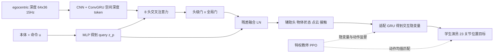

# ReGATE（arXiv:2611.02871）

**ReGATE**（*Recurrent Gated Visual Fusion for Reactive Humanoid-Object Interaction*，[arXiv:2611.02871](https://arxiv.org/abs/2611.02871)，Hao Zhu、Jorge Peña-Queralta，苏黎世应用科技大学（ZHAW）人工智能中心，2026-11-02）。原文归档见 [sources/papers/regate_arxiv_2611_02871.md](../../sources/papers/regate_arxiv_2611_02871.md)。

## 一句话定义

**一个只用机载 egocentric 深度和本体感知、响应用户速度与接触命令的人形全身控制器：用循环门控适配器把深度当作对「常开本体表征」的修正，并预测物体几何与接触，深度不可靠时仍可维持交互。**

## 英文缩写速查

| 缩写 | 英文全称 | 简要说明 |
|------|----------|----------|
| HOI | Humanoid-Object Interaction | 人形与物体交互 |
| GMT | General Motion Tracking | 通用运动跟踪 |
| RSI | Random State Initialization | 随机状态初始化，本文改为按阶段采样 |
| GRU | Gated Recurrent Unit | 门控循环单元 |
| ConvGRU | Convolutional GRU | 卷积 GRU，保留空间位置的循环特征 |
| PPO | Proximal Policy Optimization | 近端策略优化 |
| PD | Proportional-Derivative | 关节位置目标的低层比例-微分跟踪 |
| LN | Layer Normalization | 层归一化 |
| VLM | Vision-Language Model | 视觉-语言模型，论文设想作高层触发 |

## 为什么重要

- 许多 HOI 系统跟踪预设动作，或依赖动捕、外部位姿估计（第 I 节）；ReGATE 目标是只靠机载传感部署（作者自述）。
- 深度会被遮挡、缺帧、延迟或冻结（第 I 节），让门控显式决定何时采纳视觉，是对这类问题的一种具体做法。
- 命令接口（速度、偏航率、期望接触）使接触时机可由用户在线调整，而不是重放参考轨迹。
- 作者声称是首个把「循环门控的深度-本体融合」从感知运动（locomotion）扩展到人形 loco-manipulation 且处理视觉中断的工作（摘要，作者自述）。

## 核心机制

### 方法栈与流程总览

- **输入输出（III-A）：** 命令 u=[vx, vy, ωz, c]，c 表示期望接触；输出 23 维关节位置目标，PD 跟踪。
- **适配器（III-B）：** 融合式为 z_fuse = LN(z_p + g_global · (g_head · A))；g_global=0 时退化为本体残差路径。门是「学到的任务相关系数，而非校准过的传感器可靠度估计」（III-B3 原文）。物体状态、带位姿点云和末端接触由辅助头预测，并条件化适配 GRU，而不是直接用 z_fuse（III-B4）。
- **深度课程（III-B5）：** 先干净深度且强制两级门全开，避免门因随机初始化的深度编码器而过早关闭；之后门逐步放开并引入结构化遮挡与整帧黑屏。
- **两阶段训练（III-C）：** 阶段 I：PPO 特权教师（参考动作、真值物体状态与接触）+ 用零深度特征预热学生适配模块；阶段 II：适配损失（Eq.4：隐变量对齐、物体状态、点云、图像空间物体位置、接触 BCE）+ 教师动作均值匹配，学生演员再用 PPO 微调。
- **阶段感知 RSI（III-C3）：** 示范分为 approach、pre-contact、interact、pre-release、release 五阶段，先按任务分布采阶段再在阶段内均匀选帧，以提高短接触过渡的覆盖。
- **奖励（III-D）：** 保留运动跟踪与运动正则奖励，阶段 II 增加五类命令条件的交互奖励（末端靠近、物体靠近、朝向对齐、接触正确、接触恢复）。

## 实验与评测（均来自论文第 IV 节）

| 项 | 设置 / 结果 |
|----|------------|
| 训练 | Isaac Sim，PPO；教师 4096 并行环境，学生 512；单块 RTX 5090 |
| 频率 | 策略 50 Hz，64×36 深度 15 Hz（帧保持到下次更新） |
| 真机 | Unitree G1，29 自由度，策略控制 23 关节，6 个腕关节固定；头戴 ZED 2i |
| Q1 命令响应 | 真机 10 次试验全部成功（IV-B1） |
| Q2 静态箱子（MuJoCo） | 11 个横向偏移 [-0.5, 0.5] m 各 30 次：281/330 = 85.2%（表 I） |
| 对比 VisualMimic | 同协议 160/330 = 48.5%；论文称每个测试位置 ReGATE 均更高（表 II） |
| Q2 移动箱子（MuJoCo） | 速度 0.1 至 0.5 m/s 四档、11 个位置各 10 次：378/440 = 85.9%（表 III） |
| Q3 视觉退化 | 真机在初次观测后、接触命令前遮挡相机仍成功取箱（图 7，定性）；遮挡与黑屏协议见 IV-B3，无定量表 |

读法：作者指出训练时未随机化物体位置，故静态偏移和移动箱子评测是未见位置上的零样本测试（IV-B2）。

## 工程实践

- **部署链路：** 深度在真机上预处理为 64×36，30 Hz 采集后以 15 Hz 放入策略并保持，与训练节奏对齐（IV-A2）。
- **域随机化：** 训练随机化深度噪声、偏置、延迟、遮挡、黑屏与相机参数（IV-A1），参见 [域随机化](../concepts/domain-randomization.md)。
- **命令时机：** 接触命令约在示范接触前 60 至 70 帧激活，给策略留出接近与对齐时间（IV-A1）。
- **数据：** 沿用 VAIC 的交互动作并增加物体接触标签与期望接触命令（IV-A1）。
- **开源状态：** 论文未给出代码或项目页链接，入库日（2026-11-09）未核查到公开仓库，复现需自行实现。

## 局限

**论文自述：**

- 不评测接近物体与接触触发决策，设想由 VLM 或其他高层控制器负责（IV-A4）。
- 门是学习到的任务系数，不是校准的传感器可靠度估计（III-B3）。

**我的观察（未经论文验证）：**

- 定量结果只在 MuJoCo 仿真、单一任务（箱子）上；真机为 10 次命令序列与定性图示，视觉遮挡的真机实验没有成功次数统计。
- 静态偏移表 I 成功率不对称（+0.2 至 +0.4 m 最低，约 63% 至 77%），论文只描述现象，未给原因。
- 与 VisualMimic 的对比使用其官方 MuJoCo 配置、仅改箱子初始位置；两者任务设计与命令接口本不同，该差距是否全部来自方法差异无法由论文判定（推测）。
- 没有关闭门控、去掉循环或去掉阶段感知 RSI 的消融表，门控与课程各自的贡献论文未量化。
- 视觉遮挡仿真协议（IV-B3）未给定量结果。

## 关联页面

- [Loco-manipulation 任务页](../tasks/loco-manipulation.md)
- [特权训练（Privileged Training）](../concepts/privileged-training.md)
- [Sim2Real](../concepts/sim2real.md)
- [域随机化](../concepts/domain-randomization.md)
- [全身控制（WBC）](../concepts/whole-body-control.md)
- [PPO](../methods/ppo.md)
- [Teacher-Student / DAgger 训练](../methods/teacher-student-dagger-training.md)
- [VisualMimic](./paper-notebook-visualmimic.md)：论文的定量对比基线
- [VAIC](./paper-loco-manip-05-vaic.md)：本文沿用其 teacher-student 骨架与命令接口
- [HAIC](./paper-haic.md)、[HDMI](./paper-hrl-stack-06-hdmi.md)、[ResMimic](./paper-resmimic.md)、[Pro-HOI](./paper-loco-manip-161-074-pro-hoi.md)：论文相关工作中的 HOI 系统
- [Unitree G1](./unitree-g1.md)

## 参考来源

- [regate_arxiv_2611_02871.md](../../sources/papers/regate_arxiv_2611_02871.md)
- [arXiv:2611.02871](https://arxiv.org/abs/2611.02871)
- 周报转述（具身运控lab，未列为原文）：创新点中的「通道级门控」与论文的头级门不一致，已按论文改正。

## 推荐继续阅读

- [arXiv HTML 全文](https://arxiv.org/html/2611.02871v1)
- [VisualMimic 详解](./paper-notebook-visualmimic.md)
- [Loco-manipulation 任务页](../tasks/loco-manipulation.md)
