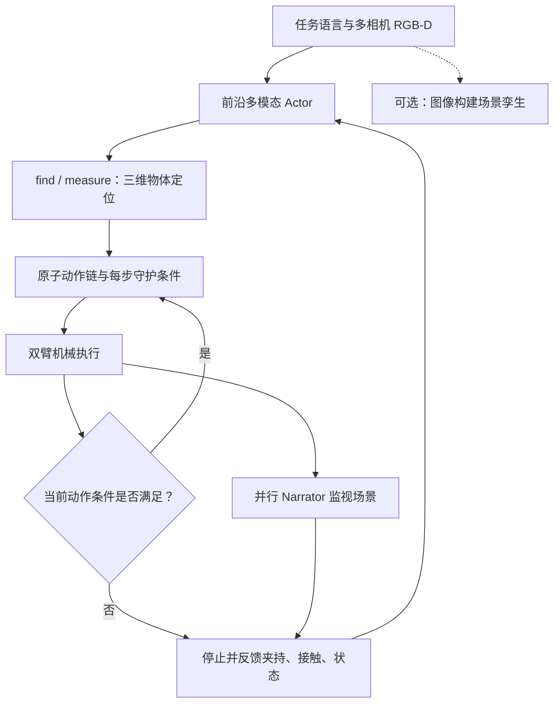

# Reins：前沿多模态模型零样本驱动真机长程双臂操作
*Reins: Frontier Multimodal Models Driving Real Robot Arms on Long-Horizon Tasks, Zero-Shot*

## 一句话定义

**Reins**：无需任务专属训练，让现成多模态模型通过三维视觉工具、带守护条件的原子动作链和并行场景旁白操作真实双机械臂。

## 英文缩写速查

| 缩写 | 英文全称 | 简要说明 |
|---|---|---|
| VLM | Vision-Language Model | 视觉与语言推理模型 |
| RGB-D | Red-Green-Blue plus Depth | 带深度图的视觉感知 |
| API | Application Programming Interface | 模型与机器人工具调用接口 |

## 为什么重要

长程操作中模型推理期间场景仍在变化；开环批量执行和迟到的反馈会累积接触、夹持与定位错误。

## 核心信息

| 维度 | 核对信息 |
|---|---|
| 原始论文 | [arXiv:2611.16632v1](https://arxiv.org/html/2611.16632v1) |
| 机构 | 麻省理工学院 MIT CSAIL、哈佛大学 |
| 论文作者 | Pengfei Ye、Zhiyang Dou、Yuxiang Ma、Haonan Chen、Heng Yang、Edward H. Adelson |
| 官方项目 | [项目页](https://reins-robot.github.io/) |
| 开源状态（2026-11-16） | 项目页标注 Code coming soon；未提供可运行源码入口。 |

## 核心原理

Actor 观察图像/任务和历史，调用 find/measure 三维感知与原子动作工具；一次调用可给多步动作链，每一步检查 success guard，首个失败即停止回报状态；另一个 narrator 实例持续观测相机并把场景变化写入下一轮 Actor 上下文。可利用图像构建用于后续策略学习的仿真场景孪生，但论文的零样本真机成功率并非该孪生训练的结果。

### 流程总览

> 图示基于论文的方法和监督流向；训练与部署路径应区分，图中模块不代表源码调用关系。

## 实验与评测

官方论文报告三种前沿模型的五项真机长程任务；其中 GPT-6.1 Sol 以自然语言任务提示、无任务专属代码达到 88% 的真实 episode 成功率。模型思考延迟占总任务时间 41%–78%；不能把论文中的 88% 误写为三种模型的共同平均值。

## 与其他工作对比

| 工作 | 关键接口与训练阶段 | 边界与取舍 |
|---|---|---|
| 本文 | 无需任务专属训练，让现成多模态模型通过三维视觉工具、带守护条件的原子动作链和并行场景旁白操作真实双机械臂。 | 示例为两台 6-DoF AirBot Play 与所述相机/工具系统，模型和 API 服务依赖强，零样本不等于零工程接口；官方项目页明确 Code coming soon，暂无公开可复现的 Reins 运行入口。 |
| [JustRUA](./paper-justrua-robot-use-agents.md) | 同领域相关研究，侧重不同的学习或动作接口 | 不能把不同基准、度量或硬件结果直接横比 |
| [ACE-CaP-0](./paper-ace-cap-0.md) | 从另一维度处理学习、记忆或控制问题 | 验收须按论文各自协议建立独立基线 |

## 结论

**无需任务专属训练，让现成多模态模型通过三维视觉工具、带守护条件的原子动作链和并行场景旁白操作真实双机械臂。 但必须按论文的实验协议和开源边界解读其效果。**

1. 有条件的动作链比不检验的开环长动作更适合接触任务。
2. Narrator 独立观察能补偿 Actor 思考时环境变化，但也增加模型调用成本。
3. 88% 是论文给出的特定模型、五任务真机结果，不能直接外推到通用双臂成功率。

## 源码运行时序图

**不适用。** 项目页标注 Code coming soon；未提供可运行源码入口。 目前只有原论文方法流程可核验，不能把未开放的代码调用关系画成运行时序图。

## 工程实践

| 项目 | 实施与检查点 |
|---|---|
| 接入输入 | 核实论文定义的观察模态、坐标系、动作/控制接口，不能照搬其他本体 |
| 基线与指标 | 复用论文评测协议；另外记录成功率、任务进度、执行耗时和失败分布各自口径 |
| 训练/执行成本 | 区分模型预训练成本、开发期调用次数、在线决策延迟及实际通信开销 |
| 代码可得性 | 项目页标注 Code coming soon；未提供可运行源码入口。 |
| 复现路径 | 以[官方论文](https://arxiv.org/html/2611.16632v1)与[项目页](https://reins-robot.github.io/)为准，缺失的数据/权重/控制接口需要单列阻塞 |

## 局限与风险

示例为两台 6-DoF AirBot Play 与所述相机/工具系统，模型和 API 服务依赖强，零样本不等于零工程接口；官方项目页明确 Code coming soon，暂无公开可复现的 Reins 运行入口。

- **跨实验不可直接排名：** 论文分别使用跨本体进度、VLA 成功率、真机 episode 成功率或 RoboDojo 子集得分，不具备共同分母。
- **工程安全边界：** 真机动作链需另行评估碰撞、限位、通信中断与异常恢复；论文实验成绩不构成部署安全保证。

## 关联页面

- [JustRUA](./paper-justrua-robot-use-agents.md)
- [ACE-CaP-0](./paper-ace-cap-0.md)
- [机器人 Code-as-Policies 对照](./paper-ace-cap-0.md)
- [VLA 学习纵深路线](../../roadmap/depth-vla.md)
- [跨本体迁移纵深路线](../../roadmap/depth-cross-embodiment.md)

## 参考来源

- [论文原文与核对归档](../../sources/papers/reins-arxiv-2611-16632.md)
- [官方项目页核对](../../sources/sites/reins-project-20261116.md)
- [arXiv HTML v1（包含实验与局限）](https://arxiv.org/html/2611.16632v1)

## 推荐继续阅读

- [官方项目页](https://reins-robot.github.io/)
- [论文 PDF](https://arxiv.org/pdf/2611.16632)
