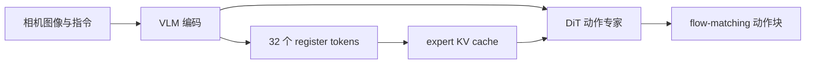
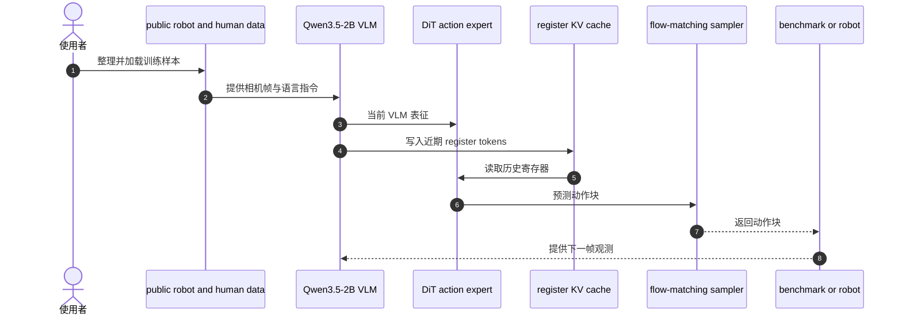

# REKI：在 VLA 中注册近期知识

## 一句话定义

**REKI 在 VLA 动作专家中加入少量 register tokens，将每帧视觉语言表征缓存进 expert KV cache，让动作策略低成本读取近期历史。**

## 英文缩写速查

| 缩写 | 英文全称 | 简要说明 |
|------|----------|----------|
| REKI | Registering Knowledge in VLAs | 用寄存器 token 保存近期上下文的 VLA |
| VLA | Vision-Language-Action | 视觉、语言到机器人动作的策略 |
| VLM | Vision-Language Model | 编码图像和指令的模型 |
| DiT | Diffusion Transformer | 以 Transformer 为骨干的生成式动作专家 |

## 为什么重要

单帧输入难以判断物体刚才如何移动、机器人是否已尝试过动作或任务进展如何。把大量帧反复送入 VLM 会增加推理成本。REKI 将记忆放在 action expert 内部，以有限数量的寄存器保存近时刻上下文。

## 核心原理

- VLM 编码当前视觉与语言输入；DiT action expert 通过 cross-attention 读取 VLM 表征并用 flow matching 预测一秒动作块。
- 32 个 register tokens 汇总每帧 VLM 输出并写入专家缓存，后续块可读取过去寄存器。
- 作者报告读取寄存器带来的额外耗时低于动作块预测的 1%；记忆在 LIBERO-Plus、RoboTwin Clean 和 RoboCasa365 带来成功率增益，并使姿态振荡约减少四倍。

## 源码运行时序图

官方仓库公开数据整理、训练、推理、评测和部署代码；此图概括 README 所列模型交互模块：

## 实验与评测

- 论文摘要称 REKI 在 LIBERO-Plus、RoboTwin Clean2Rand 和 RoboCasa365 上建立了 2.4B 规模模型的性能前沿；其比较范围是公开数据预训练模型。
- 仓库 README 报告 H100 编译推理约 21.8 ms/动作块；其他硬件和图像尺寸不可直接据此推算。
- 寄存器记忆的消融提升与不同基准相关，不能跨任务直接合并为单一收益数字。

## 工程实践与局限

- 代码采用 MIT 许可，权重采用 CC-BY-NC-SA 4.0；模型权重的非商业许可不同于代码许可。
- 寄存器仅保留压缩后的近期表征，不保证任意长时记忆或可解释的事件存储。
- 使用项目结果前应确认模型 checkpoint、机器人平台和 benchmark 版本匹配。

## 与其他工作对比

| 工作 | 历史信息存放位置 | 刷新方式 | 与 REKI 的差异 |
|------|------------------|----------|----------------|
| 单帧 VLA（如 [π0](./paper-pi0.md)） | 不保留历史 | — | REKI 在同类 VLM + flow-matching 动作专家结构上补近期上下文 |
| [Fast-VLA](./paper-fast-vla-once-per-episode.md) | 冻结 VLM 生成的固定 KV 任务记忆 | 每回合一次 | Fast-VLA 省去逐步 VLM 调用；REKI 每帧写入寄存器，保留回合内变化 |
| [VaM](./paper-vam-value-as-memory.md) | 价值预测历史经 GRU 编码为 token | 异步逐步 | VaM 记忆任务进度标量；REKI 记忆压缩视觉语言表征 |
| [GMP](./paper-gated-memory-policy.md) | 学习型门控 + cross-attention 记忆 | 门控决定是否写入 | GMP 面向非马尔可夫任务的显式门控；REKI 用固定数量寄存器、额外开销低于动作块预测的 1% |

REKI 与 Fast-VLA 都报告 LIBERO-Plus 与 RoboTwin 结果，但模型规模、预训练数据与评测设置不同，不能直接按成功率排序。

## 结论

**REKI 以 action expert 内的紧凑寄存器缓存近期 VLM 表征，在保持短期闭环上下文的同时控制了额外推理成本。**

1. 对比记忆模块时同时测量 success、动作振荡和缓存推理开销。
2. 区分模型参数规模、预训练数据公开程度和下游微调数据来源。
3. 部署或商用时分别核查 MIT 代码许可与 CC-BY-NC-SA 权重许可。
4. 将当前方法视为短期历史补充，不等同于长期任务规划记忆。

## 关联页面

- [VLA 方法](../methods/vla.md)
- [Diffusion Transformer](../concepts/diffusion-transformer.md)
- [Spark-0：触觉预训练与动作条件](./paper-spark-0-spatial-tactile-pretraining.md)

## 参考来源

- [REKI 论文归档](../../sources/papers/reki_arxiv_2610_22178.md)
- [官方项目页与权重许可](../../sources/sites/reki.md)
- [代码仓库与模型说明](../../sources/repos/reki.md)

## 推荐继续阅读

- [REKI 项目页](https://kyutai.org/reki/)
- [REKI 代码](https://github.com/kyutai-labs/reki)
- [REKI 模型集合](https://huggingface.co/collections/kyutai/reki-6ac371366b3da8cdece73ce2)
