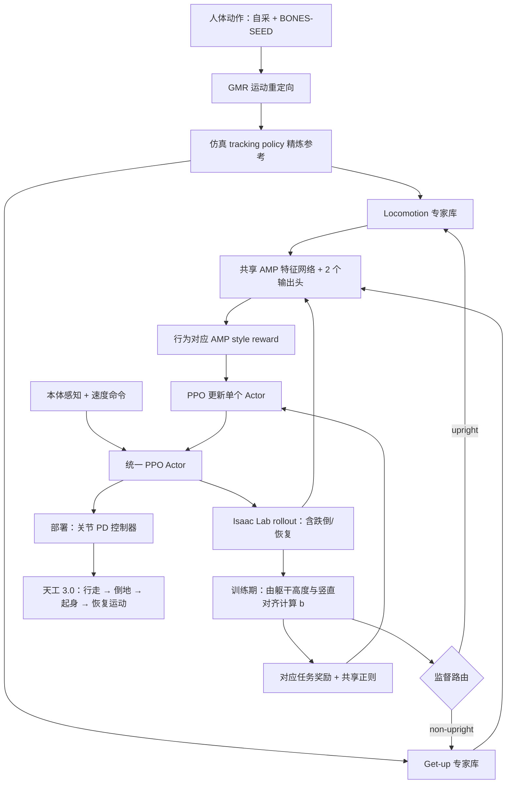

# ReLoco：通过行为条件运动先验统一人形行走与跌倒恢复（Unified Humanoid Locomotion and Fall Recovery）

**ReLoco**（*Unified Humanoid Locomotion and Fall Recovery via Behavior-Conditioned Motion Priors*，[arXiv:2611.23916v1](https://arxiv.org/abs/2611.23916)）由**华中科技大学**与**北京人形机器人创新中心**合作提出，研究在**天工 3.0（Tiangong 3.0）** 上让**同一个策略**在站立、行走、跑步、跌倒、起身后持续响应原速度命令。

## 一句话定义

**用仿真精炼的起身/行走示范和按姿态选择的行为条件 AMP 监督，训练一套无需部署时切换控制器的人形 locomotion + fall recovery 策略。**

## 英文缩写速查

| 缩写 | 英文全称 | 简要说明 |
|------|----------|----------|
| ReLoco | Recovery and Locomotion | 跌倒恢复与移动控制统一训练框架 |
| AMP | Adversarial Motion Prior | 通过专家动作历史判别器提供运动风格奖励 |
| PPO | Proximal Policy Optimization | 优化统一 actor 的强化学习算法 |
| PD | Proportional–Derivative | 将 23 维 action 关节位置目标变成力矩命令 |
| GMR | General Motion Retargeting | 将人体动作重定向至机器人后再仿真精炼 |
| RMSE | Root Mean Square Error | 起身后的速度指令恢复追踪阈值指标 |
| DTW | Dynamic Time Warping | 衡量关节运动与参考序列的相似程度 |
| Sim2Real | Simulation-to-Real | 从 Isaac Lab 训练直接迁移到天工 3.0 真机 |

## 为什么重要

- **跌倒不是一次任务结束。** 稳定移动不仅要能抗扰站住，也要从贴地姿态恢复，并在起身后重新跟踪原命令；单报 get-up 成功率不足以验证任务闭环。
- **单策略省去部署切换。** 多专家池/双判别输出头用于训练，不要求上机做“行走 ↔ 起身”独立策略选择、状态机切换。
- **AMP 参考质量决定先验质量。** 人体动作直接重定向会产生地面穿透、自碰撞或超限；先用模拟 tracking policy 生成物理可执行参考，减少不合理专家奖励。

## 核心信息

| 项目 | 原文核验 |
|------|----------|
| 作者/机构 | Lequn Fu 等；华中科技大学（HUST）、北京人形机器人创新中心（Beijing Innovation Center of Humanoid Robots） |
| 主论文 | arXiv:2611.23916v1，2026-11-18，预印本 |
| 训练/平台 | Isaac Lab + PPO；Tiangong 3.0，1.70 m、64.5 kg、31 DoF 机体中由 actor 控制 23 DoF |
| 输入/输出 | 本体感知（基座角速度、重力投影、关节位置/速度、上次 action）+ 速度指令 → 23 个关节位置 offset → PD |
| 训练专属 | critic 额外使用躯干线速度与行为路由标签；AMP 使用带历史条件的 10 帧运动特征 |
| 开放状态 | [项目主页](https://lequn-f.github.io/ReLoco/)提供 MuJoCo 交互演示；截至 2026-11-21 未见官方代码、权重或数据集下载入口 |

## 流程总览

**注意：** 路由、专家库、判别器、辅助外力**仅在训练期**；上机后部署一个 actor + 关节 PD，图中不是多控制器 FSM。

## 核心原理与训练方法

### 1. 先消除专家动作中的物理违规

自采人体动作和 BONES-SEED 片段，经 GMR 运动重定向后，由离线 tracking policy 在相同机器人和执行器模型里执行；保留 robot-executed rollout 构成两套 expert pool。在 43 组配对动作里，地面穿透率 **28.99%→0.75%**，自碰撞率 **12.91%→0.35%**，关节限位违规率 **12.90%→0.06%**（论文 Table IV）。

### 2. 姿态决定监督标签，而非部署模式

训练时使用躯干高度 h 和躯干局部竖轴与世界竖轴的对齐值 u：

- h ≥ **0.9 m** 且 u ≥ **0.7**：upright route，命令速度追踪/姿态/接触等任务奖励。
- 其他姿态：non-upright route，主要鼓励躯干向目标高度 **1.261 m** 上升。
- 两路始终共享关节限位、力矩、加速度和 action-rate 惩罚；PPO advantage 在各路分别标准化。**b 不进入部署 actor 观测**，仅是训练监督标签。

### 3. 一个 actor，两头判别器

AMP 运动片段使用 **10 帧 ×（76 运动特征 + 1 路由条件）= 770 维**；共享 discriminator backbone 分别输出“行走/起身”得分，两路都更新同一 PPO actor。相比将行走与起身 expert 直接混池，行为条件化缓解在速度追踪与起身之间互相干扰的问题。

### 4. 恢复探索与部署

随机参考姿态初始化（其中一半取起身帧）、速度扰动及逐步撤掉的头部向上辅助力帮助发现翻身/撑地/起身动作；初始辅助力消融中 **400 N** 效果优于 0/200/600 N。仿真还辨识执行器参数、域随机化质量/接触/延迟。**实际真机不用辅助力、判别器或 offline tracker**。

## 源码运行时序图

**不适用（截至 2026-11-21 无官方可下载的训练、推理或部署源码入口）。** 官方虽开放在线 MuJoCo 试玩，但这不是可审阅的 ReLoco 软件仓库；不能根据论文示意图编造脚本调用、ROS 接口或推理运行时序。待官方发布代码再按 README/入口补充 \`sequenceDiagram\`。

## 工程实践

| 复现/评测问题 | 对工程师的启发 |
|-------------|----------------|
| 速度命令恢复 | 起身后要检测**能否重新跟随速度命令**，而不只是 h/u 达阈值；论文阈值为 5 s 测量窗 RMSE≤0.3 m/s |
| AMP 标签设计 | 不把非直立样本当成行走负样本；专家采样池、判别 head 与任务奖励应按姿态对齐 |
| 训练基础 | 配置随机起身姿态与接触、推扰、延迟 DR；辅助力逐渐归零再统计无辅助恢复 |
| 关节控制 | 论文部署接口是 23-DoF 关节位置 offset + PD；不应臆测具体增益或 ROS 实现 |
| 安全保护 | 把恢复失败与硬件保护事件显式列入总试验口径；不能仅在持续运行子集上报“100%” |

## 实验与评测

**仿真消融（Table V；20k 迭代；五组配对评测，每组 250 次恢复任务）：**

| 方法 | 速度 RMSE (m/s) ↓ | 独立起身 ↑ | Push-recovery+命令恢复 ↑ |
|------|------------------:|----------:|-------------------------:|
| Task-only RL | 0.0717 | 0.00% | 8.24% |
| 无条件 AMP | 0.8599 | 94.64% | 92.32% |
| 条件单输出 AMP | 0.1485 | 90.16% | 93.36% |
| **ReLoco 双输出** | **0.1266** | **96.80%** | **96.96%** |

相对条件单输出，ReLoco 躯干平面速度 RMSE 降 **14.7%**，起身率提高 **6.64 个百分点**；上表**不同方法各只做一个原始训练 run**，不应理解成重复训练均值。

**与 HoST 对比（Table VI；1000 次随机静置倒地）：** ReLoco 起身成功率 **98.3%**、平均用时 **2.02 s**、机械功 **3.1 kJ**；HoST 为 **99.9%**、**1.57 s**、**10.7 kJ**。ReLoco 更省机械功，但 HoST 起身更快、成功率更高。

**真机（Table VII）：** 站立踢扰 47 次包含 **34 次跌倒后起身、5 次未摔倒、8 次触发硬件保护**。行走/跑步各 10 次可评估扰动合计 **16 次未倒继续、4 次倒地后恢复命令**，额外 1 次跑步受扰触发保护。俯卧/仰卧/侧卧均有成功案例，30 次均衡姿态子集平均起身 **2.64±0.64 s**。脚踢力未定量测量，不代表可保证某个力阈值恢复。

## 结论

**ReLoco 的价值在“跌倒后恢复任务指令”的单策略闭环，而不是把独立起身成功率堆到最高。**

1. **先让专家动作可执行**：直接用重定向动作做 AMP expert，接触/限位违规会影响学习。
2. **监督分路、策略不分路**：用姿态路由专家池与双输出判别器，部署 actor 无需外部模式切换。
3. **一起看跟踪与恢复**：Task-only 速度追踪反而最好，但独立起身为零。
4. **别漏算保护事件**：真机站立被踢 47 次里有 8 次硬件保护；“34/34”只能描述控制持续有效的倒地样本。
5. **看清复现边界**：项目页面能玩 MuJoCo demo，但尚缺公开训练代码、权重和真实硬件接口。

## 与其他工作对比

| 方法 | 与 ReLoco 的关键差别 |
|------|----------------------|
| [HoST](./paper-host-humanoid-standingup.md) | 着重 standing-up，恢复更快，随机倒地起身率更高；ReLoco 兼顾 gait tracking 与恢复命令 |
| [SD-AMP](./paper-unified-walk-run-recovery-sdamp.md) | 同属统一 locomotion/起身，ReLoco 的独特点是**仿真精炼专家参考 + 条件双头判别器** |
| [BeyondMimic](../methods/beyondmimic.md) | 以参考跟踪为主的 imitation/RL 路线；ReLoco 用区分行为的 AMP 适配非对齐倒地状态 |
| [Balance Recovery](../tasks/balance-recovery.md) | Balance recovery 包括“倒前站稳”；ReLoco 额外要求**完全跌倒后起身并恢复命令** |

## 局限与风险

- **代码尚未公开：** 截至 2026-11-21，项目主页未给出可复现训练/推理仓库、权重与数据入口；在线 MuJoCo demo 不是代码开源证据。
- **仿真消融多为单次训练：** 五个评测 batch 不等于五个训练随机种子；不能宣称多种子显著性。
- **真机冲击不可比：** 人工推踢力未测，不能量化冲击阈值或对复杂坡度统计泛化。
- **硬件保护是安全边界：** 保护事件不等于策略成功；工业实际部署仍要专门验证地面/机体接触安全与恢复动作碰撞风险。
- **机体和任务范围：** 仅在 Tiangong 3.0 示范，尚缺跨平台、满负载操作与长时无人值守证据。

## 关联页面

- [Balance Recovery：推扰与恢复](../tasks/balance-recovery.md)
- [Locomotion](../tasks/locomotion.md)
- [HoST：人形从倒地起身](./paper-host-humanoid-standingup.md)
- [SD-AMP：统一走跑起身](./paper-unified-walk-run-recovery-sdamp.md)
- [Reinforcement Learning](../methods/reinforcement-learning.md)
- [Sim2Real](../concepts/sim2real.md)
- [人形 RL Locomotion 纵深路线](../../roadmap/depth-rl-locomotion.md)

## 参考来源

- [论文完整归档（v1）](../../sources/papers/reloco_arxiv_2611_23916.md)
- [官方项目页归档（开源核对）](../../sources/sites/reloco.md)

## 推荐继续阅读

- [论文 HTML 原文](https://arxiv.org/html/2611.23916)
- [ReLoco 项目主页与 MuJoCo 交互演示](https://lequn-f.github.io/ReLoco/)
- [HoST（arXiv:2502.08378）](https://arxiv.org/abs/2502.08378)
