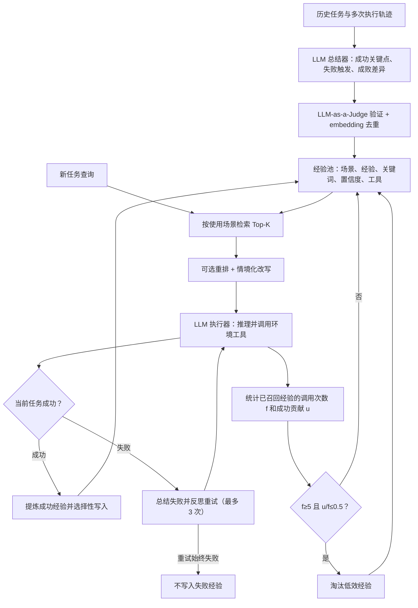
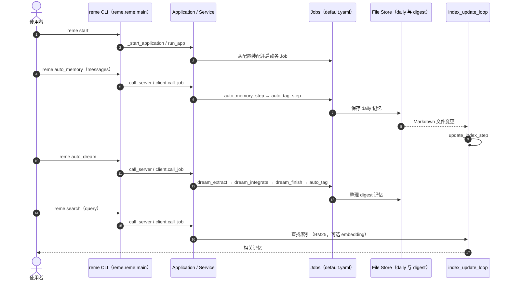

# ReMe：动态程序性记忆让 Agent 从经验中演化 / Remember Me, Refine Me

## 一句话定义

**ReMe（Remember Me, Refine Me）是一套不修改底座 LLM 权重、以「细粒度经验提炼 → 场景适配复用 → 成功筛选与低效淘汰」闭环持续改进工具型智能体的程序性记忆框架。** 原始论文为 [arXiv:2512.10696v2](https://arxiv.org/html/2512.10696v2)，已发表于 [Findings of ACL 2026](https://aclanthology.org/2026.findings-acl.829/)；作者来自上海交通大学（Shanghai Jiao Tong University）与阿里巴巴通义实验室（Tongyi Lab, Alibaba Group）。

## 英文缩写速查

| 缩写 | 英文全称 | 简要说明 |
|------|----------|----------|
| ReMe | Remember Me, Refine Me | 本文的经验驱动动态程序性记忆框架 |
| LLM | Large Language Model | 执行任务、总结轨迹、验证与重排经验的模型 |
| BFCL-V3 | Berkeley Function-Calling Leaderboard Version 3 | 多轮工具使用评测基准 |
| ICL | In-Context Learning | 不更新模型参数、通过检索到的经验引导任务执行 |
| Avg@4 | Average Success at Four Trials | 四次试验的平均成功率，论文主指标之一 |
| Pass@4 | Pass at Four Trials | 四次试验至少成功一次的比例 |

## 核心信息

| 项 | 内容 |
|---|---|
| 英文题目 | Remember Me, Refine Me: A Dynamic Procedural Memory Framework for Experience-Driven Agent Evolution |
| 机构 | 上海交通大学 AGI Institute；阿里巴巴通义实验室（Tongyi Lab, Alibaba Group） |
| 论文版本 | 2025-12-11 初稿；核对 2026-04-15 v2；Findings of ACL 2026 |
| 论文与代码 | [论文 HTML](https://arxiv.org/html/2512.10696v2) · [官方 ReMe 仓库](https://github.com/agentscope-ai/ReMe) |
| 改进对象 | 外部程序性经验池（不是 LLM 权重） |
| 主要评测 | BFCL-V3 与 AppWorld 的软件工具调用任务 |

## 为什么重要

- **记忆不是越多越好：** 一味追加轨迹既重复又可能保留有害指导。ReMe 对经验的采纳、召回与移除都引入筛选。
- **保留可迁移关键点：** 成功轨迹中的关键步骤、失败触发点、成败对照，比整段对话或完整轨迹更容易在新任务中用上。
- **小模型可通过外部经验缩小差距：** 对比结果表明，在特定指标和任务集上，8B + 动态记忆可超过无记忆 14B；这是记忆增强的证据，不能推出模型权重能力已追平。
- **符合[递归自我改进的第一层](../../roadmap/depth-rsi.md)：** 改善被保存在可检索的外部记忆中；移除记忆后增益未必存在，不是权重级 RSI，也未演化改进算法本身。

## 核心机制

### 1. 经验获取：成功、失败、对照三路蒸馏

对于任务查询 q，执行器采样 N=8 条多样轨迹，按奖励选高/低示例，摘要模型执行成功关键步骤识别、最早失败触发分析和成败对比。结构化经验记录为 E =〈ω, e, κ, c, τ〉：

| 字段 | 含义 |
|---|---|
| ω / usage scenario | 经验适用情境，作为语义检索主键 |
| e / experience | 可复用的程序性指导内容 |
| κ / keywords | 便于类别索引的关键词集合 |
| c / confidence | [0,1] 的经验置信度 |
| τ / tools | 涉及的工具列表 |

候选经 LLM-as-a-Judge 验证可行动性、准确性和价值，再用 embedding 余弦相似度去重，写入可检索经验池。**失败轨迹可用于初始对比提炼，但在线新增阶段不直接把一次失败的结论当成可信记忆。**

### 2. 经验复用：场景检索 → 重排 → 改写

新任务以 query 向量匹配经验的使用情境 ω，取 top-K=5；可选 LLM reranker 按新任务约束再筛选，随后 rewriting 模块把多条历史经验组织为当前任务的可执行指导，注入执行器上下文。检索发生于**任务开始时**，并非每一步工具执行后动态重新检索。

### 3. 经验精炼：选择性写入 + 失败反思 + 效用淘汰

- **选择性写入：** 当前任务成功后才将新经验加入池，避免单次失败轨迹带来未经证实的伪知识。
- **失败反思：** 失败时由摘要模型诊断并指导新尝试；至多自反思 3 次，重试成功才保存反思所得，仍失败则丢弃。
- **效用淘汰：** 记忆维护检索频次 f 与成功贡献计数 u；满足 f≥α=5 且 u/f≤β=0.5 时删除。这里的成功贡献是操作性归因统计，不能代替严格因果归因。
- **版本差异：** ReMe(fixed) 使用不动态变更的经验池；ReMe(dynamic) 允许上述在线增删。

## 流程总览

这张图表达论文 §3 的三个记忆生命周期阶段；失败重试有次数上限，实际实现不得把回环理解为无限重试。

## 实验与评测

原文主表为跨 **BFCL-V3 + AppWorld** 的聚合均值（单位 %），不要与单基准的分数混算：

| 模型与设置 | Avg@4 | Pass@4 |
|---|---:|---:|
| Qwen3-8B，无记忆 | 27.65 | 46.20 |
| Qwen3-8B + ReMe(fixed) | 30.78 | 51.04 |
| **Qwen3-8B + ReMe(dynamic)** | **34.94** | **55.03** |
| Qwen3-14B，无记忆 | 35.62 | 54.65 |
| Qwen3-14B + ReMe(dynamic) | 44.66 | 63.71 |

- **准确读数：** 小模型 ReMe(dynamic) 的 Pass@4 为 55.03%，略高于大模型无记忆 54.65%；但 Avg@4 34.94% 仍略低于 35.62%，不可宣称所有指标全面超越。
- **与 8B 无记忆比较：** 主表差值为 Avg@4 **+7.29 个百分点**（34.94−27.65），Pass@4 **+8.83 个百分点**（55.03−46.20）。论文 §4.2 对 7.29/8.83 的指标归属表述与主表相反；以表中原始数值为准。
- **动态精炼消融（BFCL-V3，8B）：** 全量写入 40.83/62.00 → 选择性写入 44.33/64.66 → 加反思 45.00/64.66 → 再加删除 45.17/68.00（Avg@4/Pass@4）。
- **复现配置：** BFCL-V3 取 50 个初始经验任务与 150 个 Base 测试任务，AppWorld 取 90/168 训练/测试任务；K=5、α=5、β=0.5；正文使用 text-embedding-v4 的 1024 维配置，附录另讨论 Qwen3-Embedding 与 Elasticsearch。
- **成本与迁移：** AppWorld 单任务延迟 21.42→23.96 秒（+2.54 秒）；附录报告 BFCL-V3 扩展 750 任务 Qwen3-8B 的 Pass@4 从 37.78% 升至 43.02%。

## 结论

**ReMe 的有效改进来自“先浓缩可靠经验，再按场景精确复用，最后用真实使用反馈清理经验池”，而不是简单增加历史长度。**

1. **先验采集要能对照成败**：成功关键点、最早失败点与成败差异是三类不同监督信号。
2. **写入策略比原始记忆量更重要**：在线单次失败不直接入库，需重试成功作验证。
3. **检索 key 很关键**：以经验使用情境编码可比原始任务文字更稳健，但须保持同模型/同划分比较。
4. **不能只看 Pass@4**：8B 动态记忆超过 14B 无记忆仅成立于该聚合 Pass@4，Avg@4 尚未超过。
5. **清理策略可操作**：f≥5 且 u/f≤0.5 触发淘汰；部署时应保留撤销与可审计记录。
6. **迁移到机器人前另需验收**：原文没有真机安全、控制时延、动作精度实验。

## 与其他工作对比

| 工作 | 经验结构与复用时机 | 最重要的差异 |
|---|---|---|
| 论文基线 A-Mem / LangMem | 使用外部记忆辅助 LLM | ReMe 强调细粒度提炼、重排改写和按使用效用淘汰 |
| [Procedural Graphs](./paper-procedural-graphs-self-evolving-llm-agents.md) | 显式程序关系图；按任务步提取局部子图 | ReMe 用结构化自然语言经验池，任务启动时召回一次 |
| [MemCompiler](./paper-memcompiler-state-conditioned-memory.md) | 具身任务中逐步编译记忆，按当前状态输出 | ReMe 并未按每步观察做状态条件编译，不能当作实时具身记忆模块 |
| [Agent 记忆与 Dreaming](../concepts/agent-memory-and-dreaming.md) | 持久记忆提取和后台整理的一般工程概念 | ReMe 论文有明确 BFCL/AppWorld 任务效用评估与动态增删条件 |

## 源码运行时序图

**实现版本说明：** 官方仓库 [agentscope-ai/ReMe](https://github.com/agentscope-ai/ReMe) 目前已演进为以 Markdown 文件为持久事实源的 ReMe 产品。以下时序**仅根据当前 main** 的 pyproject.toml、reme/reme.py、reme/core/application.py 和 reme/config/default.yaml 已核实运行入口绘制，**不冒充 2025 论文实验的代码复现路径**；论文对应 BFCL/AppWorld 实验入口仍需专门定位历史版本。

## 工程实践

| 实践事项 | 路径或检查点 |
|---|---|
| 当前开源状态 | 官方 GitHub 主分支公开，Apache-2.0；与原文算法实验不完全同版 |
| 安装（当前 main） | Python ≥3.11；按官方 README 安装 reme-ai[core] |
| 服务与命令 | 通过 reme start 启动，reme auto_memory / auto_dream / search / read 调用 |
| 原文实验复现 | 需锁定历史 commit、BFCL/AppWorld 数据、LLM、embedding、经验池实现；尚未核实论文的一键复现脚本 |
| 实施借鉴（机器人） | 可先在任务规划/工具使用/实验修复 agent 层检验经验复用，不应直接进入高频闭环关节控制 |

## 局限与风险

- **检索时机受限：** 原论文每个任务开始时检索一次，长时间运行过程中环境变化可能使经验过时。
- **经验可靠性问题：** LLM-as-a-Judge 存在漏判/误判，成功贡献计数也可能误归因；需要外部可验证任务指标和回滚机制。
- **反思与模型成本：** N=8 初始采样、LLM 重排改写、最多三次反思和推理延迟，部署预算不能只算最终执行器。
- **结果范围：** 软件 API / 函数调用 benchmark，不是机器人动作控制/真机实验；不能推断物理任务成功率或安全收益。
- **版本边界：** 当前 GitHub main 的文件原生记忆方案不等于 2025 论文 Table 1 的全部实验实现，详见[源码归档](../../sources/repos/agentscope-ai-reme.md)。

## 关联页面

- [Coding Agent 验证闭环](../methods/coding-agent-verification-loops.md) — ReMe 在线写入和淘汰的工程落地需要独立任务验收；此页提供证据驱动测试思路，**不是论文使用的直接评测方法**。
- [Claude Code 动态工作流](../methods/claude-code-dynamic-workflows.md) — 可作为把已检索程序性经验编排为执行与独立核查步骤的软件 Agent 工作流参照；论文未直接测试这一框架。
- [Agent 记忆与 Dreaming](../concepts/agent-memory-and-dreaming.md)
- [递归自我改进](../concepts/recursive-self-improvement.md)
- [Procedural Graphs：自演化程序知识图](./paper-procedural-graphs-self-evolving-llm-agents.md)
- [MemCompiler：状态条件记忆编译](./paper-memcompiler-state-conditioned-memory.md)
- [RSI 纵深路线 Stage 1](../../roadmap/depth-rsi.md)

## 参考来源

- [ReMe 论文原文通读归档](../../sources/papers/reme_procedural_memory_arxiv_2512_10696.md)
- [官方 ReMe 仓库与代码入口核查](../../sources/repos/agentscope-ai-reme.md)
- [arXiv:2512.10696v2](https://arxiv.org/html/2512.10696v2)
- [Findings ACL 2026 正式论文](https://aclanthology.org/2026.findings-acl.829/)

## 推荐继续阅读

- [论文 PDF（v2）](https://arxiv.org/pdf/2512.10696v2)
- [ReMe 最新官方文档](https://reme.agentscope.io/)
- [论文相关官方源码](https://github.com/agentscope-ai/ReMe)
