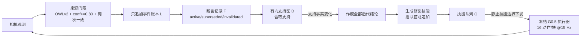

# REMM：给冻结操作策略加“可修订记忆”

**REMM**（*Revisable Embodied Memory for Manipulation*，[arXiv:2610.12710](https://arxiv.org/abs/2610.12710)，[项目页](https://revanthsenthil.github.io/remm/)）由 Carnegie Mellon University 与 Bosch Center for AI 的 Senthilkumaran、Wickramarachchi、Oltramari、Francis 提出。它是包在冻结 VLA 执行器外面的监督式记忆层：保留证据历史，并在证据变化时撤回依赖它的结论。

## 一句话定义

**把“观测日志”与“可撤销的任务状态”分开存放，用依赖图把已完成条件挂在支持事实上；扰动使支持事实失效时，撤回这些结论并在静止技能边界插入修复技能，不改执行器参数。**

## 英文缩写速查

| 缩写 | 英文全称 | 简要说明 |
|------|----------|----------|
| REMM | Revisable Embodied Memory for Manipulation | 本文方法 |
| VLA | Vision-Language-Action model | 被冻结的执行器（G0.5）类型 |
| VLM | Vision-Language Model | Qwen3-VL-4B-Instruct，用于任务分解与视觉验证 |
| MIL | Multiple Instance Learning tracker | T3 离线像素初始化跟踪 |
| HiMe | （基线名，原文页简称） | 作者改编的分层记忆基线，非官方复现 |
| T1a/T1b/T2/T3 | Task 1a/1b/2/3 | 排队扰动 / 倒料后目的地变更 / 有序回忆 / 隐藏物体洗牌 |

## 为什么重要

- **扰动后的撤回是缺口：** 只存观测不能告诉机器人哪些“已完成”要作废。
- **不重训策略：** 记忆层作为接口外挂，适用于已部署的冻结 VLA（例如 [Galaxea G0.5](./paper-galaxea-g05.md)，推测与论文所用执行器同族）。
- **评测诚实：** 论文把操作者协助单独记录，不把协助完成当自主成功。

## 方法栈 / 流程总览

## 方法

- **状态：** M_k = (L_k, F_k, D_k, Q_k)：账本、断言记录、支持图、技能队列。每条派生记录要求其所有父节点同时成立。
- **修订：** 记录失效则所有活跃后代作废；已完成目标被作废时生成修复技能，与当前指令共享实体则插到下一条，否则追加到队尾。
- **派发：** 执行中不改指令，仅在已验证的静止技能边界下发。
- **组件：** 执行器为冻结的 G0.5（自回归 VLA），机器人 Galaxea R1 Lite；Qwen3-VL-4B-Instruct 做受限分解与验证；OWLv2 提供 2D 检测。视觉关系需置信度 ≥0.80 且两次不同观测一致，单纯漏检不撤回事实。
- **依赖来源：** 图来自任务编译器和固定谓词本体，不是学出来的。

## 实验与评测

- **51 次真机试验：** Vanilla G0.5 18 次（全部完成/部分/失败 0/12/6），HiMe 改编 16 次（2/10/4），REMM 17 次（10/7/0）；各任务试验数不同，作者称汇总计数为描述性。
- **记录进度均值：** 干预恢复 REMM 91% 对最强基线 57%；序列回忆 70% 对 43%；T3 隐藏物体 REMM 4/4 完成，基线无完整完成。
- **协助：** 记录数（无协助/任务协助/未记录）：vanilla 12/0/6，HiMe 6/2/8，REMM 10/4/3；协助运行计入全部数字。
- **离线视频诊断（42 段，无运动策略）：** T2 完整决策 REMM 8/12，RoboMME 风格 5，其余 0；T3 隐藏目标 REMM 30/30，MemER 风格 13，无记忆 11，RoboMME 风格 11，HiMe 10。
- 评测指标：记录进度 P_e（预先固定检查点的满足比例），严格成功 S_e（全部检查点才为 1）。

## 源码运行时序图

不适用：论文称 “will release” 代码，项目页除第三方工具外没有 REMM 自身仓库；截至 2026-10-12 无可对齐的目录与脚本（见 [项目页核查](../../sources/sites/remm_project_page.md)）。

## 工程实践

- 思路可直接借用：事件账本 + 失效传播 + 边界下发，与具体 VLA 解耦。
- 感知门限保守（0.80 置信度 + 两次一致）以避免漏检误撤回；代价是对瞬时变化反应慢。
- 只在静止边界纠正，意味着技能粒度决定恢复延迟。

## 结论

**REMM 说明：对冻结 VLA，给记忆加“撤回与修复”语义，比单纯存历史更能提升扰动后的任务进度，但证据仅来自小样本、含协助的真机试验。**

1. 干预恢复的记录进度 91% 对 57%，序列回忆 70% 对 43%。
2. 17 次 REMM 试验无完全失败，10 次完整完成，其中 2 次完整完成记录了协助。
3. 收益不能单独归因于图传播（论文自述）。
4. 依赖结构来自固定谓词本体，换任务要重写。
5. 代码待发布，暂不可复现。

## 局限与风险

- **开源：** 待发布（论文承诺，项目页无自身仓库）。
- 单机器人、小物体集、控制的干预；2D 检测、不打断动作块；完全遮挡下不保证恢复。
- 基线 HiMe、MemER、RoboMME 风格均是改编而非官方复现；视频诊断各方法计算/观测路径不同。
- 记录进度不等同自主成功率；附录未单独核对。

## 与其他工作对比

| 对照 | 读法 |
|------|------|
| [Gated Memory Policy](./paper-gated-memory-policy.md) | 记忆在策略内部做门控；REMM 在冻结策略外做符号化修订 |
| [HyMES 混合记忆操作](./paper-hymes-hybrid-memory-manipulation.md) | 同为操作记忆；对照点在是否显式支持“撤回” |
| [Galaxea G0.5](./paper-galaxea-g05.md) | 论文所用执行器（推测同族） |
| HiMe / MemER / RoboMME 风格 | 论文中的改编基线 |

## 关联页面

- [34 篇空间落地技术图谱（汇总页）](../overview/embodied-station-34-papers-spatial-grounding-technology-map.md)
- [操作任务总览](../tasks/manipulation.md)
- [VLA（方法）](../methods/vla.md)
- [Galaxea G0.5](./paper-galaxea-g05.md)
- [Gated Memory Policy](./paper-gated-memory-policy.md)
- [HyMES](./paper-hymes-hybrid-memory-manipulation.md)

## 参考来源

- [公众号盘点：具身智能小站 34 篇](../../sources/blogs/wechat_embodied_station_34_papers_spatial_grounding_2026-10-12.md)
- [remm_arxiv_2610_12710.md](../../sources/papers/remm_arxiv_2610_12710.md)
- [remm_project_page.md](../../sources/sites/remm_project_page.md)
- [arXiv:2610.12710](https://arxiv.org/abs/2610.12710)

## 推荐继续阅读

- [REMM 项目页](https://revanthsenthil.github.io/remm/)
- [arXiv HTML 全文](https://arxiv.org/html/2610.12710v1)
