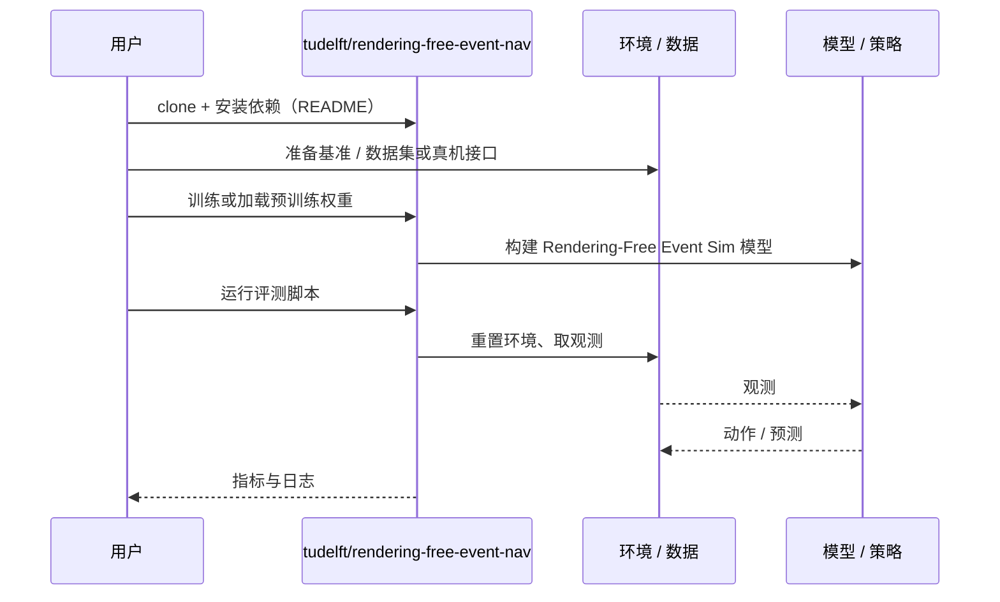

# Rendering-Free Event Sim（arXiv:2610.37543）

**Rendering-Free Event Sim**（*Rendering-Free Event Frame Simulation for Fast Reinforcement Learning of Autonomous Robot Navigation*，[arXiv:2610.37543](https://arxiv.org/abs/2610.37543)，[代码](https://github.com/tudelft/rendering-free-event-nav)）来自 [具身智能小站 2026-10-28 盘点](../../sources/blogs/wechat_embodied_station_59_papers_human_video_to_robot_experience_2026-10-28.md)，属「导航、无人机与群体」组。

## 一句话定义

**事件相机适合低功耗、低延迟机器人，但先渲染图像再转换事件的仿真流程会拖慢强化学习。**

## 英文缩写速查

| 缩写 | 英文全称 | 简要说明 |
|------|----------|----------|
| Rendering-Free Event Sim | Rendering-Free Event Frame Simulation for Fast Reinforcement Learning of Autonomous Robot Navigation | 本文方法 / 基准的简称 |

## 为什么重要

- 让微型无人机绕开事件仿真瓶颈。本文从运动边缘直接生成事件观测，把训练吞吐与微控制器部署连起来，值得关注的是整条工程路径，以及近似传感模型能否支持真实迁移。
- 开源结论：**已开源**（步骤 2.5，2026-10-28）。仓库可达（git ls-remote）。
- 同期同组工作见 [潜在动作、免渲染事件仿真与机器人评测：具身智能小站 10-28 期 59 篇阅读坐标](../overview/embodied-station-2026-10-28-59-papers-technology-map.md)。

## 核心机制

| 项 | 内容 |
|----|------|
| **arXiv** | [2610.37543](https://arxiv.org/abs/2610.37543) |
| **开源** | **已开源** |
| **要点** | 事件相机适合低功耗、低延迟机器人，但先渲染图像再转换事件的仿真流程会拖慢强化学习。 |
| **文内指标** | 公众号转述：把闭环事件观测本身做成可并行解析近似，而非仅优化渲染或用特权状态替代事件输入；再将传感近似、策略训练与机载部署放在同一验证链条中。 |

## 源码运行时序图

以下为按仓库入口（`tudelft/rendering-free-event-nav`）推断的通用运行链路；入库日仅核实仓库可达，未逐文件阅读，具体脚本名以 README 为准。

## 实验与评测

- 公众号转述：把闭环事件观测本身做成可并行解析近似，而非仅优化渲染或用特权状态替代事件输入；再将传感近似、策略训练与机载部署放在同一验证链条中。
- **读法：** 本页为索引级摘要，依据公众号转述的官方摘要与仓库信息整理；逐项数字与 baseline 以原文 PDF 为准。

## 与其他工作对比

- 横向索引见 [潜在动作、免渲染事件仿真与机器人评测：具身智能小站 10-28 期 59 篇阅读坐标](../overview/embodied-station-2026-10-28-59-papers-technology-map.md)；同 arXiv 不重复造页。

## 结论

**让微型无人机绕开事件仿真瓶颈：把闭环事件观测本身做成可并行解析近似，而非仅优化渲染或用特权状态替代事件输入；再将传感近似、策略训练与机载部署放在同一验证链条中。**

1. 开源边界：**已开源** — 仓库可达（git ls-remote）。
2. 核心机制：事件相机适合低功耗、低延迟机器人，但先渲染图像再转换事件的仿真流程会拖慢强化学习。
3. 复现与选型前核对任务协议、硬件与基准口径，勿直接横比公众号摘录数字。

## 关联页面

- [locomotion](../tasks/locomotion.md)
- [sim2real](../concepts/sim2real.md)
- [reinforcement-learning](../methods/reinforcement-learning.md)
- [embodied-station-2026-10-28-59-papers-technology-map](../overview/embodied-station-2026-10-28-59-papers-technology-map.md)

## 参考来源

- [rendering_free_event_sim_arxiv_2610_37543.md](../../sources/papers/rendering_free_event_sim_arxiv_2610_37543.md)
- [wechat_embodied_station_59_papers_human_video_to_robot_experience_2026-10-28.md](../../sources/blogs/wechat_embodied_station_59_papers_human_video_to_robot_experience_2026-10-28.md)
- [arXiv:2610.37543](https://arxiv.org/abs/2610.37543)

## 推荐继续阅读

- [arXiv PDF](https://arxiv.org/pdf/2610.37543)
- [https://github.com/tudelft/rendering-free-event-nav](https://github.com/tudelft/rendering-free-event-nav)
