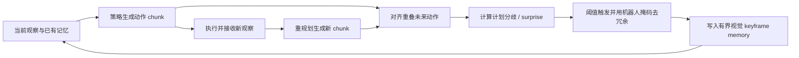

# RePlanMem-VLA：用计划修订触发视觉记忆

**RePlanMem-VLA**（[When Plans Change, Remember](https://arxiv.org/abs/2610.22556)，[项目页](https://vika787.github.io/RePlanMem/)）将相邻滚动动作计划对同一重叠未来的预测分歧转化为关键帧信号，把少量任务相关视觉观察保存在有界记忆中，供长程 VLA 后续决策使用。

## 英文缩写速查

| 缩写 | 英文全称 | 简要说明 |
| --- | --- | --- |
| RePlanMem-VLA | Replanning-Guided Keyframe Memory for Vision-Language-Action Models | 根据 VLA 计划修订写入稀疏视觉记忆的方法。 |
| VLA | Vision-Language-Action | 从视觉与语言任务输入生成机器人动作的策略。 |
| ROC-AUC | Receiver Operating Characteristic Area Under the Curve | 衡量计划分歧检测关键事件能力的指标。 |
| FM | Flow Matching | 论文中用于从头训练策略的生成式动作模型路线。 |

## 为什么重要

长程操作常包含延迟线索：策略看到一次物体颜色或任务阶段后，线索可能离开当前相机视野，直到之后的抓取或排序动作才需要。保存完整观测历史会引入计算和冗余，固定窗口也可能在真正需要时丢掉早期线索。RePlanMem 利用 VLA 正常重规划时已经产生的动作预测变化，提供一种不依赖额外关键帧标注或仿真特权状态的记忆写入信号。

## 核心原理

设滚动时域策略在时刻 $q-1$ 产生动作 chunk $C_{q-1}$，观察新帧后在时刻 $q$ 产生 $C_q$。两段 chunk 覆盖部分相同的未来动作；将重叠区间对齐后，比较两次预测的差异。若新观察使策略显著修订同一未来动作，分歧可作为任务相关事件的候选提示。方法再将该时刻的视觉帧写入容量有界的记忆，并通过机器人掩码去重，降低机器人本体区域或重复画面的写入。

论文对 35 种分歧测量方式作筛选，覆盖从头训练的自回归 decoder-only 与 Flow-Matching Transformer；随后在预训练 OpenVLA-OFT 与 π₀.₅ 上评估事件检测和记忆保留。核心取舍是：记忆触发器从策略自己的计划变化中取信号，因此可随策略表征而变化，但需对重叠 chunk 的比较方式和不同任务尺度进行校准。

## 实验与评测

| 评测环节 | 论文摘要报告 | 解读 |
| --- | --- | --- |
| 计划分歧事件检测 | ROC-AUC 0.981–0.997 | 指标来自筛选后的 detector；不等价于端到端任务成功率。 |
| 记忆保留 | 评估的记忆实验中，100% episode 将任务相关观察保留至后续决策点 | 是特定延迟线索任务设置下的保留结果，不代表所有长程任务均无遗忘。 |
| 真机相关验证 | replay data 支持事件选择和去冗余可扩展到仿真之外 | 回放数据分析不等于在线真机策略闭环部署。 |

## 与其他工作对比

| 方法 | 关键帧触发信号 | 记忆路径 |
| --- | --- | --- |
| [EventVLA](./paper-eventvla-visual-evidence-memory.md) | 学习式前瞻预测未来 chunk 内关键帧 | 原始图像拼接到 QwenOFT 上下文。 |
| [KEMO](./paper-kemo-event-driven-keyframe-memory-vla.md) | 运动学事件显著性与视觉变化验证 | 关键帧经门控 cross-attention 融合。 |
| **RePlanMem-VLA** | 相邻重规划在重叠动作上的预测分歧 | 事件触发后写入有界视觉记忆，并抑制冗余帧。 |

三者都在处理“保留哪些历史观察”，但触发信号、记忆注入方式和评测协议不同；各自结果不能直接排序。

## 结论

**RePlanMem 的贡献是把策略重规划本身变成在线记忆写入线索，使“记住什么”由计划修订驱动。**

1. 检测器比较的是时间对齐的重叠动作预测；直接比较两个完整 chunk 会把自然时移误当成策略变化。
2. ROC-AUC 高说明关键事件识别有效，不足以单独证明下游机器人任务成功率提升。
3. 有界 memory 与机器人掩码去重共同控制历史冗余；实际部署还需测量每次写入带来的视觉编码、上下文和推理成本。
4. 100% 保留率应限定在论文所评估任务与观察窗口中解读。
5. 真机 replay evidence 与在线硬件闭环不同，不能用它替代真实执行安全与可靠性验证。
6. 截至 2026-10-20，项目页未列代码或数据集链接；目前可复核论文和方法展示，但不能据此声称公开实现已可运行。

## 工程实践与局限

- **分歧量需要任务校准：** 不同动作维度、策略采样温度和 chunk 长度会改变尺度，阈值应在目标任务上验证。
- **计划改变不一定意味着重要事件：** 感知噪声、随机采样和策略不稳定也可能造成高分歧；机器人掩码只是去冗余的一部分。
- **记忆预算有限：** 需同时考察触发 precision/recall、存储容量、视觉编码成本与真正的长程任务表现。
- **源码开放状态：** 官方项目页截至入库日只链接 arXiv；无可核查的公开运行入口，因此源码运行时序图不适用。

## 源码运行时序图

**不适用：** 截至 2026-10-20，项目页未列代码仓库，无法从官方实现核对训练或推理入口。

## 参考来源

- [RePlanMem-VLA 官方论文摘录](../../sources/papers/replanmem_vla_arxiv_2610_22556.md)
- [RePlanMem 官方项目页核查](../../sources/sites/replanmem-project.md)

## 关联页面

- [VLA](../methods/vla.md)
- [Action Chunking](../methods/action-chunking.md)
- [EventVLA](./paper-eventvla-visual-evidence-memory.md)
- [KEMO](./paper-kemo-event-driven-keyframe-memory-vla.md)
- [Manipulation](../tasks/manipulation.md)

## 推荐继续阅读

- [RePlanMem 项目页](https://vika787.github.io/RePlanMem/)
- [arXiv 论文](https://arxiv.org/abs/2610.22556)
