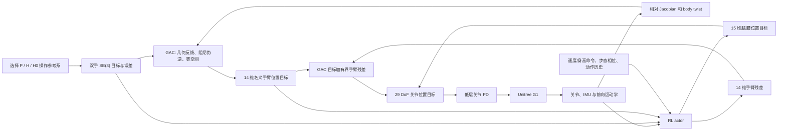

# ResGAC：全身人形控制中的精确 SE(3) 末端执行器跟踪 / Precise SE(3) End-Effector Tracking in Whole-Body Humanoid Control

**ResGAC**（Joohwan Seo 等，UC Berkeley / Amazon FAR / CMU，arXiv:[2610.09479](https://arxiv.org/abs/2610.09479)，[项目页](https://resgac.github.io/ResGAC-website/)）结合几何导纳控制的名义末端跟踪动作与残差强化学习：控制器负责手臂位姿误差反馈，策略补偿动态误差并协调其余全身关节，使 Unitree G1 在站立、基座移动和行走扰动下仍能精确跟随双手 SE(3) 目标。

## 一句话定义

**ResGAC 将浮动基座 SE(3) 几何导纳控制生成的双臂名义关节位置目标与 RL 有界手臂残差相加，同时由 RL 直接控制腿/腰关节位置，实现动态全身运动中的精确双臂末端位姿跟踪。**

## 为什么重要

- **操作目标明确：** 一般全身动作模仿策略重点跟踪关节运动，而操作任务需要同时满足双手位置和姿态的几何误差。
- **统一控制接口：** GAC 提供结构化任务空间反馈，残差 RL 负责建模误差、重力和动态耦合，同时协调步行与平衡；不是把互不交互的机械臂 IK 和步态策略简单拼接。
- **参考系选择影响实际目标：** H0 仅保留骨盆在世界坐标系中的平面位移与偏航，避免 roll/pitch/heave 直接通过参考坐标变换进入末端期望位姿；真实足端冲击仍需控制器补偿。

## 英文缩写速查

| 缩写 | 英文全称 | 简要说明 |
|------|----------|----------|
| SE(3) | Special Euclidean group in 3D | 三维位置与方向组成的刚体位姿空间 |
| GAC | Geometric Admittance Control | 将末端位姿误差映射成名义手臂关节目标 |
| RL | Reinforcement Learning | 学习手臂残差与腿/腰协调目标 |
| EEF | End Effector | 末端执行器；本文主要指双手 |
| H0 | Ground-attached Heading Frame | 保留平面位置/偏航，剔除 pelvis roll/pitch/heave 的地面航向坐标系 |

## 核心原理：名义几何控制 + 有界残差 + 全身协调

**术语边界：** 论文 §III-A2 明确指出，此处 GAC 是使用位姿误差的几何跟踪控制器，**不输入实测外部 wrench（力/力矩）**；不能因此直接称其已经实现接触力传感器闭环。

### 关键控制方程（论文式 13–20）

几何控制先构造期望末端速度，再通过阻尼伪逆及零空间项映射为手臂位置目标。RL 在同一个关节位置接口上叠加残差：

$
a_{\mathrm{arm},t}=a_{\mathrm{GAC},t}
+s_r\operatorname{clip}(a_{\mathrm{RL,arm},t},-c_r,c_r),
\qquad a_{\mathrm{other},t}=a_{\mathrm{RL,other},t}.
$

其中作者设置 $s_r=0.75$、$c_r=1.0$；手臂 14 DoF 使用受限修正，其余 15 DoF 为 RL 直接输出，**不是输出末端力矩**。

- **GAC 名义动作：**由浮动基座下的几何位姿误差反馈产生手臂目标，使用阻尼伪逆与零空间项处理运动学映射。
- **残差策略：**手臂目标上叠加受限残差；腿/腰 15 个关节目标由策略直接输出。G1 共 29 DoF，其中手臂 14 DoF。
- **策略观测：**包括速度命令、关节状态/速度、投影重力、机身角速度、GAC 动作、末端位姿误差、机身 twist、最近动作及步态相位。critic 可看仿真 pelvis 线速度特权量，部署 actor 不需要该量。
- **部署接口：**50 Hz 策略输出关节位置目标，由低层 PD 执行。

### H0 解决什么问题

世界固定目标直接变换进 pelvis 坐标系时，躯干 roll、pitch、heave 会传到手部参考。H0 保留水平位置与偏航、去除这三类变化，可减弱行走时一部分参考扰动。实验显示 roll 传递与手部 z 误差改善明显，但 pitch 基本不变；H0 不是完整扰动隔离器。

### 训练与部署配置（论文 §III-D / §IV-A）

| 模块 | 原文报告设置 |
|---|---|
| 训练框架 | Isaac Sim / Holosoma + FastSAC；4096 环境、单张 L40S，六阶段完整课程约 16 小时 |
| 课程 A–F | 站立固定目标 → 站立轨迹 → 步行固定目标 → 步行轨迹；随后继续收紧位置/姿态奖励并扩展指令范围 |
| 奖励 | 25 项：双手位置 L2²+L1、SO(3) 方向、底盘速度、摆脚、姿态、足端与正则项等 |
| 数据增强 | 左右镜像 transition + actor 等变性 / critic 不变性正则 |
| Actor/critic | Actor 读取位置/速度、IMU、GAC、末端误差和相对 twist、两帧动作历史、相位；critic 另使用仿真特权线速度 |
| 部署接口 | GAC 和策略均以 50 Hz 工作、Pinocchio 计算运动学、低层 PD 跟踪位置；参考系速度中部署侧不依赖不可可靠观测的基座线速度 |

### H0 的数学边界

论文式 (23) 定义 $p_{WH_0}=\operatorname{diag}(1,1,0)p_{WP}$、$R_{WH_0}=R_z(\psi)$，因此 H0 保留 $(x,y,\psi)$ 运动而去除 pelvis roll/pitch/heave **对期望末端位姿的坐标系传播**。行走冲击等真实扰动不会仅因换坐标系消失。

## 真机结果

| 场景 | 结果 | 解读 |
|------|------:|------|
| 站立 setpoint | 6.5 mm / 1.37° MAE | 留出轨迹跟踪优于所测基线 |
| 站立 pick-and-place | 6.6 mm / 1.67° MAE | 手部精度用于操作轨迹 |
| Peg-in-hole | 18/20（90%）；SONIC v1.1 为 10/20（50%） | 25 mm 销、35 mm 孔；失败涉及注册误差与 OptiTrack 遮挡 |
| 移动基座世界系跟踪 | 8.8 mm / 2.69°；E2E RL 为 30 mm / 13.75° | 基座运动时维持位置/方向精度 |
| 行走静态手保持 | H0 roll 传递比 0.790（无 H0 为 0.958）；z MAE 12.6 mm（无 H0 为 22.5 mm） | pitch 传递未改善（0.964 vs 0.954） |

这些结果来自特定硬件、轨迹与标记系统，不应外推为所有动态接触任务的成功率。插孔仅 20 次，且依赖 OptiTrack 注册；评测也未证明可完全抵消身体运动。

## 与其他工作对比

| 对比对象 | 控制分工 | 论文中的相对表现 / 差异 |
|----------|----------|--------------------------|
| E2E RL（端到端强化学习） | 策略直接输出全部关节目标，无几何控制先验 | 移动基座世界系跟踪 30 mm / 13.75°，ResGAC 为 8.8 mm / 2.69°；缺少名义 SE(3) 反馈时末端精度明显下降 |
| GAC + decoupled RL | GAC 负责手臂、RL 单独负责下肢，二者解耦 | 四种留出站立轨迹上不及 ResGAC；对照提示手臂残差与腿/腰协调在同一策略中联合学习更有利 |
| [SONIC](../methods/sonic-motion-tracking.md)（v1.1） | 通用全身动作跟踪器，以参考动作而非末端位姿误差为目标 | 插孔 10/20（50%），ResGAC 为 18/20（90%）；在该 25 mm 销 / 35 mm 孔设定下末端精度不及专门的 SE(3) 跟踪 |
| [残差策略学习](../methods/residual-policy-learning.md) 一般范式 | 名义控制器 + 有界残差 | ResGAC 的区别在于残差只加在手臂，腿/腰由策略直接输出，并以 H0 坐标系减弱躯干姿态扰动 |

相对最佳基线，论文报告站立留出轨迹的位置误差降低约 54–67%、方向误差约 72%；以上均为作者在 G1 真机与 OptiTrack 注册条件下的对照。

## 结论

- 末端目标明确且已有可靠几何控制器时，可由传统控制承担名义跟踪，让 RL 聚焦移动、接触与未建模动态。
- 该方法不只是给手臂加残差：手臂围绕 GAC 修正，腿/腰由策略直接协调，输出统一为关节位置目标。
- 世界系适合外部固定目标；H0 减少部分躯干姿态进入手部参考，但不能假定其对每个方向都同样有效。
- 扩展验证应覆盖注册/遮挡、不同步态相位、接触力与连续移动基座，并报告多次试验和失败模式。

## 工程实践与开源状态

项目补充材料给出 Isaac Sim / Holosoma、FastSAC、4096 并行环境、单张 L40S 约 16 小时训练、50 Hz actor 和 Pinocchio 部署信息，课程由站立逐步扩展到行走轨迹。截至 2026-11-10 官方站点仍未提供可运行训练或部署控制代码；因此不附代码入口或源码运行流程图。这些参数是作者报告的配置摘要，不代表已有完整可复现实装。

## 局限与风险

- **依赖外部配准/定位：** Peg-in-hole 实验的孔目标由 OptiTrack 标记估计；静态手保持和 Mime-man 的位置外环通过 OptiTrack 获取 pelvis 平面位姿，不能据此宣称无外部定位的全自主世界系操作。
- **条件特定：** 四组站立轨迹、行走保持和 20 次插孔试验不能代表未知接触环境和不同机器人平台的可泛化性能，也未给出独立安全保证。
- **导纳并非实时测力：** GAC 在本文不使用外力测量输入；尚不能据此推导接触力安全上限。
- **参考系仍有轴向局限：** H0 对 roll 和高度传播有改善，pitch 传递比 0.954 对 0.964 近似不变。
- **复现入口未开放：** [ResGAC 官网仓库](https://github.com/ResGAC/ResGAC-website) 为网页/视频和补充实现说明，项目主页显示控制代码“Code (released on acceptance)”；截至 2026-11-10 无可验证的官方训练/推理实现。

## 源码运行时序图

**暂不适用（截至 2026-11-10）：** 没有可运行的官方控制源码，不应根据论文推测源码模块调用顺序。上述 Mermaid 是**论文方法信号流图**，不是由实际函数调用追踪得出的 `sequenceDiagram`。待作者发布训练或推理仓库后，应核实真实源码入口再补图。

## 关联页面

- [Loco-Manipulation（移动操作）](../tasks/loco-manipulation.md)
- [Residual Policy Learning（残差策略学习）](../methods/residual-policy-learning.md)
- [Whole-Body Tracking Pipeline](../concepts/whole-body-tracking-pipeline.md)
- [Unitree G1](./unitree-g1.md)
- [【10.5-10.9前沿论文动态】人形/四足44篇](../overview/frontier-humanoid-quadruped-2026-10-05-10-09.md)

## 参考来源

- Seo et al., [Precise SE(3) End-Effector Tracking in Whole-Body Humanoid Control](https://arxiv.org/abs/2610.09479), arXiv:2610.09479, 2026.
- [ResGAC project page](https://resgac.github.io/ResGAC-website/), [supplementary details](https://resgac.github.io/ResGAC-website/details.html), and [official static-site repository](https://github.com/ResGAC/ResGAC-website), rechecked 2026-11-10.
- [【10.5-10.9前沿论文动态】人形/四足44篇 综述条目](../../sources/blogs/frontier_humanoid_quadruped_2026_10_05_10_09.md)

## 推荐继续阅读

- [arXiv HTML 全文](https://arxiv.org/html/2610.09479v1)：控制结构、观测与对照实验。
- [项目实验详情](https://resgac.github.io/ResGAC-website/details.html)：训练配置、补充曲线与视频。
- [Loco-Manipulation 任务综述](../tasks/loco-manipulation.md)：对照残差、分层控制与 VLA 路线。
