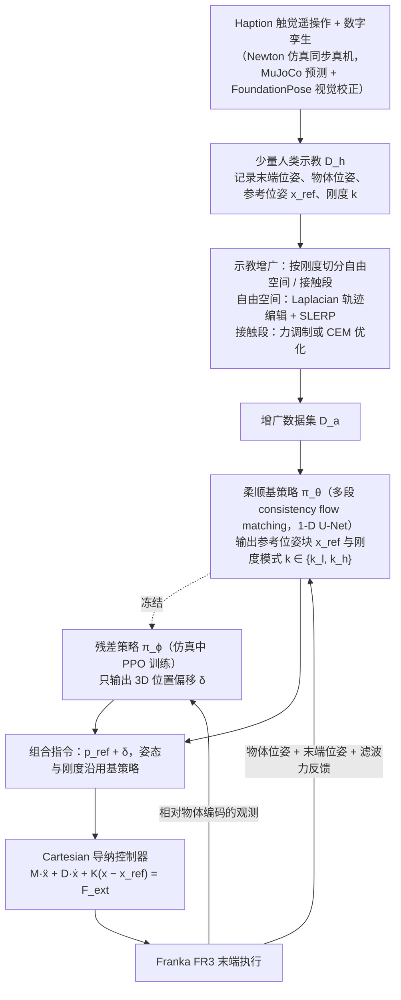

# Residual Compliant Policy（arXiv:2610.14035）

**Residual Compliant Policy**（*Residual Compliant Policy: Learning Compliant Policies from Few Demonstrations*，[arXiv:2610.14035](https://arxiv.org/abs/2610.14035)，[项目页](https://residual-compliant-policy.github.io/)）来自 [具身智能小站 2026-10-14 盘点](../../sources/blogs/wechat_embodied_station_41_papers_streamingwam_2026-10-14.md)，属「操作与柔顺控制」组。

## 一句话定义

**遥操作中显式选择柔顺模式，结合轨迹重定向与物理优化，再由残差 RL 调整导纳控制参考。**

## 英文缩写速查

| 缩写 | 英文全称 | 简要说明 |
|------|----------|----------|
| RL | Reinforcement Learning | 强化学习 |
| FR3 | Franka Research 3 | Franka 机械臂 |
| Admittance | Admittance Control | 导纳控制 |

## 为什么重要

- 示范中的柔顺性通常隐含在力交互里，难以被表达和迁移。
- 开源结论：**待发布**（步骤 2.5，2026-10-14）。项目页含「coming soon」字样，入库日未列 GitHub。
- 同期同组工作见 [流式动作块与世界模型记忆：具身智能小站 10-14 期 41 篇阅读坐标](../overview/embodied-station-2026-10-14-41-papers-technology-map.md)。

## 流程总览

图依据：论文 §III-A 至 §III-E（式 1–4）。

## 核心机制

| 项 | 内容 |
|----|------|
| **arXiv** | [2610.14035](https://arxiv.org/abs/2610.14035) |
| **开源** | **待发布** |
| **要点** | 模式选择 → 重定向 + 物理优化 → 残差 RL 调导纳参考；实验集中于 FR3 翻转与推动。 |
| **文内指标** | 少示范；结论限论文任务范围。 |

## 源码运行时序图

**不适用（待发布）** — 项目页含「coming soon」字样，入库日未列 GitHub。 不编造运行脚本；代码公开后再补。

## 实验与评测

- 少示范；结论限论文任务范围。
- **读法：** 本页为索引级摘要，依据公众号转述的官方摘要与仓库信息整理；逐项数字与 baseline 以原文 PDF 为准。

## 与其他工作对比

- 横向索引见 [流式动作块与世界模型记忆：具身智能小站 10-14 期 41 篇阅读坐标](../overview/embodied-station-2026-10-14-41-papers-technology-map.md)；同 arXiv 不重复造页。

## 结论

**让柔顺成为显式变量（模式 + 参考）再学残差，比端到端学力控更数据高效。**

1. 开源边界：**待发布** — 项目页含「coming soon」字样，入库日未列 GitHub。
2. 核心机制：模式选择 → 重定向 + 物理优化 → 残差 RL 调导纳参考；实验集中于 FR3 翻转与推动。
3. 复现与选型前核对任务协议、硬件与基准口径，勿直接横比公众号摘录数字。

## 关联页面

- [admittance-control](../methods/admittance-control.md)
- [residual-policy-learning](../methods/residual-policy-learning.md)
- [manipulation](../tasks/manipulation.md)
- [embodied-station-2026-10-14-41-papers-technology-map](../overview/embodied-station-2026-10-14-41-papers-technology-map.md)

## 参考来源

- [residual_compliant_policy_arxiv_2610_14035.md](../../sources/papers/residual_compliant_policy_arxiv_2610_14035.md)
- [wechat_embodied_station_41_papers_streamingwam_2026-10-14.md](../../sources/blogs/wechat_embodied_station_41_papers_streamingwam_2026-10-14.md)
- [arXiv:2610.14035](https://arxiv.org/abs/2610.14035)
- [arXiv PDF](https://arxiv.org/pdf/2610.14035)：已通读方法部分（实验与附录以略读为准）：§I Introduction、§III Method（A–E）、§IV-A 实验设定

## 推荐继续阅读

- [arXiv PDF](https://arxiv.org/pdf/2610.14035)
- [项目页](https://residual-compliant-policy.github.io/)
