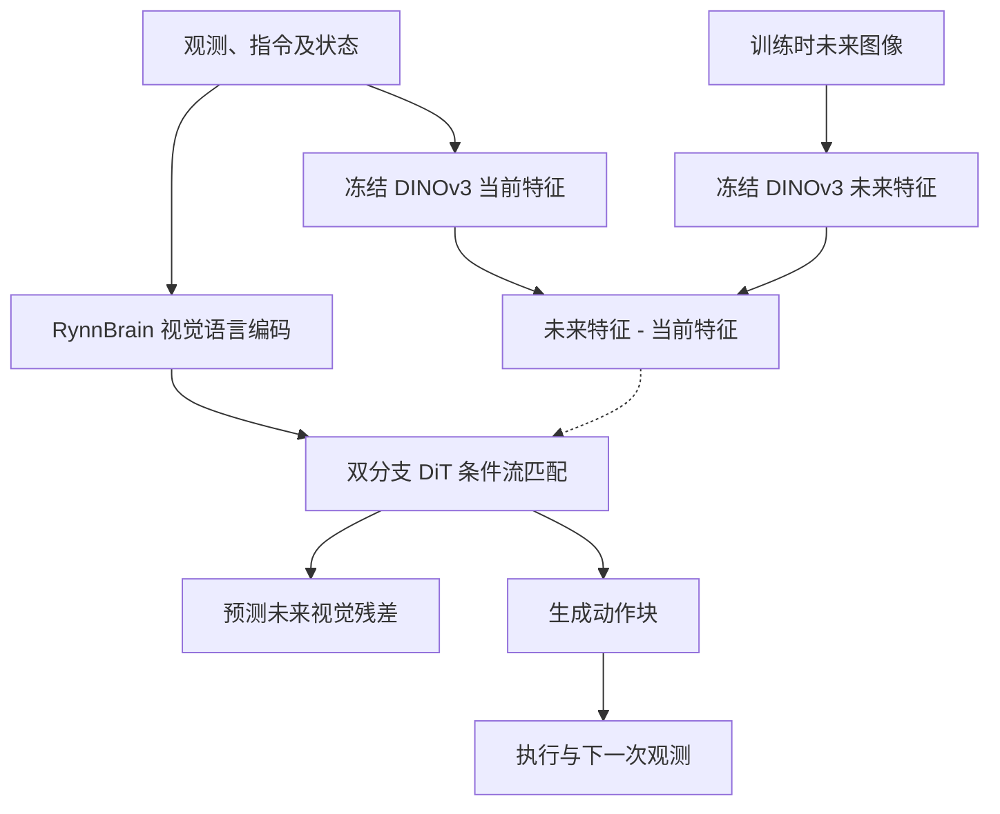
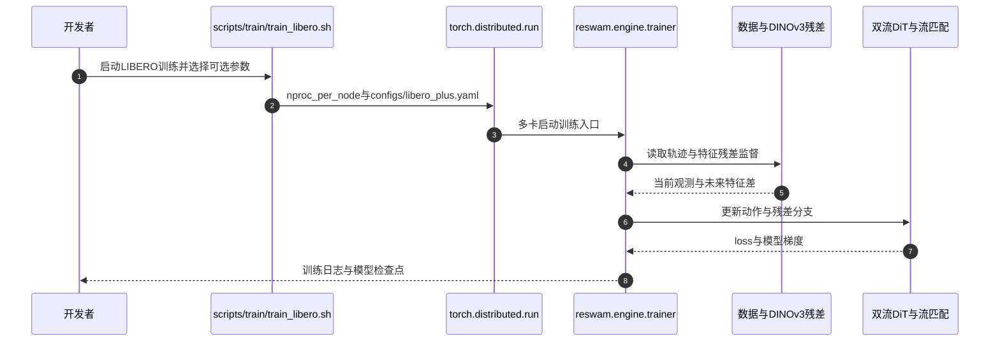

# ResWAM: Learning What Changes, Not What Stays, for World-Action Models / 世界–动作模型只学习未来真正变化的部分

## 一句话定义

**ResWAM**：ResWAM 在冻结 DINOv3 表征中学习未来特征增量，并用 0.5B 双分支 DiT 联合生成残差与动作；总计约 2.3B，LIBERO-Plus 81.1%、RoboTwin 2.0 93.8%、真机平均 80.0%，真机延迟 92.7 ms。

## 英文缩写速查

| 缩写 | 英文全称 | 简要说明 |
|---|---|---|
| WAM | World-Action Model | 未来表征与动作联合学习 |
| DINOv3 | Self-Distillation with No Labels version 3 | 冻结视觉特征空间 |
| DiT | Diffusion Transformer | 残差与动作双流专家 |
| FSDP | Fully Sharded Data Parallel | 多卡分片训练工具 |
| CFM | Conditional Flow Matching | 学习连续变量变换的生成目标 |

## 为什么重要

短时动作块中的背景通常几乎不变；监督整张未来图像会浪费容量在复制不变化区域。特征残差将训练重点转向机械臂和物体的真正变化。

## 核心原理

1. 冻结 DINOv3 将当前和未来图像编码为特征，监督目标是未来特征减去当前特征，而非预测完整的未来 RGB 或整帧特征。
2. 大约 0.5B 双流 DiT 在给定 VLM 上下文下共同学习动作块和视觉残差，采用条件流匹配；整套模型总参数约 2.3B，不能把双流头参数当总规模。
3. 残差目标强化了动态物体与机械臂区域的表示；推理侧不要求显式合成高分辨率未来视频，减少闭环推理压力。

## 流程总览

## 源码运行时序图

代码静态核对的真实入口如下（仅确认调用链，未执行训练）：

## 工程实践

- 可复现入口：安装依赖后以 bash scripts/train/train_libero.sh 启动 torch.distributed.run，再进入 reswam.engine.trainer。
- 比较监督目标时固定 DINOv3 特征、动作块大小、真实机器人数据量和随机种子，分别消融未来完整特征与未来特征残差。
- 上线时检查动作服务延迟、模型权重与 action/state 归一化 statistics 是否配套；报告准确的硬件/批量。

## 实验与评测

- LIBERO-Plus 81.1%（官方发布对应 10030 次测试回合）；RoboTwin 2.0 93.8%，无外部机器人动作预训练的条件须单列。
- RoboDojo 报告任务成功率 9.40%、得分 13.41；不同平台不能跨任务直接排名。
- 真机 Open / Put / Stack 三项平均成功率 80.0%，较论文所报 π0.5 基线 +10 个百分点；真机推理延迟 92.7 ms。
- 官方模型权重还分别发布了 LIBERO、RoboTwin 和 RoboDojo 的 checkpoint；不能把不同模型/任务的 92.2、99.4、99.7 ms 混成同一测试。

## 结论

**ResWAM 的价值应以相同任务协议、训练数据与推理测时边界判断，不能仅依据宣传规模或单一成功率。**

1. 冻结 DINOv3 将当前和未来图像编码为特征，监督目标是未来特征减去当前特征，而非预测完整的未来 RGB 或整帧特征。
2. 大约 0.5B 双流 DiT 在给定 VLM 上下文下共同学习动作块和视觉残差，采用条件流匹配；整套模型总参数约 2.3B，不能把双流头参数当总规模。
3. 可复现入口：安装依赖后以 bash scripts/train/train_libero.sh 启动 torch.distributed.run，再进入 reswam.engine.trainer。
4. 比较监督目标时固定 DINOv3 特征、动作块大小、真实机器人数据量和随机种子，分别消融未来完整特征与未来特征残差。

## 与其他工作对比

| 对照 | 关键差异 |
|---|---|
| ThinkWAM | 训练期特征残差监督 vs 部署前两遍动作 refinement，残差所处位置不同。 |
| JEPA4R | DINOv3 视觉特征差分 vs 公制点云潜空间动作条件规划，传感器和中间表示不同。 |

## 局限与风险

- 动态表征对冻结 DINOv3 的可见运动和特征质量敏感。
- 实机结果覆盖有限操作任务，不意味着跨本体或所有接触复杂动作成功率一致。

## 关联页面

- [动作分块](../methods/action-chunking.md)
- [扩散策略](../methods/diffusion-policy.md)
- [机器人操作](../tasks/manipulation.md)
- [ThinkWAM](./paper-thinkwam-2611-21258.md)
- [JEPA4R](./paper-jepa4r-2611-19771.md)
- [WAM 纵深路线](../../roadmap/depth-wam.md)

## 参考来源

- [论文全文归档](../../sources/papers/reswam-2611-19559.md)
- [arXiv 原文 v1](https://arxiv.org/html/2611.19559v1)
- [官方项目页归档](../../sources/sites/reswam-2611-19559.md)
- [官方代码归档](../../sources/repos/reswam-2611-19559.md)

## 推荐继续阅读

- [ResWAM: Learning What Changes, Not What Stays, for World-Action Models](https://arxiv.org/abs/2611.19559)
- [官方项目页](https://chongyu-fan.netlify.app/posts/reswam/)
- [官方代码](https://github.com/OPTML-Group/ResWAM)

