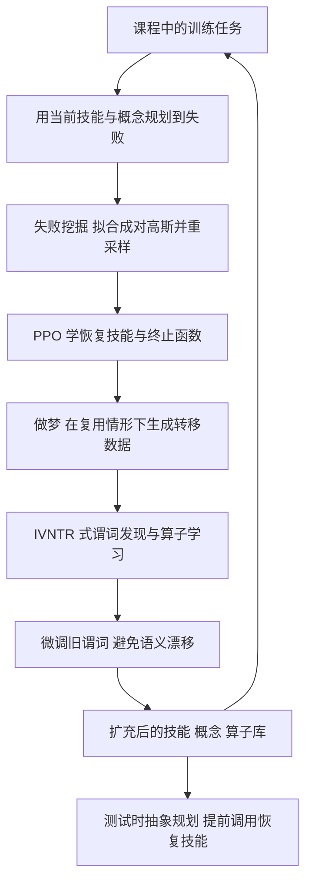

# ReSYNC：从机器人失败中学习技能与概念（arXiv:2606.18328）

**ReSYNC**（*Recover, Discover, Plan: Learning Skills and Concepts from Robot Failures*，[arXiv:2606.18328](https://arxiv.org/abs/2606.18328)，CMU / Princeton 等，v1 2026-06-16）。本页依据论文全文（含大部分附录）撰写，细节见 [来源归档](../../sources/papers/resync-recovery-driven-skill-concepts_arxiv_2606_18328.md)。

## 一句话定义

**ReSYNC 让机器人在失败里同时学「技能」和「概念」：先用 RL 学恢复技能，再从恢复经验里发现关系谓词并更新符号算子，使恢复技能能在未见任务中被规划器提前调用，而不是出错后才反应式触发（论文 §1、§4）。**

## 英文缩写速查

| 缩写 | 英文全称 | 简要说明 |
|------|----------|----------|
| ReSYNC | Recovery-Driven Synthesis of Relational Concepts | 本文方法名 |
| RF-MDP | Relational Factored Markov Decision Process | 状态按类型化物体分解的 MDP（§3） |
| PDDL | Planning Domain Definition Language | 技能对应的符号算子描述语言（§3、附录 E） |
| IVNTR | Bilevel Learning for Bilevel Planning（RSS 2025） | 本文借用的离线谓词发现框架（§4.2） |
| RC | Recovery Chaining | 反应式恢复基线（§5.1） |
| DSG | Deep Skill Graph | 技能图基线，DSG-S 单任务、DSG-M 多任务（§5.1） |
| TTRL | Test-Time Recovery Learning | 在测试时才为新失败学新技能的样本效率对照（§5.3） |
| PPO | Proximal Policy Optimization | 恢复策略所用 RL 算法（§4.1） |

## 为什么重要

- 为每种失败各训练一个恢复策略效率低，且恢复技能只在失败后触发，遇到新的失败配置难以泛化（论文 §1）。
- 作者的想法是把失败当作发现新抽象的机会：失败暴露缺失的技能，恢复过程产生自监督数据，用来发现让技能可复用的谓词（§1，作者自述）。
- 机构标签：CMU、Princeton（论文首页作者单位，另有 AI2、MIT、Centaur AI、Bosch Center for AI）。

## 核心原理与流程总览

每个课程阶段：用当前技能与概念规划直到失败 → 挖掘并扩充失败状态 → PPO 学恢复技能 → 做梦生成覆盖「技能复用」的转移数据 → 用 IVNTR 式的谓词选择学新谓词与算子 → 微调旧谓词 → 进入下一阶段（§4、图 3）。

要点（均出自 §4）：

- **恢复成功判据：** 恢复 MDP 从失败状态集 D_F 出发，到达一个「继续用库中技能规划能成功」的状态即成功，用 PPO 训练，终止函数用监督学习训练；策略与终止函数只看失败物体 o^F 与相关物体 o^R 的特征，因而可对同类型的其他物体复用（§4.1）。
- **做梦：** 只用恢复轨迹无法区分 IsOpen 与 HammerInOpenDrawer 之类的候选解释，所以在「技能被用于其他物体」的前后状态分布里重采样失败物体，造出复用数据（§4.2）。
- **渐进学习：** 组合式做梦把前面阶段的失败物体与新物体组合；概念微调让旧谓词适应新技能改变后的状态分布（§4.3）。

## 工程实践

- **训练设定（§3、§5.1）：** 需要可重置的仿真动力学、用户给定的分阶段课程（每阶段 10 个任务）、能检测失败状态（如碰撞）；仿真实验在 A100 上做。
- **失败物体识别（附录 E）：** 先在用户给的失败状态上训练一个「过拟合」的恢复技能，再 rollout 并把受力超过固定阈值的物体标为失败物体。
- **做梦的成本（附录 J）：** 论文称最复杂的 Rearrange（6 物体）域组合做梦在单张 A100 上约 2 小时，并给出用预训练基础模型初始化谓词的方向（未实现）。
- **真机管线（§5.1）：** 恢复策略在 IsaacSim 里训练并做域随机化，再蒸馏成 RGB 策略；谓词用仿真物体位姿学出；真机用腕部相机加 SAM3 得到物体中心状态，再用学到的谓词生成高层计划，顺序执行学到的和给定的技能。硬件为 UR7e、Robotiq 2F-140、三个 RealSense D435i。
- **代码：** 项目页给出 GitHub 仓库入口；本次整理未能访问仓库，是否完整开源与可复现未核对。

## 评测证据与清单说法的对比核对

清单（Glen Berseth 的 CoRL 2026 阅读清单第 071/101 条，P1 档，作者称摘要由 LLM 据摘要起草）一句话说：「Learns recovery skills with RL and discovers relational predicates from failure-recovery experience to support abstract planning.」逐项核对：

| 清单说法 | 论文核对 |
|----------|----------|
| 用 RL 学恢复技能 | 属实：PPO 训练恢复策略（§4.1）；真机场景的恢复策略在 IsaacSim 里训练再蒸馏成 RGB 策略（§5.1） |
| 从失败-恢复经验里发现关系谓词 | 基本属实，但有限定：谓词发现用的不是恢复轨迹本身，而是「做梦」生成的反事实数据，且骨架是已有的 IVNTR；论文称只用恢复轨迹的 RC+IVNTR 在首阶段掉 10–36%（§4.2、§5.3） |
| 支持抽象规划 | 属实：谓词连同学到的 PDDL 算子进入规划器，测试时提前用恢复技能（§3、§5.2） |
| （清单未提）设定前提 | 需要用户给定的失败诱发课程、可重置的仿真训练和失败检测（§3、§6） |
| （清单未提）验证范围 | 4 个仿真域加 2 个真机域；真机为单一类型的非抓取恢复技能，每场景 10 任务 x 3 种子（§5.1、表 2）。真机不是全部实验，主结果在仿真 |

结论：摘要本身与论文一致，但略去了做梦、课程假设和「真机规模较小」这几个限定。排序/分档是清单作者的兴趣打分，不代表质量评价。

## 结论

ReSYNC 把局部恢复经验编译进关系谓词和抽象规划，但课程、感知与接触控制仍需人工和工程支持。

- 分别验收恢复技能、谓词识别与 PDDL 算子，避免把局部恢复成功当规划正确。
- 在真机上复查由仿真位姿学习的谓词，尤其监测插入和抽屉操作的感知误差。
- 按任务分布报告成功率并保留失败，摘要增益范围不能替代逐域对照。

## 局限

论文自述（§6、附录 I、J）：

- 依赖用户指定的失败诱发课程；做梦用高斯分布，难以扩展到高维观测；继承 IVNTR 的表达力有限与技能到算子一一对应。
- 真机最常见的失败是插入，原因是用脚本式高斯滤波控制器、无力反馈；RL 恢复技能也受 sim-to-real 差距影响，如夹爪卡在缝隙或图像错位导致碰撞；抽屉拉推等高精度技能对感知与控制噪声敏感。

我看到的未验证之处（判断，非作者自述）：

- 真机结果只有两个场景、每场景 10 任务 x 3 种子，表 2 未给置信区间，样本较小。
- 真机谓词由仿真位姿学出（§5.1），真机上的感知误差对谓词的影响只在失败案例里定性讨论（附录 I）。
- 基线 VLM-OS 仅用一个上下文示例且新技能算子为空前提/效果（附录 C），与更强的 VLM 规划提示相比的公平性未知（推测）。
- 摘要称「超过基线 50% 以上」，而 §5.2 写「20–70%」，引言写「平均 70%」，口径不同；表 1 中训练分布任务上 ReSYNC 并非处处最好（如 Icy Transport T1train 的 GNN/TF 为 0.98，对 0.92）。
- 代码仓库内容未核对。

## 关联页面

- [PPO](../methods/ppo.md)：恢复策略所用的 RL 算法。
- [分层强化学习](../methods/hierarchical-reinforcement-learning.md)：DSG 等基线所属的路线，论文将自己定位为模型式、层次化方法（§1）。
- [强化学习](../methods/reinforcement-learning.md)：背景。
- [Sim2Real](../concepts/sim2real.md)与[域随机化](../concepts/domain-randomization.md)：真机恢复技能的迁移手段。
- [RoboRecover](../entities/paper-roborecover.md)：另一条机器人失败恢复工作，可对照。
- [VisualPredicator](../entities/paper-sa-2410-23156-visualpredicator-learning-abstract-world-models.md)：同属学习抽象世界模型/谓词的路线。
- [ManiSkill](../entities/maniskill2.md)：Cluttered Drawer 与 Rearrange 域所用的仿真平台家族（论文 §5.1 用的是 ManiSkill 与 ManiSkill-HAB，本库页面为 ManiSkill2 条目）。

## 参考来源

- [来源归档：arXiv:2606.18328](../../sources/papers/resync-recovery-driven-skill-concepts_arxiv_2606_18328.md)
- [arXiv:2606.18328](https://arxiv.org/abs/2606.18328)
- [项目页](https://jaraxxus-me.github.io/ReSYNC/)

## 继续阅读

- [arXiv PDF](https://arxiv.org/pdf/2606.18328v1)
- 论文引用的前作：Recovery Chaining（arXiv:2410.13979）、IVNTR（RSS 2025）、SLAP（arXiv:2511.01107）。
