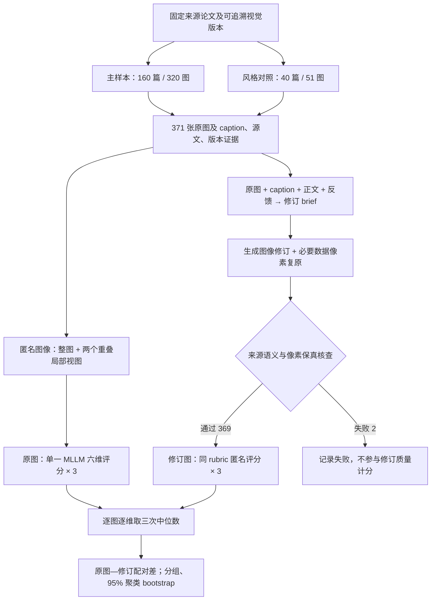

# Do You Miss the Nights We Spent Crafting Figures?｜生成式 AI 时代的论文引导图与框架图

## 一句话定义

南洋理工大学 2026 年研究（[arXiv:2611.08486v1](https://arxiv.org/abs/2611.08486)）用 **200 篇论文、371 张科研图**与 **369 张通过保真核查的 AI 辅助修订图**，区分“讲清楚”与“画得协调”两类质量目标，强调图形设计须由研究者负责科学语义。

## 英文缩写速查

| 缩写 | 英文全称 | 简要说明 |
|---|---|---|
| M | Motivation figure | 用来提出问题、对比缺陷或解释动机的引导图 |
| F | Framework figure | 呈现研究方法的总体模块与关系的框架图 |
| MLLM | Multimodal Large Language Model | 同时理解文字和图像的模型评审器 |
| ICLR | International Conference on Learning Representations | 本研究末期样本所用投稿平台对应的学术会议 |
| CI | Confidence Interval | 论文聚类 bootstrap 得出的统计区间 |

## 为什么重要

- 生成式工具可以快速增加注释、对比和布局变体，但研究图最关键的是**关系正确、信息重点明确、视觉层级一致**；只看一项综合分数会掩盖取舍。
- 对机器人领域的系统框图、训练管线图、Sim2Real 示意图，这项研究提供**图示质量评估方法**，而不是机器人实验结果。
- 与 [AI Auto-Research](../concepts/ai-auto-research.md) 的 S4「Tables & Figures」互补，也可对照 [Diagram Design](./diagram-design.md) 与 [Draw.io Scientific Illustrator](./drawio-scientific-illustrator.md) 等生成工具。

## 核心信息

| 项 | 核实内容 |
|---|---|
| 论文 | *Do You Miss the Nights We Spent Crafting Figures? Rethinking Teaser and Framework Figures in the Age of Generative AI* |
| 中文标题 | 还记得那些熬夜绘图的日子吗？生成式 AI 时代重新思考论文引导图与框架图 |
| 作者 | Xiaoqi Zhao、Youwei Pang、Kailai Zhou |
| 机构 | 南洋理工大学（Nanyang Technological University, Singapore） |
| 发布 | arXiv:2611.08486v1，2026-11-05；**预印本**，未据此声称顶会录用 |
| 原文/图集 | [官方完整 HTML](https://arxiv.org/html/2611.08486v1) · [PDF](https://arxiv.org/pdf/2611.08486) · [论文配套图集](https://ntu-ai4x.github.io/Rethinking_Figures/index_en.html) |
| 开放状态 | 逐图图集和 CSV/评分入口公开；项目主页**未列研究代码 GitHub/运行入口**（核对 2026-11-12） |

## 核心原理与方法栈

**样本两路收集，不能混算：**

- **主样本**：4 个时间阶段 × 4 方向（目标检测、图像分割、图像复原、3D 视觉）× 每格 10 篇 → **160 篇 / 320 张**，每篇 1 张 M + 1 张 F。
- **视觉风格对照**：有目的地筛选 40 篇 ICLR 2027 投稿图，51 张（M 11 / F 40）；“S4-AI-Style”是选样标签，**不证明图由 AI 生成**，也不进入主样本的阶段平均。
- **评价**：对每张图做 3 次独立 1–5 分模型评分，维度是清晰度、组织可读性、图形一致性、美学协调、目的性创新、设计特异性。
- **受来源约束修订**：原图、caption、相关论文正文和已记录的不足构成修订说明；以 gpt-image-2.5 辅助图像修订，数据图像区块按需恢复原像素。用独立会话核查对象、标签、指向关系和数据保真，过检者再做三次匿名评分。
- **统计**：每图每维取三次中位数；报告 original/revision 配对差、变化数量及 **5,000 次论文聚类 bootstrap** 95% 区间。六维等权均值仅用于展示，不是已验证的视觉质量量表。

### 流程总览

以下流程依据原文 §3–§4 的**实际研究设计**，并非未公开代码的运行流程：

## 实验与评测

**369 / 371** 张修订图通过所记录的保真检查；其余 2 张未评分（EAGLE 动机图和 Make It Up 框架图均有科学关系错误）。

| 六维评审项目 | 原图 | 修订 | 均值变化 | 95% 区间 |
|---|---:|---:|---:|---|
| 清晰度 | 3.629 | 4.057 | **+0.428** | [+0.367, +0.492] |
| 组织与可读性 | 3.973 | 3.951 | −0.022 | [−0.084, +0.040] |
| 图形一致性 | 3.949 | 4.060 | +0.111 | [+0.056, +0.168] |
| 美学协调 | 3.591 | 3.480 | **−0.111** | [−0.170, −0.054] |
| 目的性视觉创新 | 3.450 | 3.501 | +0.051 | [+0.014, +0.089] |
| 设计特异性 | 4.461 | 4.623 | +0.163 | [+0.114, +0.212] |

- 六维**描述性**均值：**3.842 → 3.945（+0.103）**；173 张升、102 张持平、94 张下降。
- 主样本 M 平均变化 **+0.242（n=160）**，F **+0.018（n=159）**；风格对照 F **−0.100（n=40）**。**不能**把主样本和风格样本混成同一种分布。
- EAGLE 图修订将输入接错到真实性指令；Make It Up 图遗漏更新链并生成无依据的反向边。这说明**可视化图中的箭头是技术主张**，不能仅靠美观评审把关。

## 结论

**AI 辅助绘图可在本研究的单模型评分下提高说明清晰度，却可能牺牲版面协调；更高模型分数不构成更高人类理解度的证据。**

1. **先定义要传达的科学关系**，再让模型探索不同画法；尤其核查箭头、方向、模块归属和数据对应。
2. **把 M 与 F 分开审查**：动机图在该样本中的均值收益更明显；框架图可能因重叠放大区或重复标签而退化。
3. **保留原始数据块**：曲线、数值、热图、照片不能只靠生成式重绘确保精度。
4. **逐维复核清晰度、层级、美学与特异性**，不要把六维平均分当作唯一验收目标。
5. **增加说明与删除冗余同样重要**：案例表明图文重复可能伤害组织性。
6. **模型评分与人工读者验证分离**：需要独立的理解率、阅读时间、语义保真与盲评实验。

## 与其他工作对比

| 类型 | 解决的问题 | 本文相对于它的位置 |
|---|---|---|
| [Diagram Design](./diagram-design.md) | 代理生成可展示的 HTML/SVG 说明图 | 本文研究修订**是否更会沟通**，不是新的绘图 Skill |
| [Draw.io Scientific Illustrator](./drawio-scientific-illustrator.md) | 可编辑科研绘图工具与逐步绘制 | 本文强调视觉优化不能改变论文实际语义 |
| [AI Auto-Research](../concepts/ai-auto-research.md) | AI 介入科研全生命周期 | 本文深入其中“图表生成和验证”的评估取舍 |

## 工程实践

对机器人科研论文中的 teaser、框架图、训练及部署管线建议采用**人工语义底稿 → AI 版式提案 → 保留实验数据 → 逐边关系审核 → 读者试读**。这是根据研究结果提炼的**实践建议**，论文并未对机器人或人类读者开展专门验证。

**源码运行时序图：不适用。** 截至 2026-11-12 官方图集提供 CSV 和视觉证据，但没有公开可核实的训练/修订/评价可执行入口及 GitHub 仓库；不能根据文字方法虚构代码模块与调用时序。

## 局限与风险

- 非概率抽样，阶段窗口、论文发表年份、文献源、筛选条件不等；时间差异**不是生成式 AI 的因果效应**。
- 评分和修订反馈使用同一模型配置 gpt-6-astra（分会话）；未进行跨评审模型和人类理解对照，也没有独立专家保真一致性。
- 部分修订新增了原文 caption 的说明，评分变化并不只反映颜色/版式变化。
- 保真“通过”只代表流程内检查通过，不等于独立专家已认证；统一 1–5 整数尺度及六维平均尚非经验证的人类感知量表。
- 图集中 S4-AI-Style 是**选样规则**，不能用于判断原稿 AI 使用情况；机器人领域外推仅是实践类比。

## 关联页面

- [AI Auto-Research](../concepts/ai-auto-research.md) — S4 Figure 与人机共同负责
- [Diagram Design](./diagram-design.md) — 设计工具和量化评审的边界
- [Draw.io Scientific Illustrator](./drawio-scientific-illustrator.md) — 可编辑科研示意图与关系保真

## 参考来源

- [arXiv v1 正文通读归档](../../sources/papers/rethinking_figures_arxiv_2611_08486.md)
- [NTU AI4X 图集和开放状态归档](../../sources/sites/ntu-ai4x-rethinking-figures.md)
- [arXiv 官方全文 HTML](https://arxiv.org/html/2611.08486v1)
- [论文配套图集](https://ntu-ai4x.github.io/Rethinking_Figures/index_en.html)

## 推荐继续阅读

- [官方 200 篇论文 / 371 图的原图与修订图可检索图集](https://ntu-ai4x.github.io/Rethinking_Figures/index_en.html)
- [arXiv:2611.08486 论文与版本历史](https://arxiv.org/abs/2611.08486)
